# SwarmAI Dark Factory ("Nightshift") — Azure Architecture

| | |
|---|---|
| **Version / date** | 1.0 · 17 November 2026 |
| **Scope** | Target (production) architecture on Azure for per-plant edge, regional cloud hubs and a multi-plant fleet, **plus** an honest account of the reference slice deployed in this repository (§19) |
| **Companions** | [PRD.md](PRD.md) · [FEATURES.md](FEATURES.md) · [business-case/outputs.md](business-case/outputs.md) |
| **Grounding** | Microsoft Learn documentation (links in §21); Azure Retail Prices API for cost drivers; numbers quoted from `business-case/outputs.json` |
| **Caveat** | Preview services are marked *(preview)*. Nothing here is a commitment by Microsoft; services and regional availability change — verify before design freeze. |

---

## 1. Purpose and scope

**Purpose.** Define how Nightshift — a swarm of governed AI agents coordinated by a Shift Supervisor over a plant digital twin — runs on Azure so that **safety-critical loops stay at the plant**, intelligence scales in the cloud, every decision is explainable and auditable, and the customer's data and operations stay within agreed boundaries.

**In scope:** edge and cloud architecture, data and AI architecture, security and compliance, integration with MES/SCADA/ERP/PLC ecosystems, deployment topology and landing zone, reliability, performance and cost, operations and DevSecOps, architectural decisions.

**Out of scope:** certified functional-safety design of machines (remains with the machine builders and the plant's safety engineers), customer MES/ERP internals, hardware selection beyond reference edge configurations.

**Reference numbers used throughout** (Base case, core platform): reference plant = **400 monitored assets**, ≈ **930 telemetry messages/s**, ≈ **10 GB/day raw**; Contoso = **8 plants**; Azure run-rate **US$0.91 M a year** (≈ **US$114 k per plant-year**), Year-3 ACR **US$0.68 M**; with the optional expansion levers E1–E5 (§12.1) **US$1.87 M** at 8 plants and **US$21 M** for a 100-plant fleet.

## 2. Architecture principles

| # | Principle | Consequence |
|---|---|---|
| 1 | **Edge-first for safety and latency** | Protective actions, interlocks and sub-second loops run at the plant; the cloud advises, trains, aggregates and archives. Loss of the cloud degrades autonomy (ceiling drops to L2), it never degrades safety |
| 2 | **Sim-first, always** | Every consequential action is rehearsed on a forked twin (what-if) before execution; the twin is a first-class, versioned service |
| 3 | **Deterministic core, LLM at the edges of the decision** | Detection, scheduling, arbitration and policy are deterministic and unit-testable; LLMs interpret context, draft proposals and narrate — they never decide alone |
| 4 | **Policy decides, agents propose** | A policy decision point (PDP) outside every agent gates all control actions (autonomy level, risk, blast radius, forbidden setpoints, kill switch) |
| 5 | **Everything is evidence** | Each decision produces a hash-chained ledger entry with rationale, evidence and counterfactual; evidence is exportable and independently verifiable |
| 6 | **Zero-trust, keyless, least privilege** | Entra ID and managed identities; no keys or connection strings; private networking in production; OT/IT segmented per IEC 62443 zones and conduits |
| 7 | **Open interfaces, replaceable parts** | OPC UA, MQTT and ISA-95 at the boundary; ports/adapters for MES/ERP/CMMS; every Azure service sits behind an interface with an offline stub |
| 8 | **Measure value and cost continuously** | A/B replay, KPI engine, FinOps meter and the business-case model are part of the product, not afterthoughts |

---

## 3. System context, logical architecture and the edge/cloud split

### 3.1 System context (C4 level 1)

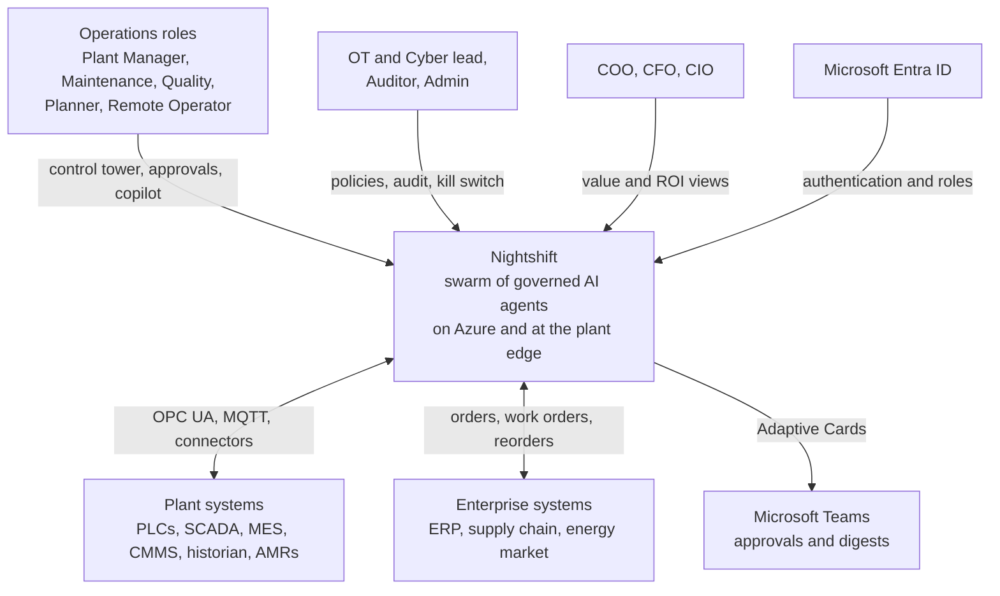

### 3.2 Logical architecture (C4 level 2)

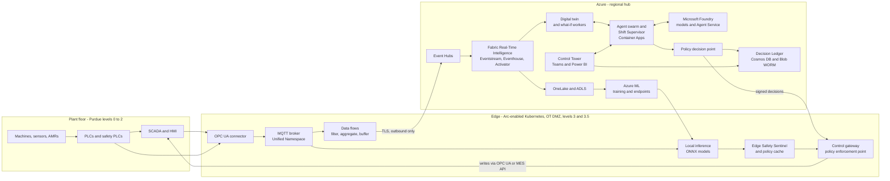

### 3.3 What runs at the edge and what runs in the cloud

| Capability | Edge (per plant) | Cloud (regional hub / fleet) | Why |
|---|---|---|---|
| Protocol connectivity (OPC UA, MQTT) | **Yes** — IoT Operations connectors and broker | — | proximity to OT, protocol translation, store-and-forward |
| Unified Namespace (ISA-95 topics) | **Yes** — authoritative per plant | mirrored via Event Hubs / Eventstream | plant keeps working without the cloud |
| Telemetry filtering, aggregation, buffering | **Yes** — data flows with deadband and batching | — | bandwidth and cost (≈ 930 msg/s per reference plant) |
| Protective stops, forbidden-setpoint checks | **Yes** — Safety Sentinel and control gateway | policy authoring and signing | latency and fail-safe behaviour |
| Anomaly scoring / vision first line | **Yes** — ONNX models served locally | model training, registry, rollout | latency, bandwidth, offline operation |
| Policy evaluation for control actions | **Yes** — cached signed policy bundle (policy enforcement point) | policy decision point for cloud-originated proposals, versioning, dry-run | consistent decisions with or without the cloud |
| What-if simulation | cached twin for local checks | **Yes** — twin and elastic what-if workers | compute elasticity |
| Agent swarm, Supervisor, arbitration | edge copies for time-critical classes (maintenance, protective) | **Yes** — full swarm per plant/region | LLM access, memory, fleet context |
| LLM reasoning, copilot, vision long tail | — | **Yes** — Foundry models | model availability and scale |
| Time-series analytics, KPIs, history | short ring buffer | **Yes** — Eventhouse, OneLake, Power BI | scale and retention |
| Decision Ledger | local append buffer, signed batches | **Yes** — Cosmos DB index, Blob WORM, anchoring | tamper-evidence and retention |
| Fleet learning (signatures, playbooks), A/B replay | — | **Yes** | cross-plant data |
| Control Tower, Teams approvals, Power BI | local read-only status page | **Yes** | users and collaboration live in the cloud |

---

## 4. Azure service map and rationale

| Layer | Capability | Target Azure service | Why this service | Alternatives considered | Reference slice |
|---|---|---|---|---|---|
| Edge | Kubernetes runtime | **Azure Arc-enabled Kubernetes** (K3s, AKS on Azure Local, AKS Edge Essentials single-node, other conformant clusters) | one control plane for a fleet of plant clusters; supported hosts for IoT Operations [S22] | self-managed K8s without Arc; IoT Edge | — |
| Edge | OT connectivity, MQTT broker, data flows | **Azure IoT Operations** (Standard SKU for the OPC UA connector; Essentials for connector-less, single-node sites) | first-party, OPC UA and MQTT native, data flows to Event Hubs/Kafka and Fabric RTI [S21][S22] | third-party gateways; Kepware-style OPC servers (kept as sources) | SimSource + HTTP ingest |
| Edge | Device/asset registry, schema registry | **Azure Device Registry** (part of IoT Operations) | asset and device inventory, schemas shared edge ↔ cloud | custom CMDB | asset graph in Cosmos DB |
| Ingest | Cloud streaming ingest | **Azure Event Hubs** (Standard, Kafka endpoint) | managed, Kafka-compatible, private networking | IoT Hub (device-centric), Event Grid MQTT broker | in-process bus |
| Analytics | Real-time analytics, rules | **Microsoft Fabric Real-Time Intelligence**: Eventstream, Eventhouse (KQL), Activator; Real-Time hub | one capacity for streaming, KQL, alerting, Power BI; OneLake as shared lake [S29] | Azure Data Explorer + Stream Analytics + separate BI | Python KPI engine |
| Analytics | Lake and BI | **OneLake**, **Power BI** (included viewer licensing at F64+ capacities) | open Delta/Parquet storage, Direct Lake | ADLS + Synapse | Cosmos aggregates |
| Twin | Semantic model | **Azure Digital Twins** (DTDL graph, event routes) and/or **digital twin builder** in Fabric RTI *(preview)* | standard ontologies, graph queries, routing to Event Hubs/Service Bus [S34][S35] | custom graph only | in-memory graph |
| Twin | What-if simulation | **Simulation workers** (Container Apps jobs / AKS pods) running the same engine as the reference simulator | elastic, deterministic forks; not a managed-service feature | Azure Batch | in-process fork |
| AI | Models and agent platform | **Microsoft Foundry** (formerly Azure AI Foundry): model deployments (gpt-5.4 family), **Foundry Agent Service**, MCP tools, tracing, evaluations [S24] | enterprise controls, managed identity, data-zone deployments [S36] | self-hosted open models | Foundry account: `chat` gpt-5.4-mini, `reasoning` gpt-5.4 |
| AI | Grounding | **Azure AI Search** (SOPs, manuals, failure-mode library) | vector + hybrid retrieval with security trimming | Cosmos DB vector search | ledger/asset tools only |
| AI | Classical ML | **Azure Machine Learning** (training, registry, managed online endpoints; ONNX export to the edge) | MLOps, registry, endpoint management | Fabric data science | stub detectors |
| Compute | Agent runtimes, APIs, workers | **Azure Container Apps** (dedicated workload profiles for always-on agents, consumption for bursts, jobs for A/B) | no cluster operations, KEDA scaling, private endpoint support | AKS (more control, more operations) | one Container App |
| State | Agent memory, blackboard, ledger index, KPI snapshots | **Azure Cosmos DB for NoSQL** (autoscale, multi-region, Entra data-plane RBAC) | low-latency JSON, change feed, global distribution | PostgreSQL; Table storage | Cosmos DB serverless |
| Archive | Raw archive, images, ledger segments, models | **Azure Storage / ADLS Gen2** (ZRS, lifecycle tiers, **immutable WORM** containers) | cost tiers and immutability [S37] | OneLake only | Blob Storage |
| Messaging | Workflows, approvals, DR-safe queues | **Service Bus**, **Event Grid** | durable queues and system events | Storage queues | in-process |
| Experience | Control Tower, approvals | **Container Apps** web front end behind **Azure Front Door Premium + WAF**; **Microsoft Teams** Adaptive Cards (Workflows/bot) | global edge, WAF, Entra sign-in | Static Web Apps | SPA served by FastAPI |
| Identity | Humans and agents | **Microsoft Entra ID** (app roles, Conditional Access, PIM) and **Entra Agent ID** for agent identities [S38] | one identity plane; agents are governed non-human identities | local accounts | demo role switcher + JWT validation |
| Security | Secrets, keys, posture, SIEM | **Key Vault** (signing keys), **Defender for Cloud**, **Defender for IoT** (OT network sensors), **Microsoft Sentinel**, **Azure Policy** | native detection and governance; Defender for IoT OT licensing is per site [S39] | third-party SIEM/OT tools | managed identity only |
| Network | Hybrid and private connectivity | **ExpressRoute** (primary) + **VPN** (backup), **Private Link**, Azure Firewall / NVA in hub | private, predictable | public endpoints | public endpoints (demo) |
| Operations | Observability | **Azure Monitor**: Application Insights (OpenTelemetry), Log Analytics, Managed Grafana; Container insights | one telemetry plane | third-party APM | Application Insights + Log Analytics |
| Delivery | Build and deploy | **Azure Container Registry** (Premium geo-replication), **GitHub Actions** with OIDC federation, **Bicep/azd**, Azure Landing Zones | repeatable, keyless | Azure DevOps (equivalent) | ACR Basic, azd, remote build |

---

## 5. Data architecture

### 5.1 Data flows

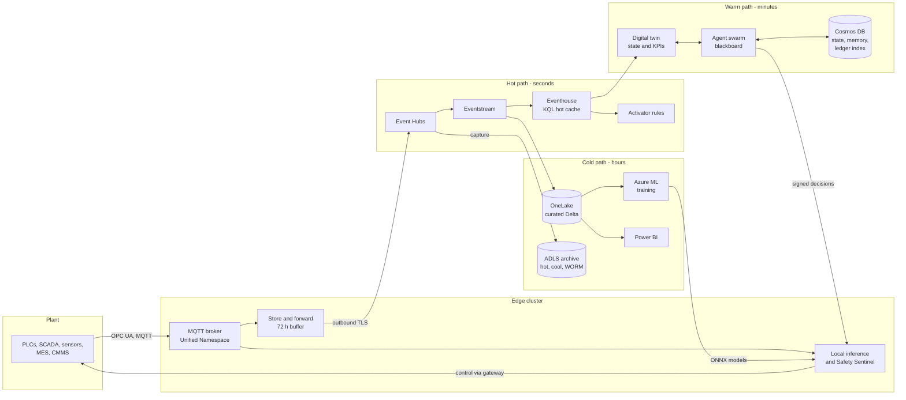

* **Hot path (seconds):** filtered telemetry → Event Hubs → Eventstream → Eventhouse; Activator rules and Supervisor triggers react; twin state updates (≈ 6 operations per asset per minute in the model drivers).
* **Warm path (minutes):** twin, blackboard and agent memory in Cosmos DB; what-if workers read twin snapshots.
* **Cold path (hours to years):** curated Delta tables in OneLake feed Azure ML training and Power BI; raw archive and images in ADLS with lifecycle tiers; ledger segments in immutable (WORM) containers.
* **Control path (reverse):** signed decisions → control gateway at the edge → OPC UA write or MES/CMMS API; nothing writes to the plant except the gateway.

### 5.2 Unified Namespace and message contract

ISA-95 hierarchy, one topic per measurement: `{enterprise}/{site}/{area}/{line}/{cell}/{asset}/{metric}`

```text
contoso/kat1/machining/line1/cell3/cnc-04/spindle_temp_c
contoso/kat1/utilities/compressors/-/cmp-01/discharge_pressure_bar      # "-" fills an unused level
contoso/kat1/machining/line1/cell3/cnc-04/state                          # RUN | IDLE | SETUP | DOWN | MAINT | BLOCKED | STARVED
```

```json
{
  "topic": "contoso/kat1/machining/line1/cell3/cnc-04/spindle_temp_c",
  "value": 71.4, "unit": "degC", "quality": "GOOD",
  "ts_source": "2026-11-17T02:14:07.250Z", "ts_ingest": "2026-11-17T02:14:07.912Z",
  "seq": 1840221, "source_id": "iotops-kat1-opcua-01"
}
```

* Schemas live in the schema registry (IoT Operations) and are validated at the edge and again at ingest; units come from a registry (e.g. `vibration_rms` in mm/s); `quality` follows OPC UA semantics; late and duplicate messages are handled idempotently by `(topic, seq)`.
* Wildcards `+` and `#` follow MQTT semantics; consumers subscribe by area/line/asset.
* **Model drivers (Base):** 400 assets × (8 hot tags every 5 s + 22 warm tags every 30 s) ≈ **930 messages/s**, ≈ 120 B each, ≈ **9.7 GB/day raw**, ≈ 1.6 GB/day after columnar compression (6×).

### 5.3 Stores, retention and residency

| Store | Content | Tier / service | Retention (Base model assumption) | Residency and protection |
|---|---|---|---|---|
| Edge buffer | last values, 5 s/30 s batches, decisions awaiting sync | MQTT broker + local persistent volume | **72 h** store-and-forward | plant premises; disk encryption |
| Eventhouse hot cache | recent telemetry for KQL | Fabric Eventhouse | 30 days hot *(Assumption)* | tenant region/capacity |
| Curated telemetry | cleaned, contextualised Delta tables | OneLake | **24 months** | OneLake region; workspace RBAC |
| Raw archive | raw telemetry, waveforms (≈ 11.5 GB/plant-day), inspection images (≈ 0.6 GB/plant-day) | ADLS Gen2 ZRS: hot 3 months → cool | **36 months** | storage account in the customer region; Private Link |
| Operational state | twin snapshots, blackboard, agent memory, KPI snapshots | Cosmos DB (autoscale, 2 regions) | memory TTL 90 days; KPI snapshots 24 months | multi-region replica for DR; Entra data-plane RBAC |
| Decision Ledger | hash-chained entries (index in Cosmos) + JSONL segments and anchors | Cosmos DB + **Blob immutable (WORM)** container; optional Azure Confidential Ledger for head attestation [S45] | **≥ 7 years** *(Assumption, configurable)* | WORM time-based retention [S37]; anchors verifiable offline |
| Models and artefacts | ONNX, prompts, policy bundles, evaluation sets | Azure ML registry, ACR, Git | all versions | signed artefacts |
| Logs and traces | structured logs, OpenTelemetry traces | Log Analytics / Application Insights | 90 days interactive, archive beyond | workspace per region |

### 5.4 OT/IT segmentation — Purdue model and IEC 62443 zones and conduits

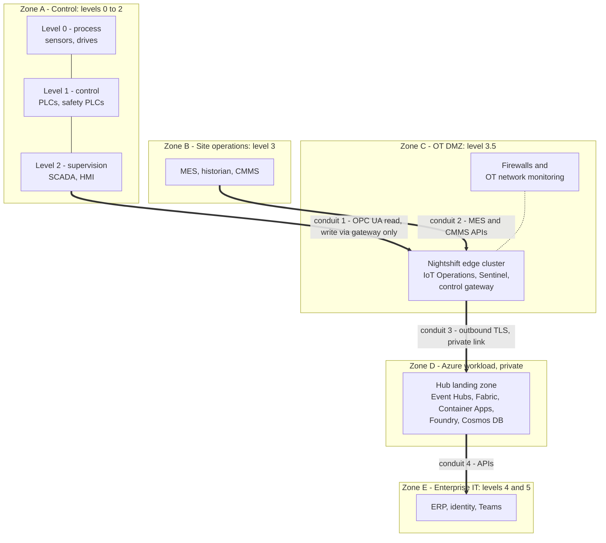

Illustrative zone design (target security levels are set per zone in the IEC 62443-3-2 risk assessment with the customer's OT/Cyber lead [S17]):

| Zone | Contents | Starting SL-T *(Assumption)* | Key controls on the conduit |
|---|---|:-:|---|
| A Control (L0–L2) | PLCs, safety PLCs, SCADA | 2–3 | no inbound from any higher zone except the gateway; OPC UA security policies and certificates; safety functions independent of Nightshift |
| B Site operations (L3) | MES, historian, CMMS | 2 | API allow-lists; service accounts with least privilege |
| C OT DMZ (L3.5) | Nightshift edge cluster, control gateway, OT network monitoring | 2 | **outbound-only** connections to Azure; signed policy bundles; no shell access; OT sensors (Defender for IoT) on mirrored traffic |
| D Azure workload | Event Hubs, Fabric, Container Apps, Foundry, Cosmos DB | 2 | private endpoints, Entra auth, no public ingress except via Front Door/WAF |
| E Enterprise IT (L4–L5) | ERP, identity, collaboration | per IT policy | standard enterprise controls |

Azure IoT Operations supports **layered (nested) networking**: clusters at lower Purdue levels forward through each layer, so telemetry terminates and re-originates hop by hop instead of crossing the boundary directly [S40].

### 5.5 Data governance

* **Classification:** operational telemetry, quality and maintenance records, commercial order data, **minimal personal data** (operator identifiers only where a role requires them; no individual performance analytics — see PRD §5).
* **Lineage and contracts:** each topic and table has an owner, schema and unit contract; Purview (optional) catalogues OneLake and Cosmos DB.
* **Residency:** processing at the edge first; cloud region chosen per customer; model deployments use **DataZone** or regional deployment types where residency matters, **Global** only where permitted [S36].
* **Retention and erasure:** per §5.3; personal data (if any) subject to erasure requests; ledger entries reference identities by role and pseudonymous id.

---

## 6. AI architecture

### 6.1 Model portfolio and routing

| Workload | Model (Foundry deployment) | Reason | Controls |
|---|---|---|---|
| Agent situation assessment, proposal drafting (≈ 6,000 calls per plant-day) | `gpt-5.4-mini` | low latency and cost; US$0.75 in / US$4.50 out per 1 M tokens (Global Standard list) | structured output schema, token caps |
| High-stakes reasoning: arbitration narrative, safety-relevant analysis (≈ 120 calls) | `gpt-5.4` with higher reasoning effort | quality where a mistake is expensive; US$2.50 / US$15 | second-model cross-check for policy-relevant text |
| Alarm and event triage (≈ 8,000 calls) | `gpt-5.4-nano` | cheap classifier; US$0.20 / US$1.25 | confidence threshold, fallback to rules |
| "Ask the Factory" copilot (≈ 200 calls) | `gpt-5.4-mini`, escalating to `gpt-5.4` | tool-calling, streaming | read-only tool set, citation check |
| Vision long tail (≈ 2,000 images per plant-day) | `gpt-5.4-mini` multimodal | handles rare defects; edge models do first-line inspection | human-review queue below 0.70 confidence |
| Retrieval | `text-embedding-3-small` + Azure AI Search | SOPs, manuals, failure-mode library | security trimming |
| Anomaly detection, RUL, vision first line | Azure ML models exported to **ONNX** at the edge | millisecond inference, offline operation | versioned registry, canary rollout |

Order of magnitude per reference plant-day: **≈ 49 M input and ≈ 5.8 M output tokens** (≈ US$53 at list price). For 8 plants this is ≈ 0.3 M tokens per minute on average — **plan quota (TPM) for 3× peaks** and use data-zone deployments for EU residency [S36]. Models and SKUs are per the `swedencentral` catalogue used by the reference slice; provisioned throughput is optional for guaranteed latency in production.

### 6.2 Agent topology

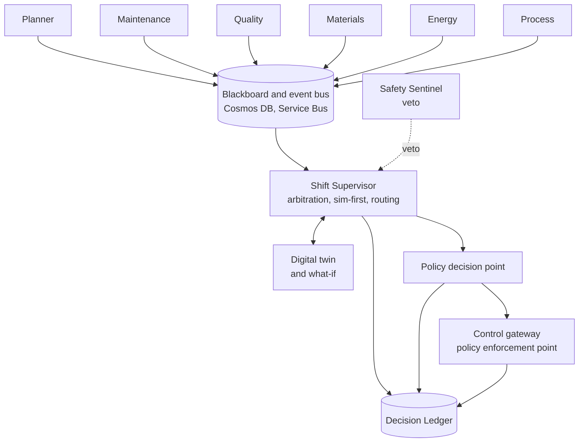

* **Hosting.** Cloud: one agent-runtime container per agent role per plant on Container Apps dedicated profiles (always-on), LLM calls through Foundry; time-critical classes (maintenance, protective) have edge replicas. The reference slice runs all roles as asyncio loops in one container.
* **Identity.** Each agent role has its own identity (managed identity now, **Microsoft Entra Agent ID** as the governed agent identity [S38]) with least-privilege access: agents read the blackboard and twin, publish proposals, never hold plant-write credentials.
* **Memory.** Short-term (blackboard, 24 h), long-term (failure signatures, playbooks, per-asset history) in Cosmos DB; embeddings in AI Search; memory is data, never instructions.
* **Rate limits and budgets.** Per-agent proposals-per-hour, per-plant token budgets, and a daily AI spend cap that **fails closed**.

### 6.3 Tools and the action boundary

| Tool class | Examples | Who may call | Effect |
|---|---|---|---|
| **Read** | `get_kpis`, `get_asset`, `query_ledger`, `list_open_proposals` | all agents, copilot | none |
| **Simulate** | `run_whatif(actions, horizon)` | Supervisor, Planner, Energy, Process, copilot | forked twin only |
| **Propose** | `propose_action(class, params, rationale)` | agents, copilot | creates a proposal; **no execution** |
| **Execute** | control-gateway call | **only the policy enforcement point**, with a signed PDP decision | writes to plant systems |

LLMs and agents have **no execute tool**: the only path from a model output to the plant is *proposal → Supervisor → PDP decision → control gateway*. Tools are exposed as MCP servers over the plant APIs (Foundry Agent Service supports MCP tools [S24]); the tool registry is an allow-list per role.

### 6.4 Guardrails — defence in depth

| Layer | Control | Enforced by |
|---|---|---|
| 1 Input | retrieved and tool content treated as **untrusted data**; instruction/data separation; prompt-injection tests; Foundry content filters and prompt shields | agent runtime, Foundry |
| 2 Reasoning | structured (JSON-schema) outputs; tool allow-list per role; step and token budgets | agent runtime |
| 3 Output validation | schema and semantic validators (setpoint ranges, asset existence); numbers in digests checked against structured input | validators, digest checker |
| 4 Decision | what-if margin, utility arbitration, **Safety veto**, forbidden setpoints, protected assets (LOTO), blast radius, action-rate limits | Supervisor, Sentinel, PDP |
| 5 Execution | signed decision required; kill switch; rollback on regression | control gateway |
| 6 Humans | approvals with SLA; break-glass with dual control | inbox, RBAC |
| 7 Evidence | tracing of every model/tool call; ledger chain | Foundry tracing, ledger |

### 6.5 Sim-first validation

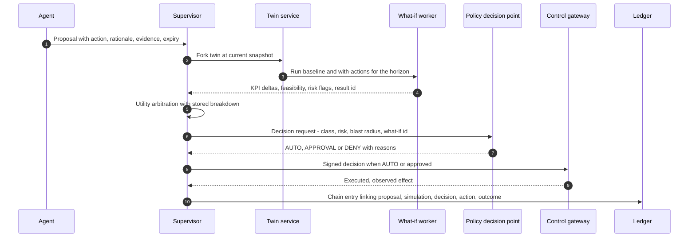

The twin is **versioned and calibrated** (R2: fitted to plant history); prediction error is tracked against realised outcomes, and a growing error lowers the confidence term in the risk score and eventually forces a decision class back to approval.

### 6.6 Autonomy Dial enforcement — policy decision and enforcement points

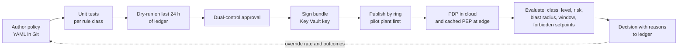

* **Inputs:** decision class, current autonomy level, risk score components, blast radius, cost/exposure, time window, actor, what-if id and result, kill-switch state, protected-asset state.
* **Outputs:** `AUTO`, `AUTO_AFTER_VETO`, `REQUIRE_APPROVAL`, `RECOMMEND` or `DENY`, with matched rules and reasons; every decision is ledgered with the policy version.
* **Edge behaviour:** the enforcement point caches the last signed bundle; if the bundle is older than the configured age or the cloud is unreachable, the autonomy ceiling **drops to L2** (R1.5 DF-32); protective stops remain allowed.
* **Kill switch:** a signed flag distributed to every enforcement point; acts within one tick; resetting needs the Admin role and is ledgered.

### 6.7 Evaluation and LLMOps

* **Scenario library and replay.** Seeded scenarios (the nine faults, combinations, historian replays) run offline against any agent/prompt/model version; the harness reports missed due dates, false-alarm rate, lead time, override rate, cost per decision. *In the reference slice* the A/B replay (DF-21) is this harness in its first form: 16 seeds × 8 injected disruptions, swarm OFF vs ON, **twelve metrics reported with 95 % CIs including the ones that do not improve** — six are significantly better (downtime −79 %, late orders −20 %, tardiness −18 %, total loss −31 %, OEE +13.5 pts, effective energy price −10 %), absolute energy cost is slightly worse (+6 %), and scrap, escapes, OTIF and shipped units show no significant effect. It is simulation evidence on synthetic assumptions, not a customer guarantee, and it is deterministic (bit-identical on laptop and container).
* **Gates.** CI blocks a change that regresses the replay suite or the adversarial pack (injection, malformed tool output, conflicting objectives); model upgrades roll out through canary rings per plant with automatic fallback to the deterministic path.
* **Tracing and evaluation.** Foundry tracing and evaluations capture every model call and tool invocation [S24]; traces are correlated with ledger ids.
* **Cost control.** Prompt caching (≈ 30 % cache-hit share assumed), model routing (nano → mini → full), per-plant budgets, FinOps meter (DF-24).
* **Degradation ladder.** LLM unavailable → deterministic templates and detectors continue; policy and safety are unaffected.

---

## 7. Security and compliance

### 7.1 Identity and access

| Principal | Mechanism | Notes |
|---|---|---|
| People (operators, engineers, plant managers, auditors, admins) | **Microsoft Entra ID** sign-in, app roles and groups, Conditional Access (MFA, device compliance), **PIM** for Admin and break-glass | roles: Operator, Engineer, Plant Manager, Auditor, Admin; enforced in the API (DF-23) |
| Azure workloads | **Managed identities** (user-assigned), Entra-only data-plane access, **no keys, connection strings or SAS** | Cosmos DB data roles, Storage Blob Data Contributor, Cognitive Services OpenAI User, AcrPull |
| AI agents | one identity per agent role; **Microsoft Entra Agent ID** for governed agent identities [S38] | agents never hold plant-write credentials |
| Edge clusters | Arc identity and **workload identity federation**; X.509 certificates for OPC UA sessions | outbound-only trust to Azure |
| CI/CD | GitHub Actions **OIDC federation** to Azure | no stored cloud credentials |

Separation of duties: policy publication and break-glass need two distinct identities; the kill switch can be *activated* by Operator-and-above and *reset* only by Admin; Auditors are read-only including ledger verification.

### 7.2 Network

* **Production:** private endpoints for Cosmos DB, Storage, Key Vault, ACR, AI Search, Foundry, Event Hubs and Fabric managed private endpoints; Container Apps environment on a VNet with private ingress; **Azure Front Door Premium + WAF** is the only public entry for the Control Tower; egress through hub firewall with FQDN allow-lists; private DNS zones; ExpressRoute primary with VPN backup per plant.
* **OT side:** the edge cluster sits in the OT DMZ; **only outbound** TLS to Azure; no inbound from the cloud to levels ≤ 3; OT network monitoring on mirrored traffic.
* **Demo slice:** public endpoints with identity-only access (see §19 for the exact governance posture).

### 7.3 Data protection

* TLS 1.2+ everywhere; encryption at rest with platform-managed keys, customer-managed keys in Key Vault where required.
* **Key Vault** holds policy-bundle and ledger-anchor signing keys (HSM-backed in production); rotation and access logged.
* **Immutability:** ledger segments and anchors in WORM containers with locked time-based retention [S37]; optional Azure Confidential Ledger head attestation [S45].
* **Backup and restore:** Cosmos DB continuous backup (30 days) and a second region; Storage ZRS with GRS for archives; infrastructure as code for rebuild.

### 7.4 Threat model — STRIDE summary

| # | Asset / flow | Threat (STRIDE) | Mitigations |
|---|---|---|---|
| T1 | Control gateway ↔ SCADA/MES | **S**poofing, **T**ampering | mutual authentication (OPC UA security policy, certificates); signed decisions; allow-listed nodes and APIs; rate limits |
| T2 | Policy bundle and autonomy levels | **T**ampering, **E**levation | signed bundles verified at every enforcement point; dual control; Git protected branches; dry-run before publish; PIM |
| T3 | Decision Ledger | **T**ampering, **R**epudiation | hash chain, WORM segments, external anchors, role separation, scheduled verification job and alert on mismatch |
| T4 | Prompt injection via asset names, work-order text, ledger rationale, supplier emails | **T**ampering, **E**levation | tool outputs are untrusted data; no execute tool for models; allow-listed tools; output validators; adversarial test pack (DF-16, DF-34) |
| T5 | Training/feedback data (poisoning) | **T**ampering | dataset lineage and signing; validation and drift checks; human review of label feedback; canary rollout and automatic fallback |
| T6 | Privileged insider raising autonomy to L5 | **E**levation, **R**epudiation | PIM, dual control, ledgered policy diffs, off-hours anomaly alert in Sentinel |
| T7 | Telemetry flood / LLM cost exhaustion | **D**enial of service | per-source rate limits, back-pressure, quotas, daily AI budget cap that fails closed |
| T8 | Cross-plant data exposure | **I**nformation disclosure | plant-level partitioning, RBAC, private endpoints, no shared secrets |
| T9 | Compromised edge node | all | minimal signed images, workload identity, Defender for Containers, outbound-only, no cloud-to-OT inbound path, blast radius limited to one plant |
| T10 | Software supply chain | **T**ampering | pinned dependencies, SBOM, image signing, ACR and Defender for Cloud scanning, `pip-audit`/`npm audit` in CI |
| T11 | Twin/simulation manipulation produces misleading what-ifs | **T**ampering | snapshot hashing, calibration-error monitoring, shadow-mode comparison, risk score penalises novelty |
| T12 | Kill-switch abuse | **D**enial of service | activation allowed to many roles (fail-safe), reset restricted to Admin with audit; protective stops unaffected |

### 7.5 Security operations

**Defender for Cloud** (posture; containers, storage, Cosmos DB, Key Vault plans) and **Defender for IoT** (agentless OT network monitoring; licensed per site through the Microsoft 365 admin centre, outside Azure consumption [S39]) feed **Microsoft Sentinel**, where analytics rules watch Nightshift-specific signals: bursts of denied decisions, policy changes outside change windows, kill-switch toggles, ledger-verification failures, unusual agent token usage. Azure Policy enforces landing-zone guardrails (private endpoints required, keyless auth, allowed regions, tag rules). Incident response follows runbooks linked to ledger evidence; a penetration test precedes pilot go-live.

### 7.6 Mapping to IEC 62443 foundational requirements

| Foundational requirement | Nightshift implementation |
|---|---|
| **IAC** identification and authentication control | Entra ID, managed identities, X.509 for OPC UA, agent identities |
| **UC** use control | RBAC roles, policy-gated control API, dual control, kill switch |
| **SI** system integrity | signed policy bundles and images, ledger hash chain, validated inputs |
| **DC** data confidentiality | TLS, encryption at rest, private networking, plant-level partitioning |
| **RDF** restricted data flow | zones and conduits, outbound-only DMZ, allow-lists |
| **TRE** timely response to events | OT network monitoring, Sentinel rules, ledger evidence, runbooks |
| **RA** resource availability | edge autonomy, store-and-forward, rate limits and back-pressure, DR |

Responsible-AI controls and regulatory alignment (EU AI Act, Machinery Regulation, NIS2, ISO 13849/10218 boundaries, ISO/IEC 27001 and 42001) are summarised in [PRD §16](PRD.md); no certification is claimed.

---

## 8. Integration architecture

### 8.1 Ports and adapters

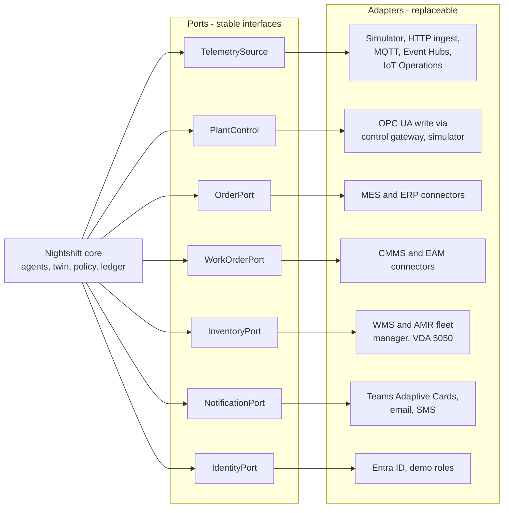

### 8.2 Integration matrix (examples; versions and availability to be validated per customer)

| System class | Typical products | Interface | Direction | Nightshift adapter and rules |
|---|---|---|---|---|
| Machine controllers, CNC, robots | Siemens, Rockwell, Fanuc, Mitsubishi and others | **OPC UA** server on the controller or a gateway; vendor protocols via gateways | read (telemetry), write only via control gateway | IoT Operations OPC UA connector; legacy via protocol gateways; write nodes whitelisted per asset |
| SCADA / HMI / historian | AVEVA (e.g. PI System), Ignition-class platforms, vendor SCADA | OPC UA, historian APIs, MQTT | read, limited write | ingest through UNS; historian backfill for training and replay |
| MES | Siemens Opcenter, Rockwell Plex, AVEVA MES, SAP Digital Manufacturing | REST/OData, B2MML, message bus | read orders/routings; write schedules and holds | `OrderPort`; staged write-back (propose → confirm); idempotent |
| ERP | SAP S/4HANA, Dynamics 365 Supply Chain Management | OData, BAPI/IDoc, Dataverse | read demand/inventory; write purchase proposals | `InventoryPort`; approvals through ERP workflows where required |
| CMMS / EAM | SAP PM, IBM Maximo, Infor EAM | REST | read history/spares; write work orders in planned windows | `WorkOrderPort` |
| AMR / WMS | vendor fleet managers, VDA 5050 over MQTT | MQTT, REST | read status; write dispatch tasks | `PlantControl` task channel |
| Energy | smart meters, tariff and carbon feeds | Modbus/OPC UA, REST | read | `TelemetrySource`; tariff service |
| Collaboration | Microsoft Teams | Adaptive Cards via Workflows webhook; bot for actions (R1.5) | notify, approve | `NotificationPort` |
| Identity | Microsoft Entra ID | OIDC/JWT | authenticate | `IdentityPort` |

### 8.3 Write-back safety rules

1. **Read-only first.** Every connector starts read-only; write scopes are enabled per asset class after shadow-mode validation.
2. **One door.** All writes go through the control gateway, which requires a signed PDP decision and checks forbidden setpoints and LOTO state again.
3. **Two-phase writes** for MES/ERP: propose → confirm, with idempotency keys and reconciliation jobs.
4. **Bounded blast radius** per call (assets, orders, value); rate limits per target system.
5. **Rollback and dry-run** modes for every adapter; change windows respected.
6. **Evidence:** request/response digests are attached to the ledger entry.

---

## 9. Deployment topology and landing zone

### 9.1 Topology

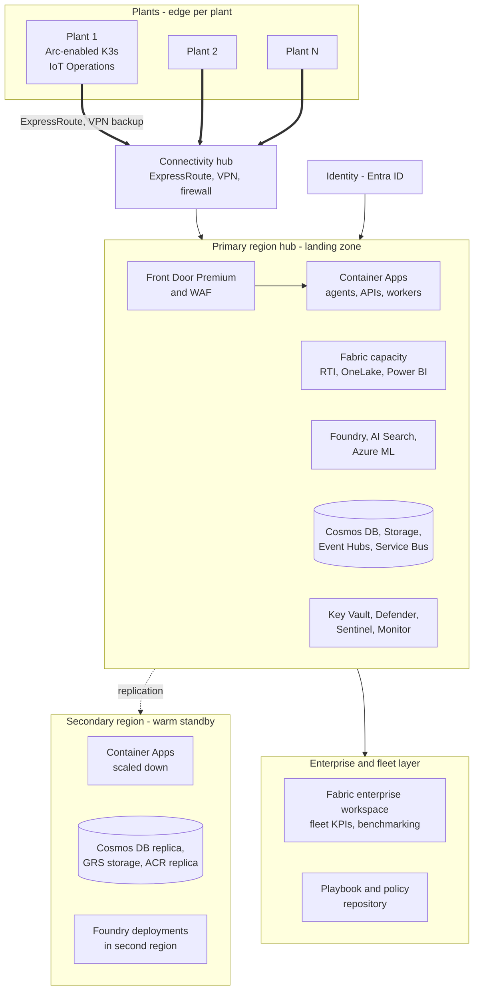

### 9.2 Landing-zone layout (Azure Landing Zones, hub-and-spoke)

| Subscription / scope | Contents | Guardrails |
|---|---|---|
| **Platform – Connectivity** | hub VNets, ExpressRoute/VPN gateways, firewall, private DNS | allowed regions, no public IPs outside the hub |
| **Platform – Identity** | Entra configuration, PIM, break-glass accounts | Conditional Access baselines |
| **Platform – Management** | Log Analytics, Sentinel, Defender plans, Azure Policy, Cost Management | policy initiative: private endpoints, keyless auth, tags |
| **Nightshift – Prod (per region)** | Container Apps, Cosmos DB, Storage, Event Hubs, Foundry, AI Search, Azure ML, Key Vault, ACR | deny public network access; require managed identity |
| **Nightshift – Data** | Fabric capacity and workspaces, OneLake, Power BI | workspace RBAC; sensitivity labels |
| **Nightshift – Non-prod** | dev, test, twin sandboxes, evaluation | cost caps, auto-shutdown, synthetic data |
| **Edge (Arc)** | one Arc-enabled cluster per plant | GitOps-managed, signed images, Defender for Containers |

The **demo slice** uses a single resource group (§19); everything above is the production target.

### 9.3 Per-plant edge reference configuration

* **Cluster:** 3 nodes (≈ 16 vCores, 64 GB RAM, NVMe each) running an Arc-enabled Kubernetes distribution supported by IoT Operations (K3s on Ubuntu for multi-node; AKS on Azure Local, VKS or OpenShift as alternatives; AKS Edge Essentials is single-node only) [S22]. **Standard** IoT Operations SKU for the OPC UA connector; **Essentials** (single-node, no OPC UA connector) suits connector-less, cost-sensitive sites [S22].
* **Workloads:** IoT Operations (OPC UA connector, MQTT broker, data flows, Device Registry), ONNX inference runtime, edge Safety Sentinel and control gateway, policy cache, store-and-forward buffer, optional GPU node for inline vision.
* **Cost anchors (Base):** 3 servers ≈ US$14 k each, OT firewalls/switches ≈ US$15 k, sensor retrofit ≈ US$33 k, gateways ≈ US$25 k ⇒ ≈ **US$115 k hardware per plant**; IoT Operations Standard ≈ US$2.1 k per node-year (list).

### 9.4 Regions, residency and service availability

| Concern | Design |
|---|---|
| Arc connection region for IoT Operations | must be one of the supported regions — e.g. **West Europe, North Europe, Germany West Central**, several US regions [S22]; cloud resources may live elsewhere |
| Cloud hub region | customer choice; reference slice uses **swedencentral** (models and platform services), prices in the model use swedencentral list prices |
| Azure Digital Twins | not offered in swedencentral at list-price time — deploy in **westeurope** (priced there in the model) or use Fabric digital twin builder *(preview)* |
| Model deployments | **Global Standard** (recommended start), **DataZone** (processing within the data zone; data at rest in the geography) or regional deployments where residency or sovereignty requires [S36] |
| EU data boundary and sovereignty | edge-first processing; hub region within the required boundary; customer-managed keys where required |
| Fabric | capacity in the hub region; OneLake BCDR option for DR |

### 9.5 Disaster recovery

| Component | DR design | RTO | RPO |
|---|---|---|---|
| Edge cluster | 3-node HA; automatic pod rescheduling; plant keeps running on cached policy | minutes (local) | 0 (local state) |
| Telemetry path | edge buffer ≥ 72 h; Event Hubs replication/geo-DR | < 1 h | ≤ 5 min |
| Cosmos DB (state, ledger index) | second region replica; continuous backup (30 days) | < 15 min (service-managed failover) | ≈ seconds |
| Ledger segments and archive | ZRS primary, GRS copy; WORM retained | < 1 h | ≤ 15 min |
| Container Apps (agents, APIs) | redeploy from IaC to the secondary region (warm standby, scaled down) | ≈ 1 h | n/a (stateless) |
| Fabric (RTI, OneLake) | secondary capacity and OneLake BCDR storage | 2–4 h | ≤ 15 min |
| Foundry models | second-region deployments with the same names | minutes | n/a |
| Front Door / DNS | health-probe failover | minutes | n/a |

The Base model includes a **25 % uplift** for warm-standby DR and **15 %** for dev/test on the families where they apply; failover drills are scheduled quarterly (R2).

---

## 10. Reliability

### 10.1 Service-level objectives (production targets)

| Service | SLI | SLO | Notes |
|---|---|---|---|
| Control plane (API, supervisor, policy decision point) | successful requests | **99.9 %** monthly | composite of dependent Azure SLAs; error budget ≈ 43 minutes a month |
| Decision pipeline | detect → proposal → decision latency (excl. human approval) | p95 ≤ 5 s | LLM narration is asynchronous |
| What-if | 12-h horizon latency | p95 ≤ 2 s | bounded concurrency |
| Telemetry freshness | edge-to-Eventhouse staleness | p95 ≤ 10 s | hot tags every 5 s |
| Ledger | append success and verification | 100 % verification; append p95 ≤ 200 ms | chain continuity alert on mismatch |
| Approvals | notification delivery | ≥ 99 % within 30 s | Teams and in-app |
| Edge autonomy | operation while cloud unreachable | ≥ 72 h | degraded autonomy ceiling L2 |

### 10.2 Failure modes and degradation

| Failure | Behaviour | Safety effect |
|---|---|---|
| WAN or cloud outage | edge continues; cached signed policy; autonomy ceiling **drops to L2**; data buffered 72 h | none — protective loops are local |
| Policy bundle stale beyond limit | same as above; alert | none |
| LLM unavailable or throttled | deterministic detectors, scheduler and templates continue; proposals lose narrative only | none |
| What-if workers unavailable | consequential classes fall back to **approval** (no sim, no auto) | none |
| Ledger store unavailable | **no ledger, no action**: autonomous actions pause; protective stops execute and are buffered locally for later chaining | none |
| Cosmos DB region down | service-managed failover to replica | none |
| Event Hubs / Eventhouse down | edge buffer grows; hot-path rules pause; agents run on edge/last-known state with reduced autonomy | none |
| Edge node failure | HA cluster reschedules; broker data replicated | none |
| Kill switch ON | all agent-initiated actions halt; protective stops allowed | reduces risk |

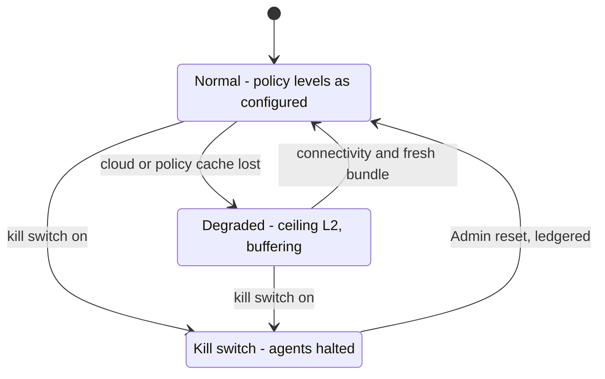

### 10.3 What the reference slice has shown (evidence)

* **Single replica by design.** One Container App (0.5 vCPU / 1 GiB, `minReplicas` = `maxReplicas` = 1) because the plant simulation, agents, ledger head and SSE hub are in-process state; scale-out is by partitioning plants across replicas (§19). Readiness checks pass on the live instance (Cosmos DB 37 ms, Blob Storage 192 ms, Azure OpenAI 1,409 ms in smoke #2); the replica had 0 restarts after the final smoke and Playwright runs.
* **Incident found by the live smoke test (and fixed).** The A/B replay originally ran in a worker *thread*; on 0.5 vCPU it starved the event loop (GIL convoy plus CPU quota), `/healthz` timed out for about 60 s and the liveness probe restarted the container (`restartCount` = 1, confirmed in `ContainerAppSystemLogs_CL`). Fix: the replay runs in a **separate worker process** (one seed per task) as a background job with progress polling, and probe timeouts and thresholds were raised (liveness 5 s / 5 failures). This is the same design the target architecture prescribes — what-if and A/B fan-out run as separate jobs, never in the API process (ADR-004, ADR-008) — and the 10-seed replay takes ≈ 2.2 s on a laptop but **≈ 41 s on the container**.
* **Degradation verified in tests:** deterministic fall-backs when the LLM budget is spent or the model is unreachable; approvals expire fail-safe; kill switch halts every autonomous action while the protective stop remains allowed; the ledger chain survives a restart via its repository anchor.

---

## 11. Performance and scalability

### 11.1 Capacity model (Base drivers, per reference plant of 400 assets)

| Dimension | Per plant | 8 plants (Contoso) | 25 plants |
|---|---:|---:|---:|
| Telemetry messages/s (30 tags/asset, 5 s / 30 s publish) | ≈ 930 | ≈ 7,500 | ≈ 23,000 |
| Raw telemetry per day | ≈ 9.7 GB | ≈ 78 GB | ≈ 240 GB |
| Stored after compression (6×) | ≈ 1.6 GB/day | ≈ 13 GB/day | ≈ 40 GB/day |
| Waveform + image archive per day | ≈ 12 GB | ≈ 96 GB | ≈ 300 GB |
| Event Hubs throughput units (2× headroom) | ≈ 2 | ≈ 15 | ≈ 47 |
| Fabric capacity (modelled) | ≈ 6 CU + shared base | 56 CU (rounded to 8) | ≈ 160 CU |
| Cosmos DB autoscale max | 6,000 RU/s | 48,000 RU/s | 150,000 RU/s |
| LLM calls per day | ≈ 16,400 | ≈ 131,000 | ≈ 410,000 |
| LLM tokens per day (in + out) | ≈ 55 M | ≈ 440 M | ≈ 1.4 B |
| Always-on agent vCPU (dedicated) | ≈ 12 | ≈ 96 + 24 shared | ≈ 300 + 38 shared |

Scaling rules: per-plant components scale linearly with assets; the shared platform scales sub-linearly (modelled at ×0.6 for one plant, ×1.0 for eight, ×1.6 for 25). Triggers: Event Hubs TU auto-inflate on throughput; Container Apps KEDA rules on queue depth and CPU; Fabric capacity on throttling alerts; quotas (TPM) reviewed monthly.

### 11.2 Latency budget — detect to auto-decision (target p95)

| Step | Budget |
|---|---:|
| Sensor → edge broker → edge data flow (deadband/batch) | ≤ 0.5 s |
| Edge → Event Hubs → Eventhouse / twin update | ≤ 2.0 s |
| Detector → proposal on blackboard | ≤ 0.4 s |
| Supervisor: what-if (12-h horizon) | ≤ 2.0 s |
| Arbitration + policy decision | ≤ 0.1 s |
| **Total detect → auto-decision (no human)** | **≈ 5 s** |
| Control gateway write to the asset | ≤ 1 s |
| *Protective stop (edge only): intrusion event → stop request* | ≤ 1 s |

The agent LLM cadence (every 5 minutes per agent and area) is separate from this path: deterministic detectors fire continuously; the LLM adds context and proposals.

### 11.3 Measured on the reference slice (live, single replica, 0.5 vCPU)

| Measurement | Result (REPORT §7) |
|---|---|
| Load check — 300 requests, 20 concurrent, keep-alive, 10 read endpoints | 53–68 requests/s, **0 errors**; client p50 **251–256 ms** against a network round-trip floor of 241–253 ms to swedencentral from the test machine (server contribution ≈ 0–3 ms); p95 640–740 ms, i.e. the TCP/TLS handshakes of the 20 fresh connections (one run right after the E2E suite showed p95 1.97 s) |
| Server-side latency (the app's own metrics, 1,542 requests, 0 errors) | typical feature **p50 1.2–2.6 ms, p95 6–45 ms**; DF-21 (calculator and A/B polling) p50 31 ms, p95 0.86 s |
| Calculator | metadata 255 ms (23 kB gzip); plain compute ≈ 300 ms (round trip + ≈ 40–60 ms); sensitivity cold 1.2 s (Base) / 5.8 s (levers on, 366 model runs), repeated input 259 ms (server cache) |
| A/B replay | 10 seeds × 8 h: 2.2 s on a laptop, **≈ 41 s on the container** (background job in a worker process with progress polling); results bit-identical on both |
| Resource use | ≈ 30 mCores and 280 MB idle; the A/B worker process adds ≈ 100 MB while it runs |

What was *not* benchmarked: the 5 s detect-to-decision budget end to end (the slice has no edge, Event Hubs or Eventhouse hops), what-if p95 and copilot time-to-first-token as separate figures. The budgets above remain design targets.

---

## 12. Cost and ACR drivers

Cost and consumption are modelled **bottom-up** in [`business-case/`](business-case/README.md) from 60 Azure Retail Prices API meters (list price, USD, retrieved 2026-11-17 [S27]); the table shows the **core platform** (Base, expansion levers off) run-rate at 8 plants (US$910 k a year, ≈ US$114 k per plant-year, ≈ US$312 per plant-day). The expansion levers E1–E5 that take this to ≈ US$1.87 M at 8 plants and ≈ US$21 M for a 100-plant fleet are described after the FinOps controls.

| Family | Run-rate / yr | Largest driver | Main lever |
|---|---:|---|---|
| Foundry models and AI Search | $185.9 k | agent calls (≈ 6,000/plant-day) and output tokens | model routing (nano → mini → full), prompt caching, call cadence |
| Container Apps and registry | $143.6 k | always-on dedicated vCPU/memory | right-size profiles, scale-to-zero for burst jobs |
| Fabric (RTI, OneLake, Power BI) | $134.1 k | 24×7 capacity (≈ 56 CU) | capacity right-sizing, pause non-prod, reservations |
| Defender, Sentinel, Key Vault | $89.5 k | Sentinel ingestion (≈ 2 GB/plant-day), Defender for Containers | tiering logs, commitment tiers |
| Cosmos DB | $72.9 k | autoscale RU/s × 2 regions | TTLs, partition design, serverless for non-prod |
| Azure Monitor | $59.9 k | Log Analytics ingestion (≈ 5 GB/plant-day) | sampling, basic logs, retention |
| IoT Operations, Arc, Device Registry | $55.9 k | Standard nodes (3 per plant) | Essentials SKU where OPC UA is not needed |
| Digital Twins | $53.2 k | property-update operations (≈ 6/asset/min) | batch updates, deadbands |
| Networking | $46.6 k | ExpressRoute circuits, VPN gateways | shared circuits, SD-WAN |
| Storage / ADLS | $31.4 k | archive volume and retention | lifecycle to cool/archive |
| Azure Machine Learning | $21.7 k | training hours, endpoints | spot/low-priority training, schedule |
| Event Hubs / Grid / Service Bus | $15.3 k | ingress events, TUs | batching at the edge |

**What moves Year-3 ACR most** (Base $677 k): LLM usage multiplier ($625 k – $781 k), roll-out pace ($572 k – $712 k), always-on vCPU per plant ($651 k – $756 k), Fabric CU per plant ($640 k – $739 k), dev/test uplift ($657 k – $738 k), Cosmos DB RU/s ($657 k – $737 k).

**FinOps controls in the product (DF-24):** per-agent and per-plant token meters, daily AI budget cap that fails closed, cost per plant-day in the UI, cost allocation tags per plant, monthly review of quotas and capacity. List prices exclude enterprise discounts and reservations; carrier last-mile, Defender for IoT OT licences and Microsoft 365 licences are outside Azure consumption.

### 12.1 Expansion levers E1–E5: the high-consumption workloads a real programme adds

The core platform above is what the swarm needs to *run*. Five optional workloads — each with its own Azure meters, customer-side cost and benefit category in the model — are what make consumption grow once a customer standardises on the platform. They are **off in Base and Conservative, on in Upside**, and switchable with `exp_*_adoption` overrides (`business-case/README.md` §4a). Figures are the Base-input expansion case at the levers' Upside adoption (E1 50 %, E2 75 %, E3 50 %, E4 and E5 100 % of live plants); every line (quantity × list price) is in `business-case/outputs.md` §8.

| Lever | Azure services (target) | Consumption driver (per deploying plant, Base sizing) | Run-rate at 8 plants | What bounds it |
|---|---|---|---:|---|
| **E1 Machine-vision fleet** | Blob / ADLS Gen2 (hot → cool ZRS), Azure ML GPU nodes (T4, A100), Foundry multimodal models, Azure Monitor | 30 cameras × 0.5 frames/s × 20 h/day ≈ 1.08 M frames/day scored **at the edge**; 3 % archived (≈ 32 k images, ≈ 49 GB/day, 36 months); 0.8 % escalated to cloud models (≈ 8.6 k calls/day, 10 % to the larger model); 12 models retrained 12×/year | $116 k (4 plants deploy) | upload share, escalation threshold, lifecycle to cool/archive, spot GPU training |
| **E2 High-frequency condition monitoring** | Event Hubs, ADLS Gen2, Fabric (Eventstream, Eventhouse, OneLake), Azure ML (training, managed online endpoints) | 80 rotating assets × 3 channels × 25.6 kS/s; edge feature extraction, **5 % of raw waveforms** uploaded (≈ 27 GB/day compressed, 24 months); continuous streaming would be 20× | $93 k (6 plants) | duty cycle, compression, retention, feature-first design |
| **E3 Continuous sim-first what-if at scale** | AKS / Azure Batch / Container Apps jobs (D16s v5), ADLS Gen2, Cosmos DB | 1,500 decisions × 64 Monte-Carlo rollouts × 45 vCPU-s ≈ 4.3 M vCPU-s/day ≈ 125 VM-hours/day at 60 % utilisation; 10 GB/day of results (3 months) | $188 k (4 plants) | rollouts per decision, which decision classes are rehearsed, scale-to-zero pools |
| **E4 Enterprise data-platform modernisation** | Microsoft Fabric capacity, OneLake (Delta), Power BI | 64 CU enterprise + 8 CU per migrated plant (≈ 128 CU at 8 plants, billed per CU-hour); 96-month retention; 5 TB historian archive per plant (40 TB) | $336 k (8 plants) | capacity right-sizing and pause, retention tiering; reservations are not modelled |
| **E5 OT security and connectivity hardening** | ExpressRoute (1 Gbps metered, diverse second path), Azure Firewall Premium (regional hubs, 1 per 25 plants), Defender for Servers P2 (Arc-enabled OT servers), Microsoft Sentinel, Log Analytics | 1 circuit per plant; 30 OT servers; 6 GB/day OT logs to Sentinel; 1.5 TB/month over ExpressRoute | $224 k (8 plants) | commitment tiers, log filtering and tiering, shared circuits |

Customer-side, outside Azure consumption: edge inference GPU servers, cameras and kHz sensors, **Defender for IoT** site licences (Microsoft 365 admin centre, no Azure meter [S39]) and **Power BI Pro** ([S48]). **Honest sizing:** E2 and E3 are small per plant (≈ $12 k and $23 k at Upside adoption) because feature extraction and discrete-event simulation are cheap — consumption grows only with raw streaming or Monte-Carlo scale — while E4 (enterprise Fabric) and E5 (network and security hubs) carry most of the step.

**ACR by plant tier, core vs levers on** (steady-state run-rate, Base inputs):

| Tier | Core | With levers | Per plant (levers on) | Per monitored asset-year |
|---|---:|---:|---:|---:|
| Pilot (1 plant, single line) | $55 k | $55 k (levers not offered) | $55 k | $1,091 |
| 1 plant (400 assets) | $177 k | $384 k | $384 k | $960 |
| **8 plants (Contoso)** | **$0.91 M** | **$1.87 M** | $233 k | $583 |
| 25-plant enterprise | $2.71 M | $5.44 M | $218 k | $544 |
| **100-plant enterprise fleet** | $10.64 M | **$21.23 M** | $212 k | $531 |

By year for Contoso (core → with levers): Year 1 $149 k → $225 k · Year 2 $386 k → $724 k · Year 3 $677 k → $1.28 M. With Upside inputs the 8-, 25- and 100-plant run-rates are $2.43 M, $7.14 M and $27.98 M. Shared-platform capacity beyond 25 plants is extrapolated linearly, so the 100-plant tier illustrates scale and is not a design for a specific customer. **Architecture consequences:** (1) the hub-and-spoke landing zone (§9) must carry ExpressRoute and firewall hubs from the first lever; (2) Fabric capacity is sized and paused per environment as a FinOps control, not an afterthought; (3) simulation pools are stateless and scale to zero, so E3 never competes with the safety-critical edge loop; (4) all raw high-frequency and image data stay behind lifecycle policies and the residency boundary (§5).

### 12.2 Cost of the reference slice itself (idle, list prices, swedencentral — REPORT §10)

| Item | ≈ USD / month |
|---|---:|
| Container Apps, 0.5 vCPU + 1 GiB always active (1 replica; the monthly free grant applies) | 34 |
| Container Registry Basic | 5 |
| Cosmos DB serverless (write-behind capped by daily document limits; ≈ 1–2 M RU and a few MB) | 2–5 |
| Log Analytics + Application Insights (mostly inside the free ingestion allowance) | 0–3 |
| Storage (LRS, a few MB of images) | < 1 |
| Azure OpenAI tokens (only when exercised: ≈ $0.2–0.3 per full smoke run; idle ≈ 0) | 0–2 |
| **Total idle** | **≈ 45 (range 40–55)** |

A heavy demo day adds well under $1 of tokens; the $5-a-day budget guard bounds the worst case at ≈ $150 a month of AI spend. Scale-to-zero is deliberately not used because the live simulation is in-process state. **This is a demonstrator cost, not a pilot sizing:** the slice is simulated and single-replica and has no edge cluster, Event Hubs, Fabric, Digital Twins or AI Search — the model prices a one-line pilot at ≈ $55 k a year (§12.1 tier table).

---

## 13. Observability and operations

* **Telemetry plane:** OpenTelemetry traces, metrics and structured logs (Azure Monitor OpenTelemetry distro) into Application Insights/Log Analytics; **one correlation id per decision** links agent cycle, what-if, policy decision, control write and ledger entry; PII redaction in logs.
* **SLIs per agent:** proposals per hour, cycle latency, throttles, proposal acceptance, override rate; supervisor: decisions by outcome, arbitration latency; twin: what-if latency and error; PDP: latency and deny reasons; ledger: append latency and verification status; LLM: tokens, latency, cost.
* **Dashboards and alerts:** Managed Grafana/Azure Monitor workbooks per plant and fleet; SLO burn-rate alerts; ledger-chain mismatch is a Sev-1.
* **AgentOps console:** policy versions and diffs, autonomy level per class, override and outcome trends, cost per decision, replay-suite status, model/prompt versions in use.
* **Runbooks and on-call:** edge connectivity, stale policy, LLM throttling, ledger verification failure, kill-switch use, DR failover; post-incident reviews feed the replay suite.
* **Change management:** policies, prompts, models and agents are versioned artefacts promoted by rings (pilot plant → region → fleet) with automatic rollback.
* **Operational reviews:** monthly capacity, quota and cost review; quarterly DR drill and security review; game-day scenarios in R3.

---

## 14. DevSecOps and infrastructure as code

```mermaid
flowchart LR
  A["Pull request"] --> B["Lint, type check,<br/>unit and API tests<br/>80 percent domain coverage"]
  B --> C["Scenario replay suite<br/>and adversarial pack"]
  C --> D["SBOM, dependency and<br/>image scan, secret scan"]
  D --> E["Build image<br/>ACR remote build, sign"]
  E --> F["Bicep build and<br/>what-if on target scope"]
  F --> G["Deploy to dev<br/>OIDC, managed identity"]
  G --> H["Smoke tests on Azure<br/>per feature"]
  H --> I["Approval gate"]
  I --> J["Ring rollout<br/>pilot plant, region, fleet"]
  J --> K["Monitor SLOs,<br/>auto rollback"]
```

* **Repository layout:** `app/` (feature-sliced backend and web), `infra/` (Bicep modules), `scripts/` (smoke test, seed), `business-case/` (model + tests), `deck/`.
* **IaC:** Bicep modules and `azd`, idempotent and re-runnable; resource group (or landing-zone subscription) created with governance tags; user-assigned managed identity with role assignments; **no secrets or keys in templates or outputs**; teardown by `azd down --purge --force`.
* **Policy as code:** Azure Policy initiatives for landing zones; autonomy policy files in Git with tests, dry-run and signed bundles.
* **Supply chain:** pinned dependency ranges, permissive licences only, `pip-audit`/`npm audit`, SBOM, signed images, Defender for Cloud scanning.
* **Environments:** dev, test, pilot, prod per region; synthetic data in non-prod.
* **Test pyramid:** unit and API tests, behavioural scenario tests (bearing-wear lead time, safety veto precedence, kill switch, A/B significance, planner vs. FIFO), Playwright journeys (the 02:14 narrative), post-deploy smoke tests asserting concrete outcomes. *Delivered in the slice:* **113 pytest tests at 93 % line coverage**, ruff clean, mypy clean on `sim` and `core`, `tsc` and Vite build clean, 9 Vitest, Playwright 15/15 on the live URL, a 26-route crawl, and a 25-check live smoke test (all pass).

---

## 15. Well-Architected checklist

The five pillars of the Azure Well-Architected Framework [S41]:

| Pillar | Key design decisions | Status |
|---|---|---|
| **Reliability** | edge-first autonomy; store-and-forward; degraded-mode ladder; warm-standby DR; deterministic fall-backs for LLMs; "no ledger, no action" | Target; slice: fall-backs, health/readiness, **single replica**, 0 restarts after the final runs; one probe-failure incident found by the live smoke test and fixed (§10.3) |
| **Security** | Entra ID and Entra Agent ID, managed identities, keyless; private endpoints; IEC 62443 zones and conduits; signed policies; WORM ledger; prompt-injection defences | Target; slice: keyless (managed identity only; Cosmos/AI local auth and storage shared key disabled), RBAC with audited 403s, injection tests; public endpoint with demo roles (known gap) |
| **Cost optimisation** | bottom-up ACR model (core + five switchable expansion levers); routing and caching for tokens; right-sized always-on capacity; lifecycle tiers on image and waveform archives; Fabric capacity pause; budgets that fail closed | Model + FinOps meter in slice; slice ≈ **US$45 a month idle** (§12.2); daily AI budget guard fails closed |
| **Operational excellence** | IaC and ring rollouts; correlation ids; AgentOps console; runbooks; replay suite in CI | Slice: Bicep + azd, idempotent re-deploy proven (provision ≈ 2 min 11 s, deploy ≈ 2 min 9 s), smoke test **25/25**, telemetry to Application Insights |
| **Performance efficiency** | edge filtering; hot/warm/cold paths; bounded what-if concurrency; KEDA scaling; quota planning | Capacity model §11; slice measured: server-side **p50 1.2–2.6 ms, p95 6–45 ms** for typical calls (§11.3) |
| **Responsible AI** (per the framework's emphasis on responsible operation) | sim-first, human oversight, explainability, ledger, honest labelling of simulation | Slice: all |

---

## 16. Architecture decision records

### ADR-001 — Edge-first with Azure IoT Operations on Arc-enabled Kubernetes
* **Context.** Safety-relevant actions need sub-second, offline-capable decisions next to the plant; OT teams require outbound-only connectivity and local control.
* **Decision.** Run connectors, the MQTT broker, data flows, local inference and the Safety Sentinel on an Arc-enabled Kubernetes cluster per plant using **Azure IoT Operations** (Standard SKU where the OPC UA connector is needed) [S21][S22].
* **Alternatives.** Cloud-only ingestion (latency, availability, OT objections); IoT Edge (device-centric); third-party gateways as the only path.
* **Consequences.** + autonomy survives WAN loss; + one fleet control plane. − hardware and cluster operations at every plant; − Arc connection must be in a supported region (e.g. West/North Europe) even when cloud resources are elsewhere.

### ADR-002 — MQTT broker as the plant Unified Namespace with an ISA-95 topic hierarchy
* **Context.** Many protocols and vendor-specific tag names make every integration bespoke.
* **Decision.** One topic per measurement, `{enterprise}/{site}/{area}/{line}/{cell}/{asset}/{metric}`, validated schemas and units; the edge broker is authoritative, mirrored to the cloud.
* **Alternatives.** Vendor-defined tags; historian-centric access; Sparkplug-only conventions.
* **Consequences.** + uniform semantics for agents, twin and analytics; + adapter-friendly. − requires an asset-modelling effort per plant (covered by onboarding cost).

### ADR-003 — Fabric Real-Time Intelligence and OneLake as the cloud analytics backbone
* **Context.** Need streaming ingestion, sub-second KQL, rules and BI on one governed lake.
* **Decision.** Event Hubs → Eventstream → Eventhouse; Activator for rules; OneLake (Delta) shared with Azure ML and Power BI [S29][S42].
* **Alternatives.** Azure Data Explorer + Stream Analytics + separate BI; Synapse.
* **Consequences.** + one capacity and one governance plane; + open formats. − capacity sizing and throttling management (modelled at ≈ 56 CU for 8 plants); − some RTI features are preview — adopt behind interfaces.

### ADR-004 — Twin strategy: simulation engine for what-if, graph services for semantics
* **Context.** Sim-first needs executable, forkable dynamics; semantic models need standard ontologies and graph queries.
* **Decision.** The **what-if engine** is our deterministic simulator running in elastic workers (same code as the reference simulator, calibrated from history in R2); **Azure Digital Twins** (DTDL) and/or **digital twin builder** *(preview)* provide the semantic graph and routing [S34][S35]. Neither replaces the other.
* **Alternatives.** ADT as the only twin (no dynamics); physics-based commercial simulators (cost, integration).
* **Consequences.** + deterministic, testable what-if; + replay and A/B reuse the engine. − calibration effort; − two models to keep consistent (mitigated by generating the semantic model from the same asset definitions).

### ADR-005 — Deterministic agent core; LLMs interpret, propose and narrate
* **Context.** Pure-LLM control is non-deterministic, hard to test and unsafe for physical actions.
* **Decision.** Detection, scheduling, utility arbitration and policy are deterministic code; LLMs add context, draft proposals and explanations; outcomes must not depend on LLM text.
* **Alternatives.** LLM-orchestrated agents making decisions; rules only.
* **Consequences.** + reproducible A/B, unit-testable guardrails, graceful LLM outage; − less "emergent" behaviour; − richer reasoning must be added as explicit proposals.

### ADR-006 — A separate policy decision point with signed bundles and edge enforcement
* **Context.** Guardrails embedded in prompts or agents cannot be audited or trusted.
* **Decision.** Policy-as-code (YAML/JSON) evaluated by a small tested PDP; bundles signed with Key Vault keys; cached enforcement points at the edge; dry-run and dual control for changes.
* **Alternatives.** Azure Policy (resource governance, not decision policy); OPA/Rego (viable adopted engine later); policy in prompts.
* **Consequences.** + deterministic, explainable gating; + works offline. − own engine to maintain (kept deliberately small, with unit tests for every rule class).

### ADR-007 — Hash-chained ledger in Cosmos DB with WORM anchors
* **Context.** Decisions must be tamper-evident, queryable and retained for years.
* **Decision.** Append-only hash chain (SHA-256 over canonical JSON + previous hash), index in Cosmos DB, JSONL segments and periodic anchors in immutable Blob containers [S37]; optional head attestation in Azure Confidential Ledger [S45].
* **Alternatives.** Confidential Ledger as the primary store (limited query model); public/permissioned blockchain (cost, operations).
* **Consequences.** + cheap, fast queries, independent offline verification. − tamper-*evident*, not tamper-proof: protection against a privileged insider relies on WORM and anchoring.

### ADR-008 — Azure Container Apps for cloud agent runtimes
* **Context.** Agent roles, APIs and what-if workers need elastic, mostly stateless compute without cluster operations.
* **Decision.** Container Apps with dedicated workload profiles for always-on agents, consumption for bursts and **jobs** for A/B and what-if fan-out; AKS only where a customer standard requires it.
* **Alternatives.** AKS (control, more operations); Functions (poor fit for long-lived agents).
* **Consequences.** + low operations, KEDA scaling, private ingress; − fewer low-level knobs; costs modelled (≈ US$144 k a year for 8 plants incl. registry).

### ADR-009 — Hybrid agent platform: Foundry Agent Service plus our supervisor
* **Context.** LLM-driven reasoning needs enterprise model access, tools and tracing; safety-relevant orchestration must stay deterministic and testable.
* **Decision.** Use **Microsoft Foundry** for model deployments, tool integration (MCP), tracing and evaluations [S24]; keep the Shift Supervisor, arbitration and policy in our own code; agents run in our runtimes and call Foundry for models.
* **Alternatives.** Fully managed agent orchestration (less control over deterministic gating); fully self-hosted open-source stack (more operations, fewer enterprise controls).
* **Consequences.** + enterprise controls where they add value; + portability of the safety-critical core. − two surfaces to operate and evaluate.

### ADR-010 — Model deployment types follow residency needs
* **Context.** Global deployments route prompts to any geography; some customers need data-zone or regional processing [S36].
* **Decision.** Default to **Global Standard** for cost and availability in non-restricted deployments; **DataZone** or regional deployments where residency or sovereignty requires; provisioned throughput optional for guaranteed latency.
* **Alternatives.** Single deployment type everywhere.
* **Consequences.** + residency by configuration; − DataZone/regional list prices are higher (≈ 10 % in the retail meters seen) and quotas differ.

### ADR-011 — Cosmos DB for NoSQL as the operational store
* **Context.** JSON documents (proposals, twin snapshots, ledger index, memory) with low latency, change feed and multi-region.
* **Decision.** Cosmos DB with Entra data-plane RBAC, autoscale in production (serverless in the demo), partitioning by plant and day for the ledger.
* **Alternatives.** PostgreSQL (relational strengths), Table storage (limited queries).
* **Consequences.** + simple scaling and DR; − RU planning; costs modelled (≈ US$73 k a year for 8 plants incl. replica and backup).

### ADR-012 — Identity: Entra ID, managed identities and Entra Agent ID; keyless everywhere
* **Context.** Static keys leak; agents are a new class of non-human identity.
* **Decision.** Entra ID for people, managed identities for workloads, **Entra Agent ID** for governed agent identities [S38], OIDC federation for CI/CD; no keys, connection strings or SAS in code, configuration or outputs.
* **Alternatives.** API keys and shared secrets.
* **Consequences.** + auditable least privilege; − RBAC design effort and local-dev setup (`az login`).

### ADR-013 — Sim-first is a hard gate with a fail-closed fallback
* **Context.** The riskiest moment is the first time an action touches the plant.
* **Decision.** Consequential classes require a what-if id before execution; if the twin/what-if service is unavailable the class **falls back to approval** (never to auto).
* **Alternatives.** Best-effort simulation; post-hoc review only.
* **Consequences.** + defensible safety argument; − autonomy depends on twin availability and fidelity (monitored; see §6.5).

### ADR-014 — Demo slice governance versus production landing zone
* **Context.** The demo runs in a managed sandbox subscription whose policies force private networking and key-less settings unless exempted.
* **Decision.** The demo resource group and resources carry the sandbox conventions `SecurityControl=Ignore`, `SecurityExemption=StorageAccountKeyAccess`, `project=SwarmAI`, `concept=darkfactory`, `owner=michalfu`, `environment=demo`, while the application is still built **keyless** (managed identity, `disableLocalAuth`, no shared keys). Production landing zones follow the private-endpoint, policy-compliant pattern of §7 and §9 with **no exemptions**.
* **Alternatives.** Fully private demo (cost and effort not justified for a synthetic-data showcase).
* **Consequences.** + fast, cheap, reproducible demo; − the demo's public endpoints must not be mistaken for the target network posture.

---

## 17. Architecture risks

| # | Risk | Mitigation |
|---|---|---|
| A1 | Twin fidelity drifts from reality | calibration from plant history (R2), prediction-error tracking, shadow-mode comparison, fail-closed to approval |
| A2 | Dependence on preview services (digital twin builder, Fabric operations agents) | keep them behind interfaces; use GA services (Digital Twins, Eventhouse) for the critical path |
| A3 | Regional constraints (IoT Operations Arc regions, Digital Twins not in swedencentral) | region matrix (§9.4), adapters, Arc connection in a supported region |
| A4 | LLM quota, latency or price changes | routing and caching, deterministic fall-back, quota planning with 3× peaks, replay suite on new models |
| A5 | Data growth (waveforms, images) outpaces budget | edge feature extraction, lifecycle tiering, retention policy per data class |
| A6 | Heterogeneous edge hardware and OT estates | reference configurations, protocol gateways, readiness assessment |
| A7 | Connector availability for specific MES/ERP versions | ports/adapters, partner connectors (R1.5), contract tests |
| A8 | Cost drift (always-on capacity, log volume) | FinOps meter, budgets, right-sizing reviews, ACR model refresh |

---

## 18. Evolution path from the reference slice to production

| Release | Architectural change | Items |
|---|---|---|
| **R1.5** | real OPC UA/MQTT through IoT Operations; edge inference and edge Sentinel; Event Hubs → Fabric RTI; MES/ERP/CMMS adapters; actionable Teams approvals; Entra production auth and PIM; private-networking landing zone with Defender for IoT/Sentinel; signed policy bundles and degraded-mode autonomy | DF-26 … DF-32 |
| **R2** | twin calibration from history; evaluation/LLMOps harness; model exchange with ADT/digital twin builder; supplier and workforce agents; robot fleet bridges; fleet policy management; federated playbooks | DF-33 … DF-40 |
| **R3** | cross-plant optimisation; resilience drills; sustainability reporting; regulatory evidence pack; policy verification; agent-assisted commissioning | DF-41 … DF-46 |

Roadmap items are product intent, **not commitments by Microsoft or any partner**; see [FEATURES.md](FEATURES.md) §4.

---

## 19. Reference implementation in this repository: implemented vs target

The reference slice proves the product behaviour end to end over a **simulated plant** ("Contoso Precision Components — KAT-1") and is deployed to a single resource group in `swedencentral`. It is cost-optimised (Container Apps with `minReplicas` = `maxReplicas` = 1 because the live simulation is in-process state — scale out by partitioning plants across replicas, see the note below the table; Cosmos DB serverless, Storage LRS, ACR Basic, Log Analytics with a daily cap, a daily AI budget cap) and built **keyless** (user-assigned managed identity, Entra RBAC, no keys). Every component sits behind an interface so the target services plug in without changing agent, policy or ledger code. *Verified against the live deployment (build `ca-nightshift--azd-1794963538`): **25/25 features deployed**, live smoke test **25/25 PASS**, **113 automated tests at 93 % line coverage**, Playwright **15/15** on the live URL, 14 resources in one resource group, all tagged; evidence per feature in [FEATURES.md](FEATURES.md) and `REPORT-TEST-AND-DEPLOYMENT.md`. Measured performance is in §11.3, the idle cost of the slice (≈ US$45 a month) in §12.2.*

| Component | Target Azure service | In the demo slice | How it plugs in later |
|---|---|---|---|
| Plant and sensors | real equipment via Azure IoT Operations (OPC UA, MQTT) | **seeded, deterministic simulator** (`SimSource`) and HTTP ingest | enable the IoT Operations adapter; same `PlantInterface` and topic model |
| Unified Namespace | MQTT broker (IoT Operations) + schema registry | in-process asyncio bus, pydantic validation, ring-buffer time series | MQTT adapter publishes/subscribes the same ISA-95 topics |
| Streaming and analytics | Event Hubs → Fabric RTI (Eventstream, Eventhouse, Activator) | in-process KPI engine; aggregates persisted in Cosmos DB | Eventstream sink adapter; KPI queries move to KQL |
| Lake and BI | OneLake, Power BI | in-app KPI views and JSONL/CSV/Markdown exports served by the API; Blob Storage holds the vision-inspection images (a reserved `exports` container is provisioned, unused) | OneLake shortcuts; Power BI semantic model |
| Digital twin and what-if | Azure Digital Twins / digital twin builder + elastic what-if workers | in-memory asset graph; `fork()` by snapshot inside the container | `TwinStore` → ADT; `WhatIfRunner` → Container Apps jobs |
| Agents and Shift Supervisor | Container Apps per role; Foundry Agent Service for tools | asyncio agent loops in **one Container App**; deterministic core; optional LLM narration | split roles into separate apps; expose tools via MCP |
| LLM and vision | Microsoft Foundry (Global/DataZone), AI Search | Foundry (AIServices) account: **`chat` = gpt-5.4-mini**, **`reasoning` = gpt-5.4**, vision via the chat model; managed identity; GlobalStandard | same API; add DataZone/regional deployments, AI Search grounding |
| Classical ML | Azure ML training and endpoints; ONNX at the edge | algorithmic detectors (robust z/EWMA/isolation-forest-style) in Python | model-registry adapter; ONNX runtime at the edge |
| Policy engine | PDP in the cloud + cached PEP at the edge; signed bundles via Arc GitOps | YAML rules (editable and validated in the UI) + a Python engine evaluated on every action; dial / kill-switch state persisted in Cosmos DB and restored at start; every change is a ledger entry (rule versions are not yet stored as separate documents) | bundle signing with Key Vault; edge enforcement |
| Decision Ledger | Cosmos DB + Blob WORM + optional Confidential Ledger | SHA-256 hash chain persisted to Cosmos DB (write-behind) with the head re-anchored after a restart; JSONL export via the API (auditor role); no Blob anchors or immutability lock yet | enable immutability policies; anchor to Confidential Ledger |
| Operational state | Cosmos DB autoscale, multi-region | **Cosmos DB serverless**, Entra data-plane RBAC | provisioned autoscale + replica |
| Storage | ADLS Gen2 ZRS with lifecycle and WORM | Blob Storage (LRS), shared-key access disabled | tiering and immutability policies |
| Messaging | Service Bus, Event Grid | in-process event bus | queue adapters |
| Identity | Entra ID, PIM, Entra Agent ID | JWT validation module + demo role switcher; one user-assigned managed identity for Azure access | `AUTH_MODE=entra`, app roles, PIM |
| Control Tower and copilot | Container Apps + Front Door/WAF; Teams | React SPA served by FastAPI; optional Teams webhook notifier | Front Door, Entra sign-in, bot for actionable approvals |
| Observability and FinOps | Azure Monitor, Managed Grafana, Cost Management | `azure-monitor-opentelemetry` → Application Insights/Log Analytics; in-app AI usage meter and budget | workbooks, Grafana, per-plant tags |
| Value calculator and expansion levers (E1–E5) | Container Apps API; Retail Prices API refresh; Cost Management actuals vs model | vendored `business-case/model.py` + `assumptions.json` + `outputs.json` v1.1.0 (pure stdlib; a test compares the **whole** `outputs.json` for Conservative/Base/Upside within 0.5 % and that the three files are byte-identical to `business-case/`); the calculator UI is generated from the model's assumption file (287 drivers + 60 unit prices), the lever switches (`exp_*_adoption`) are calculator overrides, and the 100-plant fleet tier is shown as illustrative. **The lever workloads themselves (vision archive, kHz waveforms, simulation pools, enterprise Fabric, ExpressRoute hubs) are modelled, not deployed** | scheduled price refresh; customer inputs replace assumptions; each lever lands as the services listed in §12.1 |
| Network | Private Link, ExpressRoute/VPN, firewall, Front Door | public endpoints, identity-only access | private endpoints, VNet-integrated Container Apps |
| Delivery | GitHub Actions OIDC, ACR Premium, landing zones | Bicep + `azd`, remote build in ACR Basic, smoke tests | pipelines and ring rollouts |
| Governance | Azure Policy initiatives, no exemptions | resource group and resources carry the sandbox tags `SecurityControl=Ignore`, `SecurityExemption=StorageAccountKeyAccess`, `project=SwarmAI`, `concept=darkfactory`, `owner=michalfu`, `environment=demo` (a managed-subscription convention, see ADR-014) | production landing zone: private endpoints and policy-compliant configuration |

**Facts about the deployed slice (verified, see `REPORT-TEST-AND-DEPLOYMENT.md`)**

- **Compute:** one Container App, 0.5 vCPU / 1 GiB, `minReplicas` = `maxReplicas` = 1. The simulator, agents, supervisor, ledger head and SSE hub are in-process state, so a second replica would run a second, independent plant. **Scale-out path:** partition by plant — one revision (or app) per plant group with `PLANTS=<ids>`, ingress affinity on the `plant` query parameter, Cosmos DB partition key = plant id (already used), and a fleet-level aggregator reading the per-plant KPI/ledger documents. The A/B replay runs on isolated simulator instances in a **separate worker process** (one seed per task, thread fallback only if processes are unavailable) as a background job with progress polling — a thread-based first version starved the health probes on 0.5 vCPU (§10.3) — so it can move to Container Apps jobs unchanged.
- **Persistence:** ledger entries, approvals, hourly KPI snapshots and per-asset hourly telemetry aggregates, policy state, A/B job summaries and readiness results are written through a bounded write-behind queue to Cosmos DB (8 containers, partition key `/pk`, serverless, Entra data-plane RBAC, local auth disabled); Blob Storage (Entra only, shared key disabled) stores vision images.
- **AI:** Azure OpenAI over managed identity (`chat` = gpt-5.4-mini, `reasoning` = gpt-5.4, GlobalStandard). Used for narration of plans, shift reports, RCA, the copilot (tool calling with citations) and vision; every call goes through one `LLMClient` interface with a deterministic fallback and a daily budget guard that fails closed. The agents' decisions themselves are deterministic algorithms.
- **Not in the deployed slice (by design, cost/governance):** Event Hubs, Fabric, Digital Twins, Azure ML endpoints, AI Search, Front Door/WAF, private endpoints, VNet integration, Entra sign-in (JWT validation is implemented and tested; the demo uses a role switcher; `enableEntraAuth` in Bicep adds Container Apps built-in auth).
- **Synthetic by construction:** the plant, tariffs, faults and human response times are simulated; the connectors that would talk to real equipment (OPC UA, MQTT, Event Hubs) exist as tested decoders only.

---

## 20. Abbreviations

ACR Azure Consumed Revenue · ALZ Azure Landing Zones · CU Fabric capacity unit · DTDL Digital Twins Definition Language · KEDA Kubernetes event-driven autoscaling · LOTO lock-out/tag-out · MCP Model Context Protocol · OT/IT operational/information technology · PDP/PEP policy decision/enforcement point · PIM Privileged Identity Management · RTI Real-Time Intelligence · RTO/RPO recovery time/point objective · SL-T target security level · TPM tokens per minute · UNS Unified Namespace · WORM write once, read many.

## 21. References (Microsoft Learn and other sources)

Numbering continues the source list of the PRD (§20); S1–S33, S39 and S47–S48 are defined there too (S39 is repeated below).

| ID | Source | URL |
|---|---|---|
| S17 | ISA/IEC 62443 series | https://www.isa.org/standards-and-publications/isa-standards/isa-iec-62443-series-of-standards |
| S21 | What is Azure IoT Operations? | https://learn.microsoft.com/azure/iot-operations/overview-iot-operations |
| S22 | Azure IoT Operations versions, support, and licensing | https://learn.microsoft.com/azure/iot-operations/overview-support |
| S24 | Agents in Microsoft Foundry (Foundry Agent Service) | https://learn.microsoft.com/azure/foundry/agents/overview |
| S27 | Azure Retail Prices API | https://learn.microsoft.com/rest/api/cost-management/retail-prices/azure-retail-prices |
| S29 | Cost breakdown of Eventhouse | https://learn.microsoft.com/fabric/real-time-intelligence/pricing-cost-drivers |
| S34 | What is Azure Digital Twins? | https://learn.microsoft.com/azure/digital-twins/overview |
| S35 | What is digital twin builder (preview)? | https://learn.microsoft.com/fabric/real-time-intelligence/digital-twin-builder/overview |
| S36 | Deployment types for Azure AI Foundry Models | https://learn.microsoft.com/azure/ai-foundry/openai/how-to/deployment-types |
| S37 | Immutable storage for Azure Blob Storage (WORM) | https://learn.microsoft.com/azure/storage/blobs/immutable-storage-overview |
| S38 | What is Microsoft Entra Agent ID? | https://learn.microsoft.com/entra/agent-id/what-is-microsoft-entra-agent-id |
| S39 | Defender for IoT billing | https://learn.microsoft.com/azure/defender-for-iot/organizations/billing |
| S40 | Layered networking for Azure IoT Operations | https://learn.microsoft.com/azure/iot-operations/manage-layered-network/concept-layered-network |
| S41 | Azure Well-Architected Framework pillars | https://learn.microsoft.com/azure/well-architected/pillars |
| S42 | Configure data flow endpoints for Microsoft Fabric Real-Time Intelligence | https://learn.microsoft.com/azure/iot-operations/connect-to-cloud/howto-configure-fabric-real-time-intelligence |
| S43 | What is Azure Event Hubs? | https://learn.microsoft.com/azure/event-hubs/event-hubs-about |
| S44 | Azure Container Apps overview | https://learn.microsoft.com/azure/container-apps/overview |
| S45 | Azure confidential ledger overview | https://learn.microsoft.com/azure/confidential-ledger/overview |
| S46 | Azure landing zones | https://learn.microsoft.com/azure/cloud-adoption-framework/ready/landing-zone/ |
