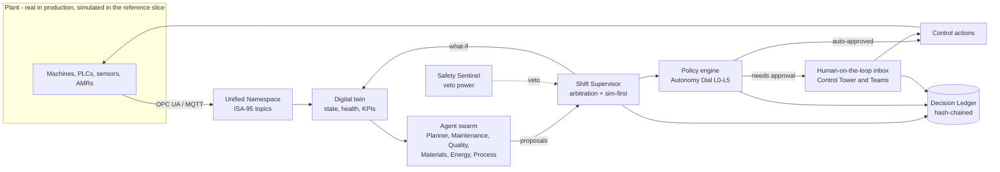
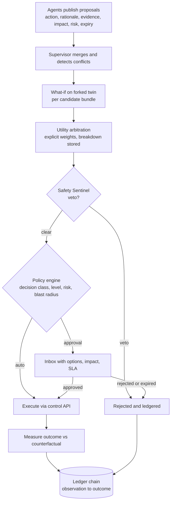
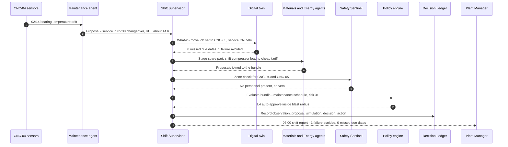
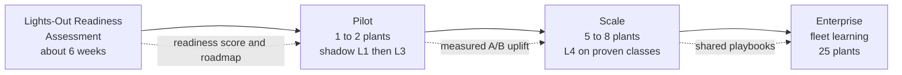
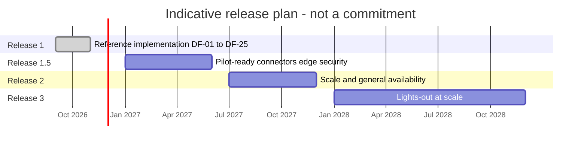

# SwarmAI Dark Factory ("Nightshift") — Product Requirements Document

| | |
|---|---|
| **Product** | SwarmAI Dark Factory — codename *Nightshift*: lights-out manufacturing run by an Azure-native swarm of AI agents, humans *on* the loop |
| **Version / date** | 1.2 · 18 November 2026 (v1.2 reconciles the business case with the evidence from the deployed reference implementation: A/B simulation results, evidence classes per benefit, measured platform facts; v1.1 added the expansion levers E1–E5) |
| **Status** | Release 1 delivered: **25/25 features deployed and verified on Azure** — live smoke test 25/25, 113 automated tests at 93 % line coverage, Playwright 15/15 on the live URL (evidence in [REPORT-TEST-AND-DEPLOYMENT.md](REPORT-TEST-AND-DEPLOYMENT.md)); live demo <https://ca-nightshift.blackforest-a28408f9.swedencentral.azurecontainerapps.io> (synthetic data) |
| **Owner** | Product & Solution Architecture |
| **Audience** | COO / CFO / CIO sponsors, plant and OT leadership, Microsoft and partner field teams, engineering |
| **Companions** | [ARCHITECTURE.md](ARCHITECTURE.md) · [FEATURES.md](FEATURES.md) · [business-case/](business-case/README.md) · [deck/](deck/) |
| **Reference customer** | **Contoso Industrial Group** (fictional): discrete manufacturer (auto & industrial components), US$2.0 B revenue, 8 plants, ~3,200 monitored assets in scope, three-shift operation |
| **Numbers** | Every ROI/ACR figure in this document is quoted from `business-case/outputs.json`, produced by `business-case/model.py` from `business-case/assumptions.json`. Market facts carry a source tag [S#] (see §20); anything else is labelled *Assumption*. **Illustrative — validate with customer data. All demo data is synthetic.** |

---

## 1. Executive summary

**The problem.** Unplanned downtime costs the world's 500 biggest companies about **US$1.4 trillion a year — 11 % of revenue** — and an average large plant still loses **326 hours a year** to it [S1]. Most manufacturers run at an OEE closer to **60 %** than the 85 % world-class benchmark [S3], while the US alone could need up to **3.8 million** extra manufacturing workers by 2033, of whom **1.9 million** posts could go unfilled [S4]. "Lights-out" automation exists, but it is rigid: it breaks on variability — a failing bearing, a late supplier, a rush order, a power-price spike, a drifting process. The missing piece is a **cognitive layer**.

**The product.** *Nightshift* is a **swarm of specialised AI agents** — Planner, Maintenance, Quality, Materials, Energy, Safety, Process — grounded in a live **digital twin** and coordinated by a **Shift Supervisor** under **policy-as-code guardrails** and an **Autonomy Dial** (L0 observe … L5 lights-out). Humans move from *in* the loop to *on* the loop: they set goals and guardrails, review exceptions in a control tower or Teams, and read an auto-generated shift report.

**Why it wins** — six defensible differentiators: (1) **sim-first safety** — every consequential action is rehearsed on a forked twin before it touches the plant; (2) **Autonomy Dial + policy-as-code** with blast-radius limits, kill switch and a tamper-evident **Decision Ledger**; (3) **explainable swarm negotiation** — conflicting objectives are arbitrated by explicit utility, not hidden prompts; (4) **measured value** — counterfactual A/B replay in simulation (same seeds, swarm ON vs OFF, 95 % confidence intervals, *including the metrics that do not improve*) feeding an ROI + ACR calculator, with shadow mode and a pilot as the real proof; (5) **Lights-Out Readiness Assessment** — the land motion and gap-closing roadmap; (6) **Azure-native and open** — IoT Operations, Fabric Real-Time Intelligence, Foundry, Azure ML, Cosmos DB, Defender, Entra, Teams; interoperable with Siemens, Rockwell, AVEVA, SAP and MES through standard connectors.

**The business case** (Contoso, 8 plants rolled out 2 → 5 → 8 over three years; 10 % discount rate; `business-case/outputs.json`, risk-adjusted). **Base** is the core platform with the five optional *expansion levers* (E1–E5, §11.5) switched **off**; **Upside** has them **on** with its higher benefit assumptions.

| | Conservative | **Base** (levers off) | Upside (levers on) |
|---|---:|---:|---:|
| 3-year benefit | $9.4 M | **$21.4 M** | $50.3 M |
| 3-year cost (Azure + hardware + integration + people + licences) | $11.2 M | **$10.5 M** | $20.5 M |
| **NPV** | −$2.1 M | **$8.3 M** | $23.3 M |
| ROI (net ÷ cost) | −16 % | **104 %** | 146 % |
| Payback (months from programme start) | 39 | **22** | 19 |
| 5-year NPV (memo) | $11.4 M | **$36.6 M** | $79.6 M |
| Steady-state benefit at 8 plants (per year) | $18.6 M | **$29.3 M** | $51.4 M |
| **Azure consumption (ACR), Year 3** | $0.50 M | **$0.68 M** | **$1.91 M** |
| **ACR run-rate at 8 plants (per year)** | $0.73 M | **$0.91 M** | **$2.43 M** |
| Per additional plant: benefit ÷ run cost · payback after go-live | — | **9.8× · 5.5 months** | — |

**What the evidence supports — and what it does not.** The in-app A/B replay (16 seeds × 8 simulated hours, swarm OFF vs ON, identical seeds, order book, noise and fault schedule, 8 injected disruptions per seed) is **simulation evidence on synthetic assumptions — not a customer guarantee** (§10.3). Six of its twelve metrics improve significantly: **unplanned downtime −79 %, late orders −20 %, order tardiness −18 %, total loss −31 %, OEE +13.5 points and the effective energy price paid −10 %** (evening-peak window; about −2 % in the night and day windows). Absolute energy cost is slightly **worse** (+6 %: less downtime means more machine-hours, and the energy agent moves load to cheaper hours rather than cutting kWh), and **scrap, customer escapes, OTIF and good units shipped show no significant effect**. Mapped onto the business case, **44 % of the risk-adjusted three-year benefit is simulation-supported** (downtime, OEE/throughput, late-delivery cost) and **56 % is benchmark- or assumption-only** (scrap, maintenance, energy, labour, inventory, expedite, capex deferral): hypotheses that shadow mode and the pilot must confirm (§11.1). The Base case stays positive if scrap and energy contribute nothing — NPV $4.7 M, payback 25 months (calculator overrides `scrap_reduction_pct` = 0 and `energy_saving_pct` = 0).

**The Azure opportunity** (list price, no EA discount, bottom-up from 60 Azure Retail Prices API meters, retrieved 2026-11-17 [S27]). The **core platform** is **$0.68 M in Year 3** and **$0.91 M a year at 8 plants** (≈ $114 k per plant-year; pilot ≈ $55 k, one full plant ≈ $177 k, 25 plants ≈ $2.7 M). A real dark-factory programme then adds high-consumption workloads, modelled as five optional levers, each with its *own* cost and benefit — **E1** machine-vision fleet, **E2** high-frequency condition monitoring, **E3** continuous sim-first what-if at scale, **E4** enterprise data-platform modernisation, **E5** OT security and connectivity hardening. With the levers on, Contoso's run-rate at 8 plants is **$1.87 M (2.05× core; ≈ $233 k per plant-year)**, a 25-plant enterprise **$5.4 M**, and a **100-plant enterprise fleet $21.2 M a year** (core $10.6 M; with Upside inputs $28.0 M). The levers are a *fleet* story: per plant they are modest (E2, E3 add ≈ $12–23 k per plant), and most of the step comes from enterprise-scale Fabric (E4) and network/security hubs (E5). For every $1 of AI services (Foundry, AI Search, Azure ML) the solution pulls through **$3.4** (core) to **$5.9** (levers on) of data, edge, compute, security, monitoring and networking consumption.

**The ask.** Commission a **Lights-Out Readiness Assessment** (≈ 6 weeks) to pick the first two plants, then a **two-plant pilot** that runs in shadow mode (L1), earns L3–L4 on proven decision classes, and proves the uplift on the customer's own data before the 5- and 8-plant roll-out.

**Status.** All 25 Release-1 features are **deployed and verified on Azure** (swedencentral, 14 resources in one resource group, keyless over a user-assigned managed identity): live smoke test **25/25 PASS**, **113 automated tests at 93 % line coverage**, Playwright **15/15** on the live URL, 26/26 UI routes crawled without errors; 127 API operations. The slice is one Container App (0.5 vCPU / 1 GiB, a **single replica** because the plant simulation is in-process state), Cosmos DB serverless, Blob Storage and Azure OpenAI (`gpt-5.4-mini`, `gpt-5.4`), with Application Insights. Measured on the live instance: typical API calls take **1.2–2.6 ms p50 and 6–45 ms p95** server-side (client p50 251–256 ms from the test machine, of which 241–253 ms is the network round trip; 300 requests at 20 concurrent, 0 errors); the calculator recomputes in ≈ 300 ms; an A/B replay of 10 seeds takes ≈ 2 s on a laptop but **≈ 41 s on the 0.5 vCPU container**, so it runs as a background job in a worker process with progress polling. The slice costs **≈ US$45 a month idle** at list prices (range $40–55) — a demonstrator, not a pilot-scale deployment (§11.4). The plant is **simulated** ("Contoso Precision Components — KAT-1"); there are no real PLC/MES/ERP connections, and production edge/cloud services described in ARCHITECTURE.md plug in behind the same interfaces. Evidence: [REPORT-TEST-AND-DEPLOYMENT.md](REPORT-TEST-AND-DEPLOYMENT.md).

---

## 2. Problem and market context

| # | Fact | Why it matters | Source |
|---|---|---|---|
| 1 | Unplanned downtime costs the 500 largest companies ~US$1.4 T a year (**11 % of revenue**); the cost of an hour ranges from **US$36 k (FMCG) to US$2.3 M (automotive)**; the average large plant loses **27 h a month (326 h a year)** and suffers **25 incidents a month** — fewer than in 2019 (42) because predictive maintenance went mainstream | Downtime is the largest controllable loss; the baseline is measurable in every CMMS | [S1] |
| 2 | Predictive maintenance typically **reduces machine downtime by 30–50 %** and increases machine life by 20–40 % | Evidence for the largest lever; the business case haircuts it to 20 % (Base) | [S2] |
| 3 | Most manufacturers' OEE is closer to **60 %** than the **85 %** world-class level | Headroom for planning, changeover and speed gains beyond availability | [S3] |
| 4 | US manufacturing could need up to **3.8 M** net new employees 2024–2033; **1.9 M** could go unfilled | Autonomy is a capacity strategy, not only a cost play | [S4] |
| 5 | The WEF Global Lighthouse Network counts **189 sites**; leaders average **> 50 %** improvement in conversion cost, cycle time and defect rates, and report ROI multiples of two to three in 10–20 months — leaders, not typical plants | Proves the ceiling; our case assumes a fraction of it | [S5] |
| 6 | Real lights-out operations exist: Xiaomi's Beijing Changping plant (opened Feb 2024; ≥ 10 M phones a year; designed for robots to do most work around the clock) [S9]; FANUC's Oshino campus is reported to run machining unattended for long periods, up to 30 days in a 2003 account [S10 — secondary] | Dark factories are real but built greenfield and rigid; brownfield variability needs a cognitive layer | [S9] [S10] |
| 7 | Smart-factory market: US$104 B (2025) → US$170 B (2030), 10.2 % CAGR (MarketsandMarkets) · US$155 B (2024) → US$273 B (2030), 10.0 % CAGR (Grand View Research); definitions differ | Large, growing spend pool; we do not claim a share | [S6] [S7] |
| 8 | EU manufacturing: ~2.2 M enterprises, 30.0 M persons employed; **large enterprises employ 48.3 %** of them (2022) | Anchor for the illustrative plant-count sizing in §11.8 | [S8] |
| 9 | Regulation is moving: EU AI Act high-risk obligations deferred to **2 Dec 2027 / 2 Aug 2028** by the Digital Omnibus adopted in 2026; Machinery Regulation applies from **20 Jan 2027**; NIS2 covers manufacturers of machinery, electrical equipment and vehicles | Design for evidence, human oversight and OT security from day one (§16) | [S11]–[S16] |

**The gap.** Today's plants combine rigid automation (PLCs, robots, MES rules) with dashboards and humans who re-plan by spreadsheet at 03:00. Predictive-maintenance tools see one failure mode; MES rules see one schedule; copilots answer questions but do not act. Nobody **coordinates competing objectives — throughput vs. energy vs. maintenance vs. quality vs. due dates — under explicit, auditable guardrails**. That coordination layer, with a safe path from recommendation to autonomy, is the product.

---

## 3. Vision and positioning

**Vision.** *A factory that runs itself on the night shift — and can prove it was safe, explain every decision and show the money.*

**Positioning statement.** For **COOs and plant leaders of discrete manufacturers** who must raise OEE and protect due dates while skilled labour gets scarcer, **SwarmAI Dark Factory** is an **Azure-native swarm of governed AI agents** that plans, maintains, protects quality, feeds materials and saves energy autonomously within policy. Unlike dashboards, single-purpose predictive-maintenance tools or engineering copilots, it **rehearses every consequential action on a digital twin first, earns autonomy per decision class, records every decision in a tamper-evident ledger and measures its own value by counterfactual replay**.

**Principles**

| Principle | Meaning in the product |
|---|---|
| **Sim-first** | No consequential action reaches the plant without a what-if on forked twin state (DF-03, DF-04) |
| **Earned autonomy** | L0–L5 per decision class; promotion needs evidence and OT/Cyber sign-off (DF-12) |
| **Guardrails are code** | Policy-as-code, blast-radius limits, forbidden setpoints, kill switch — tested, not prompted (DF-12, DF-10) |
| **Safety has a veto** | The Safety Sentinel can stop any agent; certified safety functions stay in certified controllers (DF-10) |
| **Explain everything** | Rationale, evidence and counterfactual for every decision; hash-chained ledger (DF-14) |
| **Measure, don't claim** | A/B replay with confidence intervals — reported for *every* metric, including those that do not improve or get worse; assumptions visible; "simulation" labelled as such and never presented as a customer guarantee (DF-21) |
| **Edge-first, cloud-smart** | Fast and safety-relevant loops stay at the plant; the cloud adds models, fleet learning and analytics |
| **Open by design** | OPC UA / MQTT / ISA-95 Unified Namespace, standard connectors, pluggable adapters |

**What it is not:** a safety system, a MES/ERP/SCADA/historian replacement, a worker-monitoring tool, or a promise of full lights-out in every plant.

---

## 4. Personas and jobs-to-be-done

| Persona | Role | Job to be done | Pain today | What Nightshift gives them | Key features |
|---|---|---|---|---|---|
| **COO / VP Manufacturing** | Economic buyer, sponsor | "Show me the ROI and the risk control before I let a machine decide" | Opaque AI claims; fear of safety and compliance exposure | Autonomy Dial with evidence, A/B-*measured* uplift in simulation (not a guarantee), readiness roadmap | DF-12, DF-15, DF-21, DF-22 |
| **CFO** | Approver of spend | "Prove the payback with numbers I can audit" | Benefits not traceable to P&L lines | ROI/NPV/payback with visible assumptions, scenarios, sensitivity | DF-21, DF-19 |
| **Plant Manager** | Daily user | "Hit the schedule and the KPIs without being called at 03:00" | Firefighting, shift-handover gaps | Control tower, 06:00 shift report, "Ask the Factory" | DF-20, DF-17, DF-16 |
| **Maintenance Lead** | Daily user | "Fix things before they break, in the cheapest window" | Late alarms, emergency repairs, spare shortages | RUL with lead time, work orders in planned windows, spare check | DF-05, DF-08, DF-18 |
| **Quality Manager** | Daily user | "Stop defects early and contain what escaped" | Late SPC signals, manual containment | SPC with bounded compensation, quarantine, vision queue | DF-06 |
| **Supply-chain Planner** | Daily user | "Keep due dates when disruptions hit" | Static schedules, expediting | Continuous re-planning, supplier-delay mitigation | DF-07, DF-08 |
| **OT / Cyber lead** | **Veto holder** | "Nothing touches my plant that I can't contain, audit or switch off" | Black-box AI, flat networks, unclear blast radius | Policy-as-code, kill switch, RBAC, ledger, IEC 62443-aligned segmentation | DF-10, DF-12, DF-14, DF-23 |
| **Process Engineer** | Specialist | "Tune recipes safely and learn from every shift" | Parameters set-and-forget; no safe experimentation | Bounded optimiser with rollback, twin sandbox, RCA | DF-11, DF-03, DF-18 |
| **Remote Operator** (exception handler) | On-the-loop human | "Decide only what matters, with the evidence in front of me" | Alert floods, no context | Approvals inbox with options, impact, SLA timers; Teams cards | DF-13, DF-16 |

---

## 5. Goals and non-goals

**Product goals** (targets are product/business-case values to be validated; see §10)

| # | Goal | Target |
|---|---|---|
| G1 | Cut unplanned downtime and its cost | −20 % of unplanned downtime hours (Base; −14 % … −26 % across scenarios) |
| G2 | Protect due dates and quality | Fewer late orders and lower tardiness than the no-swarm baseline, shown by A/B with CIs excluding zero (**achieved in simulation:** late orders −20 %, tardiness −18 %); lower scrap is a *target to prove* in shadow mode and the pilot — it is **not** significant in the simulation |
| G3 | Make autonomy safe | **0** agent-attributable safety incidents; 100 % of decisions in the ledger with rationale and counterfactual; kill switch acts within one tick |
| G4 | Earn trust with evidence | Autonomy ratio and override rate tracked per decision class; promotion only with measured results |
| G5 | Fast time-to-value | Readiness assessment ≤ 6 weeks; first autonomous (L3+) shift ≤ 4 months from pilot start; plant onboarding ≤ 12 weeks once templates exist |
| G6 | Pay back and scale on Azure | Base NPV $8.3 M, payback 22 months; ~$114 k Azure consumption per plant-year with 3.4× pull-through (core); ≈ $233 k per plant-year and 5.9× with the expansion levers on |

**Non-goals**

1. Replacing certified safety functions (safety PLCs, light curtains, E-stops) — the Sentinel only adds a higher-level layer that can *reduce* risk.
2. Replacing MES, ERP, SCADA, historians or CMMS — Nightshift reads from and writes to them through connectors.
3. Monitoring or evaluating individual workers, or allocating tasks to individuals by behaviour or personal traits (also keeps the product clear of the EU AI Act's employment high-risk category, §16).
4. Closed-loop control of sub-100 ms process loops from the cloud — those stay in PLCs/edge controllers.
5. Claiming real-plant results from simulation — simulated uplift informs, a pilot proves.
6. Training foundation models on customer data.
7. Supplying plant hardware or sensors (it specifies reference edge configurations).

## 6. Solution overview

### 6.1 Concept

### 6.2 The swarm

| Agent | Perceives | Proposes | Methods (reference implementation) | KPIs moved | Feature |
|---|---|---|---|---|---|
| **Shift Supervisor** (orchestrator) | all proposals, twin state, policy | the executed bundle, with utility breakdown | conflict detection, utility arbitration, sim-first what-if, policy routing | KPI-10, 12, 13 | DF-04 |
| **Planner** | orders, routings, capacity, disruptions | (re-)schedules, rush-order options | finite-capacity scheduling, re-planning, FIFO baseline for A/B | KPI-04, 02, 06 | DF-07 |
| **Maintenance** | vibration, temperature, current, spindle load | work orders in planned windows, spare requests | robust z / EWMA / isolation-forest-style detection, RUL with confidence, failure-signature library | KPI-01, 09 | DF-05 |
| **Quality** | SPC subgroups, drift, images | bounded setpoint compensation, lot quarantine, review requests | X-bar/R, Cpk, Western Electric rules, vision via Azure OpenAI multimodal (6/6 on the live model); scrap effect is **not** significant in the simulation | KPI-03 | DF-06 |
| **Materials** | BOM, inventory, supplier status, AMRs | reorders, expedites, AMR dispatch, kits | min/max logic, mitigation ranking | KPI-07, 08 | DF-08 |
| **Energy** | tariff, carbon intensity, load | load shifts, peak shaving | ToU- and carbon-aware shifting verified by what-if; it lowers the **price paid per kWh** where tariffs vary — it does not reduce consumption | KPI-05 | DF-09 |
| **Process** | process parameters, yield, energy | bounded parameter trials with rollback | trust-region search on twin forks | KPI-02, 03, 05 | DF-11 |
| **Safety Sentinel** | zone occupancy, setpoints, cyber posture | protective stops, vetoes | rule engine, forbidden-setpoint guards, protected assets | KPI-11, 19 | DF-10 |

### 6.3 Autonomy model

| Level | Name | Behaviour |
|---|---|---|
| **L0** | Observe | agents analyse and log; nothing is proposed or executed |
| **L1** | Recommend | proposals shown to humans; humans execute manually |
| **L2** | Approve-to-act | executes only after explicit human approval (default for new decision classes) |
| **L3** | Act-with-veto | auto-executes after a short veto window unless a human vetoes; humans notified |
| **L4** | Auto-approve within guardrails | executes immediately when risk ≤ threshold, sim-validated and inside blast-radius and exposure limits; humans informed in the digest |
| **L5** | Lights-out | autonomous within the widest envelope; humans handle policy escapes and audits |

The level is set **per decision class**, never globally. Illustrative starting points and targets (*Assumption* — set with the customer's OT/Cyber lead during the pilot):

| Decision class | Pilot start | Target after proof | Hard cap / note |
|---|---|---|---|
| `maintenance.schedule` | L1 | L4 | blast radius ≤ 2 assets and ≤ 6 orders |
| `planning.reschedule` | L1 | L4 | outside the freeze horizon only |
| `materials.reorder` | L2 | L4 | spend ≤ policy limit |
| `energy.load-shift` | L2 | L4 | never at the cost of a due date |
| `quality.compensate` | L1 | L3 | bounded offset and rate; rollback |
| `quality.quarantine` | L2 | L4 | release/scrap stays human |
| `planning.rush-order`, `materials.expedite` | L2 | L3 | cost-bearing |
| `process.parameter-change` | L1 | L3 | trust-region limits |
| `safety.protective-stop` | L5 | L5 | always allowed: it only reduces risk |
| `safety.restart`, `quality.release`, `policy.change` | L2 / L1 / human | L2 / L2 / human | capped; policy changes need dual control |

**Risk score (0–100)** blends blast radius, reversibility, safety proximity, financial exposure, model confidence, novelty and the what-if margin; weights and thresholds live in the versioned policy file. Break-glass is time-boxed, dual-controlled and ledgered; the **kill switch** halts all agent-initiated actions within one tick while protective stops stay allowed.

### 6.4 Sim-first safety — the decision pipeline

### 6.5 What is real and what is simulated in Release 1

| Layer | Reference implementation | Production target |
|---|---|---|
| Plant, sensors, PLCs, AMRs | **Simulated** (seeded, deterministic, same interfaces) | Real equipment via Azure IoT Operations (OPC UA, MQTT) |
| Telemetry, UNS, twin, what-if | **Real software** over the simulator | Event Hubs → Fabric RTI, Azure Digital Twins / Fabric digital twin builder |
| Agents, Supervisor, policy engine, ledger, KPI engine | **Real software**, deterministic by default | Same code on Container Apps / AKS and edge |
| LLM features (copilot, narration, vision) | **Real**, Azure OpenAI via Foundry (managed identity) | Foundry Agent Service, AI Search grounding |
| MES / ERP / CMMS / Teams / grid feeds | **Simulated or optional webhook** behind ports | Certified connectors (SAP, Siemens, Rockwell, AVEVA, Dynamics 365) |
| Safety functions | **Simulated**; no safety-rated claim | Certified safety PLCs/relays remain authoritative |

---

## 7. User journeys

### 7.1 The 02:14 night shift

| Time | What happens | Who/what | Features |
|---|---|---|---|
| 02:14 | Bearing temperature on **CNC-04** drifts; the anomaly score crosses the threshold | Maintenance agent | DF-02, DF-05 |
| 02:15 | RUL estimate ≈ **14 h** with confidence; failure signature "bearing wear" matched | Maintenance agent | DF-05 |
| 02:15 | Supervisor asks the twin: move the CNC-04 job set to CNC-05, service CNC-04 in the 05:30 changeover → **0 missed due dates, 1 failure avoided** | Supervisor + twin | DF-03, DF-04, DF-07 |
| 02:16 | Materials stages the spare; Energy shifts compressor load into the cheap-tariff window | Materials, Energy | DF-08, DF-09 |
| 02:16 | Safety confirms **no personnel** in the CNC-04/05 zone; no veto | Safety Sentinel | DF-10 |
| 02:16 | Policy: class `maintenance.schedule`, risk 31 < threshold, inside blast radius → **L4 auto-approve** | Policy engine | DF-12 |
| 02:16 | Action executes; **ledger** records observation → proposal → simulation → decision → action with rationale and counterfactual | Supervisor, ledger | DF-14 |
| 05:30 | Planned maintenance runs in the changeover window; CNC-04 returns healthy | Maintenance | DF-05 |
| 06:00 | **Shift report:** "1 failure avoided, 0 missed due dates, €X saved" (X computed from the ledger counterfactual) | Digest | DF-17, DF-19 |

*Illustration for scale:* at the Base-case derived cost of **US$4.2 k per line-hour** (`business-case`), avoiding a 3.5-hour breakdown is worth ≈ US$14.6 k before spares and expedite costs.

### 7.2 Other journeys

| Journey | Trigger | Steps | Outcome | Features |
|---|---|---|---|---|
| **06:00 handover** (Plant Manager) | shift boundary | reads the digest; asks "why did the Supervisor move the CNC-04 jobs?"; follows citations into the ledger | 5-minute handover instead of a 30-minute briefing | DF-17, DF-16, DF-14 |
| **Approval at L2** (Remote Operator) | quality drift beyond the autonomous bound | inbox item with options, what-if impact, SLA timer; approves a bounded compensation; Teams card for the shift lead | decision in minutes with evidence; ledgered | DF-06, DF-13, DF-20 |
| **Human intrusion** (Safety) | person enters the CNC-04/05 zone during a run | Sentinel issues protective stop/slow within one tick; Planner proposals for those assets are vetoed; restart needs a human with the right role | zero-harm response, full audit | DF-10, DF-12, DF-23 |
| **Promoting autonomy** (COO + OT/Cyber lead) | 8 weeks of shadow-mode evidence for `maintenance.schedule` | review override rate, A/B delta and ledger samples; dry-run the new policy on the last 24 h; promote L2 → L3 → L4 with dual control | autonomy earned, not assumed | DF-12, DF-14, DF-21 |
| **Show me the money** (CFO) | steering-committee review | runs A/B replay (≥ 10 seeds), then the calculator with the customer's revenue, downtime cost and labour rates; reads NPV, payback, ACR | auditable business case in one session | DF-21, DF-19 |
| **Readiness assessment** (COO, Plant Manager) | start of engagement | answers the questionnaire; auto-measured signals from the data feed; receives radar, gaps and a sequenced roadmap | choice of first two plants and the gap-closing plan | DF-15 |

## 8. Functional requirements

Priority: **P0** = must exist for the demo to make sense · **P1** = Release-1 depth · **P2** = Release-1 stretch. *Verification* cites the acceptance criteria in [FEATURES.md](FEATURES.md).

### Epic A — Plant digital twin and telemetry

| ID | Requirement — the platform shall … | Pri | Feature | Verification |
|---|---|---|---|---|
| FR-A01 | provide a seeded, deterministic plant simulation (asset state machine, degradation, sensors, quality, energy, ToU tariff and carbon curves) | P0 | DF-01 | AC-01.1, 01.3 |
| FR-A02 | inject catalogued faults (bearing wear, tool wear, thermal drift, jam, supplier delay, rush order, power-price spike, quality drift, human intrusion) and scripted scenarios | P0 | DF-01 | AC-01.4 |
| FR-A03 | support time acceleration, pause/step, snapshot/restore and a validated control API for agent and human actions | P0 | DF-01 | AC-01.2, 01.5, 01.6 |
| FR-A04 | normalise telemetry into an ISA-95 Unified Namespace (`enterprise/site/area/line/cell/asset/metric`) with a validated message schema | P0 | DF-02 | AC-02.1, 02.2 |
| FR-A05 | accept telemetry from pluggable sources (simulator, HTTP; MQTT, Event Hubs and IoT Operations adapters behind one interface) | P0 | DF-02 | AC-02.3 |
| FR-A06 | retain, downsample, persist and live-stream time series | P0 | DF-02 | AC-02.4–02.6 |
| FR-A07 | maintain a live asset graph and offer fork-and-simulate-ahead what-if returning KPI deltas | P0 | DF-03 | AC-03.1–03.6 |

### Epic B — Agent swarm

| ID | Requirement — the platform shall … | Pri | Feature | Verification |
|---|---|---|---|---|
| FR-B01 | run agents in a perceive → propose cycle on a shared blackboard, emitting proposals with action, rationale, evidence, impact, risk, cost and expiry | P0 | DF-04 | AC-04.4, 04.5 |
| FR-B02 | detect conflicts and arbitrate by explainable utility, validating every consequential action sim-first | P0 | DF-04, DF-03 | AC-04.1–04.3, 04.6 |
| FR-B03 | predict asset failures with RUL and book maintenance in planned windows | P0 | DF-05 | AC-05.1–05.6 |
| FR-B04 | detect quality drift (SPC), compensate within bounds and contain suspect lots | P0 | DF-06 | AC-06.1–06.3, 06.6 |
| FR-B05 | inspect parts by vision and route low-confidence calls to human review | P0 | DF-06 | AC-06.4, 06.5 |
| FR-B06 | plan and continuously re-plan production with finite capacity and explain the schedule | P0 | DF-07 | AC-07.1–07.6 |
| FR-B07 | keep materials flowing: inventory, reorder, AMR dispatch, supplier-delay mitigation, kitting | P1 | DF-08 | AC-08.1–08.5 |
| FR-B08 | optimise energy cost and carbon by load shifting and peak shaving | P1 | DF-09 | AC-09.1–09.5 |
| FR-B09 | protect people and assets: safety zones, intrusion response, forbidden setpoints, veto, cyber hygiene | P0 | DF-10 | AC-10.1–10.6 |
| FR-B10 | optimise process parameters inside safe bounds with automatic rollback | P2 | DF-11 | AC-11.1–11.5 |

### Epic C — Autonomy governance

| ID | Requirement — the platform shall … | Pri | Feature | Verification |
|---|---|---|---|---|
| FR-C01 | provide autonomy levels L0–L5 configurable per decision class | P0 | DF-12 | AC-12.1 |
| FR-C02 | evaluate policy-as-code deterministically: risk scoring, approval thresholds, blast radius, time-boxed auto-approval, break-glass, global kill switch | P0 | DF-12 | AC-12.2–12.6 |
| FR-C03 | queue approvals and escalations with options, impact, explanation, SLA timers and policy defaults | P0 | DF-13 | AC-13.1–13.3, 13.5, 13.6 |
| FR-C04 | deliver approval requests to Microsoft Teams as Adaptive Cards | P1 | DF-13 | AC-13.4 |
| FR-C05 | record every decision in a tamper-evident, queryable, exportable, verifiable ledger | P0 | DF-14 | AC-14.1–14.4, 14.6 |
| FR-C06 | store rationale, evidence and counterfactual impact with every decision | P0 | DF-14, DF-04 | AC-14.5, 04.2 |
| FR-C07 | score plant readiness for lights-out and generate a gap-closing roadmap | P1 | DF-15 | AC-15.1–15.5 |

### Epic D — Copilot and insight

| ID | Requirement — the platform shall … | Pri | Feature | Verification |
|---|---|---|---|---|
| FR-D01 | answer questions about plant, ledger, twin and what-if with streaming, grounded, cited responses | P0 | DF-16 | AC-16.1, 16.2, 16.4, 16.6 |
| FR-D02 | let the copilot act only by proposing through the approval/policy path and resist prompt injection | P0 | DF-16 | AC-16.3, 16.5 |
| FR-D03 | generate shift handover and executive digests with verified numbers and a deterministic fallback | P1 | DF-17 | AC-17.1–17.5 |
| FR-D04 | assist root-cause analysis with ranked, evidenced hypotheses and a loss Pareto | P1 | DF-18 | AC-18.1–18.5 |
| FR-D05 | compute standard manufacturing KPIs consistently, including $ impact | P0 | DF-19 | AC-19.1–19.5 |

### Epic E — Platform and business value

| ID | Requirement — the platform shall … | Pri | Feature | Verification |
|---|---|---|---|---|
| FR-E01 | provide a control tower for situational awareness and the levers (dial, inbox, ledger, what-if, copilot) | P0 | DF-20 | AC-20.1–20.4, 20.7 |
| FR-E02 | measure value by counterfactual A/B replay with confidence intervals | P0 | DF-21 | AC-21.1, 21.6 |
| FR-E03 | compute ROI, NPV, payback and Azure ACR by service family and by expansion lever (E1–E5, each switchable) from the shared business-case model | P0 | DF-21 | AC-21.2–21.5 |
| FR-E04 | support a multi-plant fleet with benchmarking and cross-plant playbook sharing | P1 | DF-22 | AC-22.1–22.5 |
| FR-E05 | enforce role-based access with Entra-ready authentication and audit privileged actions | P1 | DF-23 | AC-23.1–23.5 |
| FR-E06 | expose observability and FinOps: traces, metrics, health endpoints, AI cost meter, budget cap | P1 | DF-24 | AC-24.1–24.5 |
| FR-E07 | deploy, test and tear down by infrastructure as code, keyless | P0 | DF-25 | AC-25.1–25.6 |
| FR-E08 | publish a feature registry / Feature Map and label simulated data honestly | P0 | DF-20, DF-25 | AC-20.5, 20.6 |

---

## 9. Non-functional requirements

Targets are for the **production design**; the last column states what the reference slice demonstrates, with the **measured evidence** from [REPORT-TEST-AND-DEPLOYMENT.md](REPORT-TEST-AND-DEPLOYMENT.md) (live instance, single replica, 0.5 vCPU / 1 GiB, swedencentral).

| ID | Area | Requirement | Production target | Reference-slice evidence |
|---|---|---|---|---|
| NFR-01 | Latency | Protective action at the edge | ≤ 1 s from event to safe-stop request; sub-100 ms loops stay in PLCs | one-tick response (AC-10.1); live smoke #11: intrusion → protective stop + veto → verified restart |
| | | Detect → proposal → decision (excl. human approval) | p95 ≤ 5 s | decision-cycle time metered per agent (DF-24); server-side API latency typically **p50 1.2–2.6 ms, p95 6–45 ms** (1,542 requests, 0 errors) |
| | | What-if, 12-h horizon | p95 ≤ 2 s | AC-03.4; what-if on a forked twin exercised live (smoke #13, Playwright journey); not separately benchmarked |
| | | Copilot first token | p95 ≤ 3 s | AC-16.6; live tool-calling copilot with citations (smoke #14); not separately benchmarked |
| NFR-02 | Availability and resilience | Cloud control plane | 99.9 % monthly; edge runs autonomously ≥ 72 h offline with store-and-forward; autonomy ceiling drops to L2 when the cached policy is stale (R1.5); RTO 1 h, RPO 5 min for ledger and state | `/healthz`, `/readyz` (Cosmos 37 ms, Blob 192 ms, Azure OpenAI 1,409 ms in smoke #2); **single replica** by design (in-process plant state), 0 restarts after the final runs; one restart incident found by the live smoke test and fixed (A/B moved from a thread to a worker process, probe timeouts raised) |
| NFR-03 | Safety | Agents cannot compromise safety | **0** agent-attributable incidents; certified safety functions stay authoritative; Sentinel veto cannot be overridden by policy below break-glass; protective stop always allowed | AC-10.1–10.6, AC-12.3 |
| NFR-04 | Security | Identity, network, data | Entra ID + least-privilege RBAC; managed identities, no secrets in code; TLS 1.2+; private endpoints; OT/IT segmentation per IEC 62443 zones and conduits; prompt-injection defences; pen test before GA | keyless IaC grep gate (AC-25.4), RBAC matrix (AC-23.1), injection test (AC-16.5); live: managed identity only, Cosmos and AI local auth disabled, storage shared key disabled, server-side 403s audited (smoke #22); known gap: public endpoint with a demo role switcher |
| NFR-05 | Explainability and audit | Evidence for every consequential decision | 100 % of decisions with rationale + counterfactual; ledger verifiable offline; WORM retention ≥ 7 years (*Assumption*, configurable) | AC-14.1–14.6 |
| NFR-06 | Data residency | Data stays where the customer says | processing at the edge first; cloud regions and EU Data Boundary options per customer; no training of shared models on plant data (confirm per deployment) | single-region slice (swedencentral) |
| NFR-07 | Scalability | Reference plant 400 assets ≈ 930 telemetry messages/s ≈ 10 GB/day raw (model drivers); 25-plant fleet | linear per plant; shared platform scales sub-linearly | 3-plant fleet (DF-22); capacity model in ARCHITECTURE.md; one replica; load check of 300 requests at 20 concurrent: 53–68 req/s, 0 errors |
| NFR-08 | Determinism | Reproducibility | same seed + same actions ⇒ identical state hash; deterministic arbitration; reproducible A/B | AC-01.1, AC-04.2, AC-21.1; A/B results bit-identical between a laptop and the container (10 seeds) |
| NFR-09 | Usability and accessibility | Control-room UX | WCAG 2.2 AA; every panel ≤ 2 clicks; keyboard-operable approvals | AC-20.1, 20.3, 20.4 |
| NFR-10 | Cost / FinOps | Bounded AI spend | daily AI budget cap, fails closed; Azure + AI cost per plant-day tracked (Base model: ≈ $312 all-in, of which ≈ $53 model tokens) | AC-24.2, AC-24.5; daily budget guard fails closed — $0.25 of the $5 cap used by a full smoke run; the slice itself costs ≈ $45 a month idle at list prices |
| NFR-11 | Maintainability | Feature-sliced, adapter-based | ≥ 80 % line coverage on domain logic; every external system behind an interface with a stub | **113 pytest tests at 93 % line coverage** (ruff clean, mypy clean on sim + core, `tsc` and Vite build clean, 9 Vitest); adapter contract tests |
| NFR-12 | Compliance alignment | Standards and regulation | alignment (not certification) with IEC 62443, ISO/IEC 27001 controls, EU AI Act obligations, ISO 13849 / ISO 10218 boundaries, NIS2 (§16) | ledger, RBAC, policy history as evidence |
| NFR-13 | Observability | See inside the swarm | OpenTelemetry traces, metrics and structured logs with one correlation id per decision | AC-24.3, 24.4 |
| NFR-14 | Interoperability | Open standards | OPC UA, MQTT, ISA-95 UNS, open data formats (Parquet/Delta) in OneLake; no proprietary data lock-in | adapter interfaces (AC-02.3) |

---

## 10. Success metrics and measurement plan

### 10.1 KPI catalogue and targets

Targets for the business KPIs are the **Base** values in the business case (scenario range in brackets) and must be **validated on customer data**; autonomy, safety and platform KPIs are product targets (*Assumption*).

| KPI | Name | Baseline source | Target | Measured by |
|---|---|---|---|---|
| KPI-01 | Unplanned downtime | CMMS/MES last 12 months (Siemens large-plant average: 326 h/yr [S1]) | **−20 %** of unplanned hours (−14 % … −26 %). *Simulation:* −79 % against a synthetic baseline — more optimistic than the case; not to be read across | DF-19, A/B, pilot |
| KPI-02 | OEE | MES (typical ≈ 60 % [S3]) | **+1.5 pts** from planning/changeover/speed, reported separately from availability and quality. *Simulation:* OEE +13.5 pts, mostly availability (counted under downtime) | DF-19 |
| KPI-03 | Scrap, rework and FPY | quality system | **−12 %** scrap & rework cost (−9 % … −15 %) — a benchmark/assumption target; **not significant in the simulation** (§10.3) | DF-19, shadow mode, pilot |
| KPI-04 | OTIF and tardiness | ERP/MES | **−20 %** late/short-delivery cost (−14 % … −26 %). *Simulation:* late orders −20 % and tardiness −18 % significant; OTIF points (+4.3) not significant | DF-19, DF-21 |
| KPI-05 | Energy cost and CO2e per unit | meters, tariff | **−5 %** energy cost per unit through tariff-aware load shifting, i.e. a lower **price paid per kWh** where tariffs vary — not lower consumption (−3.5 % … −6.5 %). *Simulation:* effective price −10 % in the evening-peak window (−2 % outside), absolute cost +6 % | DF-19, DF-09 |
| KPI-06 | Indirect-labour effort | time study / planner logs | **+10 %** productivity (≈ 9,900 hours a year released per plant, Base) | pilot time study |
| KPI-07 | Inventory and working capital | balance sheet | **−6 %** inventory (≈ US$2.1 M cash per plant at maturity; memo, not in NPV) | ERP |
| KPI-08 | Expedite and premium freight | AP / logistics | **−20 %** spend | ERP/AP |
| KPI-09 | Maintenance effectiveness | CMMS | **−8 %** maintenance spend; planned-work ratio up; MTBF up, MTTR down | DF-19 |
| KPI-10 | Autonomy ratio and override rate | ledger | ≥ 60 % of eligible decisions at L3+ and < 10 % overrides after month 12 of the pilot | DF-12, DF-14 |
| KPI-11 | Safety | incident log | **0** agent-attributable incidents; protective stop ≤ 1 tick; 100 % veto compliance | DF-10 |
| KPI-12 | Decision latency | traces | detect → proposal p95 ≤ 5 s; what-if ≤ 2 s | DF-24 |
| KPI-13 | Explainability and integrity | ledger | 100 % with rationale + counterfactual; 100 % chain verification | DF-14 |
| KPI-14 | Human-on-the-loop responsiveness | inbox | ≥ 95 % of approvals inside SLA; median time-to-decision < 10 min | DF-13 |
| KPI-15 | Time-to-value | project plan | assessment ≤ 6 weeks; first autonomous shift ≤ 4 months; onboarding ≤ 12 weeks per plant | DF-15, DF-25 |
| KPI-16 | Readiness score | assessment | ≥ 70/100 for pilot plants; +10 per quarter of roadmap work | DF-15 |
| KPI-17 | Platform reliability | monitoring | 99.9 % control-plane availability; platform MTTR < 1 h | DF-24 |
| KPI-18 | Unit economics | Azure cost management | ≈ $312 Azure + AI per plant-day all-in (Base) | DF-24 |
| KPI-19 | Security and compliance posture | RBAC, audit | 100 % privileged actions audited; 0 open critical vulnerabilities | DF-23, DF-12 |
| KPI-20 | Copilot quality | evaluation set | ≥ 95 % answers with valid citations; TTFT ≤ 3 s | DF-16 |
| KPI-21 | Value proof | A/B | 95 % CI excludes 0 for downtime, late orders, tardiness, total loss, OEE and the effective energy price (16 seeds, simulation — **achieved**); absolute energy cost, scrap, customer escapes, OTIF and units shipped are reported as they are (worse or not significant); calculator reproduces `outputs.json` within 0.5 % (**achieved**, whole-document test) | DF-21 |
| KPI-22 | Azure consumption | Azure billing | ≈ $114 k ACR per plant-year at run-rate (core), ≈ $233 k with the expansion levers on; pull-through 3.4× (core) to 5.9× | DF-21 |

### 10.2 Measurement plan — four stages of evidence

| Stage | Method | What it proves | Confidence used in the model |
|---|---|---|---|
| 1. **Simulation A/B** (Release 1, delivered) | same seeds, order book, noise and fault schedule, swarm OFF vs ON, ≥ 10 seeds (16 in the default replay), paired deltas with 95 % confidence intervals; reproducible (bit-identical on laptop and container) | mechanisms work and the direction/size of effects **on synthetic assumptions** — *not* real-plant results and *not* a customer guarantee | benefit levers stay *Assumption*; 44 % of the Base benefit is simulation-supported (§11.1) |
| 2. **Shadow mode on customer data** | agents run on historian replay and live feeds at L0–L1; compare proposals with what humans did; no actions | detection lead time, false-alarm rate, schedule quality on real data | replace baselines with customer actuals |
| 3. **Pilot A/B in production** | two plants (or lines/shifts) with matched controls; pre-registered metrics; difference-in-differences; autonomy raised per decision class | realised uplift and override rates | replace confidence factors with measured realisation |
| 4. **Production tracking** | ledger counterfactuals + finance validation each quarter; benefits recognised only after Finance sign-off | bankable benefits and ACR | quarterly re-forecast |

**Attribution rules.** Availability gains are counted once (downtime), OEE only for the performance component; counterfactuals come from the ledger (what-if vs do-nothing); working-capital release is reported but excluded from NPV; benefits that depend on redeployment (indirect labour) are counted at the confidence factor until the customer commits to the decision.

### 10.3 What the Release-1 A/B replay showed — simulation evidence, reported without selection

16 seeds × 8 simulated hours after a 3-hour warm-up, 8 injected disruptions per seed, approvals answered after 20 simulated minutes; window "late" (plant clock 17:00–01:00, which spans the evening tariff peak). Same seeds, order book, noise streams and fault schedule in both arms. *Significant* = the two-sided 95 % interval of the improvement excludes zero. **Synthetic plant, assumed fault load — simulation evidence, not a customer guarantee.**

| Metric | Swarm OFF | Swarm ON | Change | 95 % CI of the improvement | Significant |
|---|---:|---:|---:|---|---|
| Unplanned downtime (h) | 2.39 | 0.51 | **−1.89 (−79 %)** | [1.38, 2.39] | yes |
| Late orders (realised + forecast) | 7.56 | 6.06 | **−1.50 (−20 %)** | [0.70, 2.30] | yes |
| Order tardiness (h) | 58.7 | 48.1 | −10.6 (−18 %) | [0.30, 20.8] | yes |
| Total loss (EUR) | 3,032 | 2,106 | −926 (−31 %) | [18, 1,834] | yes |
| OEE (points) | 64.1 | 77.6 | **+13.5** | [10.8, 16.2] | yes |
| Effective energy price paid (EUR/kWh) | 0.288 | 0.258 | −0.030 (−10 %) | [0.022, 0.037] | yes |
| Energy cost per unit-operation (EUR) | 0.140 | 0.135 | −0.005 (−4 %) | [−0.001, 0.011] | no |
| **Energy cost, absolute (EUR)** | 447 | 475 | **+28 (+6 %, worse)** | [−42, −14] | no — the interval lies wholly on the unfavourable side |
| Scrap (units) | 1.91 | 2.54 | +0.63 (worse) | [−3.84, 2.59] | no |
| Customer escapes (units) | 0.10 | 0.001 | −0.10 | [−0.06, 0.26] | no |
| OTIF (points) | 87.0 | 91.2 | +4.3 | [−7.7, 16.2] | no |
| Good units shipped | 749 | 731 | −18 | [−105, 69] | no |

**Honest reading.**

* **Significant improvements (6 of 12):** unplanned downtime, late orders, tardiness, total loss, OEE and the effective energy price paid.
* **Energy:** absolute energy cost is slightly *higher* (+6 %) because less downtime means more machine-hours running, and the energy agent **moves consumption to cheaper hours rather than reducing it**. The benefit is therefore a lower *price paid per kWh* where tariffs vary — not lower consumption — and it shrinks to about −2 % outside the evening-peak window (night and day windows) where the tariff spread is smaller. It is zero under a flat tariff.
* **No significant effect** in this scenario: scrap, customer escapes, OTIF and good units shipped (the order book is identical in both arms, so extra capacity does not necessarily turn into extra shipments). The case therefore treats scrap as a benchmark/assumption benefit to be proven in shadow mode and the pilot.
* **Other windows:** the night (01:00) and day (09:00) windows give the same picture (downtime −79 %, late orders −19 %/−18 %, OEE +13.2/+13.7 points, total loss −31 %); tardiness is borderline in the night window (CI [−0.1, 19.5]).
* **Statistical power matters:** the default replay in the app uses 10 seeds (≈ 41 s on the container) and shows 4 of 12 metrics significant (downtime −72 %, late orders −16 %, OEE +12.5 points, effective energy price); with 16 seeds, tardiness and total loss become significant too.
* **Do not read −79 % across:** the swarm-OFF arm is a simple baseline — FIFO pull MES, hard-wired safety interlocks, periodic manual QC rounds, ERP min/max reorder and **run-to-failure maintenance** (documented in the app's A/B assumptions) — whereas real plants already run preventive maintenance and have planners. The Base case assumes −20 % unplanned downtime for exactly that reason.

## 11. Business case

*Everything in this section is quoted from `business-case/outputs.json` (model v1.1.0, assumptions v1.1.0, Azure prices retrieved 2026-11-17). The model, its 287 assumptions (53 scenario drivers) and 37 unit tests are described in [business-case/README.md](business-case/README.md). Illustrative — validate with customer data.*

### 11.1 Value drivers (per plant, steady state, Base) and their evidence class

Plant revenue is US$250 M (US$2.0 B ÷ 8). *Confidence* is the risk-adjustment factor applied to the gross benefit. Every category is classed by what supports it: **simulation-supported** = the Release-1 A/B replay shows a significant effect in the same direction (§10.3) — on synthetic assumptions, so a mechanism check, not a value; **benchmark/assumption-only** = the value rests on literature benchmarks and stated assumptions, and the simulation either does not measure it or shows no significant effect.

| Category | Mechanism | Gross $M/yr | Confidence | Risk-adjusted $M/yr | Evidence class | Evidence |
|---|---|---:|---:|---:|---|---|
| Unplanned downtime | 5 lines × 324 h baseline (5.4 % of 6,000 h) × 20 % reduction × US$4.2 k per line-hour | 1.35 | 0.80 | 1.08 | **Simulation-supported** | A/B −79 % hours against a run-to-failure baseline (the case assumes −20 %, the more conservative); baseline [S1]; effect range [S2]; cost per line-hour *Assumption* |
| Throughput / OEE | +1.5 OEE pts on 60 % baseline [S3] = 2.5 % capacity × 28 % margin × 40 % sold | 0.70 | 0.60 | 0.42 | **Simulation-supported** (direction) | A/B OEE +13.5 pts, mostly availability (counted under downtime); the +1.5-pt performance component and the 40 % of freed capacity that is sold are *Assumption*; good units shipped show no significant effect |
| OTIF revenue protection | 0.5 % of revenue × 20 % reduction | 0.25 | 0.50 | 0.12 | **Simulation-supported** (late orders, tardiness) | A/B late orders −20 % and tardiness −18 % significant; OTIF points (+4.3) not significant; cost of a late order *Assumption* |
| Scrap and rework | 2 % of revenue × 12 % reduction | 0.60 | 0.80 | 0.48 | Benchmark/assumption-only | A/B **no significant effect** (scrap 1.91 → 2.54 units, CI [−3.84, 2.59]); the 12 % is *Assumption* to prove in shadow mode and the pilot |
| Energy | 2.5 % of revenue × 5 % saving — **tariff-aware load shifting that lowers the effective price paid per kWh where tariffs vary; not lower consumption** | 0.31 | 0.90 | 0.28 | Benchmark/assumption-only | A/B effective price −10 % (evening-peak window; −2 % outside it) but absolute cost +6 % (more machine-hours); energy per unit −4 %, not significant; zero under a flat tariff |
| Maintenance cost | 2 % of revenue × 8 % reduction | 0.40 | 0.80 | 0.32 | Benchmark/assumption-only | not measured by the A/B (no maintenance-spend metric) |
| Indirect labour | 55 FTE × 1,800 h × 10 % × US$52/h (= 9,900 h released) | 0.52 | 0.70 | 0.36 | Benchmark/assumption-only | time study in the pilot; redeployment is a customer decision |
| Inventory carrying cost | 14 % of revenue × 6 % reduction × 18 % carrying rate (US$2.1 M cash release is a memo item, not in NPV) | 0.38 | 0.60 | 0.23 | Benchmark/assumption-only | ERP data in the pilot |
| Expedite and premium freight | 0.6 % of revenue × 20 % reduction | 0.30 | 0.70 | 0.21 | Benchmark/assumption-only | not measured by the A/B |
| Capex deferral | unsold capacity gain × 60 % gross PPE × 17 % carry | 0.38 | 0.40 | 0.15 | Benchmark/assumption-only | derived from the capacity gain; an accounting assumption |
| **Total** | | **5.19** | | **3.66** (1.5 % of plant revenue) | | simulation-supported **$1.63 M (44 %)** · benchmark/assumption-only **$2.03 M (56 %)** |

The same 44 / 56 split holds over three years ($9.5 M of $21.4 M is simulation-supported). **Stress tests (calculator overrides, Base):** with scrap and energy at zero the NPV is **$4.7 M** (payback 25 months); with *all* benchmark/assumption-only categories at zero — only downtime, OEE/throughput and late-delivery benefits remain — the three-year NPV is **−$1.3 M** (payback 38 months) and the five-year NPV **$8.6 M**. The three-year payback therefore depends on benchmark-only benefits that the pilot must confirm; the confidence factors (0.40–0.90) express how measurable a benefit is on customer data and are replaced by measured realisation in the pilot. The expansion levers (§11.5) are modelled, not simulated: assumption-only.

The downtime cost per line-hour (US$4.2 k) is deliberately low: Siemens reports US$36 k per hour at the bottom end (FMCG) and US$2.3 M in automotive for the *largest* plants [S1]. Leading Lighthouse sites report far larger gains [S5]; the case assumes a fraction of them.

### 11.2 Results — Base case (US$ M)

| | Year 1 | Year 2 | Year 3 | 3-year |
|---|---:|---:|---:|---:|
| Plants live at year end | 2 | 5 | 8 | |
| **Benefits (risk-adjusted)** | **1.28** | **5.94** | **14.17** | **21.39** |
| · downtime | 0.38 | 1.75 | 4.18 | 6.32 |
| · scrap and rework | 0.17 | 0.78 | 1.86 | 2.81 |
| · throughput / OEE | 0.15 | 0.68 | 1.63 | 2.46 |
| · indirect labour | 0.13 | 0.59 | 1.40 | 2.11 |
| · maintenance | 0.11 | 0.52 | 1.24 | 1.87 |
| · energy | 0.10 | 0.46 | 1.09 | 1.65 |
| · inventory carrying cost | 0.08 | 0.37 | 0.88 | 1.33 |
| · expedite and freight | 0.07 | 0.34 | 0.81 | 1.23 |
| · capex deferral | 0.05 | 0.25 | 0.59 | 0.90 |
| · OTIF protection | 0.04 | 0.20 | 0.48 | 0.73 |
| **Costs** | **3.00** | **3.20** | **4.28** | **10.48** |
| · integration, onboarding, platform foundation | 1.46 | 0.57 | 0.57 | 2.60 |
| · platform and other licences | 0.33 | 0.93 | 1.47 | 2.73 |
| · AgentOps team (humans on the loop) | 0.33 | 0.56 | 0.79 | 1.68 |
| · **Azure consumption (list price)** | 0.15 | 0.39 | 0.68 | **1.21** |
| · edge hardware and sensors | 0.23 | 0.34 | 0.34 | 0.92 |
| · change management and training | 0.18 | 0.27 | 0.27 | 0.72 |
| · contingency · hardware support · readiness assessment | 0.33 | 0.14 | 0.16 | 0.62 |
| **Net benefit** | **−1.72** | **2.74** | **9.89** | **10.91** |
| Cumulative net benefit | −1.72 | 1.02 | 10.91 | |

**NPV US$8.3 M (10 %), ROI 104 %, payback 22 months, IRR 136 %** (a small up-front investment relative to the ramping benefit; decide on NPV and payback). Azure is **11.6 %** of three-year cost. At full roll-out the steady-state benefit is **US$29.3 M a year** against a run cost of about US$3.6 M (Azure, licences, AgentOps, hardware support) — the 3-year window understates the programme because most plants are live for only part of it (5-year NPV US$36.6 M).

### 11.3 Scenarios and sensitivity

| | Conservative | Base | Upside |
|---|---|---|---|
| What changes | lower reductions (e.g. downtime −14 %), slower ramp (25 / 65 / 90 %), go-live month 9, costs +10–25 %, lower Azure usage; **expansion levers off** | brief + assumptions in `assumptions.json`; **expansion levers off** | higher reductions (downtime −26 %), faster ramp (45 / 85 / 100 %), go-live month 5, costs −10–25 %, higher Azure usage; **expansion levers on** (E1 50 %, E2 75 %, E3 50 %, E4 and E5 100 % of live plants; §11.5) |
| NPV · payback | −$2.1 M · 39 months | **$8.3 M · 22 months** | $23.3 M · 19 months |
| 5-year NPV | $11.4 M | **$36.6 M** | $79.6 M |

Only the 53 *scenario drivers* (41 core, 12 for the expansion levers' adoption, start lag and ramps) move between scenarios; the tornado below stresses each assumption alone (Base):

| What moves NPV most (Base) | Unfavourable end → NPV | Favourable end → NPV | Swing |
|---|---|---|---:|
| Benefit ramp (20/55/85 % ↔ 50/90/100 %) | $3.0 M | $12.9 M | $10.0 M |
| Downtime reduction (10 % ↔ 30 %) | $5.7 M | $10.8 M | $5.1 M |
| Roll-out pace (1/4/7 plants ↔ 2/6/8) | $4.7 M | $9.6 M | $4.9 M |
| Go-live month (9 ↔ 5) | $6.1 M | $10.4 M | $4.3 M |
| OEE uplift (0.5 ↔ 2.5 pts) | $6.5 M | $10.1 M | $3.6 M |
| Downtime cost per line-hour (35 % ↔ 65 % of line revenue) | $6.7 M | $9.8 M | $3.1 M |
| Baseline downtime (4 % ↔ 7 %) | $6.9 M | $9.8 M | $2.8 M |
| Scrap reduction (6 % ↔ 20 %) | $7.1 M | $9.8 M | $2.7 M |

NPV stays positive in all 155 one-at-a-time low/high stresses of the core assumptions (lowest: US$3.0 M, with the benefit ramp at its low end); the case turns negative only when *several* levers sit at their low end at once (Conservative). **Evidence stress (§11.1):** if scrap and energy contribute nothing the Base NPV is US$4.7 M; if every benchmark/assumption-only category is zero, the three-year NPV is −US$1.3 M (five-year +US$8.6 M) — the pilot's job is to move benefits from the second class into measured realisation. The Upside tornado has the same top drivers (benefit ramp, roll-out pace, downtime reduction) plus the lever drivers — E2's extra downtime reduction swings NPV by US$2.8 M. **Validate first:** the downtime baseline and cost per hour, the achievable downtime reduction, the autonomy ramp (how fast decision classes reach L3–L4), and the scrap and energy effects that the simulation does not support.

**Why the levers lower three-year NPV but raise the five-year view.** The expansion levers are an *investment first*: inside the three-year window they cost the Upside about US$2 M of NPV (cameras, GPU servers, the data-platform programme and OT network hubs are paid before the benefit ramps) and add about US$5 M to its five-year NPV. Their value is in years 4–10 and in fleet scale — which is also where the Azure consumption is.

### 11.4 Azure Consumed Revenue (ACR) — bottom-up

**Method.** Units × Azure Retail Prices API **list price** (USD, pay-as-you-go, no EA discount) [S27], per service family, per year, with the 2 / 5 / 8 plant ramp; provisioned capacity bills from two months before go-live, usage-driven meters follow an adoption ramp (50 / 85 / 100 %), the shared enterprise platform grows sub-linearly with plants, plus dev/test (+15 %) and warm-standby DR (+25 %) on the families where they apply. Every line (quantity × unit price) is in `business-case/outputs.md` §5.

| Service family | Year 1 | Year 2 | Year 3 | Run-rate at 8 plants |
|---|---:|---:|---:|---:|
| Foundry models and AI Search | $16.8 k | $53.8 k | $110.3 k | $185.9 k |
| Container Apps compute and Container Registry | $32.4 k | $73.8 k | $119.9 k | $143.6 k |
| Microsoft Fabric (RTI, OneLake, Power BI) | $31.1 k | $75.1 k | $119.7 k | $134.1 k |
| Defender, Sentinel, Key Vault | $15.6 k | $39.7 k | $69.0 k | $89.5 k |
| Cosmos DB | $12.2 k | $36.5 k | $63.8 k | $72.9 k |
| Azure Monitor / Log Analytics | $6.3 k | $18.5 k | $36.6 k | $59.9 k |
| IoT Operations, Arc, Device Registry | $9.3 k | $27.9 k | $48.9 k | $55.9 k |
| Azure Digital Twins | $3.3 k | $14.0 k | $30.7 k | $53.2 k |
| ExpressRoute, VPN, Front Door, Private Link | $15.5 k | $29.0 k | $42.0 k | $46.6 k |
| Storage / ADLS | $0.4 k | $3.4 k | $10.2 k | $31.4 k |
| Azure Machine Learning | $4.3 k | $9.0 k | $15.3 k | $21.7 k |
| Event Hubs, Event Grid, Service Bus | $1.8 k | $5.6 k | $10.6 k | $15.3 k |
| **Total** | **$149 k** | **$386 k** | **$677 k** | **$910 k** |

Three-year cumulative ACR **US$1.21 M** (core, Base). Conservative: Year-3 $0.50 M, run-rate $0.73 M. Everything above is the **core platform** (levers off); §11.5–11.6 add the expansion levers — **Upside (levers on): Year-3 $1.91 M, run-rate $2.43 M**.

**By plant tier** (steady-state run-rate, Base inputs; "with levers" = E1–E5 at their Upside adoption, §11.5):

| Tier | Plants × assets | Core ACR / year | Core per plant | **With levers** / year | Per plant | Per asset-year | Uplift |
|---|---|---:|---:|---:|---:|---:|---:|
| Pilot (single line) | 1 × 50 | $55 k | $55 k | $55 k (no levers at pilot) | $55 k | $1,091 | 1.0× |
| One plant | 1 × 400 | $177 k | $177 k | $384 k | $384 k | $960 | 2.18× |
| **Contoso (reference customer)** | 8 × 400 | **$910 k** | $114 k | **$1.87 M** | $233 k | $583 | 2.05× |
| 25-plant enterprise | 25 × 400 | $2.71 M | $108 k | $5.44 M | $218 k | $544 | 2.01× |
| **100-plant enterprise fleet** | 100 × 400 | $10.64 M | $106 k | **$21.23 M** | $212 k | $531 | 2.00× |

Core pull-through is 4.2× at the pilot, 4.1× for one plant, 3.4× at 8 plants and 3.2× at 25 plants: the shared platform amortises, so ACR per plant falls as plants are added, and the levers roughly double consumption at every scale — the fleet figure is a plant-count story, not a per-plant stretch.

**Pull-through / attach.** AI core (Foundry + AI Search + Azure ML) is **23 %** of run-rate consumption; **data** (Fabric, Event Hubs, Digital Twins, Cosmos DB, Storage) 34 %, **compute** 16 %, **security** 10 %, **monitoring** 7 %, **edge** 6 %, **networking** 5 % — i.e. **$3.4 of non-AI consumption per $1 of AI**. With the levers on, AI core is 15 % and data 42 % (E4's enterprise Fabric), compute 17 %, security 12 %, networking 6 %, monitoring 6 %, edge 3 % — **$5.9 per $1 of AI**. Unit economics (core): ≈ $284 per monitored asset-year, ≈ $312 per plant-day, of which ≈ $53 is model tokens.

**How the pilot lands and expands.** Assessment (no meaningful ACR) → single-line pilot ≈ $55 k/yr run-rate → two plants live in Year 1 ($149 k with shared platform and ramp) → 5 plants ($386 k) → 8 plants ($677 k in Year 3, $910 k run-rate) → expansion levers on the plants that have earned them (E4 first, then E5, E3, E2, E1: $1.87 M at 8 plants) → enterprise tier ($5.4 M at 25 plants) → fleet ($21.2 M at 100 plants). *Not modelled, so not in any number here:* provisioned model throughput for guaranteed latency, physics-level twin fidelity, voice at scale, and all discounts (Reservations, Savings Plans, EA) — discounts would lower list-price ACR, the others would raise it. *For scale:* the Release-1 demonstrator costs only **≈ US$45 a month idle** at list price (range $40–55: one Container App replica, Cosmos DB serverless, Basic registry, Log Analytics) because it is simulated and single-replica — it is not a pilot sizing; the one-line pilot above is ≈ $55 k a year.

### 11.5 Expansion levers E1–E5 — what a real programme adds on top of the core

The core model is deliberately conservative: it prices the platform that runs the swarm. A real dark-factory programme also adds workloads that are Azure-heavy once they run across a fleet. Each is modelled as an **optional lever with its own Azure meters** (priced from the Retail Prices API), **its own customer cost** (hardware, integration, people, licences) and **its own benefit category**, so ROI and ACR stay coherent. Levers are **off in Base and Conservative**, **on in Upside**, and switchable in the live calculator (override keys in `business-case/README.md` §4a). *Adoption* is the share of live plants that deploy the lever; every number below is the **Base-input expansion case** (`outputs.json` → `scenarios.base.expansion`) with the Upside adoption.

| Lever (adoption) | What Azure carries (metered, list price) | Customer-side cost | Benefit mechanism |
|---|---|---|---|
| **E1 Machine-vision fleet** (50 %; starts 6 months after plant go-live) | 30 cameras × 0.5 frames/s scored inline — inference **stays on customer edge GPUs**; Azure holds the defect-image archive (3 % of frames, 36 months, hot → cool ZRS), retraining on T4 and A100 GPU nodes (Azure ML), 0.8 % of frames escalated to multimodal models (Foundry), monitoring | cameras and lighting ($8 k per station), 2 edge GPU servers, integration ($100 k per plant), 0.3 FTE review | escape and scrap cost (0.6 % of revenue × 25 %), inspection hours released (14 inspectors × 40 %) |
| **E2 High-frequency condition monitoring** (75 %; 3 months) | 20 % of assets (rotating) × 3 channels × 25.6 kS/s; the edge extracts features and only **5 % of raw waveforms** are uploaded (Event Hubs → ADLS hot → cool, 24 months); feature extraction in Fabric; failure-signature training and online endpoints (Azure ML) | kHz sensors and DAQ ($2.2 k per asset), integration, licences | +5 % unplanned-downtime reduction beyond the core 20 %, −3 % maintenance spend |
| **E3 Continuous sim-first what-if at scale** (50 %; 9 months) | 1,500 decisions per plant-day × 64 Monte-Carlo rollouts × 45 vCPU-seconds on D16s v5 pools (AKS / Batch / Container Apps jobs) at 60 % utilisation; results on ADLS; Cosmos DB twin snapshots | twin calibration ($90 k per plant), 0.25 FTE | higher autonomy levels earned: +5 % indirect-labour productivity, +2 % energy, +0.5 OEE points |
| **E4 Enterprise data-platform modernisation** (100 %; 3 months) | Fabric capacity at enterprise scale (64 CU enterprise + 8 CU per migrated plant, billed pay-as-you-go), OneLake with 96-month retention and a 5 TB historian archive per plant | $450 k programme, $90 k migration per plant, 0.2 FTE data engineering, 300 Power BI Pro licences (US$14 per user per month [S48]; **Microsoft 365, not ACR**) | avoided historian ($90 k per plant-year) and BI tools ($40 k), 4,500 analyst hours per plant-year |
| **E5 OT security and connectivity hardening** (100 %; at go-live) | one additional diverse 1 Gbps metered ExpressRoute circuit per plant, Azure Firewall Premium regional hubs (1 per 25 plants), Defender for Servers P2 on 30 Arc-enabled OT servers, Sentinel ingestion (6 GB per plant-day), Log Analytics | 3 OT sensors ($12 k each), segmentation work, Defender for IoT site licence ($24 k per plant-year — **Microsoft 365 licence, no public Azure meter [S39]; Assumption, not ACR**), 0.1 FTE SOC | expected cyber-loss reduction (8 % incident probability *Assumption* — 65 % of manufacturers reported ransomware in the prior year [S47] — × $3.0 M × 40 %) plus a 10 % insurance-premium reduction |

**Economics per deploying plant** (steady state, risk-adjusted benefit; "other run" = licences, people, hardware support):

| Lever | Azure run | Other run | Benefit | Net / year | One-time | Simple payback | Deploying plants at full roll-out |
|---|---:|---:|---:|---:|---:|---:|---:|
| E1 | $29 k | $89 k | $493 k | $375 k | $442 k | 14 months | 4 |
| E2 | $15 k | $44 k | $341 k | $282 k | $282 k | 12 months | 6 |
| E3 | $47 k | $38 k | $371 k | $287 k | $132 k | 5.5 months | 4 |
| E4 | $5 k + enterprise share | $30 k | $240 k | $205 k | $121 k | 7 months before the enterprise programme | 8 |
| E5 | $26 k + hub | $41 k | $52 k | −$15 k | $122 k | none | 8 |

E4's enterprise items at 8 plants are US$298 k a year of Azure (Fabric), US$50 k of licences and a US$495 k one-time programme; E5's hub firewall is US$15 k a year. **Be straight about what these show:** E1–E4 each earn back their own cost once they run, but E2 and E3 are *small for Azure* (≈ $12 k and $23 k per plant at Upside adoption — the edge does the heavy lifting), E1's Azure share is modest because inference is customer-side, and **E5 is a risk and compliance lever that roughly breaks even on expected-loss value alone**. The big step is E4: enterprise-scale Fabric.

**ACR by lever** (Base inputs, levers at Upside adoption; US$ k):

| | Year 1 | Year 2 | Year 3 | Run-rate at 8 plants |
|---|---:|---:|---:|---:|
| Core platform | 149 | 386 | 677 | 910 |
| E1 Machine-vision fleet | 0 | 12 | 38 | 116 |
| E2 High-frequency condition monitoring | 5 | 25 | 55 | 93 |
| E3 Continuous sim-first what-if | 0 | 22 | 73 | 188 |
| E4 Enterprise data-platform | 39 | 185 | 269 | 336 |
| E5 OT security and connectivity | 31 | 95 | 168 | 224 |
| **Total with levers** | **225** | **724** | **1,279** | **1,866** |

**Customer view of the same case** (Base inputs, all five levers at Upside adoption): 3-year benefit $25.6 M, cost $19.3 M, **NPV $4.3 M** (core $8.3 M), payback 31 months, **5-year NPV $38.1 M** (core $36.6 M), steady-state benefit $37.1 M a year (core $29.3 M). In the Upside scenario, where the benefit assumptions are also higher, the levers cost about $2.0 M of three-year NPV (US$25.3 M without them, US$23.3 M with) and add about $5.4 M of five-year NPV (US$74.2 M → US$79.6 M); setting the five `exp_*_adoption` overrides to 0 reproduces the no-lever figures (Year-3 ACR $1.10 M, run-rate $1.35 M). So the levers are **roughly NPV-neutral inside three years and mildly positive by year five** — a customer buys each one on its own business case, not as a package.

**What moves ACR most** (Upside, Year-3; each driver alone): Monte-Carlo rollouts per decision (16 ↔ 256: $1.83 M ↔ $2.23 M), the share of time raw waveforms are uploaded (1 % ↔ 100 %, i.e. continuous streaming: $1.90 M ↔ $2.26 M), roll-out pace ($1.65 M ↔ $2.01 M), E4 adoption (0 ↔ 100 %: $1.57 M ↔ $1.91 M) and decisions per plant-day (500 ↔ 5,000: $1.84 M ↔ $2.16 M). No single driver moves Year-3 ACR by more than about ±18 % around $1.91 M.

### 11.6 The ACR expansion path — from $0.9 M to a fleet-scale run-rate (Base inputs)

| Step | Run-rate ACR per year | Step |
|---|---:|---:|
| Core platform, 8 plants (levers off) | **$0.91 M** | |
| + E1 Machine-vision fleet | | +$0.12 M |
| + E2 High-frequency condition monitoring | | +$0.09 M |
| + E3 Continuous sim-first what-if at scale | | +$0.19 M |
| + E4 Enterprise data-platform modernisation | | +$0.34 M |
| + E5 OT security and connectivity hardening | | +$0.22 M |
| **= With expansion levers, 8 plants** | **$1.87 M** | 2.05× core |
| 25-plant enterprise, levers on | **$5.44 M** | core $2.71 M |
| **100-plant enterprise fleet, levers on** | **$21.23 M** | core $10.64 M |

With Upside inputs the same footprints are **$2.43 M** (8 plants), **$7.14 M** (25) and **$27.98 M** (100 plants). The 100-plant tier is an *illustration of scale* (shared-platform capacity is extrapolated linearly beyond 25 plants and amortised across the fleet), not a plan for Contoso; the model shows the path so that a Microsoft or partner account team can see what each step is worth and what must be true for it.

### 11.7 Unit economics per additional plant (Base)

| | |
|---|---:|
| Risk-adjusted benefit at maturity | $3.66 M / year |
| Azure (incl. share of shared platform, dev/test, DR) | $114 k / year |
| Licences, AgentOps, hardware support | $261 k / year |
| **Net per plant-year** | **$3.28 M** |
| One-time cost (hardware, integration, change, contingency) | $435 k |
| Benefit ÷ run cost | 9.8× |
| Payback after go-live (with the 35 / 75 / 95 % ramp) | 5.5 months |

### 11.8 Illustrative opportunity sizing for Microsoft and partners (assumption-driven)

EU manufacturing employs 30.0 M people, 48.3 % of them in large enterprises [S8]. With *Assumptions* of 400 employees per large-enterprise plant and 30 % of plants discrete and automation-ready, ≈ **10.9 k EU plants** are addressable; with a 4× global multiplier ≈ **43.5 k plants**. At $114 k ACR per plant-year (core) the full-penetration pool is ≈ **$4.9 B a year**; at 3 % penetration (≈ 1,300 plants, ≈ 163 customers like Contoso) ≈ **$148 M a year**. With the expansion levers on ($233 k per plant-year) the same footprint is ≈ **$10.1 B** at full penetration and ≈ **$304 M a year** at 3 %. The scenario spread is Conservative $13 M (core, 1 % penetration; $30 M with levers) to Upside $1.46 B (levers on, 5 % penetration, a larger addressable base). *This is a sizing illustration to prioritise effort, not a forecast or a commitment.*

### 11.9 Assumptions that most need customer validation

1. Downtime baseline and cost per line-hour (CMMS log, finance) · 2. achievable downtime reduction · 3. autonomy ramp and roll-out pace · 4. go-live timing · 5. OEE uplift and the share of extra capacity that can be sold · 6. labour redeployment (indirect-labour benefit) · 7. SwarmAI licence and integration prices · 8. telemetry volume and model usage (ACR) · 9. **expansion-lever sizing** — cameras per plant and escalation rate (E1), kHz asset share and waveform upload duty cycle (E2), rollouts per decision (E3), enterprise Fabric capacity and avoided historian/BI cost (E4), circuits, sensors and incident probability (E5), and the Defender for IoT licence price, for which no public meter exists.

---

## 12. Competitive landscape and differentiation

*Category-level and factual; named examples are limited to those verified in §20. Individual products vary and evolve.*

| Category | Examples | Strengths | Where Nightshift differs or complements |
|---|---|---|---|
| **Microsoft building blocks** | Azure IoT Operations (OPC UA connector, MQTT broker, data flows) [S21][S22]; Fabric Real-Time Intelligence including **operations agents (preview)** that watch an eventhouse and recommend or trigger actions [S23]; Foundry Agent Service [S24] | Native Azure services, governance, scale | Nightshift is a **solution on these blocks**: the manufacturing swarm, twin-based sim-first validation, autonomy governance, ledger and measured value. Preview services are labelled as such; no roadmap commitment is implied |
| **Industrial-vendor suites and copilots** | Siemens Industrial Copilot, built with Azure OpenAI Service [S25]; Siemens Senseye predictive maintenance (named in [S1]) | Deep domain content, installed base, engineering assistance | Vendor-neutral coordination *across* vendors' equipment and systems; acts within policy instead of only assisting; complements rather than replaces |
| **Hyperscaler point services** | AWS Lookout for Equipment (discontinued 7 Oct 2026) and Monitron (closed to new customers 31 Oct 2024) [S26] | Simple PdM entry points | The market is consolidating from point services to platforms and partner solutions; here PdM is one agent in a coordinated swarm |
| **MES / historian / OT data platforms** | system-of-record vendors (no named examples) | Authoritative data, execution control | Nightshift reads and writes through them; it is not a replacement |
| **Specialist PdM, quality and scheduling vendors** | category | Depth in one problem | Cross-objective arbitration (maintenance vs. due dates vs. energy), one ledger, one policy model |
| **Build in-house** | data-science teams on Fabric/Foundry | Fit to the customer | Months of undifferentiated plumbing: twin, policy engine, ledger, evaluation harness — this product is a head start |

**Differentiation matrix** (qualitative; ● core capability · ◐ partial or typical add-on · ○ not typically core):

| Capability | Dashboards / analytics platforms | Point predictive-maintenance tools | Engineering copilots | **Nightshift** |
|---|:-:|:-:|:-:|:-:|
| Sim-first validation of actions on a forked twin | ○ | ○ | ○ | ● |
| Autonomy levels per decision class with policy-as-code and kill switch | ○ | ○ | ○ | ● |
| Tamper-evident decision ledger with counterfactuals | ○ | ○ | ○ | ● |
| Multi-objective swarm arbitration (explainable utility) | ○ | ○ | ○ | ● |
| Acts on the plant within guardrails | ○ | ◐ | ○ | ● |
| Counterfactual A/B value measurement and ROI/ACR calculator | ○ | ◐ | ○ | ● |
| Readiness assessment and roadmap | ○ | ○ | ○ | ● |
| Strong at one narrow task (alerts, RUL, code generation) | ◐ | ● | ● | ◐ (by design a swarm) |

---

## 13. Go-to-market and packaging

### 13.1 Land and expand

| Stage | Duration | Scope | Autonomy | Exit criteria | ACR (Base run-rate) |
|---|---|---|---|---|---|
| **Assess** | ≈ 6 weeks | questionnaire + auto-measured signals, 1–3 candidate plants | L0 | readiness ≥ 70 for pilot plants; roadmap agreed; OT/Cyber lead engaged | ≈ 0 |
| **Pilot** | 3–6 months (months 2–7; first plants go live in month 7) | 1–2 plants (or one line first), shadow mode then A/B | L1 → L3 on 2–3 decision classes | measured uplift with CI; override rate < 10 %; zero safety findings | ≈ $55 k (single line) to $177 k (plant) |
| **Scale** | months 7–36 (5 plants live by month 19, 8 by month 31) | 5 → 8 plants, templates reused | L3–L4 on proven classes | benefits validated by Finance; onboarding ≤ 12 weeks per plant | $0.39 M (Y2) → $0.68 M (Y3) core; $0.72 M → $1.28 M with expansion levers |
| **Enterprise** | Year 3 and beyond | fleet learning, benchmarking, signed policy bundles, expansion levers E1–E5 plant by plant | L4–L5 on selected cells | fleet KPIs; evidence packs accepted by auditors | $0.91 M (8 plants) → $1.87 M with levers → $5.4 M (25 plants, levers on); fleet of 100 plants ≈ $21 M |

**Expansion sequencing.** The levers (§11.5) are sold *after* the Scale stage has proven the core benefits and one at a time, each on its own business case: **E4** data-platform modernisation and **E5** OT security hardening are platform decisions (CIO and OT/Cyber lead, ≈ $0.34 M and $0.22 M of run-rate at 8 plants); **E1** machine vision and **E2** high-frequency monitoring follow plant by plant where a quality or reliability problem is already measured; **E3** continuous what-if at scale comes once L3 is proven on the decision classes it rehearses. Lever start lags in the model are 0–9 months after a plant's go-live.

### 13.2 Packaging and pricing hints (*Assumption* — not a price list)

| Edition | Includes | Commercial hint |
|---|---|---|
| **Assess** | Lights-Out Readiness Assessment, roadmap, calculator run on customer inputs | fixed fee ≈ US$120 k (may be credited against the pilot) |
| **Pilot** | platform for 1–2 plants, shadow mode, A/B evidence pack | subscription at plant rate + integration services |
| **Plant** | all Release-1 agents and governance for one plant | ≈ US$160 k per plant-year subscription (≈ 4 % of risk-adjusted benefit) |
| **Fleet** | fleet view, benchmarking, playbook sharing, policy rollout | enterprise fee ≈ US$300 k per year |

Azure consumption is billed separately by Microsoft (list price in the model; lower with enterprise agreements or reservations). Integration is delivered by partners. **Expansion modules E1–E5** are separate add-ons: the model costs their licences at $1,000 per camera-year (E1) and $250 per monitored asset-year (E2); Defender for IoT site licences (E5) and Power BI Pro (E4) are Microsoft 365 licences bought separately and are **not** Azure consumption. An outcome-linked component (share of Finance-validated savings) is an option to explore, **not** modelled.

**Channels (candidate routes, to be validated):** systems integrators and OT integrators; Microsoft manufacturing industry teams and partner co-sell; a transactable marketplace listing. **Buying centre:** COO (sponsor) · OT/Cyber lead (gate — engage in week 1) · CFO (value proof) · CIO (platform) · Plant Manager (adoption).

---

## 14. Release plan — MVP to GA

| Release | Scope | Exit criteria | Indicative timing |
|---|---|---|---|
| **R1 — Reference implementation** (MVP / demonstrator) | DF-01 … DF-25 on Azure over a simulated plant; A/B replay; ROI/ACR calculator | **Met (Nov 2026):** 25/25 features *Deployed ✔*; live smoke test 25/25; 113 tests at 93 % coverage; Playwright 15/15 on the live URL; business case reproduced by the app (whole-document parity test against `outputs.json`, model v1.1.0) | **complete** (17–18 Nov 2026) |
| **R1.5 — Pilot-ready** | DF-26 … DF-32: IoT Operations connectors and edge inference, Fabric RTI, MES/ERP write-back, actionable Teams approvals, Entra production identity, private networking and Defender/Sentinel integration, signed policy bundles with degraded-mode autonomy | OT/Cyber design review (IEC 62443-aligned zones and conduits), penetration test, shadow mode on one real plant | Jan–Jun 2027 |
| **R2 — Scale (GA)** | DF-33 … DF-40: twin calibration from history, agent evaluation/LLMOps harness, model exchange, supplier and workforce agents, robot fleets, fleet policy management, federated playbooks | ≥ 3 plants in production; L3+ on ≥ 3 decision classes with measured uplift; SLA, support model, evidence packs | Jul–Dec 2027 |
| **R3 — Lights-out at scale** | DF-41 … DF-46: cross-plant optimisation, resilience drills, sustainability pack, regulatory evidence pack, policy verification, agent-assisted commissioning | ≥ 8 plants; auditor-accepted evidence; L4–L5 on selected cells | 2028 |

Release 2+ items are product intent only; they are **not commitments by Microsoft or any partner** and depend on the Azure services named being available in the customer's region (for example, Azure IoT Operations supports Arc-connected clusters in West Europe, North Europe and Germany West Central among others [S22]).

## 15. Risks and mitigations

| # | Risk | Impact | Mitigation | Where |
|---|---|---|---|---|
| R1 | An agent action causes a safety or quality incident | Critical | sim-first validation; Safety veto and forbidden setpoints; autonomy earned per decision class (shadow → L1 → L3 → L4); blast-radius limits; kill switch; certified safety functions remain authoritative | DF-03, 10, 12 |
| R2 | OT/Cyber lead vetoes, or new connectivity widens the attack surface | High | engage OT/Cyber in week 1; IEC 62443 zones and conduits; outbound-only edge connections; no direct cloud-to-PLC writes; policy-gated control API; RBAC and audit | DF-10, 12, 23 |
| R3 | Data gaps (missing tags, poor timestamps, flat networks) cap detection quality | High | readiness assessment with measured signals; sensor retrofit budgeted (~US$33 k per plant); UNS validation and quality flags | DF-02, 15 |
| R4 | Benefits fall short of the case — **56 % of the Base benefit is benchmark/assumption-only**, and the A/B shows no significant scrap, OTIF or shipped-units effect | High | evidence classes on every benefit (§11.1); confidence factors; baselines from customer actuals; staged evidence (A/B → shadow → pilot); Finance sign-off; stress tests and sensitivity show the drivers (scrap and energy at zero: NPV $4.7 M); the pilot is designed to prove the benchmark-only categories first | DF-21; §10, §11.1 |
| R5 | Trust gap and change resistance (operators, works council) | High | shadow mode, explanations and citations, transparent overrides, training budget (US$0.72 M over 3 years), early works-council engagement | DF-13, 14, 16 |
| R6 | Twin fidelity gap makes sim-first validation misleading | Medium | calibration from plant history (R2), fidelity check (AC-03.6), risk score penalises novelty, outcome measured against counterfactual, shadow-mode comparison | DF-03, 33 |
| R7 | LLM errors, prompt injection or cost spikes | Medium | deterministic core, LLM only narrates or proposes; tool allow-list; output validation; budget caps; evaluation harness in R2 | DF-04, 16, 24, 34 |
| R8 | Integration cost or time overrun | Medium | template reuse (US$280 k → US$190 k per plant), connectors in R1.5, 10 % contingency | business case |
| R9 | Cloud dependency, latency or outage | Medium | edge-first design; protective loops local; store-and-forward; autonomy ceiling drops to L2 when policy cache is stale | NFR-02, DF-32 |
| R10 | Regulatory change (AI Act timeline, Machinery Regulation, NIS2) | Medium | evidence by design (ledger, RBAC, policy history); legal review per deployment; avoid Annex III uses; evidence pack in R3 | §16, DF-44 |
| R11 | Azure service gaps by region or preview status (e.g. Digital Twins not offered in swedencentral; IoT Operations Arc regions; operations agents in preview) | Medium | adapters behind interfaces; regional matrix in ARCHITECTURE.md; no hard dependency on preview features | ARCHITECTURE.md |
| R12 | MES/ERP vendor API access and cost | Medium | ports/adapters, partner connectors, certified-connector roadmap | DF-28 |
| R13 | Scarce AgentOps skills | Medium | AgentOps team costed (US$1.68 M over 3 years); training; managed-service option | business case |
| R14 | Privacy and works-council concerns about monitoring people | Medium | non-goal: no individual performance monitoring or task allocation by behaviour; data minimisation; DPIA template | §5, §16 |
| R15 | Licence price or ACR below expectation | Medium | pricing hints with scenarios; expansion levers E1–E5 sold lever by lever on their own business cases (§11.5); start with the assessment | §11, §13 |
| R16 | Simulation results are read as guarantees (e.g. downtime −79 %) or the non-improving metrics are overlooked | High | every A/B result is labelled *simulation evidence on synthetic assumptions*; all twelve metrics are reported including the worse (absolute energy cost) and non-significant ones (§10.3); the case assumes −20 % downtime, not −79 %; shadow mode and the pilot are the proof | §10.3, DF-21 |

---

## 16. Responsible AI and compliance

### 16.1 Responsible-AI design

| Principle | Design measure | Features |
|---|---|---|
| **Human oversight** | humans on the loop: Autonomy Dial per decision class, approvals with SLA timers, time-boxed break-glass with dual control, global kill switch | DF-12, 13 |
| **Transparency and explainability** | rationale, evidence and counterfactual with every decision; citations in the copilot; users are told when they interact with an AI assistant | DF-14, 16 |
| **Accountability and records** | hash-chained, exportable ledger; RBAC with audit of privileged actions; dual control for policy changes | DF-14, 23 |
| **Robustness and safety** | sim-first validation, forbidden setpoints, protected assets, Safety veto, degraded-mode autonomy ceiling | DF-03, 10, 12 |
| **Privacy and data protection** | data minimisation, edge-first processing, regional residency, no individual-worker monitoring | NFR-06 |
| **Security** | keyless identities, least privilege, segmentation, prompt-injection defences | NFR-04 |
| **Evaluation** | counterfactual A/B with confidence intervals — all metrics reported, including the worse or non-significant ones; adversarial tests; evaluation harness (R2) | DF-21, 34 |
| **Sustainability** | energy and CO2e-aware optimisation as a first-class objective | DF-09 |

### 16.2 Standards and regulation — relevance and claim boundaries

*Factual summary for planning; not legal advice. Nightshift is designed to **support** these frameworks; **no certification or conformity is claimed**.*

| Framework | What it is | Relevance to this product | How Nightshift addresses it |
|---|---|---|---|
| **EU AI Act** — Regulation (EU) 2024/1689 [S13] | Risk-based regulation of AI systems. AI-literacy duties (Art. 4) apply since 2 Feb 2025 [S33]; transparency duties (Art. 50) proceed from 2 Aug 2026; the **Digital Omnibus on AI**, adopted in 2026, defers high-risk obligations to **2 Dec 2027** (stand-alone, Annex III) and **2 Aug 2028** (embedded in regulated products, Annex I) [S11][S12] | Classification depends on intended purpose. Nightshift optimises production; it does **not** allocate tasks to individuals by behaviour or monitor individual performance (an Annex III employment use) and is not sold as a safety component of critical infrastructure. If embedded in machinery, the Machinery Regulation route applies [S12] | Built to the Act's high-risk disciplines in any case: risk management and robustness (sim-first, guardrails), record-keeping (ledger), transparency (rationale, citations), human oversight (Autonomy Dial, approvals, kill switch), accuracy and cybersecurity (evaluation, IEC 62443 alignment). AI-literacy material for operators in the change programme |
| **EU Machinery Regulation** — (EU) 2023/1230 [S14][S15] | Applies from **20 Jan 2027**; adds requirements for machinery with software, connectivity and self-evolving behaviour, incl. recording of safety-critical decision data | Matters to machine builders and to operators buying new machines | No self-evolving safety functions; safety functions remain in certified controllers; decision records via the ledger |
| **NIS2** — Directive (EU) 2022/2555 [S16][S32] | Cyber-risk management and incident reporting; Annex II includes manufacture of machinery, electrical equipment, motor vehicles, computer/electronic products and medical devices — medium and large entities are *important entities* | Most discrete manufacturers in scope | RBAC and audit, segmentation, vulnerability and supply-chain hygiene (SBOM), incident evidence from the ledger |
| **IEC 62443** [S17] | Security for industrial automation and control systems: zones and conduits, target security levels SL 1–4, seven foundational requirements, requirements for asset owners, integrators and products | Defines how an OT-adjacent system must be segmented and operated | Edge cluster in the OT DMZ, outbound-only connections, policy-gated control API, zone/conduit design in ARCHITECTURE.md; SL-T set per zone with the OT/Cyber lead |
| **ISO/IEC 27001:2022** [S30] | Information-security management system standard (organisation-level certification) | Customers ask for it from the service provider | Controls supported: access control, logging, secure development, supplier management; ISMS certification belongs to the operating organisation |
| **ISO 13849-1:2023** [S18], IEC 62061, **ISO 10218-1/-2:2025** [S19] | Functional safety of control systems (performance levels), industrial-robot safety (2025 revision adds mobile platforms and cybersecurity) | Define the **boundary**: safety functions live in certified safety-related parts of control systems | Nightshift never implements or relaxes a safety function; the Sentinel can only request protective stops/slow-downs through non-safety channels and veto actions; any safety claim stays with the certified system |
| **ISO/IEC 42001:2023** [S31], **NIST AI RMF** [S20] | AI management-system standard; voluntary AI risk-management framework | Governance frameworks customers use for AI programmes | Ledger, policy history and evaluation results are the evidence; compliance-mapping pack planned for R3 (DF-44) |

### 16.3 What we claim and what we do not

* We claim: a design that supports human oversight, traceability and OT-security alignment; deterministic, tested guardrails; honest labelling of simulated data.
* We do not claim: certification or conformity to any standard or regulation; functional-safety ratings; real-plant results from the simulator; that preview Azure services will reach GA or that any roadmap item is committed by Microsoft or partners.

---

## 17. Assumptions

1. The reference customer's baselines (downtime hours, maintenance, scrap, energy, inventory, expedite, late-delivery costs) are assumptions until replaced by customer actuals (`assumptions.json`, flag *assumption*).
2. Benefits ramp 35 / 75 / 95 % in the 12-month periods after each plant's go-live; cohorts go live in month 7 of their onboarding year.
3. Edge servers run Azure IoT Operations Standard on Arc-enabled Kubernetes (3 nodes per plant); the OPC UA connector is available in the Standard SKU only [S22].
4. Cloud services run in swedencentral/westeurope-class regions at list price; Digital Twins is priced in westeurope.
5. Model usage is call-based (≈ 6,000 agent assessments and ≈ 8,000 triage calls per plant-day) with gpt-5.4-family models; Global Standard prices.
6. The AgentOps team (2 central + 0.5 per live plant) absorbs exception handling; indirect-labour benefit is *capacity released*, not headcount reduction.
7. SwarmAI subscription and services prices are pricing hints, not a price list.
8. Safety functions in the customer's plants are implemented in certified controllers independent of Nightshift.
9. The customer provides OT network access, an OT/Cyber sponsor and historian/CMMS exports for shadow-mode evaluation.
10. The Release-1 A/B replay is **simulation evidence on synthetic assumptions** (run-to-failure baseline, 8 injected disruptions per seed, an identical order book in both arms); it supports mechanisms for downtime, OEE and late-delivery cost only (§10.3, §11.1) and does not replace shadow mode and the pilot.

## 18. Open questions

1. What are Contoso's actual unplanned-downtime hours and cost per line-hour by plant (first calibration of §11)?
2. Which two plants have readiness ≥ 70 and a sponsor willing to pilot?
3. Which decision classes does the OT/Cyber lead allow at L3–L4 first, and with which blast-radius limits?
4. Which MES/ERP/CMMS systems and versions must the R1.5 connectors cover first (SAP, Siemens, Rockwell, AVEVA, Dynamics 365)?
5. Which Azure regions and data-residency constraints apply (Arc connection regions for IoT Operations, availability of Digital Twins)?
6. Is the customer's data permitted to leave the plant for cloud models, and under which data-boundary commitments?
7. Which works-council or labour-law constraints apply to AI in production planning?
8. What should the SwarmAI price points be, and is an outcome-linked component acceptable?
9. Do customers prefer Azure Digital Twins or Fabric digital twin builder as the semantic twin layer?
10. What evidence do auditors expect for the ledger (WORM retention, external anchoring)?
11. Do Contoso's plants have time-of-use or otherwise varying tariffs (the energy benefit exists only where the price paid per kWh can be lowered), and what are their scrap and customer-escape baselines (no significant simulation effect — to be measured in shadow mode)?

## 19. Glossary

| Term | Meaning |
|---|---|
| **ACR** | Azure Consumed Revenue — Azure usage billed to the customer, here at list price |
| **A/B replay** | Running the same seeded scenario with the swarm OFF and ON and comparing outcomes with confidence intervals; in Release 1 it is **simulation evidence on synthetic assumptions**, not a customer guarantee |
| **Evidence class** | Whether a benefit is *simulation-supported* (the A/B shows a significant effect) or *benchmark/assumption-only* (literature and stated assumptions; not measured, or not significant, in the simulation) |
| **AgentOps** | The people who operate the swarm: policy owners, agent/model operations, ledger audit |
| **Autonomy Dial** | Per-decision-class autonomy level L0 (observe) … L5 (lights-out) |
| **Blast radius** | The maximum set of assets, orders or money an action may affect without approval |
| **CMMS / MES** | Computerised maintenance-management / manufacturing-execution system |
| **Decision Ledger** | Append-only, hash-chained record of observations, proposals, simulations, decisions, actions and outcomes |
| **Digital twin** | Live model of the plant (assets, state, health, KPIs) that can be forked for what-if analysis |
| **Fabric RTI** | Microsoft Fabric Real-Time Intelligence: Eventstream, Eventhouse, Activator |
| **FPY / OEE / OTIF** | First-pass yield / overall equipment effectiveness (availability × performance × quality) / on-time-in-full |
| **ISA-95 / UNS** | Enterprise–control integration model / Unified Namespace: one hierarchical topic space for plant data |
| **Kill switch** | Global control that halts all agent-initiated actions; protective stops stay allowed |
| **LOTO** | Lock-out/tag-out: protected state in which assets must not be restarted by agents |
| **MCP** | Model Context Protocol: open standard for exposing tools and data to AI agents |
| **OPC UA / MQTT** | Industrial interoperability standard / lightweight publish-subscribe protocol |
| **OT / IT** | Operational technology (plant floor) / information technology |
| **PdM / RUL** | Predictive maintenance / remaining useful life |
| **Policy-as-code** | Autonomy and guardrail rules held as versioned, tested files evaluated by a deterministic engine |
| **Purdue model** | Reference model that segments plant networks into levels 0–5 with an OT/IT DMZ |
| **Shift Supervisor** | The orchestrator agent that arbitrates proposals, runs what-ifs and routes decisions through policy |
| **Sim-first** | Every consequential action is rehearsed on a forked twin before execution |
| **SPC** | Statistical process control (X-bar/R, Cpk, Western Electric rules) |
| **WORM** | Write once, read many (immutable storage) |

---

## 20. Sources

Most URLs were opened during preparation (17 Nov 2026); a few publisher sites block automated access (ISO, MarketsandMarkets, European Parliament, Chinese government sites) and were confirmed through search results or are standard catalogue pages. Figures are paraphrased, not quoted at length. Items marked *secondary* summarise a primary source.

| ID | Publisher | Title | Year | URL | Used for |
|---|---|---|---|---|---|
| S1 | Siemens (Senseye Predictive Maintenance) | The True Cost of Downtime 2024 | 2024 | https://assets.new.siemens.com/siemens/assets/api/uuid:1b43afb5-2d07-47f7-9eb7-893fe7d0bc59/TCOD-2024_original.pdf | downtime cost, 326 h/yr, cost per hour |
| S2 | McKinsey & Company | Manufacturing: Analytics unleashes productivity and profitability | 2017 | https://www.mckinsey.com/capabilities/operations/our-insights/manufacturing-analytics-unleashes-productivity-and-profitability | predictive-maintenance effect range |
| S3 | OEE.com (Vorne Industries) | World-Class OEE: Set Targets To Drive Improvement | 2025 | https://www.oee.com/world-class-oee/ | OEE 85 % world class vs ≈ 60 % typical |
| S4 | Deloitte and The Manufacturing Institute | US Manufacturing Could Need as Many as 3.8 Million New Employees by 2033 (press release on the 2024 study) | 2024 | https://www.prnewswire.com/news-releases/us-manufacturing-could-need-as-many-as-3-8-million-new-employees-by-2033--according-to-deloitte-and-the-manufacturing-institute-302105892.html | labour shortage |
| S5 | World Economic Forum with McKinsey & Company | Global Lighthouse Network: The Mindset Shifts Driving Impact and Scale in Digital Transformation | 2025 | https://reports.weforum.org/docs/WEF_Global_Lighthouse_Network_2025.pdf | leaders' results, ROI multiples |
| S6 | MarketsandMarkets | Smart Factory Market (2025–2030) | 2025 | https://www.marketsandmarkets.com/Market-Reports/smart-factory-market-1227.html | market size |
| S7 | Grand View Research | Smart Factory Market Size & Share, Industry Report 2030 | 2025 | https://www.grandviewresearch.com/industry-analysis/smart-factory-market | market size |
| S8 | Eurostat | Businesses in the manufacturing sector (Statistics Explained; 2022 data) | 2024 | https://ec.europa.eu/eurostat/statistics-explained/index.php?title=Businesses_in_the_manufacturing_sector | EU manufacturing employment |
| S9 | Beijing Changping District Government; Xinhua (Chinese-language) | 小米北京昌平智能工厂正式落成投产 / 小米智能工厂在京投产 (Xiaomi Beijing smart factory opens) | 2024 | https://www.bjchp.gov.cn/cpqzf/ywdt26/cpkx/2024053119022379160/index.html · https://www.bj.news.cn/20240219/e9d2a3a267774549815f02f7f741cac6/c.html | lights-out example |
| S10 | SRF Capital (*secondary*) | Lights Out Manufacturing: When a Factory Never Sleeps | 2026 | https://srfcapital.studio/resources/articles/lights-out-manufacturing | FANUC Oshino unattended machining (cites FANUC's profile and a 2003 Business 2.0 report) |
| S11 | European Parliament, Legislative Train Schedule | Digital Omnibus on AI | 2026 | https://www.europarl.europa.eu/legislative-train/package-digital-package/file-digital-omnibus-on-ai | AI Act deadlines and adoption timeline |
| S12 | Gibson Dunn (*secondary*) | EU AI Act Omnibus Agreement — Postponed High-Risk Deadlines and Other Key Changes | 2026 | https://www.gibsondunn.com/eu-ai-act-omnibus-agreement-postponed-high-risk-deadlines-and-other-key-changes/ | AI Act deadlines, machinery interplay |
| S13 | European Union | Regulation (EU) 2024/1689 (Artificial Intelligence Act) | 2024 | https://eur-lex.europa.eu/eli/reg/2024/1689/oj | AI Act text |
| S14 | European Union | Regulation (EU) 2023/1230 (Machinery Regulation) | 2023 | https://eur-lex.europa.eu/eli/reg/2023/1230/oj | machinery rules |
| S15 | UL Solutions (*secondary*) | Navigating the New EU Machinery Regulation (EU) 2023/1230 | 2026 | https://www.ul.com/resources/navigating-new-eu-machinery-regulation-eu-20231230 | application date 20 Jan 2027, digital/AI provisions |
| S16 | European Union | Directive (EU) 2022/2555 (NIS2) | 2022 | https://eur-lex.europa.eu/eli/dir/2022/2555/oj | cybersecurity obligations |
| S17 | ISA | ISA/IEC 62443 series of standards | — | https://www.isa.org/standards-and-publications/isa-standards/isa-iec-62443-series-of-standards | OT security standard |
| S18 | ISO | ISO 13849-1:2023 Safety of machinery — Safety-related parts of control systems — Part 1 | 2023 | https://www.iso.org/standard/73481.html | functional-safety boundary |
| S19 | IBF Solutions (*secondary*) | New standards for industrial robots EN ISO 10218-1 and -2 | 2026 | https://www.ibf-solutions.com/en/seminars-and-news/news/new-standards-for-industrial-robots-en-iso-10218-1-and-2 | ISO 10218:2025 revision |
| S20 | NIST | AI Risk Management Framework | 2023 | https://www.nist.gov/itl/ai-risk-management-framework | AI governance framework |
| S21 | Microsoft Learn | What is Azure IoT Operations? | 2026 | https://learn.microsoft.com/azure/iot-operations/overview-iot-operations | edge platform |
| S22 | Microsoft Learn | Azure IoT Operations versions, support, and licensing | 2026 | https://learn.microsoft.com/azure/iot-operations/overview-support | SKUs, regions, licensing |
| S23 | Microsoft Learn | Create and configure operations agents (Fabric Real-Time Intelligence, preview) | 2026 | https://learn.microsoft.com/fabric/real-time-intelligence/operations-agent | Microsoft building block |
| S24 | Microsoft Learn | Agents in Microsoft Foundry | 2026 | https://learn.microsoft.com/azure/foundry/agents/overview | agent platform |
| S25 | Siemens | Siemens and Microsoft scale industrial AI (press release) | 2024 | https://press.siemens.com/global/en/pressrelease/siemens-and-microsoft-scale-industrial-ai | Industrial Copilot |
| S26 | AWS | Preserve access and explore alternatives for Amazon Lookout for Equipment | 2024 | https://aws.amazon.com/blogs/machine-learning/preserve-access-and-explore-alternatives-for-amazon-lookout-for-equipment/ | point-service retirement |
| S27 | Microsoft | Azure Retail Prices API (queried 2026-11-17) | 2026 | https://learn.microsoft.com/rest/api/cost-management/retail-prices/azure-retail-prices | all unit prices |
| S28 | Microsoft Learn | Plan costs and understand Microsoft Sentinel pricing and billing | 2026 | https://learn.microsoft.com/azure/sentinel/billing | Sentinel billing model |
| S29 | Microsoft Learn | Cost breakdown of Eventhouse | 2025 | https://learn.microsoft.com/fabric/real-time-intelligence/pricing-cost-drivers | Fabric capacity calibration |
| S30 | ISO/IEC | ISO/IEC 27001:2022 Information security management systems | 2022 | https://www.iso.org/standard/27001 | ISMS |
| S31 | ISO/IEC | ISO/IEC 42001:2023 AI management system | 2023 | https://www.iso.org/standard/81230.html | AI management |
| S32 | directive-nis2.eu (*secondary*) | NIS2 for Manufacturing — scope and traps | 2025 | https://directive-nis2.eu/sectors/manufacturing | manufacturing sub-sectors |
| S33 | European Commission | AI Literacy — Questions & Answers | 2026 | https://digital-strategy.ec.europa.eu/en/faqs/ai-literacy-questions-answers | AI Act Art. 4 and prohibitions applying since 2 Feb 2025 |
| S39 | Microsoft Learn | Microsoft Defender for IoT billing | 2026 | https://learn.microsoft.com/azure/defender-for-iot/organizations/billing | OT monitoring is licensed per site through the Microsoft 365 admin center; no Azure meter (E5) |
| S47 | Sophos | The State of Ransomware in Manufacturing and Production 2024 | 2024 | https://www.sophos.com/en-us/blog/the-state-of-ransomware-in-manufacturing-and-production-2024 | 65 % of manufacturing organisations hit by ransomware (E5 incident-probability context) |
| S48 | Microsoft | Power BI pricing | 2026 | https://www.microsoft.com/en-us/microsoft-fabric/features/power-bi/pricing | Power BI Pro US$14 per user per month (E4; Microsoft 365 licence, not ACR) |

*IDs S34–S46 (other than S39) are the Microsoft Learn architecture references listed in ARCHITECTURE.md §21.*

