# SwarmAI Commercial Studio ("Spotlight") — Azure Architecture

| | |
|---|---|
| **Version / date** | 1.0 · 17 November 2026 |
| **Audience** | CIO / enterprise architects, security, Microsoft and partner solution architects, the engineering team |
| **Companions** | [PRD.md](PRD.md) · [FEATURES.md](FEATURES.md) · [business-case/](business-case/README.md) · [README.md](README.md) |
| **Reading guide** | §1–§10 describe the **target** enterprise architecture; **§19 (final section) states exactly what is deployed in the reference implementation and how each piece plugs into the target**. Azure facts are grounded in Microsoft Learn (§18). Numbers quoted from `business-case/outputs.json` (Base scenario). |

---

## 1. Purpose & scope

Spotlight is an **AI-native commercial production studio**: a crew of governed agents that turns a brief into brand-safe, localised, personalised and measurable campaigns (PRD §5). This document defines the Azure architecture that delivers it for an enterprise such as Contoso Consumer Brands (50,000 approved versions a year, 12 markets, 400 active users) and for agency networks running many client brands, and it records the architecture decisions (ADRs), the controls that make AI-generated advertising defensible, and the scale-out path from the demo slice.

**In scope:** application and agent runtime, model layer, Brand Brain retrieval, asset/DAM, rights and provenance data, performance analytics, identity and multi-tenancy, security and Responsible AI controls, integration, deployment topology, reliability and cost.
**Out of scope:** live-action production tooling, ad-platform buying, a bespoke video-generation model (a `VideoProvider` plug-in point is defined).

## 2. Architecture principles

| # | Principle | Consequence |
|---|-----------|-------------|
| P1 | **Governance before generation** | Claims, rights, disclosure and Content Safety are evaluated at every stage gate; failures block approval |
| P2 | **Keyless, least privilege** | Managed identities + Azure RBAC; Cosmos DB, AI Services and Storage run with local/shared-key auth disabled; no secrets in code, env or IaC outputs |
| P3 | **Interfaces over SDKs** | Every capability sits behind an interface (`LLMClient`, `ImageClient`, `SpeechClient`, `EmbeddingClient`, `SafetyClient`, `VideoProvider`, `BrandIndex`, `JobQueue`, `AdPlatformConnector`) with an Azure implementation and a deterministic offline stub |
| P4 | **Deterministic spine, generative edges** | The pipeline is an explicit state machine with stage gates; agents act *inside* stages, never decide transitions |
| P5 | **Everything is a receipt** | Hash-chained audit, immutable versions, provenance manifest per asset, prompt digests rather than raw prompts |
| P6 | **Cost is observable and capped** | Every model call is metered in US$; per-campaign and per-day caps fail closed |
| P7 | **Scale by composition** | Stateless API, queue-driven workers, partition-keyed data; add AI Search, Service Bus, Fabric and Front Door without rewriting domain code |
| P8 | **Tenant isolation by design** | Tenant id is a partition key, an index scope and an identity claim; agency guests are scoped to assigned campaigns |
| P9 | **Honest simulation** | Predictive scores, simulated ad platforms and motion-over-key-frames are labelled in APIs and UI |

## 3. System context and logical architecture

### 3.1 System context (C4 level 1)

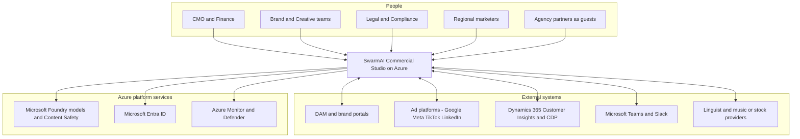

### 3.2 Logical architecture (containers)

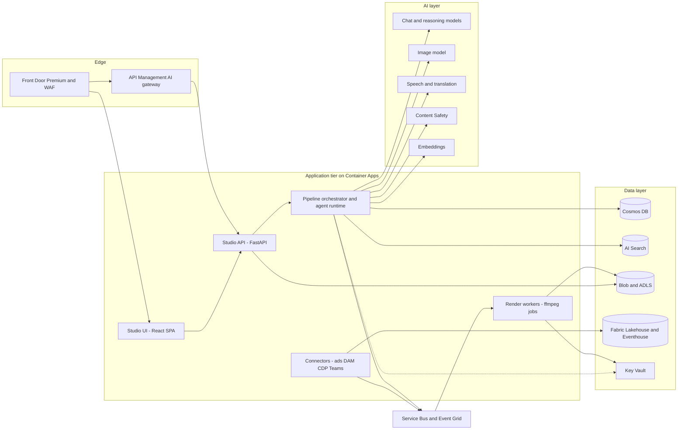

| Container | Responsibility | Scale unit |
|-----------|----------------|-----------|
| **Studio UI** (React + Vite + TypeScript) | Workspace, approvals, Guardian reports, library, experiments, cost meter, ROI calculator, Feature Map | Static assets via CDN |
| **Studio API** (FastAPI, Pydantic v2) | REST + SSE, auth, RBAC, rate limits, budget guard, feature registry (`/api/features`), health/readiness | Replicas by HTTP concurrency |
| **Pipeline orchestrator** | State machine, stage gates, agent runs, retries, Guardian auto-revise loop, metering, audit | Replicas by queue depth |
| **Render workers** | ffmpeg compositor jobs, format factory, loudness, captions, manifests | Container Apps jobs, event-driven (one execution per job) |
| **Connectors** | `AdPlatformConnector`, DAM, CDP, Teams/Slack webhooks | Functions or Container Apps jobs on timers/events |

## 4. Agent crew topology and pipeline

The crew is a **deterministic pipeline with generative stages** (ADR-09). Each stage has an owner agent, a Guardian evaluation and a human gate. Agents call tools only through an allow-list (retrieve from Brand Brain, check claims, check rights, generate image/speech, render, translate, score).

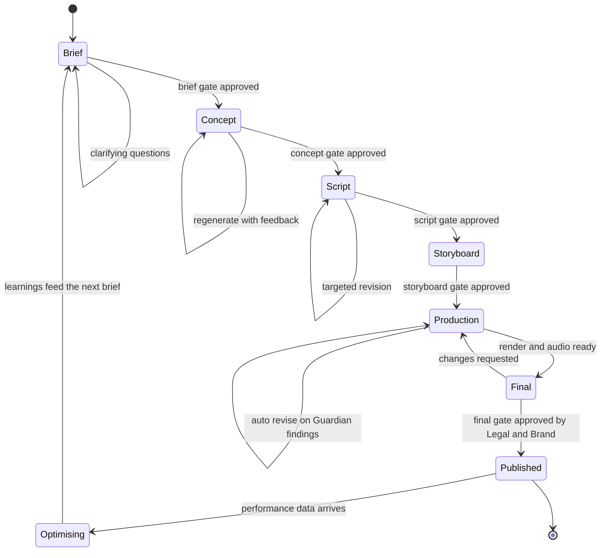

**Guardian auto-revise and approval gating**

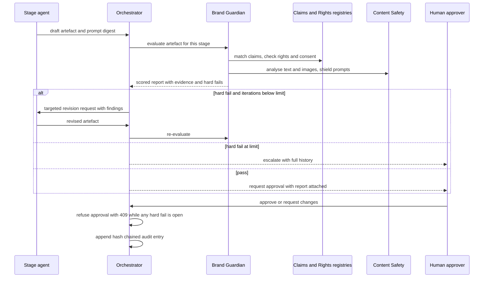

| Stage | Agent | Tools (allow-list) | Guardian checks | Gate role |
|-------|-------|--------------------|-----------------|-----------|
| Brief | Briefing | Brand Brain retrieval, claims coverage lookup | Completeness, category risk | Brand Manager |
| Concept | Strategist | Retrieval, learnings, claims check | Claim risk, voice | Creative Director |
| Script | Copywriter | Retrieval, claims check, speech-rate calculator | Claims, disclaimers, voice, forbidden words | Creative Director, Legal |
| Storyboard | Art Director | Image generation, style bible, palette tools | Visual identity, Content Safety (image), protected material | Creative Director |
| Production | Director, Sound Designer, Localizer | `VideoProvider`, TTS, translator, rights-cleared music | Rights, loudness, caption timing, per-market claims | — |
| Final | Format factory | ffmpeg, overlay templates | Legal supers, safe areas, rights per market and channel, disclosure | Legal, Brand |
| Optimise | Media Analyst | Connector, bandit, insights writer | Insight provenance | Performance marketer |

## 5. Azure service map

| Layer | Target service | Why | Alternatives considered |
|-------|----------------|-----|-------------------------|
| Models | **Microsoft Foundry Models** — GPT chat/reasoning (`gpt-5.x`), image (`gpt-image-1.5`/`-2`), embeddings, TTS; deployment types *Global Standard* (default), *Data Zone Standard* (EU residency) [L-DEPLOY] | First-party, enterprise terms, Entra auth, Content Credentials on images, quota per deployment | Direct third-party APIs (no tenant control), self-hosted models (ops burden, GPU policy) |
| Generative video | **Cinematic motion (implemented, CS-25):** open **Wan 2.2** image-to-video on **Container Apps serverless GPU** (A100, scale-to-zero, queue + blob contract) behind `VideoProvider`; for hero footage (lever E1) optionally **partner video models** from the Foundry catalog (fal: Kling, LTX, MiniMax — hosted outside Microsoft's facilities [L-FAL]) | Generated footage inside the same Guardian, Content Safety, provenance and approval gates, kept in the tenant, priced per GPU second (partner models: per generated second) | Azure OpenAI Sora 2 (retired 2 Nov 2026); always-on GPU VMs / AKS (blocked by policy, idle cost) |
| Agents | App-level orchestrator now; **Microsoft Agent Framework** and **Foundry Agent Service** as options for managed agent hosting and tracing [L-AGENTS] | Deterministic pipeline with generative edges (ADR-09); frameworks can host individual stage agents | Fully autonomous multi-agent loops (unpredictable cost and compliance) |
| Safety | **Azure AI Content Safety** — text, image, protected material, Prompt Shields, groundedness detection, custom categories [L-CS] | Native, regional, consistent with model content filters | Home-grown classifiers |
| Search | **Azure AI Search** — hybrid (vector + keyword) with semantic ranker [L-SEARCH] | Brand Brain and DAM retrieval with citations at scale, security trimming | pgvector, Cosmos vector (viable at small scale) |
| Operational data | **Cosmos DB for NoSQL** (autoscale, zone-redundant, multi-region), Entra RBAC | Document model for versions/gates/audit, partition per tenant, predictable latency | Azure SQL / PostgreSQL (more joins, less elastic) |
| Assets | **Blob Storage / ADLS Gen2** (ZRS, immutable policies for audit/provenance), **Front Door** CDN | Cheap, durable, signed delivery; no public blobs | Managed disks, third-party DAM only |
| Compute | **Azure Container Apps** (consumption, zone-redundant) with **jobs** for render [L-JOBS] | Scale to zero, event-driven jobs, no cluster ops, policy fit (no VMs/AKS pools) | AKS, App Service, Functions, Batch (kept as burst option) |
| Eventing | **Service Bus** (commands, retries, DLQ) + **Event Grid** (domain events, expiry alerts) | Reliable job fan-out and decoupled notifications | Storage queues, Event Hubs (stream scale not needed) |
| Edge | **Front Door Premium + WAF** with Private Link to Container Apps origins [L-AFD] | Global entry, DDoS/WAF, CDN, private origins | App Gateway |
| API governance | **API Management** as AI gateway: token limits, content-safety policy, usage metering per consumer [L-APIM] | Multi-tenant quotas and chargeback | Custom middleware |
| Analytics | **Microsoft Fabric** (Lakehouse, Eventhouse/Real-Time Intelligence) + Power BI; Synapse/ADX as alternatives | Performance data and marketing analytics; OneLake sharing with CDP | Synapse (legacy), ADX only |
| Identity | **Microsoft Entra ID** with **B2B** for agency guests, app roles, Conditional Access [L-B2B] | Enterprise SSO; guests scoped to campaigns | Custom auth |
| Secrets & keys | **Key Vault** (Premium/Managed HSM for signing keys) | Provenance signing; no secrets elsewhere | — |
| Language | **Azure AI Speech**, **Azure AI Translator** (glossaries), **Azure AI Language** (PII) | Multilingual voices, deterministic terminology | LLM-only translation |
| Documents | **Azure AI Document Intelligence** | PDF/Office layout extraction at scale | Text-only extraction |
| Governance | **Microsoft Purview**, **Defender for Cloud**, **Azure Policy** | Lineage, classification, posture | — |
| Observability | **Azure Monitor**, **Application Insights** (OpenTelemetry), Log Analytics | Traces, metrics, cost counters, alerts | Third-party APM |
| Delivery | ACR, GitHub Actions or Azure DevOps, **Bicep + azd** | Reproducible IaC, remote builds | Terraform |

## 6. Data architecture

### 6.1 Logical data model

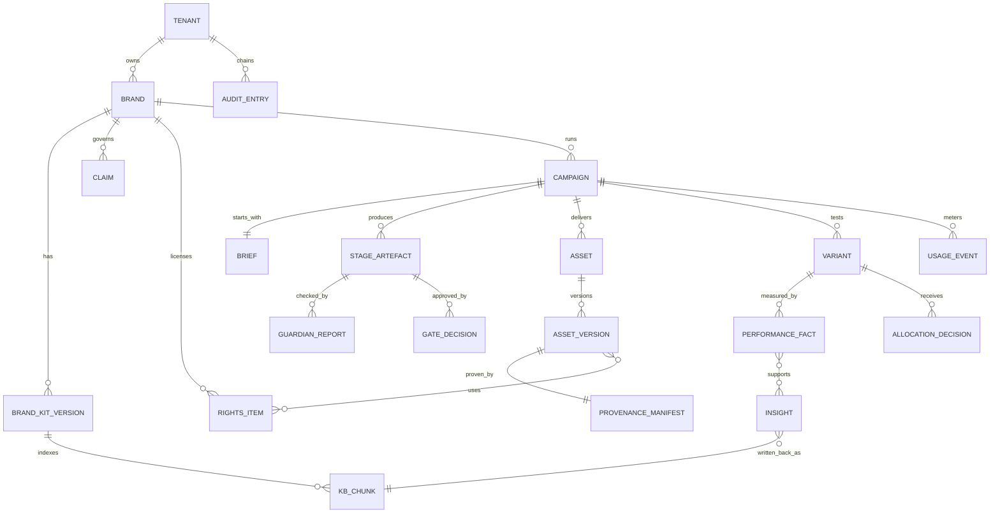

| Store | Contents | Partition / key | Notes |
|-------|----------|-----------------|-------|
| **Cosmos DB** | Tenants, brands, Brand Kit versions, claims, rights, campaigns, briefs, artefacts, Guardian reports, gate decisions, variants, allocations, insights, usage events, audit chain, job table | `/tenantId` (+ synthetic key `tenantId:campaignId` for hot campaigns); audit chain per tenant | Entra RBAC (`Cosmos DB Built-in Data Contributor`), change feed drives expiry alerts and analytics sinks, TTL for transient jobs |
| **AI Search** | Brand Brain chunks (vectors + text + citations), claims, DAM asset embeddings | Index per tenant (or security filter on `tenantId` for small tenants) | Hybrid + semantic ranker; integrated vectorisation optional |
| **Blob / ADLS** | Source documents, key-frames, stems, renders, SRT/VTT, sidecar manifests, campaign packs | Container per tenant, path `campaign/asset/version/` | ZRS; immutability (WORM) policy on manifest and audit-export containers; media served only through the API or signed CDN URLs |
| **Fabric OneLake** | Performance facts (impressions, clicks, VTR, CVR, CPA, ROAS), variant dimensions, cost events | Lakehouse Delta tables by platform/day | Shared with CDP and Power BI semantic model |
| **Key Vault** | Provenance signing keys, webhook signing secrets for customers who need them | — | HSM-backed keys; sign operations only |

### 6.2 Brand Brain retrieval

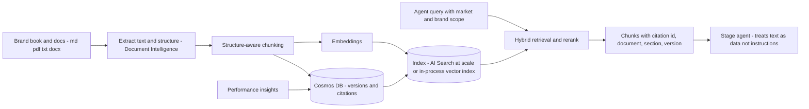

Retrieved text is **untrusted data** (prompt-injection aware): it is delimited, never concatenated into system instructions, and tool calls are restricted by an allow-list; outputs are schema-validated.

### 6.3 Rights, consent and provenance data

* **Rights items** carry rights-holder, licence id, territories (ISO 3166), channels, windows, exclusivity, restrictions and an explicit **AI-use consent** flag for likeness and voice. A rights check takes an asset's declared uses × markets × channels × date and returns pass/block with reason codes; the same function runs at voice/music selection (CS-09), at Guardian time (CS-12) and at export/publish (CS-22).
* **Provenance manifest** per asset version: asset hash, generator, actions (created, edited, composed), models and tools (deployment names), prompt digests (hashes), inputs (Brand Kit version, rights ids), approvals, ingredients (parent manifests) and a signature. The **audit chain** stores `hash(prev || entry)`; manifests reference the audit head at approval time.
* **Retention:** audit and manifests retained per customer policy (default 7 years) in immutable storage; working files purge after the campaign window.

### 6.4 Performance data flow

`AdPlatformConnector` (Google, Meta, TikTok, LinkedIn adapters; CSV importer; simulator) → Service Bus → Fabric Eventhouse/Lakehouse → variant metrics → bandit allocator (Container Apps job) → allocation decisions back to Cosmos DB and, when connectors have write scope, to the ad platform → insight generator (reasoning model) → Brand Brain.

## 7. AI architecture

### 7.1 Model layer

| Capability | Interface | Deployment (target) | Demo slice | Used by |
|------------|-----------|---------------------|-----------|---------|
| Text, structured output | `LLMClient` | `chat` = gpt-5.4-mini (default), `nano` for cheap classifiers | `chat` = gpt-5.4-mini | CS-04, 06, 10, 12, 16 |
| Reasoning | `LLMClient` | `reasoning` = gpt-5.4 (strategy, insights, regulated-category Guardian) | gpt-5.4 | CS-05, 12, 18 |
| Vision | `LLMClient` (image input) | gpt-5.x vision for frame QA and DAM tagging | via chat deployment | CS-07, 12, 21 |
| Image | `ImageClient` | `gpt-image-1.5` (`-2` for premium, approval-gated) | gpt-image-1.5 or `-mini` (low quality, small size) | CS-07, 08 |
| Embeddings | `EmbeddingClient` | `text-embedding-3-small`/`large` | text-embedding-3-small | CS-01, 02, 16, 21 |
| Speech | `SpeechClient` | `tts-hd` + Azure AI Speech neural voices; transcription for QA | `tts-hd` for English; Azure AI Speech neural voices through the same AI Services account for other languages, with automatic fallback | CS-09, 10 |
| Translation | `LLMClient` + Translator adapter | LLM transcreation + Translator glossaries | LLM only | CS-10 |
| Safety | `SafetyClient` | Content Safety (text, image, protected material, Prompt Shields) | Content Safety via the AI Services account | CS-12 |
| Video | `VideoProvider` | ffmpeg compositor (default) + external video-model provider | ffmpeg compositor | CS-08, 11 |

**Deployment types.** *Global Standard* is the default; *Data Zone Standard* keeps processing within the EU data zone (list price 10 % higher — modelled by `ai_price_uplift_pct`); *Provisioned* capacity is not used (ADR-07) because the workload is bursty and low-QPS [L-DEPLOY]. Quotas are requested per deployment with fallback deployments in a second data zone region.

### 7.2 `VideoProvider`: ffmpeg compositor + Cinematic motion (generative video on serverless GPU)

Azure OpenAI's Sora 2 is **retired** — a new `sora-2` deployment is refused with `ServiceModelDeprecated` since 2 Nov 2026 and no other first-party video model exists in any of the 65 regions checked on 18 Nov 2026 — and any single video model is a poor foundation for a governed pipeline (availability, licensing, safety posture and cost change quickly). Spotlight therefore defines a provider contract, uses the ffmpeg compositor as the editor of every render, and adds a **Cinematic motion** stage that turns each approved storyboard keyframe into a real, generated video clip:

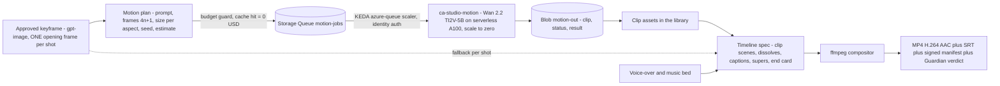

* **Compositor features:** key-frames with Ken-Burns/pan/parallax motion, transitions, VO + music bed with ducking, burned-in captions + SRT/VTT, logo and brand end-card, EBU R128 loudness (default −23 LUFS; online profile −16 LUFS), H.264/AAC.
* **Contract:** `render(spec) → artefact`; the spec hash makes renders idempotent and cacheable; capabilities (max duration, aspect ratios, audio) are negotiated so the format factory can choose a provider per output.
* **Honesty:** two quality levels, named in the UI and in the manifest. **Preview** is the compositor animating stills (Ken-Burns / pan / parallax) — fast, free and *not* generative. **Cinematic** is generative video: every shot is a model-generated clip (real subject and camera motion) that starts from the approved keyframe, and each spot reports how many shots were generated, served from cache or fell back to the still path.
* **Cinematic motion (CS-25, implemented and deployed).** Model: **Wan 2.2 TI2V-5B** (Apache-2.0, no territory restrictions), served by a worker container on an **Azure Container Apps serverless A100** (`Consumption-GPU-NC24-A100`) in the Studio's own environment: scale-to-zero, per-second billing, **no ingress**, its own managed identity (queue consumer + blob read/write; no access to Cosmos or Azure OpenAI), weights mirrored into the tenant's Blob. Studio and worker talk only through a **queue + blob contract v1** (`contracts/motion-v1.schema.json`): deterministic job ids (idempotent, transport-level cache), status/result blobs, visibility-timeout heartbeat, poison-message guard; KEDA starts the worker from zero in about 16 s with identity authentication. **Measured on the deployed A100 (18 Nov 2026):** 1024×576, 20 steps ≈ 0.75 s of GPU time per generated frame (55 s for a 3 s clip, 88 s for 4.5 s); cold start ≈ 3.7 min (image pull + weights) and 12 s to load the model. **Cost = worker GPU seconds × US$0.00108** (A100 US$0.000688/s + 8 vCPU + 64 GiB at swedencentral retail prices) — about US$0.06–0.10 per shot, **≈ US$0.35–0.45 for a four-shot spot**; the app meters the *actual* worker seconds against the daily and per-campaign caps (CS-15) and a cached shot costs US$0. **The environment holds quota for one A100** (more is a quota request), so shots render sequentially.
* **Alternatives considered for the same slot.** (1) *Sora 2 on Azure OpenAI* — retired. (2) *fal models on Microsoft Foundry (preview) — Kling v3 Pro, LTX 2.5 Fast/Pro, MiniMax H3: US$0.08–0.22 per generated second, nothing to operate, higher fidelity and native audio* — but **they run outside Microsoft's facilities: prompts and keyframes are sent to fal and the Microsoft DPA and product terms do not apply** [L-FAL]. A customer can adopt them behind the same `MotionClient` seam after an explicit legal decision; the reference implementation does not enable them. (3) *Always-on GPU VMs / AKS* — blocked by policy and always-on cost.
* **Controls unchanged and extended:** Content Safety on sampled frames of every generated clip (a flagged clip falls back to the still), the AI-disclosure badge stays burned in, and the provenance manifest gains a `generative_video` assertion (model, revision, licence, host, per-shot seed and prompt digest, GPU seconds).
* **Generative-video provider for hero footage (optional lever E1, roadmap R2-01).** When enabled, a provider submits generated shots into the timeline spec like any other asset. Cost model: **billed per generated second, rejected takes included** — Sora 2 listed at US$0.10 (standard) and US$0.50 (Pro high-res) per second before its retirement; the partner video models now offered in Foundry (fal: LTX 2.5, MiniMax H3, Kling v3) list at about US$0.08–0.22 per second (Azure Retail Prices API, retrieved 18 Nov 2026) — so a kept second costs list price × takes (about **US$0.69** with the model's mix and 3–5 takes, priced on the Sora meters). **Availability varies by region and offering:** Sora 2 is retired [L-SORA], the fal models are a preview that runs outside Microsoft's facilities [L-FAL], and the self-hosted route is bounded by GPU quota, so the provider and region are chosen per deployment and partner-model ACR eligibility is confirmed with Microsoft. Controls are unchanged: Content Safety on sampled frames (Azure AI Content Safety provides no direct video-moderation API: frames are extracted every 1–2 seconds and analysed with the image API [L-CSVID]), likeness and protected-material review, disclosure labels and a provenance manifest per asset.
* **Cost:** render compute is trivial at this volume (about 56 vCPU-seconds per 15 s version → well under US$0.01; the model uses 2.5 vCPU-s per output second × 1.5 overhead) — one reason ACR per asset is low while ROI is high.

### 7.3 Guardrails (defence in depth)

| Layer | Control |
|-------|---------|
| Input | Brief/document sanitisation; Prompt Shields on untrusted content; request-size limits; per-IP and global rate limits |
| Grounding | Brand Brain retrieval with citations; claim-aware prompts (allowed claims in, prohibited list out) |
| Generation | Schema-constrained outputs; tool allow-lists; Content Safety on prompts and outputs; no named artists, brands or real persons in image prompts |
| Evaluation | Guardian: brand voice, identity (palette ΔE, logo clear-space), claims, regulated rules, rights, Content Safety incl. protected material; bounded auto-revise |
| Human | Stage gates; Legal override requires role + reason; separation of duties optional |
| Evidence | Prompt digest, model deployment, Brand Kit version, Guardian report and approvals in the manifest and audit chain |

### 7.4 Evaluation and model change control

* **Offline evaluation sets** (versioned): seeded violation set (prohibited claim, missing disclaimer, forbidden word, palette violation, unlicensed music, expired consent, content-safety hit), compliant controls (zero false blocks), retrieval Q/A (hit@3 ≥ 90 %), localisation glossary and back-translation, bandit simulations (≥ 90 % best-variant convergence), loudness and format conformance.
* **Regression gate** before any model/version change: run the sets on the candidate deployment, compare scores, canary a tenant, then promote. Foundry evaluators and Azure OpenAI evaluation can host these runs (R2-12).
* **Drift monitoring:** Guardian block-rate, first-pass pass-rate, revision rounds and brand-voice similarity are tracked per deployment in Application Insights.

### 7.5 Cost control and metering

* Every call emits a `usage` event (`tenant`, `campaign`, `feature`, `model`, `in/out tokens`, `images`, `chars`, `render_s`, `usd_estimate`) priced from a versioned table aligned with the business-case snapshot.
* **Caps:** per-campaign and per-day budgets, alerts at 50/80/100 %, premium generation (high-resolution images, reasoning model for batch) needs an approver; the demo daily cap defaults to ≤ US$5 and fails closed.
* **Target:** API Management AI gateway enforces token quotas per consumer (`llm-token-limit`) and emits token metrics for chargeback [L-APIM]; Cost Management budgets on resource-group and tag.
* **FinOps levers (not in the Base ACR):** prompt caching (30 % assumed), Global Batch for non-interactive bulk re-checks (about 50 % lower list price), cheaper classifier models for pre-screens, render-cache by spec hash.

## 8. Security & compliance

### 8.1 Identity and multi-tenancy

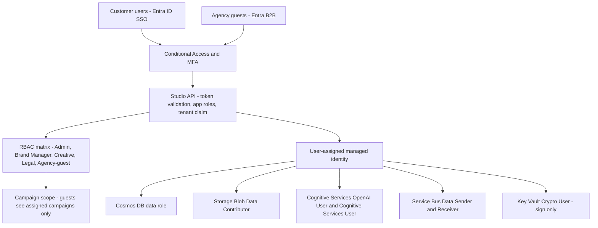

* **Humans:** Entra ID SSO with Conditional Access; app roles map to Admin, Brand Manager, Creative, Legal, Agency-guest; **B2B collaboration** gives agencies guest accounts governed by access packages and access reviews [L-B2B]. Guests see only assigned campaigns and never the claims library or other brands.
* **Workloads:** one user-assigned managed identity per app plane; data-plane roles only; `disableLocalAuth` on Cosmos DB and AI Services; `allowSharedKeyAccess=false` on Storage; no keys, connection strings or SAS tokens in code, env or IaC outputs.
* **Multi-tenant model (agency networks, R2-06):** tenant id on every document and blob path; per-tenant AI Search index and (optionally) per-tenant Cosmos container and Key Vault key; chargeback from the usage meter; for regulated clients a *dedicated stamp* (separate resource group and Cosmos account) is deployed from the same Bicep.

### 8.2 Data protection

| Control | Detail |
|---------|--------|
| In transit | TLS 1.2+ everywhere; Front Door to origin over Private Link in enterprise |
| At rest | Platform-managed keys by default; **customer-managed keys** optional for Cosmos DB, Storage and AI Search |
| Network | Private endpoints for Cosmos DB, Storage, AI Search, Key Vault, Service Bus and Foundry; VNet-integrated Container Apps; Front Door Premium + WAF [L-AFD]; egress allow-list for connectors (no server-side fetch of user URLs) |
| Residency | Data Zone deployments for models; EU-region data stores; no customer data used to train foundation models |
| Privacy | PII redaction in logs; consent metadata minimised; retention and deletion jobs; GDPR roles documented |
| Secrets | None required by the app; signing keys in Key Vault with sign-only permissions |
| Posture | Defender for Cloud (Storage, Key Vault, APIs, AI services), Azure Policy, Purview classification |

### 8.3 Threat model summary

| Threat (STRIDE + AI) | Example | Mitigation |
|----------------------|---------|------------|
| **S**poofing | Guest impersonates an agency user | Entra B2B, MFA, Conditional Access, access reviews |
| **T**ampering | Asset or manifest altered after approval | Content hashes, signed manifest, hash-chained audit, immutable storage, verification endpoint |
| **R**epudiation | "I never approved that" | Gate decisions bound to artefact versions and audit chain; override reasons recorded |
| **I**nformation disclosure | Cross-tenant leakage; brand data in prompts or logs | Tenant partitioning and index scoping, security trimming, PII redaction, private networking, no public blobs |
| **D**enial of service / cost | Runaway generation loop, abusive client | Rate limits, request-size limits, budget caps that fail closed, queue back-pressure |
| **E**levation of privilege | Role bypass; agent calls a tool it should not | Server-side RBAC checks, tool allow-lists, least-privilege managed identity |
| **Prompt injection** | Instruction hidden in a brand document or brief | Untrusted-data delimiting, Prompt Shields, output schema validation, no tool use driven by retrieved text |
| **Harmful or protected content** | Generated imagery resembling protected material, unsafe content | Content Safety (incl. protected material), Guardian hard-fails, human gates, takedown path |
| **Synthetic likeness misuse** | Prompt for a real person's face or voice | No cloning offered; prompts naming real persons blocked; consent registry with AI-use flags; disclosure labels |
| **Hallucinated claims** | Invented product benefit | Claim-aware generation, claims library matching, legal gate, citations |
| **Supply chain** | Vulnerable dependency | Pinned ranges, `pip-audit`/`npm audit`, image scanning, SBOM, non-root containers |

### 8.4 Responsible AI and content credentials (C2PA) flow

Responsible-AI controls follow Microsoft's principles (fairness, reliability and safety, privacy and security, inclusiveness, transparency, accountability) — mapped to features in PRD §16. Azure OpenAI image models attach **Content Credentials** (C2PA manifests signed by a Microsoft-traceable certificate) to every generated image [L-CC]; Spotlight preserves them as *ingredients* and adds a manifest for the composed asset.

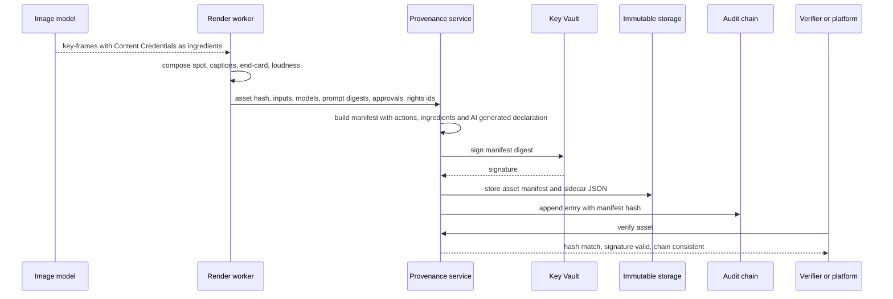

**Status honesty.** The reference implementation's manifest is **C2PA-style** (same concepts; software signing key) and is *not* a CA-issued, C2PA-trusted credential. Production signing uses a key and certificate chain from a C2PA-conformant CA held in Key Vault/Managed HSM (R2-07); the C2PA specification (v2.4 published) and conformance programme define the target [S-C2PA]. Disclosure labels (EU AI Act Article 50 from 2 August 2026, with a marking grace period to December 2026 for systems already on the market [S-EC]; platform policies) are recommended per market/platform and recorded in the manifest.

### 8.5 Consent and deepfake safeguards

1. **No voice cloning or celebrity imitation** is exposed; approved voices only; requests are refused and logged.
2. **Consent registry** records AI-use consent for likeness and voice, territories, channels and windows; a missing or expired consent hard-fails the Guardian and blocks export.
3. **Prompt policy:** image and speech prompts that name real people are rejected before generation.
4. **Disclosure by default** for realistic synthetic people in EU distribution; labels recorded in the manifest.
5. **Audit:** every use of a talent item is linked to the asset version and gate decision.

## 9. Integration architecture

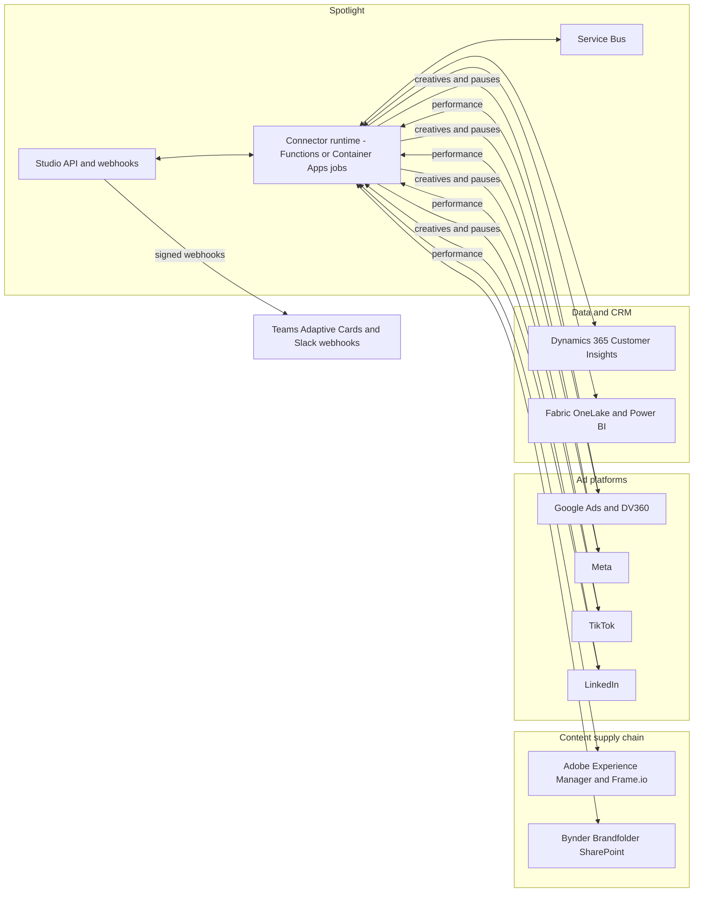

| Integration | Pattern | Contract | Release |
|-------------|---------|----------|---------|
| DAMs / brand portals | Pull brand assets in, push approved assets out; metadata mapping | REST/connector SDKs; asset + manifest sidecar | R2-04 |
| Ad platforms | Read performance; push creatives, pause losers, apply allocations | `AdPlatformConnector` (read, write, capabilities) — simulator in Release 1, CSV importer | R2-03 |
| Dynamics 365 Customer Insights / CDP | Audience segments in; learnings and variant results out; OneLake sharing | Dataverse/OneLake | R2-02 |
| Teams / Slack | Signed webhooks with Adaptive Card / message-card payloads for approvals, SLA breaches, rights expiry, budget alerts | HMAC-signed HTTP, retries | Release 1 (payloads), R2-10 (Teams app) |
| Campaign pack | Zip of MP4/PNG/CSV + manifests + hash index | Documented schema | Release 1 |
| REST API | OpenAPI for every feature; Entra tokens in production | `/docs` | Release 1 |

## 10. Deployment topology

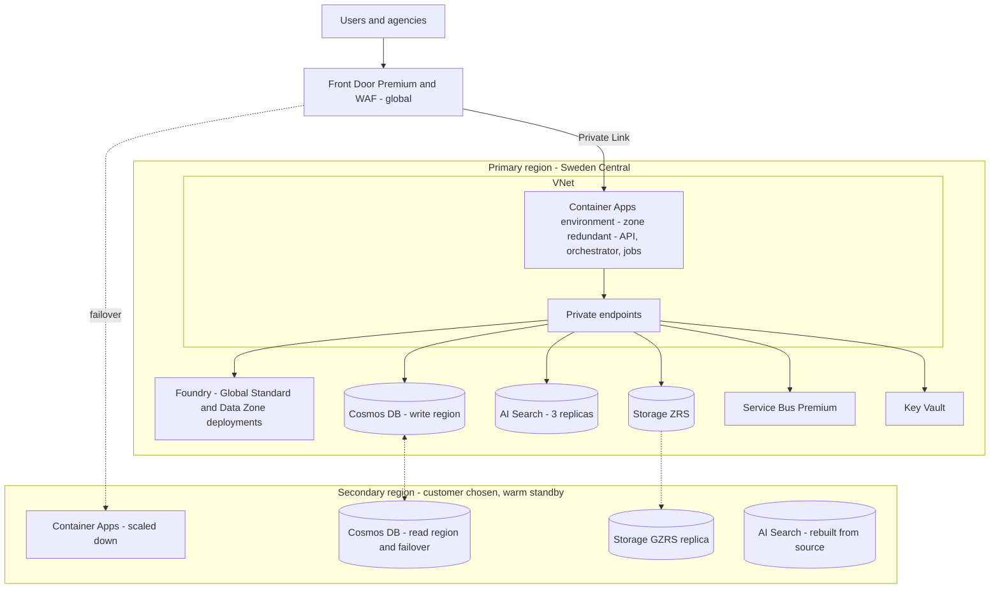

* **Zone redundancy** for Container Apps, Cosmos DB, Storage (ZRS) and AI Search (replicas); **Front Door** is global; **second region** is warm standby (Cosmos multi-region, storage replication, AI Search rebuilt from source or replicated, Container Apps scaled to minimum) — RPO ≤ 15 min, RTO ≤ 4 h (NFR-06).
* **Render workers** are Container Apps *jobs* (event-driven from Service Bus, one execution per render, scale to hundreds in parallel; Azure Batch is the burst option for very large re-renders) [L-JOBS].
* **CDN:** Front Door caches media with signed URLs; origins are private; blobs are never public.
* **Environments:** dev, test/UAT (35 % of production fixed cost in the business case), production; the demo slice is a single environment.

## 11. Reliability, performance & scalability

**Resilience patterns:** queue-based load levelling; idempotent jobs keyed by spec hash; retries with exponential back-off and dead-letter queues; circuit breakers and fallback deployments for model calls; render cache; graceful degradation (if image generation is throttled, the UI queues requests and shows ETA; Guardian never degrades to "pass").

**Capacity model — Contoso at full adoption (50,000 versions a year, 400 users, from the business-case assumptions)**

| Dimension | Derivation | Average business day | Peak design point |
|-----------|-----------|----------------------|-------------------|
| Approved versions | 50,000 ÷ 250 days | **200** | **2,000** (10×) |
| Pipeline tokens | ≈ 120 K tokens per version (adaptation + 3 Guardian checks × 1.3 loop + localisation) | ≈ 24 M | ≈ 240 M |
| Interactive tokens | 400 users × 25 actions × 3 calls × 16.4 K tokens | ≈ 490 M | ≈ 490 M (+ pipeline peak) |
| Model throughput (8 h window, 2× hour peak) | total tokens ÷ 480 min × 2 | ≈ 2.1 M TPM | ≈ 3.1 M TPM across mini and reasoning deployments |
| Images | ≈ 1,700 a day (campaign frames, statics, interactive) | ≈ 1,700 | ≈ 17,000 → about 35 images/min over 8 h |
| Video renders | 36 % of versions × 56 vCPU-s | ≈ 72 renders ≈ 1.1 vCPU-h | ≈ 720 renders ≈ 11 vCPU-h — a few minutes on 20 parallel 2-vCPU jobs |
| Storage growth | 12 MB per video, 1.5 MB per static, ×3 for working files | ≈ 0.9 GB a day | ≈ 9 GB a day |

*The binding constraints are model quota (TPM, images per minute) and human gates, not compute.* Interactive co-creation dominates token demand — protect it with per-user and per-tenant token limits at the gateway and request quota accordingly; calibrate with the live meter.

**Performance targets:** NFR-01 … NFR-04 (PRD §8): API p95 < 300 ms; script/copy p95 < 25 s; 15 s master render ≤ 3 min p95; 2,000 versions a day.

**Measured in the demo slice** (17–18 Nov 2026; [REPORT-TEST-AND-DEPLOYMENT.md](REPORT-TEST-AND-DEPLOYMENT.md) §5–§6). Light load — 400 requests at concurrency 20 against one 1-vCPU replica and Cosmos DB serverless — gave **p50 554 ms, p95 1,414 ms, p99 2,000 ms, 0 errors, ≈ 29 requests/s**, including ≈ 40–60 ms of WAN round trip. That is above the NFR-01 target, as expected for a single replica; the first run (p95 3,450 ms) was cut by Cosmos field projections, concurrent per-campaign lookups and `limit=1` gate lookups, and the target architecture adds replicas, provisioned throughput and caching. Long work runs in the background job runner with SSE progress: four `gpt-image-1.5` keyframes ≈ 90 s, a 15 s 720p spot ≈ 24 s of render on one vCPU, localisation ≈ 33 s per language. The 24 vCPU-seconds per 720p spot is the same order as the capacity model's 56 vCPU-seconds per 1080p render (1080p has 2.25× the pixels), which supports the render sizing above; p95 over many runs and 1080p masters were not measured.

## 12. Cost & ACR drivers

The business case builds ACR **bottom-up per service family** (units × Azure Retail Prices API list price; PAYG, USD; retrieved 17 Nov 2026; no EA discount). Base scenario for the reference customer (US$): **Year 1 65 k → Year 2 305 k → Year 3 465 k** (direct 389 k + pull-through 76 k; pull-through ratio 0.20).

| Family (Year 3, US$) | Value | Main driver |
|----------------------|------:|-------------|
| Azure OpenAI — text, vision, embeddings | 202 k | Interactive co-creation (users × actions × calls), Guardian checks, localisation, campaign agents |
| Azure OpenAI — image generation | 18 k | Frames, statics, key-art, attempts per accepted image |
| Speech & translation · Content Safety | 2 k | Characters synthesised, records and images checked |
| AI Search | 29 k | Search units × hours (S1, 3 replicas × 2 partitions) + semantic ranker |
| Cosmos DB | 12 k | Autoscale RU/s × regions + storage |
| Blob/ADLS + Front Door | 7 k | GB stored, delivered GB, Premium base fee |
| Container Apps (app + render) · Service Bus/Event Grid | 26 k | Replicas, render vCPU-seconds · base units and events |
| Fabric analytics | 32 k | Capacity units × hours (F16-class, paused outside windows) |
| Monitoring, security, API gateway, private networking | 61 k | Log ingestion, Defender, Purview, API Management, private endpoints |
| Pull-through (DAM archive, data platform, security/network) | 76 k | Archive migration (150 TB), extra Fabric capacity, landing-zone security |

Steady-state ACR by tier: pilot US$20 k, one brand US$101 k, global portfolio US$514 k, agency network US$2.05 M, **enterprise scale US$2.63 M** a year; Azure cost per approved version US$9.15 direct (≈ 40 % fixed platform), all-in Studio cost per version US$54 versus ≈ US$3,957 agency blend per asset today (outputs.json). At campaign scale Azure is **5.3 %** of customer benefit — the architecture should therefore optimise for *governance, quality and adoption*, not for shaving model spend.

**The demo slice itself — measured, not modelled** ([REPORT-TEST-AND-DEPLOYMENT.md](REPORT-TEST-AND-DEPLOYMENT.md) §8). Every Azure OpenAI, Content Safety and Speech call passes through the CS-15 meter at list-price estimates. The whole verification campaign (five full smoke runs, three browser-journey runs and manual checks) consumed **US$0.80** of AI spend — about **US$0.17 per full 30-check smoke run**. The always-on slice (one 1-vCPU Container App at idle rates, Container Registry Basic, Cosmos DB serverless, Storage LRS, Log Analytics and Application Insights within their free allowance) costs **≈ US$30 a month idle**, or **≈ US$5** with scale-to-zero (≈ 15 s cold start). These are demo figures; the business-case ACR above remains the bottom-up model.

### 12.1 Expansion levers E1–E4 and the enterprise-scale ACR path (Release 2+)

The Base case is the Release-1 campaign studio. Four optional levers (ADR-15) show where larger Azure consumption comes from; each carries its own consumption, benefit and non-Azure cost in the business case and is metered separately in the target design (the CS-15 meter tags consumption by lever; budgets and caps per lever; premium generation stays behind the CS-15 approval gate).

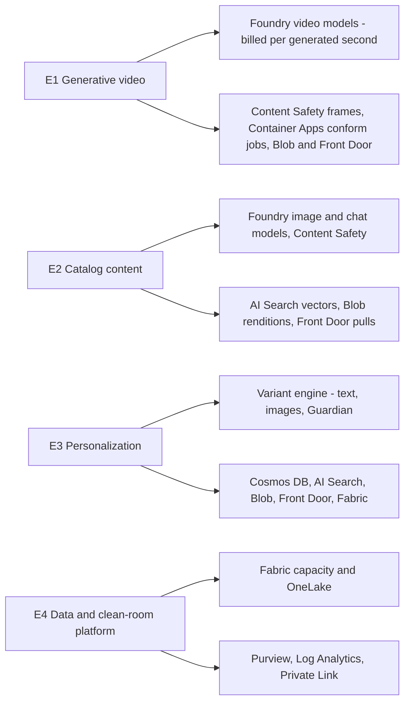

| Lever | Azure services and what drives the bill | ACR Year 3, reference customer (all four on) | ACR steady state, enterprise scale |
|-------|-----------------------------------------|---------------------------------------------:|-----------------------------------:|
| **E1** Generative video (`VideoProvider`) | Foundry Models video (Sora 2 or partner models): generated seconds × takes × per-second list price; Content Safety on sampled frames; Container Apps conform jobs; Blob + Front Door | US$21 k | US$73 k |
| **E2** Catalog-scale product content | `gpt-image-1.5` and chat models: SKUs × markets × presence × images × refresh × attempts; Content Safety; AI Search vectors; Blob renditions; Front Door pulls | US$48 k | US$246 k |
| **E3** Audience-level personalization | Variant engine: text and Guardian tokens, image variations, Cosmos DB, AI Search, Blob + Front Door, Fabric segment analytics — personalised versions at 5–20× per approved version | US$128 k | US$541 k |
| **E4** Marketing data & clean-room platform | Fabric capacity (F128 → F256) × hours, OneLake TB, Purview, Log Analytics | US$279 k | US$580 k |
| **Total** | | **US$475 k** (on top of US$465 k core) | **US$1.44 M** (plus US$1.19 M core at that scale) |

* **Enterprise-scale footprint** (assumption-driven profile: 150,000 versions, 20 markets, 1,000 users, 40,000 SKUs, personalization 10×): AI Search S2 × 4, Cosmos DB 20,000 RU/s in two regions, 14 app replicas, Service Bus Premium × 2, API Management Standard v2 × 3, Fabric F256 for E4 — **US$2.63 M a year in total**, about five times the campaign-scale baseline (US$514 k).
* **What the architecture must provide for the levers:** per-region and per-offering `VideoProvider` selection (Sora 2 is retired [L-SORA]; the self-hosted GPU route needs serverless-GPU quota in the region [L-GPU]; the fal partner models run outside Microsoft's facilities [L-FAL] and need an explicit legal decision — confirm ACR eligibility with Microsoft); Fabric capacity sizing and pause schedules (the largest single line); AI Search scale-out for the catalog and personalised-version index; Front Door Premium for delivery; consent and segment rules as data for E3; PIM / CDP connectors as integration adapters.
* **Honest unit economics (list price):** about US$0.69 per kept generated video second, US$0.20 per kept catalog image (US$0.22 all-in), US$0.21 per personalised version (US$0.36 all-in) — cents per image and dollars per second — so ACR grows from the data platform, personalization scale and customer breadth, not from per-asset intensity.

## 13. Observability

* **Telemetry:** `azure-monitor-opentelemetry` → Application Insights (workspace-based) + Log Analytics; request IDs propagate through queue messages; structured JSON logs with PII redaction.
* **Mandatory endpoints:** `/healthz` (liveness), `/readyz` (Cosmos, Storage, Azure OpenAI reachability), `/api/meta`, `/api/usage` (usage meter and budget status), `/api/features` (feature registry for the Feature Map).
* **Business signals (custom metrics/events):** cost per approved asset, Guardian block-rate and first-pass pass-rate, revision rounds, gate latency vs SLA, render duration, queue depth, allocation decisions, manifest verification failures, budget-cap hits.
* **Alerts and SLOs:** availability 99.9 %, API p95, render p95, DLQ depth, budget at 80/100 %, audit-chain verification failure (page), Defender alerts; workbook "Studio operations" and Power BI cost/quality dashboard.

## 14. DevSecOps & IaC

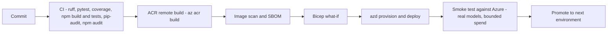

* **IaC:** Bicep modules (identity, data, AI, compute, edge, monitoring) with `azure.yaml` for `azd up`; the Container App is created with a placeholder image, then the real image is built remotely and rolled out (avoids the AcrPull chicken-and-egg); idempotent and re-runnable; outputs are URLs only.
* **Policy:** Azure Policy and Defender for Cloud in enterprise landing zones; secret scanning in CI; branch protection and signed commits.
* **Testing:** unit, API/behavioural and Playwright tests; deterministic stubs for AI calls; smoke test with a PASS/FAIL table; load check on read endpoints; teardown documented (`azd down --purge --force`).
* **Demo-subscription tagging (sandbox convention).** In the managed demo subscription, policy modifies new Storage/Cosmos/Key Vault resources to disable public network access and shared-key auth **unless** the resource group *and* resources carry `SecurityControl=Ignore` and `SecurityExemption=StorageAccountKeyAccess`, plus `project=SwarmAI`, `concept=studio`, `owner=michalfu`, `environment=demo`. These tags are **demo/sandbox conventions for a managed subscription**; the app is nevertheless keyless. **Production landing zones should not use the exemption** and instead apply private endpoints, disabled public access and policy-compliant patterns (§8.2).

## 15. Well-Architected pillar checklist

Aligned to the Azure Well-Architected Framework pillars and its AI-workload guidance [L-WAF].

| Pillar | Key design choices | Status |
|--------|--------------------|--------|
| **Reliability** | Zone redundancy, multi-region warm standby, queue-based load levelling, idempotent jobs, fallback model deployments, DR drills | Target; idempotent jobs and retries in Release 1 |
| **Security** | Keyless identity, Entra + B2B, private endpoints, WAF, Key Vault signing, Prompt Shields, tenant isolation, audit chain, Defender | Keyless, RBAC, audit, safety in Release 1; network controls Target |
| **Cost Optimization** | Consumption compute, scale-to-zero jobs, model right-sizing, prompt caching, Batch for bulk, budget caps, cost per approved asset | Caps and meter in Release 1 |
| **Operational Excellence** | IaC, CI/CD, smoke tests, OpenTelemetry, runbooks, evaluation sets, feature registry | Release 1 |
| **Performance Efficiency** | Stateless API, event-driven render jobs, hybrid retrieval, CDN, render cache, quota planning | Partly Target (AI Search, Front Door) |
| **Responsible AI** (AI workload lens) | Guardian, Content Safety, human gates, disclosure, provenance, consent, bias review, transparency labels | Release 1 |

## 16. Architecture decision records

| ADR | Decision | Alternatives considered | Consequences |
|-----|----------|-------------------------|--------------|
| **ADR-01** | **Azure Container Apps (consumption) + jobs** as the compute platform | AKS, App Service, Functions, Azure Batch | Scale-to-zero and event-driven jobs without cluster ops; fits policy (no VMs/AKS pools); long GPU-class work would need Dedicated profiles or Batch |
| **ADR-02** | **`VideoProvider` interface; the ffmpeg compositor edits every spot, and a Cinematic motion stage supplies generated clips** (Preview = stills with camera moves, Cinematic = AI video) | Depend on one hosted video model (Sora); stills-only | Survives model retirement (Sora 2 retired on 2 Nov 2026) and degrades per shot to the still path; Cinematic costs GPU time and is labelled, metered and gated like every other AI call |
| **ADR-03** | **Cosmos DB for NoSQL** (partition `/tenantId`, Entra RBAC) for operational data | Azure SQL, PostgreSQL | Elastic, document-shaped versions/gates/audit; limited ad-hoc joins (analytics go to Fabric) |
| **ADR-04** | **In-process vector index (numpy) persisted to Cosmos/Blob in the demo; Azure AI Search hybrid + semantic ranker for scale** behind `BrandIndex` | AI Search from day one, pgvector, Cosmos vector | Zero always-on search cost in the demo; identical retrieval contract; migration is an adapter swap |
| **ADR-05** | **Keyless identity**: managed identity + RBAC; local auth disabled | Keys, connection strings, SAS | No secret sprawl; every dependency must support Entra auth (all used services do) |
| **ADR-06** | **Hash-chained audit + C2PA-style manifest now; C2PA-conformant signing later** | Adopt full C2PA signing immediately; no provenance | Honest, testable provenance in Release 1; trusted credentials need a CA-issued certificate (R2-07) |
| **ADR-07** | **Global Standard by default, Data Zone for EU tenants; no Provisioned Throughput** | PTU reservations | Pay per token; +10 % for Data Zone; throughput guarantees come from quota and gateway limits, not reservations |
| **ADR-08** | **Guardian = deterministic rules + retrieval + LLM judge + Content Safety** | LLM-only or rules-only | Explainable, testable, cheaper; rules need curation; judge covers paraphrase |
| **ADR-09** | **Pipeline state machine with stage gates; agents act inside stages** | Autonomous multi-agent loops | Predictable cost and compliance; less emergent behaviour (by design) |
| **ADR-10** | **Thompson-sampling bandit for budget allocation with significance tests and auto-pause** | Fixed A/B splits, contextual bandits | Faster convergence, less waste; contextual bandits and MMM follow in R3 |
| **ADR-11** | **Logical multi-tenancy** (tenant partition + per-tenant index + B2B guests), dedicated stamps for regulated clients | Separate deployment per client | Efficient for agencies; strong isolation tests required |
| **ADR-12** | **Every AI dependency behind an interface with an Azure implementation and a deterministic stub** | Direct SDK calls | Network-free CI; vendor flexibility; small abstraction cost |
| **ADR-13** | **Microsoft Fabric (Lakehouse + Eventhouse) for performance analytics at scale** | Synapse, ADX only | OneLake sharing with CDP/Power BI; Fabric capacity is an always-on cost (paused outside windows in the model) |
| **ADR-14** | **API Management as AI gateway** (token limits, content-safety policy, metering) in the enterprise target | App-level limits only | Per-tenant quotas and chargeback; adds a hop and a fixed cost (≈ US$22 k a year Standard v2 ×2) |
| **ADR-15** | **Expansion levers E1–E4 are separate, optional and separately metered** (generative video, catalog content, personalization, data & clean-room platform); the video lever is selected per region behind `VideoProvider` | Bundle them into the base platform; hard-wire one video model | Base stays Release-1 scope and auditable; each lever has its own cost, benefit, budget cap and exit criteria; ACR potential is visible without being promised; per-region provider choice adds configuration |
| **ADR-16** | **Self-host an open video model (Wan 2.2 TI2V-5B, Apache-2.0) on Container Apps serverless GPU** inside the Studio's environment | Sora 2 (retired); fal models on Foundry (data leaves Microsoft's facilities, DPA does not apply, preview); GPU VMs / AKS (policy, idle cost); no generative video | Data stays in the tenant, scale-to-zero with per-second billing (≈ US$0.00108/s), no vendor lock-in and a permissive licence; the team owns model upgrades, GPU quota (one A100 per environment today) and cold starts (≈ 4 min, hidden by warm-up and the 7-minute cooldown) |
| **ADR-17** | **Queue + blob contract between Studio and the GPU worker** (Storage Queue, KEDA `azure-queue` scaler with identity auth, deterministic job ids, status/result blobs), no ingress on the worker | HTTP/gRPC to the worker (240 s ingress limit, cold-start timeouts, sticky sessions, scale-in kills in-flight jobs); Service Bus (more cost and moving parts for one queue) | Scale from zero without a wake-up request, retries and poison handling for free, idempotent cache, nothing to authenticate except Entra roles; polling adds ≈ 3 s latency to status |

## 17. Risks (architecture)

| Risk | Impact | Mitigation |
|------|--------|-----------|
| Model quota/TPM shortfall at peak (interactive + pipeline) | Throttling, slower gates | Quota planning with fallback deployments in a second data zone region; gateway token limits; queueing; Batch for bulk |
| Model version change alters Guardian behaviour | False passes/blocks | Pinned deployments, evaluation sets, canary, regression gate |
| Prompt injection via brand documents | Unsafe output or tool misuse | Untrusted-data handling, Prompt Shields, allow-lists, schema validation |
| Provenance misunderstood as C2PA-trusted | Reputational | Labels in UI/docs; R2-07 for CA-signed credentials |
| Cost of always-on platform components in small tenants | Poor unit economics | Tier footprints (pilot/one-brand/global/agency), pause Fabric, scale-to-zero |
| Cross-tenant leakage in multi-tenant mode | Severe | Partition and index scoping, security trimming, tenant-isolation tests, dedicated stamps |
| Region/model availability differences for DR | Failover gaps | Verify deployments per region; Data Zone deployments; document failover runbook |

## 18. References

Microsoft Learn and standards used for this design (accessed 16–17 November 2026):

| Key | Title | URL |
|-----|-------|-----|
| L-DEPLOY | Deployment types for Microsoft Foundry Models (Global, Data Zone, regional; standard vs provisioned) | https://learn.microsoft.com/azure/foundry/foundry-models/concepts/deployment-types |
| L-AGENTS | Agents in Microsoft Foundry; Microsoft Agent Framework overview | https://learn.microsoft.com/azure/foundry/agents/overview ; https://learn.microsoft.com/agent-framework/overview/ |
| L-CS | What is Azure AI Content Safety? | https://learn.microsoft.com/azure/ai-services/content-safety/overview |
| L-CSVID | Migration guide from Azure Content Moderator to Azure AI Content Safety (video moderation: no direct API; frame extraction + image API) | https://learn.microsoft.com/azure/ai-services/content-moderator/content-moderator |
| L-SORA | Video generation with Sora 2 (preview) — Microsoft Foundry / Azure OpenAI; model retirement schedule lists `sora-2` 2025-12-08 as retiring 2026-10-15, and deployments are refused as deprecated since 2026-11-02 | https://learn.microsoft.com/azure/foundry/openai/concepts/video-generation |
| L-FAL | Fal models on Microsoft Foundry (preview): Kling v3 Pro, LTX 2.5, MiniMax H3 — "fal services are operated outside of Microsoft facilities … you are electing to share your organization's data with fal"; Microsoft DPA and product terms do not apply | https://learn.microsoft.com/azure/foundry/how-to/fal-ai-models/enable-fal-models |
| L-GPU | Using serverless GPUs in Azure Container Apps (A100/T4, scale to zero, per-second billing, quota per managed environment) | https://learn.microsoft.com/azure/container-apps/gpu-serverless-overview |
| L-WAN | Wan 2.2 (Alibaba) — Apache-2.0 open video models; `Wan-AI/Wan2.2-TI2V-5B-Diffusers` (text/image-to-video, 5B) | https://huggingface.co/Wan-AI/Wan2.2-TI2V-5B-Diffusers |
| L-CC | Content Credentials in Azure OpenAI | https://learn.microsoft.com/en-us/azure/foundry-classic/openai/concepts/content-credentials |
| L-SEARCH | Hybrid search using vectors and full-text search in Azure AI Search; Semantic ranking in Azure AI Search | https://learn.microsoft.com/azure/search/hybrid-search-overview ; https://learn.microsoft.com/azure/search/semantic-search-overview |
| L-JOBS | Jobs in Azure Container Apps | https://learn.microsoft.com/azure/container-apps/jobs |
| L-AFD | Create a private link to an Azure Container App with Azure Front Door | https://learn.microsoft.com/azure/container-apps/how-to-integrate-with-azure-front-door |
| L-APIM | AI gateway in Azure API Management; Limit large language model API token usage | https://learn.microsoft.com/azure/api-management/genai-gateway-capabilities ; https://learn.microsoft.com/azure/api-management/llm-token-limit-policy |
| L-B2B | What is Microsoft Entra B2B collaboration? | https://learn.microsoft.com/entra/external-id/what-is-b2b |
| L-WAF | Azure Well-Architected Framework pillars; AI workloads on Azure | https://learn.microsoft.com/azure/well-architected/pillars ; https://learn.microsoft.com/azure/well-architected/ai/get-started |
| S-EC | European Commission — Quick Facts: Transparency rules for AI systems (Article 50 AI Act) | https://digital-strategy.ec.europa.eu/en/factpages/quick-facts-transparency-rules-ai-systems |
| S-C2PA | C2PA — Content Credentials: C2PA Technical Specification v2.4 | https://spec.c2pa.org/specifications/specifications/2.4/specs/C2PA_Specification.html |
| S-PRICE | Azure Retail Prices API (list prices; retrieved 17 Nov 2026) | https://prices.azure.com/api/retail/prices |

## 19. Reference implementation in this repository: implemented vs target

> Written from the brief's *Deployed slice* paragraph and **verified by engineering against the deployed environment on 17–18 Nov 2026** (corrections marked ✔ below; evidence in [REPORT-TEST-AND-DEPLOYMENT.md](REPORT-TEST-AND-DEPLOYMENT.md): 24 of 24 features deployed, 97 tests at 88 % coverage, 30/30 live smoke checks, p95 1.4 s under light load). Resource group `rg-swarmai-studio`, region `swedencentral`; the resource group and resources carry the demo-sandbox tags in §14 (`SecurityControl=Ignore`, `SecurityExemption=StorageAccountKeyAccess`, `project=SwarmAI`, `concept=studio`, `owner=michalfu`, `environment=demo`).

| Component | Target Azure service | Deployed in the demo slice | How it plugs in later |
|-----------|---------------------|----------------------------|-----------------------|
| Web UI | Front Door + Container Apps / Static Web Apps | React + Vite + TypeScript SPA served by the FastAPI container (public ingress, synthetic-data indicator) | Put Front Door Premium + WAF in front; split static assets to CDN |
| API + orchestrator | Container Apps (zone-redundant, multi-replica) behind API Management | **One Container App**: FastAPI + SPA + ffmpeg + background job runner; `minReplicas` 1, `maxReplicas` 2 | Split into API / orchestrator / worker apps; APIM AI gateway; Entra auth switch |
| Render workers | Container Apps jobs / Azure Batch | ✔ In-process job runner (persisted in Cosmos, SSE progress, `MAX_CONCURRENT_JOBS=2`) that runs each render in an **isolated ffmpeg subprocess worker** (`python -m spotlight.video.worker`, argument lists, timeouts, temp dirs cleaned) inside the same container; a 15 s 720p spot takes ≈ 4 s on a laptop and ≈ 24 s on the 1 vCPU replica | `VideoProvider` + `JobQueue` interface → Service Bus-triggered jobs |
| Pipeline events | Service Bus + Event Grid | In-process async queue with a Cosmos-backed job table (Cinematic motion jobs use a Storage Queue — next row) | Swap `JobQueue` for Service Bus; Event Grid for domain events |
| Generative video (Cinematic motion, CS-25) | Container Apps serverless GPU workers (A100) behind `VideoProvider`; partner video models as an option | ✔ **`ca-studio-motion`** — Wan 2.2 TI2V-5B (Apache-2.0) on a serverless A100 (`gpu-a100` workload profile in the Studio environment, 8 vCPU / 64 GiB, min 0 / max 1, **no ingress**), its own managed identity (`id-studio-motion`), KEDA `azure-queue` scaler; Studio ⇄ worker through Storage Queue `motion-jobs` + blobs `motion-in` / `motion-out`; weights mirrored in `motion-models`; transport blobs expire after 3 days (lifecycle policy) | More GPU quota → parallel shots; Premium ACR artifact streaming for faster cold starts; partner models behind the same `MotionClient` after a legal decision (§7.2) |
| Chat / reasoning models | Foundry Models (Global Standard / Data Zone) | Foundry (AIServices) account: `chat` = gpt-5.4-mini, `reasoning` = gpt-5.4 (GlobalStandard, managed identity) | Deployment names are configuration; add fallback deployments and gateway |
| Image generation | Foundry `gpt-image-1.5` / `-2` | `image` = gpt-image-1.5 and `image_draft` = gpt-image-1-mini (GlobalStandard, small quota; low quality and small sizes in smoke tests) | Premium tier gated by CS-15 approval |
| Embeddings | `text-embedding-3-small` / `large` | `embed` = text-embedding-3-small | Same |
| Speech | Azure AI Speech neural + `tts-hd` | ✔ `tts` = tts-hd (Standard SKU, capacity 2) for English voices **plus Azure AI Speech neural voices through the same AIServices account** (1,022 voices listed; used as the default for non-English languages) with automatic fallback between the two | `SpeechClient` adapter for Speech voices and transcription |
| Translation | LLM + Azure AI Translator | LLM transcreation only | Translator adapter with glossaries |
| Content safety | Azure AI Content Safety (text, image, protected material, Prompt Shields, groundedness) | ✔ Content Safety REST (text, image, protected material, Prompt Shields) through the same AIServices account with a bearer token from the managed identity, behind the deterministic rule engines (a hit becomes a Guardian finding) | Custom categories; APIM content-safety policy |
| Brand Brain index | Azure AI Search hybrid + semantic ranker; Document Intelligence | ✔ In-process numpy cosine index over `text-embedding-3-small` vectors persisted in Cosmos (`brand_chunks`, library embeddings), rebuilt lazily per replica; text extraction for md/txt/docx/pdf-text; prompt-injection screening before indexing | `BrandIndex` adapter → AI Search (R2-05) |
| Operational data | Cosmos DB (autoscale, multi-region) | Cosmos DB **serverless**, Entra RBAC (`sqlRoleAssignments`), in-memory repository for tests | Switch capacity mode; add regions |
| Assets / DAM | Blob/ADLS + Front Door CDN + AI Search vectors | Blob Storage (Entra only, LRS), media served through the backend (range support), embedding search in-process | CDN with signed URLs; AI Search vectors; DAM connectors (R2-04) |
| Performance analytics | Fabric Lakehouse/Eventhouse + Power BI | Cosmos + in-app analytics; CSV upload + simulated ad-platform connector | `AdPlatformConnector` adapters and a Fabric sink (R2-03, R2-08) |
| Provenance signing | Key Vault/Managed HSM + C2PA SDK | ✔ Ed25519 key generated on first use and stored in the **private blob** `keys/provenance-ed25519.pem` (software key — documented limitation), hash-based manifest (`spotlight-c2pa-lite/1`) + sidecar JSON + audit anchor; **not** a CA-issued C2PA credential | Key Vault key + X.509 chain (R2-07) |
| Audit | Cosmos + immutable Blob export | Cosmos hash-chained audit with verification endpoint | WORM export, ledger anchoring |
| Identity | Entra ID + B2B + app roles | ✔ Demo role switcher (`X-Studio-Role` / `X-Studio-User`, self-declared); `X-MS-CLIENT-PRINCIPAL` app roles are honoured when the optional Bicep switch `enableEntraAuth` (+ `entraClientId`) puts Container Apps built-in Entra auth in front | Enable Entra auth; B2B guests; access reviews |
| Secrets | Key Vault | None required (keyless) | Key Vault for signing keys and customer webhook secrets |
| Observability | Azure Monitor + App Insights + Log Analytics + Defender | ✔ App Insights (workspace-based, **Entra-only ingestion**, `Monitoring Metrics Publisher` for the MI) + Log Analytics (1 GB/day cap), OpenTelemetry, per-route metrics, AI usage meter (`/api/ops/*`) | Defender plans, alerts, workbooks |
| Networking | Front Door Premium + WAF + Private Link + APIM | Public ingress with rate limits, request-size limits and daily AI budget cap | Optional Bicep parameters (private endpoints, WAF) |
| Registry / delivery | ACR + CI/CD | ACR **Standard** (100 GiB — it holds the 7 GiB GPU worker image next to the app image); remote builds with `az acr build` (`scripts/deploy.sh`, `scripts/deploy_motion.sh`), Bicep via `azd` or `az deployment sub create`; `scripts/smoke_test.py` | CI pipeline with scanning and promotion |
| Languages (i18n) | Azure AI Speech `pl-PL` neural voices, Azure AI Translator glossaries, per-language Content Safety | ✔ **English + Polish end to end** (reference implementation, `app/src/spotlight/i18n`): request-locale middleware (`?lang` → `X-UI-Lang` → `Accept-Language` → `en`), message catalogs with CLDR plurals and pl-PL number/date formats, **stable codes + params rendered at read time** (errors, Guardian findings, audit, jobs, approvals, notifications), a content language per campaign (`campaign.language`) that drives LLM output language, Polish claims engine (inflection-aware, diacritic-insensitive), pl-PL voice-over with exact-silence SSML, Polish typography in captions/end card, bidirectional localization | New language = catalog pair + morphology/claims pack + voice map + glossary (README → Languages); offline stubs produce the language too; live Polish run pending |
| Governance | Purview, Defender for Cloud, Azure Policy | ✔ Demo-sandbox tags (§14) on the RG and every taggable resource via one Bicep `commonTags` object (a unit test guards it); no governance modification of any resource (public access / auth settings verified unchanged) | Policy-compliant landing zone without exemptions |

**Real versus simulated in the slice:** real — LLM text, image generation, **generative video clips (Wan 2.2 on a serverless A100)**, TTS, embeddings, Content Safety calls, ffmpeg rendering, retrieval, Guardian, approvals, audit chain, provenance manifests, metering. Simulated — ad-platform performance data and connectors, synthetic audience panel (pre-flight scores are *predicted / simulated*), licensed music (royalty-free beds standing in for licensed tracks), live-action footage, CA-signed C2PA credentials, Entra sign-in in the public demo.
