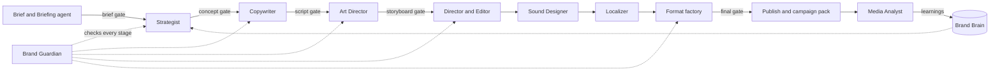
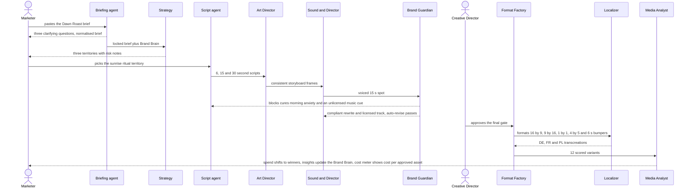

# SwarmAI Commercial Studio ("Spotlight") — Product Requirements Document

| | |
|---|---|
| **Product** | SwarmAI Commercial Studio — codename *Spotlight*: an AI-native commercial production studio on Azure |
| **Version / date** | 1.3 · 19 November 2026 · status: **delivered and verified on Azure** (25 of 25 features deployed: Release 1, CS-01 … CS-24, on 17–18 Nov and CS-25 *Cinematic motion* on 18–19 Nov; evidence in [REPORT-TEST-AND-DEPLOYMENT.md](REPORT-TEST-AND-DEPLOYMENT.md)); Release-2+ expansion levers E1–E4 are modelled in the business case (model v1.1.0), not built; per-feature status is on the [FEATURES.md](FEATURES.md) status board |
| **Companion documents** | [FEATURES.md](FEATURES.md) (25 features, status board) · [ARCHITECTURE.md](ARCHITECTURE.md) · [business-case/](business-case/README.md) (model, assumptions, `outputs.json`) · [deck/](deck/) · [README.md](README.md) |
| **Reference customer** | **Contoso Consumer Brands** (fictional): US$8 B revenue, 12 markets, ≈ 5,000 creative assets a year today; demo brand **Northwind Coffee Roasters** — campaign *Dawn Roast* |
| **Conventions** | `[n]` = entry *n* in [§19 Sources](#19-sources). Numbers marked *(outputs.json)* are quoted from `business-case/outputs.json` (Base scenario unless stated). *Assumption* = not verified from a public source — validate with customer data. Not legal advice. |

**Contents** — [1 Executive summary](#1-executive-summary) · [2 Problem & market context](#2-problem--market-context) · [3 Vision, positioning & goals](#3-vision-positioning--goals) · [4 Personas & jobs-to-be-done](#4-personas--jobs-to-be-done) · [5 Solution overview](#5-solution-overview) · [6 User journeys](#6-user-journeys) · [7 Functional requirements](#7-functional-requirements-by-epic) · [8 Non-functional requirements](#8-non-functional-requirements) · [9 Constraints & dependencies](#9-constraints-dependencies--data-requirements) · [10 KPIs](#10-success-metrics--kpis-and-measurement-plan) · [11 Business case](#11-business-case) · [12 Competitive landscape](#12-competitive-landscape--differentiation) · [13 Go-to-market](#13-go-to-market--packaging) · [14 Release plan](#14-release-plan) · [15 Risks](#15-risks--mitigations) · [16 Responsible AI & compliance](#16-responsible-ai--compliance) · [17 Assumptions & open questions](#17-assumptions--open-questions) · [18 Glossary](#18-glossary) · [19 Sources](#19-sources)

---

## 1. Executive summary

**The problem.** Marketing is asked for roughly ten times the content — more channels, formats, markets and segments — on flat budgets: marketing budgets have plateaued at **7.8 % of revenue** and **56 % of CMOs say they lack the budget** for their 2026 strategy [1]; **71 % of marketers expect content demand to grow 5× or more by 2027** [4]; global ad spend is forecast at **US$1.34 trillion in 2026** [3]. At the same time the downside of getting content wrong is rising: EU transparency duties for AI-generated content apply **from 2 August 2026** [8], EU rules on green claims apply **from 27 September 2026** [11], platforms require AI disclosure [16][17] and likeness law is tightening [18].

**The solution.** *Spotlight* is a **crew of specialised agents** — Strategist, Copywriter, Art Director, Director/Editor, Sound Designer, Localizer, Brand Guardian and Media Analyst — that turns a brief into a **brand-safe, localised, personalised and measurable campaign**: concept → script → storyboard → voiced spot → formats and cut-downs → variants → approvals → publish → performance → learnings that feed the next brief. **People stay in control** through stage gates (creative director, legal, brand), and every asset carries an audit trail and a provenance manifest.

**Why it is different and defensible**

1. **Brand Brain** — every agent is grounded in the brand book, tone of voice, claims library, catalogue and personas, with citations: consistency by construction.
2. **Governance first** — claims & compliance library, **Rights & Consent Registry**, Azure AI Content Safety, AI-disclosure labels, C2PA-style provenance, hash-chained audit.
3. **Closed loop** — variant matrix + Thompson-sampling allocation + performance ingestion; insights flow back into the Brand Brain.
4. **FinOps for creative** — metered **cost per approved asset**, budget caps and premium-generation approval; the ROI story is live in the product.
5. **Pluggable model layer** — Azure OpenAI text, image and speech, plus a self-hosted open **video model on serverless GPU** behind `VideoProvider` / `MotionClient` (Cinematic quality: real generated motion, in the customer's tenant). Azure OpenAI Sora 2 was retired on 2 Nov 2026; the ffmpeg compositor keeps every spot deliverable and is the per-shot fallback.
6. **Enterprise-ready** — DAM with semantic search, roles incl. agency guests, Teams/Slack-compatible notifications, campaign-pack export, REST API.

**The business case — Contoso Consumer Brands, 3 years, list prices *(outputs.json)***. Conservative and Base are the **Release-1 campaign studio**; Upside also switches on the four Release-2+ expansion levers (below).

| | Conservative | **Base** | Upside (incl. expansion levers) |
|---|---:|---:|---:|
| 3-year NPV @ 10 % | US$1.05 M | **US$6.98 M** | US$15.83 M |
| ROI (3-year, undiscounted) | 26 % | **140 %** | 218 % |
| Payback (from Year 0) | 28.2 months | **15.0 months** | 11.0 months |
| IRR | 30 % | **151 %** | 295 % |
| 3-year benefit / cost | US$9.39 M / 7.47 M | **US$15.86 M / 6.61 M** | US$29.88 M / 9.39 M |
| Azure Consumed Revenue, Year 1 → 3 (this customer) | US$58 k → 281 k → 424 k | **US$65 k → 305 k → 465 k** | US$111 k → 529 k → 973 k |
| ACR Year 3 with expansion levers E1–E4 at full scale | US$885 k | **US$940 k** | US$973 k |

*In the Base case benefits could fall by **56 %** before the 3-year NPV turns negative; Azure is 12.6 % of customer cost and 5.3 % of benefit; the Year-3 Studio cost per approved version is **US$54** all-in (Azure US$9.15) against an agency blend of about **US$3,957 per asset today** — and US$774 versus US$4,784 for an adapted video.* ACR by customer tier (steady state): pilot **US$20 k**, one brand **US$101 k**, global portfolio **US$514 k**, agency network **US$2.05 M**, **enterprise scale (catalog + generative video + personalization) US$2.63 M** a year; an illustrative partner pipeline reaches **US$7.6 M** ACR in Year 3 (Upside US$15.1 M). All figures are assumption-driven and must be validated with Contoso data (§17).

**The path from ≈ US$0.5 M to a multi-million ACR per customer (honest version).** Four optional levers — **E1** generative video through the `VideoProvider` plug-in, **E2** catalog-scale product content, **E3** audience-level personalization and **E4** a marketing data & clean-room platform on Fabric — each carry their own Azure consumption, customer benefit and non-Azure cost ([§11, *Expansion levers*](#expansion-levers-e1e4-and-the-enterprise-scale-tier-release-2)). For the same customer they roughly **double Year-3 ACR (US$465 k → US$940 k)**; an **enterprise-scale** customer (150,000 versions, 20 markets, 1,000 users, 40,000 SKUs, personalization at 10×) runs at **US$2.63 M a year — about 5× the campaign-scale baseline**. What does *not* drive it: per-asset model cost — a catalog image is about **US$0.22** and a kept generated video second about **US$0.69** at list price — so E1 and E2 add little Azure consumption even though E2 has the best ROI. What does: the data platform (E4), segment-scale personalization (E3) and customer breadth. Expansion is *not* in the Base case: it is Release 2+ (R2-01, R2-02, R2-08, R2-21, R2-22) and each lever must earn its place with a holdout test.

**What is real — and verified.** A reference implementation of all 25 features is deployed on Azure (`swedencentral`: a Container App, a scale-to-zero GPU worker on a serverless A100, Cosmos DB, Blob, Microsoft Foundry models, Content Safety, Speech, Application Insights; keyless, 0 secrets) with synthetic data and was verified on 17–19 November 2026 ([REPORT-TEST-AND-DEPLOYMENT.md](REPORT-TEST-AND-DEPLOYMENT.md)): **25 of 25 features report `implemented`** on `/api/features`; **1,432 backend tests** pass at **92 % line coverage** (plus 356 GPU-worker tests at 98 %); **18 of 18 English browser journeys** and a **45-check live smoke test** (English, Polish and Cinematic) pass against the deployed app with real Azure OpenAI, Content Safety, Cosmos DB, Blob and a real A100 — brief → Guardian block → auto-revise → 15 s rendered MP4 **built from AI-generated video clips** → provenance → approvals → localisation → variants → ROI parity; a light load check (400 requests, concurrency 20, one 1-vCPU replica) gives **p50 554 ms, p95 1.4 s, 0 errors**. A full smoke run consumes **≈ US$0.85** of AI spend (≈ US$0.17 for the English narrative, ≈ US$0.14 for the Polish steps, **≈ US$0.54 for the Cinematic spot**) and the always-on demo costs **≈ US$45 a month idle (≈ US$20 with scale-to-zero)** at list prices; the GPU worker costs nothing while it sleeps. Per-feature status and evidence are on the [FEATURES.md](FEATURES.md) status board. Ad platforms, the audience panel and performance history are *simulated*; generative video is *real*: the open Wan 2.2 model (Apache-2.0) on a serverless GPU in the customer's tenant, because Sora 2 is retired, with a measured motion-quality gate (clips are scored against a camera-move-on-a-still control); provenance is C2PA-*style*, not a certified Content Credential; and the expansion levers E1–E4 are modelled in the calculator, not built (E1 is priced on hosted Sora meters and was not re-based to the self-hosted path) — all labelled in the UI (see the implemented-vs-target table in [ARCHITECTURE.md](ARCHITECTURE.md#19-reference-implementation-in-this-repository-implemented-vs-target)).

**The ask.** Approve a **12-week pilot on one brand** (Dawn Roast scope: 2–3 campaigns, 3 markets, holdout-tested variants) with an executive sponsor in marketing, a legal/brand reviewer pair and finance access to purchase-order data. Success = measured cost per approved asset, cycle time, Guardian block-rate and ROAS uplift against a holdout (§10) — the evidence that converts the assumptions in §11 into Contoso's own numbers.

---

## 2. Problem & market context

| Force | Evidence | Implication for the product |
|---|---|---|
| **Flat budgets, rising expectations** | Marketing budgets are **7.8 % of company revenue** in 2026 (7.7 % in 2025), an 18 % decline over four years; **56 %** of CMOs lack budget and **54 %** lack resources for their 2026 strategy; paid media has risen to **31.4 %** of budgets, funded by agency cuts [1][2] | Cost per approved asset and agency-fee leverage are first-order value drivers (§11) |
| **Ad spend keeps growing** | WARC forecasts global advertising spend of **US$1.34 trillion in 2026 (+11.9 %)**; social, search and retail media are about two-thirds of it [3] | More placements and formats to feed; creative, not media access, becomes the constraint |
| **Content demand explodes** | **71 %** of 1,600+ marketers expect content demand to grow **5× or more by 2027**; 62 % already saw 5× in two years; personalisation is the top driver [4] | Versioning, localisation and personalisation must be automated, not hired |
| **AI adoption is mainstream but not scaled** | **88 %** of organisations use AI regularly in at least one function; **23 %** are scaling an agentic system and **39 %** experimenting [5]; CMOs allocate **15.3 %** of marketing budgets to AI, yet only **30 %** report mature readiness to scale [1] | Buyers have budget and intent; they need governed, measurable deployments, not pilots-forever |
| **Cost-out is proven by early movers** | Mondelez reports cutting content production costs by **30–50 %** with a generative AI tool, aiming to reduce agency fees and speed product launches [6] | The addressable pool (§11) is real; our model credits 25–95 % per asset class and haircuts it |
| **Creative is the biggest controllable lever** | NCSolutions/Nielsen found creative the largest single contributor to advertising sales lift (reported as 47 %); weak creative yields weak lift [7] | Testing more variants is where the performance uplift comes from (CS-16…18) |
| **AI-generated content must be marked and labelled (EU)** | Article 50 AI Act applies **from 2 August 2026**: providers must apply machine-readable marks to synthetic content; deployers must disclose deepfakes; a **grace period for marking runs to December 2026** for generative systems already on the market; fines up to **€15 M or 3 %** of worldwide turnover; a voluntary **Code of Practice** was published in June 2026 (about 190 signatories by end of July) [8][9][10] | Disclosure labels, provenance and an evidence pack are product features, not add-ons (CS-14) |
| **Green and health claims are policed** | The EU found **53.3 %** of examined environmental claims vague, misleading or unfounded and **40 %** unsubstantiated [12]; Directive (EU) 2024/825 applies **from 27 September 2026** and prohibits generic claims ("eco-friendly") without recognised performance [11] | Claims library with substantiation expiry and per-market rules (CS-02, CS-12) |
| **Platforms require AI disclosure** | YouTube requires disclosure of realistic altered or synthetic content [16]; Meta applies "AI info" labels and requires disclosure for certain ad categories; TikTok requires labelling of realistic AI content [17] | Platform-specific labels and metadata in the campaign pack (CS-14, CS-22) |
| **Provenance standards are maturing** | C2PA specification 2.x is current (v2.4 published) [15]; a conformance programme and trust list launched in 2025 [22]; Azure OpenAI image models attach Content Credentials to generated images [13] | Align the manifest with C2PA concepts today; conformant signing is Release 2 (R2-07) |
| **Likeness and voice are legally sensitive** | State digital-replica laws (e.g. Tennessee ELVIS Act in force since July 2024; California AB 2602 from January 2025) and a pending federal NO FAKES Act [18] | Consent registry with AI-use flags; no voice cloning offered (CS-03, CS-09) |

**So what.** The content supply chain is squeezed between *volume* (10× versions, more markets) and *governance* (claims, rights, disclosure, provenance). Point tools generate fast but ungoverned; agencies govern but cannot scale cost. Spotlight is positioned in the gap: **generative speed with governance by construction and a measured return**.

---

## 3. Vision, positioning & goals

**Vision.** *Every brand can brief a campaign in the morning and ship governed, localised, testable creative the same week — with a human accountable at every gate and a receipt for every asset.*

**Positioning statement.** For CMOs and brand teams of global consumer brands who must multiply content output without multiplying cost or risk, **Spotlight** is an AI-native commercial studio on Azure that produces brand-safe, localised, performance-optimised campaigns through a crew of governed agents. Unlike point generators and creative suites, it grounds every output in the Brand Brain, enforces claims, rights and disclosure before anything ships, learns from performance, and shows cost per approved asset live.

**Goals (Release 1 and pilot)**

| # | Goal | Measure (KPI) |
|---|------|---------------|
| G1 | Cut the cost of an approved asset by an order of magnitude on adaptation-type work | KPI-01 |
| G2 | Compress brief-to-approved-assets from 6–10 weeks to ≤ 4 weeks (machine time in hours) | KPI-02 |
| G3 | Zero compliance incidents reaching market from Studio-produced assets | KPI-06, KPI-11 |
| G4 | 100 % of published assets carry a verifiable provenance manifest and disclosure label where required | KPI-10 |
| G5 | Test ≥ 12 variants per campaign and shift spend to winners automatically | KPI-04, KPI-05 |
| G6 | Make the ROI and Azure consumption auditable inside the product | KPI-01, KPI-19 |

**Non-goals (Release 1)**

* Live-action production, talent casting or photographic hero films — Studio displaces concepting, versioning, adaptation and AI-native digital masters, not shoots.
* Generative video as a dependency — the compositor animates generated key-frames; a video-model plug-in is Release 2 (optional expansion lever E1, §11).
* Real ad-platform write access, media buying or billing — connectors are interfaces plus a simulator; performance data in the demo is synthetic.
* Voice cloning or celebrity/likeness imitation — refused by design.
* Legal advice — the claims and disclosure rules shipped are illustrative and customer-owned.

---

## 4. Personas & jobs-to-be-done

| Persona | Job to be done | Pain today | Gain with Spotlight | Primary features |
|---------|----------------|------------|---------------------|------------------|
| **CMO** (economic buyer) | "Give me more output at lower cost with zero brand incidents." | Flat budgets, agency fees, rework, exposure to claims and AI-disclosure rules | Live cost per approved asset, cycle time, incident count and ROI | CS-15, CS-20, CS-23 |
| **Brand Manager** | "Keep every asset on-brand across 12 markets." | PDFs, inconsistent agency output, slow reviews | Brand Brain grounding; Guardian brand-voice and identity checks | CS-01, CS-12, CS-13 |
| **Creative Director** | "Protect the idea and the craft while scaling versions." | Re-work on adaptations, no time for hero work | Territories, storyboards and approvals; agents do versioning | CS-05, CS-07, CS-13 |
| **Performance Marketer** | "Find the winning hook and shift budget fast." | Few variants, slow tests, learnings lost | 12-variant matrix, bandit allocation, insights back to the Brand Brain | CS-16, CS-17, CS-18 |
| **Legal / Compliance reviewer** | "Never approve what I cannot defend." | Late discovery of claims, rights and disclosure problems | Pre-checked claims, rights and disclosure; evidence pack; immutable audit | CS-02, CS-03, CS-12, CS-14 |
| **Regional / local marketer** | "Adapt the global idea to my market, in my language, fast." | Weeks of translation cycles; literal copy | Transcreation with glossary and per-market claim rules | CS-10, CS-11 |
| **Agency partner** | "Deliver more, faster, inside the client's rules." | Duplicate tooling, unclear approvals | Guest access to assigned campaigns, campaign-pack export | CS-22, CS-13 |
| **CFO / Procurement** | "Prove the return and control the spend." | Opaque agency costs, variable AI cost | Metered cost per asset, caps, auditable ROI model | CS-15, CS-23 |

---

## 5. Solution overview

### 5.1 Concept and principles

*Commercial* means both the advertising spot and the commercial outcome. Spotlight is built on eight principles:

1. **Grounded, not guessing** — every agent retrieves from the Brand Brain and cites it.
2. **Governance by construction** — rules (claims, rights, disclosure) run before approval, not after publication.
3. **Humans at the gates** — agents propose; people approve brief, concept, script, storyboard and final.
4. **Receipts for everything** — hash-chained audit and a provenance manifest per asset.
5. **Closed loop** — performance becomes brand knowledge.
6. **Cost is a feature** — metered, capped and visible per approved asset.
7. **Model-agnostic** — every AI capability sits behind an interface with an Azure implementation and an offline stub.
8. **Honest about simulation** — predictive scores, performance data and motion-over-key-frames are labelled as such.

### 5.2 The creative crew and the human gates

| Agent | Responsibility | Output | Features | Human gate |
|-------|----------------|--------|----------|------------|
| **Briefing** | Completeness check, ≤ 3 clarifying questions, normalised brief | Locked brief | CS-04 | Brand Manager (brief) |
| **Strategist** | Insights, segments, 3–5 territories with risk notes | Selected territory | CS-05 | Creative Director (concept) |
| **Copywriter** | 6/15/30/60 s scripts, channel copy, tone variants, claim-aware | Approved script | CS-06 | Creative Director + Legal (script) |
| **Art Director** | Shot list and consistent storyboard from the style bible | Storyboard | CS-07 | Creative Director (storyboard) |
| **Director / Editor** | Timeline spec and render through `VideoProvider` | Master spot MP4 + SRT | CS-08 | — |
| **Sound Designer** | Voice-over, captions timing, licensed music, loudness | Mixed audio | CS-09 | — |
| **Localizer** | Transcreation, glossary, back-translation, localised VO and captions | Language versions | CS-10 | Regional marketer / linguist (flagged items) |
| **Format factory** | 16:9, 9:16, 1:1, 4:5, 6/15/30 s with safe areas and legal supers | Version tree | CS-11 | Legal + Brand (final) |
| **Brand Guardian** | Voice, identity, claims, regulated-category, rights, Content Safety; auto-revise | Scored report, block | CS-12 | Legal override only with reason |
| **Media Analyst** | Variant allocation, significance, insights to Brand Brain | Learnings | CS-16 … CS-19 | Performance marketer |

### 5.3 Brand Brain and governance data

The **Brand Brain** (CS-01) holds versioned brand guidelines, tone-of-voice profile, palette, typography, logo rules, catalogue, personas and — over time — typed *learnings* from performance. Three governance registries sit beside it: the **Claims & Compliance Library** (CS-02: approved / prohibited / needs-substantiation per market × category, disclaimers, substantiation expiry), the **Rights & Consent Registry** (CS-03: talent likeness and voice with AI-use consent, music, stock, territories, channels, windows) and the **audit chain** (CS-13). The **Brand Guardian** (CS-12) consumes all three plus Azure AI Content Safety; **provenance** (CS-14) records what was made, with which models, from which Brand Kit version, approved by whom.

### 5.4 Closed loop, FinOps and the pluggable model layer

* **Closed loop** — pre-flight scorecard (CS-16, simulated) → variant matrix and bandit (CS-17) → performance ingestion (CS-18) → insights written back to the Brand Brain → next brief.
* **FinOps for creative** (CS-15) — meters tokens, images, characters and render seconds; per-campaign and per-day caps; approval for premium generation; the *cost per approved asset* KPI sits next to the agency baseline and the vendored business-case model (CS-23).
* **Pluggable model layer** — `LLMClient`, `ImageClient`, `SpeechClient`, `EmbeddingClient`, `SafetyClient`, `VideoProvider`, `AdPlatformConnector`; Azure implementations plus deterministic offline stubs for tests.

---

## 6. User journeys

### 6.1 "Dawn Roast" — Northwind Coffee Roasters launches a new roast

| Step | What the user sees | Governance moment | Features |
|------|--------------------|-------------------|----------|
| 1 Brief | Paste free text; completeness score; 3 questions | Brand Manager locks the brief | CS-04 |
| 2 Strategy | 3 territories grounded in the Brand Brain, with citations and risk notes | Claim-risk flag on a "wellness" territory | CS-05, CS-02 |
| 3 Script | 6/15/30 s scripts with beats and supers within the speech-rate budget | Required disclaimer inserted | CS-06 |
| 4 Storyboard | 6–8 consistent frames in the brand palette; single-frame regeneration | Content Safety on prompts and outputs; premium generation needs approval | CS-07, CS-15 |
| 5 Voice and render | Voice-over, captions, brand end-card, loudness-normalised MP4 | Music chosen only from rights-cleared tracks | CS-08, CS-09, CS-03 |
| 6 Guardian | **Blocks** the line "cures morning anxiety" (prohibited health claim) and an unlicensed music cue; suggests compliant fixes; auto-revise converges | Approval is impossible while a hard-fail is open (409) | CS-12, CS-13 |
| 7 Approve | Creative Director approves; Legal sees the evidence | Hash-chained audit entry | CS-13 |
| 8 Formats | 16:9 / 9:16 / 1:1 / 4:5 and 6 s bumpers with safe areas | Market legal supers applied | CS-11 |
| 9 Localise | DE, FR, PL (and up to 8 languages) with glossary, back-translation check, localised VO and captions | Per-market claim rules re-run | CS-10 |
| 10 Variants | Pre-flight scorecard ranks 12 variants (*predicted / simulated*) | — | CS-16, CS-17 |
| 11 Optimise | Bandit shifts simulated spend to winners within a day; insights written to the Brand Brain | Allocation decisions logged | CS-17, CS-18 |
| 12 Receipt | Provenance manifest and disclosure labels; cost meter shows **US$ per approved asset vs agency baseline** | Provenance pack export | CS-14, CS-15, CS-23 |

*Design target:* brief to approved-ready master plus three formats in under an hour of machine time; 12 variants pre-flighted in minutes; calendar time determined by human gates (target ≤ 4 weeks end to end versus 6–10 weeks today). *Measured on the deployed slice* (one live smoke run, draft-quality keyframes, one 1-vCPU replica; [REPORT-TEST-AND-DEPLOYMENT.md](REPORT-TEST-AND-DEPLOYMENT.md) §5): brief → strategy → script → Guardian block → auto-revise → four keyframes → voice-over → 15 s render (23.7 s) → five approved gates → 9:16, 1:1 and 6 s versions → DE, FR and PL localizations → 12-variant experiment → insights. The **whole 30-check smoke run, which contains that chain plus the platform checks, took about 7 minutes** (sum of the check durations, 400 s), so the chain itself takes at most that; the 4:5 ratio and 15/30 s cut-downs are offered but were not generated in that run. Calendar time with human gates is not yet measured; it is what the pilot (KPI-02) measures.

### 6.2 Other journeys

* **Legal reviewer** — opens the approvals inbox, sees the Guardian report with evidence per finding, checks rights and disclosure, approves or requests changes; overrides require the Legal role and a reason; exports the provenance pack for regulators.
* **Regional marketer** — takes the approved master, selects markets, reviews flagged transcreation items, approves local versions; the claims library shows what is allowed in the market.
* **Performance marketer** — uploads a CSV or connects the simulated platform, watches the bandit shift budget, reads insights ("sunrise ritual hook wins for 25–34"), and sees them cited in the next brief.
* **Agency partner (guest)** — sees only assigned campaigns, works inside the client's Brand Brain and rules, submits for approval, downloads the campaign pack.
* **CFO** — opens the ROI & ACR calculator, changes asset volume, agency cost, markets, variants, media spend, uplift, discount rate and adoption ramp, and compares the live cost per approved asset with the model.

---

## 7. Functional requirements by epic

Each requirement maps to one or more Release-1 features (see [FEATURES.md](FEATURES.md) for acceptance criteria). Priority: P0 = MVP gate, P1 = GA, P2 = illustrative at GA.

### Epic A — Brand Brain & governance data

| ID | Requirement | Feature | Pri |
|----|-------------|---------|-----|
| FR-A1 | Ingest and version Brand Kit content (guidelines in md/pdf/txt/docx text, tone, palette, typography, logo rules, catalogue, personas) with immutable versions, diff and rollback | CS-01 | P0 |
| FR-A2 | Retrieve with citations (document, section, version); every grounded output records the Brand Kit version it used; retrieved text is untrusted data | CS-01 | P0 |
| FR-A3 | Derive a brand-voice profile and expose identity rules (palette, logo clear-space/size, forbidden words) machine-readably to the Guardian | CS-01 | P0 |
| FR-A4 | Maintain claims per market × category (approved / prohibited / needs-substantiation), required disclaimers and substantiation with expiry; match by rule, embedding and judge | CS-02 | P0 |
| FR-A5 | Maintain rights and consent (likeness, voice, music, stock, fonts) with territories, channels, windows, restrictions and AI-use consent; block uses outside rights; alert before expiry | CS-03 | P0 |

### Epic B — Creative pipeline

| ID | Requirement | Feature | Pri |
|----|-------------|---------|-----|
| FR-B1 | Structured brief wizard plus free-text paste; completeness score; ≤ 3 clarifying questions; normalised, versioned brief | CS-04 | P0 |
| FR-B2 | 3–5 territories with rationale, proof points and risk notes, grounded in Brand Brain and learnings | CS-05 | P0 |
| FR-B3 | 6/15/30/60 s scripts with beats within the speech-rate budget; channel copy within limits; tone variants; claim-aware; targeted revision | CS-06 | P0 |
| FR-B4 | Shot list and consistent storyboard frames from a style bible; single-frame regeneration with versions | CS-07 | P0 |
| FR-B5 | Render a timeline spec through a `VideoProvider` (ffmpeg compositor default): motion, transitions, VO, music bed, captions (burned-in + SRT), end-card, EBU R128 loudness, H.264/AAC | CS-08 | P0 |
| FR-B6 | Voice-over from approved voices in multiple languages, fitted to the beat plan; SRT; rights-cleared music only; refuse cloning/celebrity imitation | CS-09 | P0 |
| FR-B7 | Transcreation to ≥ 8 languages with glossary and do-not-translate enforcement, back-translation check, per-market claim re-check, length fitting | CS-10 | P1 |
| FR-B8 | Reformat a master to 16:9, 9:16, 1:1, 4:5 and 6/15/30 s with safe-area reframing, overlays and legal supers; version tree with stale tracking | CS-11 | P0 |
| FR-B9 | **Cinematic quality**: turn each approved storyboard keyframe (the opening frame of a shot) into a generated video clip with real subject and camera motion; storyboard separates *opening frame* from *motion*; estimate and budget check before spending; clips cached and reused by re-renders, formats, cut-downs and localizations; per-shot fallback to the still path; every clip is **measured** (non-rigid optical flow, a camera move on a still scores low) and a clip that barely moves is retried once; Guardian frame checks; provenance of model, seed, prompt and attempts; worker scales to zero and runs inside the tenant | CS-25 | P0 |

### Epic C — Governance & safety

| ID | Requirement | Feature | Pri |
|----|-------------|---------|-----|
| FR-C1 | Multi-check Guardian (voice, identity, claims, regulated rules, rights, Content Safety incl. protected material and Prompt Shields) with scored report, evidence, fix suggestions, bounded auto-revise and approval blocking | CS-12 | P0 |
| FR-C2 | Configurable stage gates (brief → concept → script → storyboard → final), roles, comments, SLAs, delegation and optional separation of duties | CS-13 | P0 |
| FR-C3 | Tamper-evident, hash-chained audit log with a verification endpoint | CS-13 | P0 |
| FR-C4 | C2PA-style provenance manifest per asset (hashes, models, prompt digests, inputs, approvals, ingredients), sidecar, disclosure labels per market/platform, provenance pack and verification | CS-14 | P0 |
| FR-C5 | Meter tokens, images, characters and render seconds; per-campaign and per-day caps; alerts; premium-generation approval; cost per approved asset | CS-15 | P0 |

### Epic D — Performance & optimization

| ID | Requirement | Feature | Pri |
|----|-------------|---------|-----|
| FR-D1 | Pre-flight scorecard (synthetic panel + heuristics) with sub-scores and suggestions, always labelled predictive/simulated; calibration against observed results | CS-16 | P1 |
| FR-D2 | Variant matrix (hook × CTA × visual × segment) with caps | CS-17 | P0 |
| FR-D3 | Thompson-sampling allocation, significance testing, auto-pause of losers, logged decisions | CS-17 | P0 |
| FR-D4 | Performance ingestion via CSV and an `AdPlatformConnector` interface with a simulator; impressions, CTR, VTR, CVR, CPA, ROAS | CS-18 | P0 |
| FR-D5 | Generate insights with effect sizes and confidence; write them to the Brand Brain for the next brief | CS-18 | P0 |
| FR-D6 | Channel/budget split with expected reach and ROAS ranges from a diminishing-returns model, labelled illustrative | CS-19 | P2 |

### Epic E — Platform

| ID | Requirement | Feature | Pri |
|----|-------------|---------|-----|
| FR-E1 | Studio UI: dashboard, brief wizard, Brand Brain console, creative workspace, Guardian report, approvals inbox, library, experiments, performance, cost meter, ROI calculator, Feature Map; synthetic-data indicator | CS-20 | P0 |
| FR-E2 | Responsive and accessible UI (WCAG 2.2 AA target); no runtime third-party fetches | CS-20 | P0 |
| FR-E3 | Asset library with Blob storage, metadata, semantic search, versions, collections; media served through the backend only | CS-21 | P1 |
| FR-E4 | Roles (Admin, Brand Manager, Creative, Legal, Agency-guest) with campaign-scoped guest access | CS-22 | P1 |
| FR-E5 | Teams/Slack-compatible signed webhooks, campaign-pack export, documented REST API | CS-22 | P1 |
| FR-E6 | ROI & ACR calculator using the vendored `business-case/model.py`, with scenarios, overrides and Azure ACR by service family | CS-23 | P0 |
| FR-E7 | Observability, security baseline and IaC: OpenTelemetry, usage meter, rate limits, budget caps, keyless identity, Bicep/azd, smoke tests, teardown | CS-24 | P0 |

---

## 8. Non-functional requirements

| ID | Area | Requirement (target architecture; the demo slice meets the functional behaviour at smaller scale) | Measured by |
|----|------|---------|-------------|
| NFR-01 | Interactive latency | Non-AI API calls p95 < 300 ms at 200 concurrent users | Load test, App Insights |
| NFR-02 | AI-step latency | Script/copy generation p95 < 25 s and Guardian check p95 < 20 s (low reasoning effort); strategy < 60 s; progress streamed | Per-feature latency counters |
| NFR-03 | Render turnaround | 15 s 1080p master ≤ 3 min p95; 6-format batch ≤ 10 min; jobs idempotent per spec hash | Job telemetry |
| NFR-04 | Throughput | Sustain 2,000 approved versions a day per tenant (the 50,000-a-year profile averages ≈ 200 per business day; peak = 10×) by scaling render workers | Capacity test |
| NFR-05 | Availability | 99.9 % monthly for UI and API; 99.95 % with multi-region for enterprise; graceful queueing when models throttle | SLO dashboard |
| NFR-06 | Resilience / DR | RPO ≤ 15 min, RTO ≤ 4 h (enterprise); retries with back-off and idempotency; no data loss on worker restart | DR drill |
| NFR-07 | Security | Entra ID SSO with B2B guests; RBAC; managed identities and no keys; TLS 1.2+; encryption at rest with optional customer-managed keys; private endpoints and WAF in enterprise; secrets in Key Vault; prompt-injection and SSRF controls | Pen-test, Defender, secret scan |
| NFR-08 | Data residency & privacy | Tenant data and model processing within the chosen geography (EU Data Zone deployments available); customer data not used to train foundation models; PII redaction in logs; retention policies; GDPR controller/processor roles documented | Architecture review, DPA |
| NFR-09 | Accessibility | WCAG 2.2 AA; captions on every video; keyboard-operable approvals; respects reduced motion | Automated + manual audit |
| NFR-10 | Observability | OpenTelemetry traces, metrics and structured logs; request IDs; per-feature latency and cost counters; audit export | App Insights, KQL |
| NFR-11 | Cost control | Per-campaign and per-day caps fail closed; the demo daily cap is a setting (US$5 at Release 1, **US$15** with Cinematic motion, where one spot meters ≈ US$0.5 of GPU); cost per approved asset visible; FinOps tags | CS-15 meter |
| NFR-12 | Internationalisation | UTF-8 end to end; content in ≥ 8 languages with fonts for diacritics (optional JA/ZH/AR); UI i18n framework (English in Release 1) | Render tests |
| NFR-13 | Quality & testability | Deterministic offline stubs; ≥ 80 % line coverage on domain logic; evaluation sets for Guardian and retrieval; regression suite before any model upgrade | CI |
| NFR-14 | Responsible AI | Guardian hard-fail blocks approval; 100 % of published assets carry a verifiable manifest; Content Safety on prompts and outputs; human approval before publish | Audit |

**Measured on the deployed reference implementation** (17–18 November 2026; [REPORT-TEST-AND-DEPLOYMENT.md](REPORT-TEST-AND-DEPLOYMENT.md) §2–§8). The demo slice is deliberately small — one 1-vCPU / 2 GiB replica (max 2) and Cosmos DB serverless — so the table says what it demonstrates and where the target architecture must do more.

| NFR | Measured in the demo slice | Reading |
|-----|----------------------------|---------|
| NFR-01 | Light load, 400 requests at concurrency 20 (≈ 29 requests/s, including ≈ 40–60 ms WAN round trip): **p50 554 ms · p95 1,414 ms · p99 2,000 ms, 0 errors**; `/healthz` p95 550 ms, `POST /api/roi/compute` p95 789 ms, dashboard p95 2,039 ms | **Not met at demo scale** (target p95 < 300 ms at 200 users). A first run (p95 3,450 ms) led to Cosmos field projections and concurrent lookups; the target needs more replicas, provisioned throughput and caching ([ARCHITECTURE.md §11](ARCHITECTURE.md)) |
| NFR-02 / NFR-03 | One live smoke run: strategy 13.6 s, script 6.2 s, Guardian auto-revise 2.1 s, 15 s spot rendered in 23.7 s on one vCPU (1280×720, −16.1 LUFS), 9:16 + 1:1 + 6 s versions in 63.7 s | Within the targets for a single run at 720p; p95 over many runs and 1080p masters were not measured |
| NFR-07 | 0 secrets; managed identity and RBAC only; shared-key and local-auth off; per-IP and global rate limits; SSRF-guarded webhooks; 12 MB request limit; `pip-audit` and `npm audit` clean | Met for the demo slice; Entra SSO, private endpoints and WAF are the enterprise target and are **not deployed** |
| NFR-11 | Daily AI guard (US$5 at Release 1, US$15 since Cinematic motion) and per-campaign cap (US$2 → US$5) fail closed (HTTP 402 verified); English verification US$0.80, ≈ US$0.17 per English smoke run, ≈ US$0.85 per full run with the Polish steps and one Cinematic spot | Met |
| NFR-13 | 1,432 backend tests (+ 356 GPU-worker tests), **92 %** total line coverage; `ruff`, `mypy`, `tsc` and the production build clean | Met (≥ 80 % on domain logic) |
| NFR-14 | Approval is Guardian-gated and role-checked (5/5 gates, non-approver refused with 403); provenance manifest verifies and tampering is detected; hash-chained audit verifies | Met; the manifest is C2PA-*style*, not a certified Content Credential |
| NFR-05 / NFR-06 | Not exercised: single region, no failover or DR drill | Target only |

---

## 9. Constraints, dependencies & data requirements

* **Azure region and models.** The reference implementation runs in `swedencentral` (Microsoft Foundry): `gpt-5.4-mini` (chat), `gpt-5.4` (reasoning), `gpt-image-1.5` (image), `text-embedding-3-small`, `tts-hd`, Content Safety through the same AI Services account. **`sora-2` is deprecated in this region**, so nothing may depend on an Azure OpenAI video model.
* **Governance of the demo subscription.** Management-group policy disables public access and shared keys on Storage, Cosmos DB and similar resources unless the resource group and resources carry the demo-sandbox exemption tags `SecurityControl=Ignore` and `SecurityExemption=StorageAccountKeyAccess` (plus `project=SwarmAI`, `concept=studio`, `owner=michalfu`, `environment=demo`). These are **sandbox conventions for a managed subscription**; production landing zones should use private endpoints and policy-compliant patterns (see ARCHITECTURE.md). The app is nevertheless built keyless: managed identity and RBAC only.
* **Capacity limits.** Provisioned (PTU) model capacity is blocked by policy; only Global/Standard deployments are used. No VMs, GPUs or AKS; Container Apps (consumption) is the compute platform.
* **Data classes.** Brand and campaign assets, claims, rights contracts (metadata), performance data and audit logs are business-confidential; no real personal data is processed in the demo (synthetic only); talent likeness/voice consent metadata is personal data in production and needs a lawful basis and retention rules.
* **External dependencies (target).** DAMs (Adobe, Frame.io, Bynder, SharePoint), ad platforms (Google, Meta, TikTok, LinkedIn), Dynamics 365 Customer Insights / CDP, Teams, linguist providers, music and stock libraries.

---

## 10. Success metrics & KPIs and measurement plan

Baselines marked *(a)* are business-case assumptions to be replaced by Contoso data in week 1 of the pilot; targets are design targets until validated.

| ID | KPI | Baseline | Target | Measured by |
|----|-----|----------|--------|-------------|
| KPI-01 | Cost per approved asset (all-in) | Agency blend ≈ US$3,957 per asset *(a)*; adapted video US$4,784 *(a)* | Year-3 all-in **US$54** per approved version (Azure US$9.15); adapted video **US$774** *(outputs.json)* | CS-15 meter + finance (PO data) |
| KPI-02 | Brief-to-approved-master cycle time | 6–10 weeks *(brief)* | ≤ 4 weeks calendar incl. gates by month 6; machine time in hours | Workflow timestamps (CS-13) |
| KPI-03 | Approved versions per year | ≈ 5,000 *(brief)* | **42,500** in Year 3 (50,000 at full adoption) | Asset library |
| KPI-04 | Variants tested per campaign | 1–2 *(a)* | 12 | Experiments |
| KPI-05 | ROAS uplift vs holdout | n/a | +5 % at 12 variants (haircut 60 % in the case) | Holdout / geo-split |
| KPI-06 | Compliance incidents reaching market | ≈ 6 a year *(a)* | 0 critical; −50 % routine | Legal register |
| KPI-07 | First-pass Guardian pass rate; revision rounds | revision rounds ≈ 3 *(a)* | ≥ 80 % first pass by month 3; ≤ 1.5 rounds | Guardian reports |
| KPI-08 | Human review minutes per approved version | n/a | Adapted video 6 min, static 2.5, copy 1.2, hero 900 *(a)* | Approval workflow |
| KPI-09 | Localisation cost and lead time per language version | US$600 *(a)*; days | −70 % cost; hours of machine time | Localizer + LSP invoices |
| KPI-10 | Provenance coverage | 0 % | 100 % of published assets verifiable | Verification endpoint |
| KPI-11 | Rights breaches (use outside rights/consent) | unknown | 0 | Rights checks |
| KPI-12 | Media waste (spend on defective or below-median creative) | 0.5 % of in-scope media *(a)* | −60 %; < 10 % of spend on bottom-quartile variants | Experiments |
| KPI-13 | Brand-consistency score | n/a | ≥ 90 on audit sample | Guardian + audit |
| KPI-14 | Adoption | — | Share of volume 15 % / 50 % / 85 % in Years 1–3; users 60 / 200 / 340 *(outputs.json)* | Platform analytics |
| KPI-15 | Reliability and speed | — | 99.9 % availability; NFR-01…03 p95s | SLO dashboard |
| KPI-16 | Budget adherence | — | 100 % of campaigns within cap | CS-15 |
| KPI-17 | Learning-loop latency | weeks | ≤ 24 h from data to Brand-Brain insight | Pipeline timestamps |
| KPI-18 | Pre-flight predictive validity | n/a | Spearman ρ ≥ 0.3 after 20 campaigns *(a)* | CS-16 calibration |
| KPI-19 | Azure Consumed Revenue per customer-year | — | **US$65 k → 305 k → 465 k** (Years 1–3, Base) *(outputs.json)* | Azure billing (tagged) |
| KPI-20 | Security and audit integrity | — | 100 % audit-chain verification; zero secrets; Secure Score trend up | CS-24, Defender |

**Measurement plan.** (1) *Week 1* — capture baselines from purchase orders, agency rate cards, the legal incident register and cycle-time data; replace *(a)* values in `assumptions.json` and re-run the model. (2) *Instrumentation* — every gate, render, Guardian run and generation emits events with campaign and asset IDs to Application Insights; the cost meter (CS-15) reconciles to Azure Cost Management by tag. (3) *Uplift proof* — run the variant engine against a **holdout** (audience or geo split) on at least two campaigns; treat uplift as a hypothesis until the lower bound of the confidence interval is positive. (4) *Cadence* — weekly pilot stand-up on KPI-01/02/04/06/07; monthly steering review with Finance on KPI-01/03/05/19; calibrate the model with measured consumption (`azure_consumption_scale`).

---

## 11. Business case

All numbers from `business-case/outputs.json` (model v1.1.0; assumptions sha256 in `meta`). Method and assumption register: [business-case/README.md](business-case/README.md), [outputs.md](business-case/outputs.md). **Conservative and Base are the Release-1 campaign studio** (expansion levers off, numbers unchanged from model v1.0.0); the optional Release-2+ expansion levers E1–E4 are in the last part of this section and are *on* only in Upside.

**Value drivers (Base, Year 3 net of confidence — US$8.94 M of benefit)**

| Driver | Year 3 | Share | 3-year | Confidence haircut |
|--------|-------:|------:|-------:|-------------------:|
| Production & adaptation cost | US$4.45 M | 50 % | US$7.85 M | 85 % |
| ROAS / CPA uplift from testing | US$1.58 M | 18 % | US$2.87 M | 60 % |
| Cycle time / speed-to-market | US$1.07 M | 12 % | US$1.89 M | 50 % |
| Agency fees | US$0.57 M | 6 % | US$1.00 M | 80 % |
| Rework & media waste | US$0.50 M | 6 % | US$0.90 M | 70 % |
| Localization | US$0.42 M | 5 % | US$0.74 M | 85 % |
| Compliance-incident avoidance | US$0.34 M | 4 % | US$0.61 M | 50 % |

Benefits are credited only for work Contoso would otherwise buy (≈ 4,250 baseline-equivalent assets displaced in Year 3 at 85 % adoption) plus measurable uplift; the other ≈ 38,250 versions earn no avoided-agency-cost credit but are charged their full Azure and review cost.

**Customer cost and return (Base, US$)**

| | Y0 | Y1 | Y2 | Y3 | 3-year |
|---|---:|---:|---:|---:|---:|
| Benefit | 0 | 1.60 M | 5.32 M | 8.94 M | 15.86 M |
| Cost (Azure + licence + integration + change + review) | 1.04 M | 1.41 M | 1.85 M | 2.30 M | 6.61 M |
| Net benefit | −1.04 M | 0.18 M | 3.47 M | 6.64 M | 9.25 M |
| Cumulative | −1.04 M | −0.86 M | 2.61 M | 9.25 M | |

NPV US$6.98 M, ROI 140 %, payback 15.0 months, IRR 151 %, benefit-to-cost 2.4×.

**What moves the NPV (tornado, full low/high bounds, one at a time)**

| Driver | NPV at low | NPV at high |
|--------|-----------:|------------:|
| Agency + production cost per asset | US$3.32 M | US$11.94 M |
| Adoption ramp | US$3.67 M | US$9.42 M |
| Benefit confidence haircuts | US$3.88 M | US$9.19 M |
| Speed-to-market value | US$5.70 M | US$10.83 M |
| Share of baseline cost Studio can displace | US$4.44 M | US$8.44 M |
| ROAS uplift from testing | US$5.61 M | US$9.26 M |
| Azure unit consumption (×0.6 … ×1.8) | US$7.11 M | US$6.73 M |

*The case is insensitive to Azure prices and consumption and highly sensitive to Contoso's own baseline cost per asset and adoption — validate those first.*

**Unit economics (Year 3).** Azure direct cost per approved version **US$9.15** (variable only US$5.28; US$10.94 including pull-through) — about 40 % is fixed platform cost. All-in Studio cost per version **US$54.17**.

| Asset class | Agency cost / asset today | Studio all-in (displaced asset) | Saving |
|-------------|--------------------------:|--------------------------------:|-------:|
| Hero spot (live-action shoot stays external) | US$373,750 | US$239,073 | 36 % |
| Adapted video | US$4,784 | US$774 | 84 % |
| Static & social image | US$673 | US$58 | 91 % |
| Copy & CRM | US$224 | US$11 | 95 % |

**Azure Consumed Revenue — bottom-up, list price, PAYG, no EA discount** (units × Azure Retail Prices API meters retrieved 17 November 2026, `swedencentral`; Foundry text and image models at Global Standard plus 10 % for EU Data Zone):

| Service family | Year 1 | Year 2 | Year 3 |
|----------------|-------:|-------:|-------:|
| Azure OpenAI — text, vision, embeddings | 36 k | 119 k | 202 k |
| Azure OpenAI — image generation | 3 k | 11 k | 18 k |
| Speech & translation · Content Safety | 0.4 k | 1 k | 2 k |
| AI Search | 5 k | 24 k | 29 k |
| Cosmos DB | 1 k | 9 k | 12 k |
| Blob/ADLS + Front Door | 0.5 k | 5 k | 7 k |
| Container Apps (app + render) | 2 k | 10 k | 13 k |
| Service Bus & Event Grid | 0.1 k | 10 k | 13 k |
| Fabric analytics | 8 k | 27 k | 32 k |
| Monitoring, security, API gateway, private networking | 6 k | 48 k | 61 k |
| **Direct ACR** | **62 k** | **264 k** | **389 k** |
| Pull-through (DAM archive, data platform, security/network landing zone) | 3 k | 41 k | 76 k |
| **Total ACR (US$)** | **65 k** | **305 k** | **465 k** |

Pull-through ratio (Year 3, attach ÷ direct) **0.20**. By tier (steady-state annual): pilot **US$20 k**, one brand **US$101 k**, global portfolio **US$514 k**, agency network **US$2.05 M**, enterprise scale **US$2.63 M** (see *Expansion levers* below). At campaign scale Spotlight is a **high-return, modest-intensity** workload (Azure ≈ 5 % of benefit): the commercial opportunity is breadth — accounts × tiers, pull-through, multi-tenant agency networks and the expansion levers — not per-asset consumption; Provisioned Throughput is excluded from every scenario, and generative video appears only in the optional lever E1.

**Illustrative opportunity (assumption-driven, not a forecast).** A partner-led pipeline of 8 / 16 / 24 pilots, 2 / 6 / 12 one-brand, 0 / 2 / 5 global-portfolio and 0 / 1 / 2 agency-network customers over three years yields ACR of **US$0.26 M → 2.33 M → 7.58 M** (US$10.2 M cumulative; Conservative US$5.2 M in Year 3; Upside US$15.1 M in Year 3 because it also adds 1 + 2 enterprise-scale accounts). A directional ceiling of 1,500 target accounts (35 % at one-brand scale) plus 40 agency networks is about **US$636 M a year** at full penetration, **US$64 M** at 10 %; with expansion (100 enterprise-scale accounts and 30 % of the other global-portfolio accounts adding E1–E4) it is about **US$977 M**, **US$98 M** at 10 %. Account counts and shares are unsourced assumptions.

### Expansion levers E1–E4 and the enterprise-scale tier (Release 2+)

The campaign-scale case above is Release 1. Four optional levers show where larger Azure consumption comes from. Each has **its own Azure consumption, customer benefit and non-Azure cost**, so the ROI stays coherent; each is **off in Conservative and Base** and **on at full scale in Upside**, and can be switched in the live calculator (`expansion_scale`, `e1_scale` … `e4_scale`). They land on the Release-2+ roadmap in [FEATURES.md](FEATURES.md#release-2-roadmap): E1 → R2-01 (the `VideoProvider` generative-video path), E2 → R2-21, E3 → R2-02, E4 → R2-08 / R2-22. *(outputs.json → `acr.expansion`; Base drivers, all four levers at full scale by Year 3, ramp 10 % / 45 % / 100 %.)*

| Lever | What it adds | Azure ACR Y3 | Customer benefit Y3 | Lever 3-yr NPV | Honest reading |
|-------|--------------|-------------:|--------------------:|---------------:|----------------|
| **E1** Generative video behind `VideoProvider` | Generated footage in hero masters (50 % use it, 40 kept seconds) and adapted videos (30 %, 6 s); billed **per generated second incl. rejected takes** — Sora 2 US$0.10, Sora 2 Pro high-res US$0.50 [20][23] (*availability varies by region; sora-2 is deprecated in swedencentral*), partner models US$0.03–0.30 | US$21 k | US$349 k (displaced stock / 3D / VFX / pick-ups) | −US$45 k | Smallest Azure line: about **US$0.69 per kept second**, US$4 for a 6-second insert; roughly break-even in three years |
| **E2** Catalog-scale product content | 12,000 SKUs × 12 markets × 40 % presence × 8 images × 50 % refresh: images, alt-text, localized descriptions, Guardian and Content Safety on every asset | US$48 k | US$1.25 M (avoided photography / retouching; plus a *flagged* conversion effect at 25 % confidence) | **+US$1.06 M** | **Best ROI, small Azure bill**: about **US$0.22 per kept image** against ≈ US$7.50 of avoided cost |
| **E3** Audience-level personalization | 8 pre-generated segment variants per approved version, with more Cosmos DB, AI Search, Blob/Front Door and Fabric | US$128 k | US$475 k (incremental ROAS; McKinsey reports 5–25 % revenue lift from end-to-end personalization [24] — only 2 % is credited, at 45 % confidence) | −US$77 k | About **US$0.36 per personalised version** all-in; near break-even at this volume |
| **E4** Marketing data & clean-room platform (Fabric) | F128 capacity, 150 TB OneLake, Purview, CRM/CDP integration — beyond the minimal pull-through already in the core | US$279 k | US$814 k (wider measured media only; CRM/CDP revenue use cases are *not* credited) | −US$333 k | **Largest ACR lever**; an enabler whose return depends on the media base and on acting on the insights |
| **All four** | | **US$475 k** | **US$2.89 M** | **+US$0.61 M** | |

*Reading.* Generated video and catalog images are **cheap per unit at list price** (cents per image, dollars per kept video second), so E1 and E2 add little Azure consumption even though E2 pays back fastest. With every lever at full scale the same customer's Year-3 ACR roughly **doubles: US$465 k → US$940 k** (Year 1 → 3: US$104 k → 501 k → 940 k), 3-year NPV US$7.59 M (+US$0.61 M), ROI 105 %, payback 17.2 months. In Upside the four levers add **US$1.24 M of NPV and US$0.48 M of Year-3 ACR** (Upside without them: NPV US$14.58 M, ROI 300 %, payback 7.8 months, ACR Year 3 US$490 k) but dilute ROI % and payback because their integration and run costs are front-loaded.

**Enterprise-scale tier — the path to a multi-million run-rate** (steady state, US$ a year; an assumption-driven profile: 150,000 versions, 20 markets, 1,000 users, 40,000 SKUs at 35 % market presence, 10 segment variants per version, F256 and 400 TB):

| Step | ACR | Running total |
|------|----:|--------------:|
| Campaign-scale baseline — global portfolio | US$514 k | US$514 k |
| + Enterprise breadth (3× versions, 20 markets, 1,000 users, larger platform) | US$678 k | US$1.19 M |
| + E1 Generative video | US$73 k | US$1.27 M |
| + E2 Catalog-scale product content | US$246 k | US$1.51 M |
| + E3 Audience-level personalization | US$541 k | US$2.05 M |
| + E4 Marketing data & clean-room platform | US$580 k | **US$2.63 M** |

Unit economics at enterprise scale (Azure list price): **US$0.21 per generated video second** (blended standard / premium tier), **US$0.69 per kept second**; **US$0.08 per generated catalog image candidate**, **US$0.20 / 0.22 per kept image** (variable / all-in); **US$0.21 / 0.36 per personalised version**; the data platform is US$0.58 M a year. The agency-network tier (US$2.05 M) reaches a similar run-rate by multi-tenancy rather than by levers.

---

## 12. Competitive landscape & differentiation

Positioning is based on publicly described capabilities; verify against current vendor materials before external use.

| Alternative | Typical strengths | Where Spotlight differs |
|-------------|-------------------|--------------------------|
| **Creative suites with generative AI** — e.g. Adobe GenStudio for Performance Marketing with Firefly, Workfront and Experience Manager integrations: generative content, brand guardrails, workflow, performance insights [19] | Deep creative-tool and DAM integration; large installed base | Spotlight is built on the customer's Azure tenancy, makes **claims, rights/consent, disclosure and provenance** first-class gates, ships a **closed-loop experiment engine** and **FinOps meter**, and integrates with — rather than replaces — suites and DAMs |
| **Design platforms** (e.g. Canva) | Ease of use, templates, broad adoption by non-designers | Enterprise governance, multi-market claim rules, auditability, agent crew rather than templates |
| **AI creative / content-automation vendors** (e.g. Typeface, Jasper, Pencil, Smartly) | Fast generation, ad-platform integrations, creative analytics | Full brief-to-broadcast crew with human gates, rights registry, provenance, and customer-owned data plane on Azure |
| **Platform-native tools** (Google, Meta, TikTok, LinkedIn generative creative) | Native optimisation and distribution | Platform-neutral brand governance and cross-platform learning; Spotlight exports compliant packs to them |
| **Agencies and production partners** | Craft, live-action, strategy, relationships | Complementary: agencies become guest users, own the hero idea and shoots, and deliver more versions inside the client's rules |
| **Microsoft ecosystem** — Foundry (models, agents, evaluation), Azure AI Content Safety, AI Search, Fabric, Dynamics 365 Customer Insights, Microsoft Advertising, Teams, Entra | Models, safety, data, identity, security — the building blocks | Spotlight is a reference solution *on* those services: the crew, Brand Brain, registries, Guardian, provenance and ROI model are the differentiated layer; no Microsoft roadmap commitment is implied |
| **Build-your-own on Foundry** | Full control | Spotlight is the accelerator: 25 features, tests, IaC and a business-case model already exist |

**Differentiation summary.** (1) Governance before generation; (2) Brand Brain grounding with citations; (3) closed-loop learning; (4) cost per approved asset as a live KPI; (5) pluggable model/video layer that survives model deprecations (Sora); (6) deployable in the customer's tenant with keyless identity and Azure-native controls.

---

## 13. Go-to-market & packaging

**Motion: pilot → scale.** Land with a 12-week, one-brand pilot that proves cost per approved asset, cycle time, Guardian block-rate and holdout uplift; expand to a brand team, then the portfolio, then agencies.

**Pilot plan (proposal, shown on the executive deck's closing slide).**

| Weeks | Focus | Output |
|-------|-------|--------|
| 1–2 | Baseline | Purchase orders, agency rate cards, incident register and cycle times captured; business-case model re-run on customer data |
| 3–4 | Set up | Brand kit, claims library, rights registry and roles loaded; gates and one DAM or file-drop connector configured |
| 5–10 | Produce and test | 2–3 campaigns in 3 markets through the gates; holdout test on variants |
| 11–12 | Decide | Read-out on KPI-01/02/06/10 and measured uplift; business case on customer data; go / no-go for the brand roll-out |

| Package | Scope | Typical buyer | Azure tier (ACR run-rate) |
|---------|-------|---------------|--------------------------|
| **Pilot** (12 weeks) | One brand, 3 markets, 2–3 campaigns, holdout test, ROI read-out | VP/Director Marketing, CFO sponsor | US$20 k a year |
| **Brand Studio** | One brand, 6 markets, Guardian, rights, approvals, DAM | CMO / Brand VP | US$101 k |
| **Enterprise Studio** | Portfolio, 12 markets, SSO, private networking, analytics, integrations | CMO + CIO | US$514 k |
| **Agency Network** | Multi-tenant client workspaces, guest access, chargeback metering, white-label | Agency group CEO/COO | US$2.05 M |
| **Enterprise Scale** (expansion packs, Release 2+) | Enterprise Studio plus catalog-scale content (E2), audience-level personalization (E3), generative video (E1) and a marketing data & clean-room platform (E4); 3× the versions, 20 markets, 1,000 users | CMO + CIO + CDO / e-commerce | US$2.63 M |

* **Expansion motion.** Sell the levers as separate, measured **expansion packs** after the pilot and brand roll-out, in order of proven return: **E2 catalog content first** (fastest payback; the pack is justified by avoided photography and retouching cost), then **E4 data & clean-room** once the performance data justifies a wider measured media base, then **E3 personalization** and **E1 generative video** where the use case and the region's model availability allow (sora-2 is deprecated in swedencentral — use another region or a partner video model behind `VideoProvider`). Each pack needs its own holdout test and exit criteria; none is a commitment of Microsoft or any partner. Illustrative pipeline effect: Upside adds 1 + 2 enterprise-scale accounts in Years 2–3 (US$15.1 M ACR in Year 3 versus US$7.6 M in Base).
* **Partner model.** SI/agency partners deliver implementation (the case assumes US$1.2 M one-time at portfolio scale); agencies become guest users or tenants; ISV/SI partners can package Spotlight as a managed service. Multi-tenant mode (R2-06) isolates tenants with per-tenant keys, rate cards and chargeback from the CS-15 meter.
* **Pricing hints (illustrative — not Microsoft prices).** Platform subscription scaled by tier plus Azure consumption pass-through; the business case uses a US$600 k a year licence at portfolio scale. Alternative metered model: price per approved asset above an included volume, enabled by the cost meter. A transactable Azure Marketplace listing (R2-20) would let customers buy through Azure commitments; eligibility needs confirmation with Microsoft.
* **Customer success.** Week-1 baseline workshop (PO data, incident register), monthly KPI review, quarterly model recalibration.

---

## 14. Release plan

| Stage | Window | Scope | Exit criteria |
|-------|--------|-------|---------------|
| **Release 1 — reference implementation** | Delivered (verified 17–19 Nov 2026) | All 25 features (CS-01 … CS-25) implemented, tested and deployed on Azure with synthetic data | **Met:** status board *Deployed* for every feature · 1,432 tests, 92 % coverage · 18/18 English browser journeys · 45/45 live smoke checks (English, Polish, Cinematic) · `/readyz` green on six dependencies · p95 1.4 s under light load · ≈ US$0.85 AI spend per full smoke run, of which ≈ US$0.54 is the GPU for one Cinematic spot — [REPORT-TEST-AND-DEPLOYMENT.md](REPORT-TEST-AND-DEPLOYMENT.md) |
| **MVP (customer pilot)** | Weeks 0–16 (about 4 weeks of mobilisation — tenant deployment, security review, contracting — then the 12-week measured pilot) | P0 features on one brand with real brand kit and claims; Entra sign-in; one real DAM or file-drop integration | KPI-01/02/06/10 measured; Guardian false-block < 5 %; holdout designed |
| **GA** | Months 4–9 | P1 features hardened: localisation, DAM, roles, webhooks, pack export; private networking option; evaluation harness (R2-12) | NFR-05/07/08 met; DPA and security review passed |
| **Portfolio scale** | Months 9–18 | Live ad-platform connectors (R2-03), DAM integrations (R2-04), AI Search at scale (R2-05), Fabric analytics (R2-08); first expansion packs — catalog-scale content (R2-21) and data & clean-room platform (R2-22) | Adoption ≥ 50 % of volume; ROAS uplift proven on holdout |
| **Agency network / R2–R3** | Months 12–24 | Multi-tenant mode (R2-06), C2PA-conformant signing (R2-07), generative-video provider (R2-01, lever E1), personalisation at scale (R2-02, lever E3), always-on optimisation (R3-01) | Tenant isolation test; first agency-network customer; first enterprise-scale customer |

The Release 2+ backlog is in [FEATURES.md](FEATURES.md#release-2-roadmap); none of it is a commitment of Microsoft or any partner.

---

## 15. Risks & mitigations

| # | Risk | L / I | Mitigation | Features |
|---|------|:----:|------------|----------|
| R1 | **IP / copyright** — generated or retrieved content resembles protected material | M / H | Content Safety protected-material checks; no reference to named artists or brands in prompts; licensed-asset registry; provenance records inputs; legal review at the final gate | CS-12, CS-03, CS-14 |
| R2 | **Likeness / deepfake / voice cloning** | M / H | No cloning offered; consent registry with explicit AI-use flags; refuse celebrity imitation; visible disclosure for realistic synthetic people (EU Art. 50) | CS-03, CS-09, CS-14 |
| R3 | **Brand safety incident** | L / H | Guardian hard-fails block approval; Content Safety on prompts and outputs; human gates; kill-switch and takedown via campaign pack status | CS-12, CS-13 |
| R4 | **Hallucinated or unsubstantiated claims** | M / H | Claim-aware generation; claims library with substantiation expiry; Guardian claim matching by rule, embedding and judge; legal sign-off | CS-02, CS-06, CS-12 |
| R5 | **Model drift / vendor model changes** | M / M | Pinned deployments; evaluation sets and regression before upgrades (R2-12); provider abstraction; offline stubs in CI | CS-24 |
| R6 | **Model availability** (Azure OpenAI Sora 2 retired on 2 Nov 2026; no other first-party video model in any region) | H / M | Self-hosted open model (Wan 2.2, Apache-2.0) on Container Apps serverless GPU behind `VideoProvider` (CS-25); per-shot fallback to stills so a spot always renders; model, revision and licence recorded in every manifest; partner models (fal on Foundry) only after an explicit legal decision | CS-08, CS-25 |
| R7 | **Regulatory change** (AI Act guidance, green-claims rules, platform policies) | H / M | Rules as data in the claims and disclosure libraries; regulatory packs (R2-16); counsel review; EU Code of Practice alignment | CS-02, CS-14 |
| R8 | **Prompt injection / data leakage** | M / H | Untrusted-content handling; tool allow-lists; output validation; Prompt Shields; PII redaction; keyless identity; tenant isolation | CS-01, CS-12, CS-24 |
| R9 | **Cost overrun** of generation | M / M | Metering, per-campaign and daily caps, premium approval; fail closed | CS-15 |
| R10 | **Bias and cultural insensitivity** | M / M | Bias and cultural review step in transcreation and Guardian; diverse persona panel; regional reviewer gate | CS-10, CS-12, CS-16 |
| R11 | **Business-case evidence risk** — uplift or savings not proven | M / H | Holdout test in the pilot; haircut factors; replace assumptions with PO data; break-even haircut 56 % in Base | CS-23 |
| R12 | **Adoption / agency resistance** | M / M | Agencies as guests and partners; role redesign and training in the case; champions network | CS-22 |
| R13 | **Provenance mistaken for C2PA trust** | M / M | UI states the manifest is C2PA-style, not CA-issued; conformant signing in R2-07; Azure OpenAI Content Credentials preserved on generated images | CS-14 |
| R14 | **Simulated results mistaken for evidence** | M / M | "Predicted / simulated" labels in payloads and UI; calibration KPI-18 | CS-16, CS-17 |

---

## 16. Responsible AI & compliance

**Principles → controls.** Microsoft's Responsible AI principles map to concrete product controls:

| Principle | Controls in Spotlight |
|-----------|-----------------------|
| Fairness & inclusiveness | Bias and cultural review in localisation; diverse persona panel; accessibility checks (captions, contrast); WCAG 2.2 AA UI |
| Reliability & safety | Guardian multi-check with auto-revise bounded at N iterations; Content Safety text and image analysis; Prompt Shields; evaluation sets |
| Privacy & security | Keyless managed identity; RBAC; tenant isolation; PII redaction; data not used for foundation-model training; private networking in enterprise |
| Transparency | Citations for every grounded output; "predicted / simulated" labels; disclosure labels; provenance manifest and pack |
| Accountability | Stage gates with named roles; hash-chained audit; override requires Legal role and reason; separation-of-duties option |

**EU AI Act Article 50 mapping** (applies from 2 August 2026; marking grace period to December 2026 for systems already on the market; not legal advice) [8][9][10]

| Obligation | Applies to | Spotlight control | Status |
|------------|------------|-------------------|--------|
| Machine-readable marking of synthetic image, audio, video, text outputs (Art. 50(2)) | Providers of generative AI systems | Azure OpenAI attaches Content Credentials (C2PA) to generated images [13]; Spotlight adds a C2PA-style manifest and signature to every final asset and keeps ingredients linked | Manifest in Release 1; conformant signing R2-07 |
| Disclose deepfakes — realistic AI-generated or manipulated people, places or events (Art. 50(4)) | Deployers (the brand) | Disclosure-label recommendations per market/platform applied as caption/overlay and recorded in the manifest; EU icons can be used; consent flags for likeness | Release 1 (policy configurable) |
| Disclose AI-generated text on matters of public interest without editorial control | Deployers | Human editorial review recorded at the gates; label if not reviewed | Release 1 |
| Interacting with an AI system (Art. 50(1)) | Providers | Not applicable to the Studio's internal agents; chat surfaces are labelled as AI | Release 1 |
| Evidence for authorities and platforms | Both | Provenance pack: manifest, audit extract, rights evidence, Guardian report | Release 1 |

**Other compliance anchors.** Directive (EU) 2024/825 (from 27 September 2026) — generic environmental claims need recognised performance; the claims library flags them *needs-substantiation* by default [11][12]. Platform policies (YouTube, TikTok, Meta) — labels and disclosure flags in the campaign pack [16][17]. Likeness and voice — written consent with AI-use scope, territories and windows; no cloning [18]. Copyright — no named artist/brand prompts; licensed assets only via the registry. Data protection — GDPR roles, residency by Data Zone, retention policies.

---

## 17. Assumptions & open questions

**Assumptions that most need Contoso validation** (all in `assumptions.json`, flagged *assumption*):

1. Agency + production cost per asset by class (hero US$250 k, adapted video US$3,200, static US$450, copy US$150) and the agency fee uplift (30 %) — *the largest NPV driver*.
2. Share of that cost Studio can displace (25 / 80 / 90 / 95 %) and the adoption ramp (15 / 50 / 85 %).
3. ROAS uplift (5 % at 12 variants), baseline ROAS (2.5), media in scope (35 % of paid media = US$70.3 M) and contribution margin (30 %).
4. Speed-to-market value (30 time-critical campaigns, 4 weeks saved, US$60 k gross profit per week, 35 % realisation).
5. Compliance incidents (6 a year at US$250 k) and severe-event probability (3 % at US$8 M).
6. Human review minutes and rates; platform licence (US$600 k) and implementation (US$1.2 M) — illustrative commercial terms.
7. Azure unit consumption (tokens, images, interactive usage with 3 model calls per action) — calibrate with the live meter (CS-15).
8. Partner pipeline and target-account counts (unsourced).
9. **Expansion levers E1–E4** (Release 2+): SKU count, market presence and images per listing; blended cost per product image today and the share displaced; the online revenue share and the *flagged* conversion effect; incremental ROAS from audience-level personalization; Fabric sizing, OneLake volume and the wider measured-media share; integration and run costs; generative-video seconds per master and per adapted video, takes per accepted second, and the displaced stock / 3D / VFX share. Video list prices come from the Azure Retail Prices API [20]; **availability varies by region** (sora-2 is deprecated in swedencentral) and partner-model ACR eligibility must be confirmed with Microsoft.

**Open questions**

* Which Brand Kit sources and DAM does the pilot brand use, and who owns claims substantiation?
* Which markets and categories are in scope for claims rules (alcohol, health, green claims, finance)?
* Does Legal accept the Guardian as a pre-screen with human override, and what evidence format do regulators expect?
* Preferred disclosure policy per platform and market; appetite for EU icons.
* Data residency requirement (EU Data Zone versus regional deployments) and customer-managed keys?
* Agency commercial model for guest users and chargeback.
* Whether the customer keeps Cinematic on tenant-local GPU (default) or also accepts hosted partner video models that run outside Microsoft's facilities (fal on Foundry: higher fidelity and native audio, but data leaves the tenant and the Microsoft DPA does not apply), and how much serverless-GPU quota (one A100 per environment today) the rollout needs.

---

## 18. Glossary

| Term | Meaning |
|------|---------|
| **ACR** | Azure Consumed Revenue — what a customer pays Azure for consumption (list price here) |
| **Brand Brain** | Versioned, retrievable knowledge base of brand guidelines, voice, claims context, catalogue, personas and learnings |
| **Bandit (Thompson sampling)** | Allocation algorithm that shifts budget to better-performing variants while exploring |
| **C2PA / Content Credentials** | Open standard for tamper-evident provenance metadata attached to media |
| **Claims library** | Approved, prohibited and needs-substantiation statements per market and category |
| **Guardian** | Automated multi-check that blocks approval on failures |
| **Provenance manifest** | Record of an asset's hashes, tools/models, prompt digests, inputs, approvals and rights |
| **Stage gate** | Human approval point: brief, concept, script, storyboard, final |
| **Transcreation** | Adaptation of meaning, tone and claims for a market rather than literal translation |
| **VideoProvider** | Interface behind which any video-rendering backend (ffmpeg compositor or a video model) plugs in |
| **Expansion levers (E1–E4)** | Optional Release-2+ options with their own cost and benefit: E1 generative video, E2 catalog-scale content, E3 audience-level personalization, E4 marketing data & clean-room platform; off in Base |
| **Enterprise-scale tier** | Steady-state profile (150,000 versions, 20 markets, 1,000 users, 40,000 SKUs, all four levers at full scale) used to size ACR per customer |
| **Variant matrix** | Combinations of hook × CTA × visual × segment tested together |
| **Pull-through** | Additional Azure consumption (data, security, networking, storage) attached to the solution |

---

## 19. Sources

Verified between 16 and 17 November 2026 unless noted; paraphrased, not quoted at length. *Secondary* = a third-party summary of a primary rule — check the primary text before relying on it.

| # | Publisher | Title | Year | URL |
|---|-----------|-------|------|-----|
| 1 | Gartner | Gartner 2026 CMO Spend Survey Finds CMOs Allocate 15.3% of Marketing Budgets to AI, But Only 30% Are Ready to Scale AI Capabilities (press release, 11 May) | 2026 | https://www.gartner.com/en/newsroom/press-releases/2026-05-11-gartner-2026-cmo-spend-survey-finds-cmos-allocate-15-point-3-percent-of-marketing-budgets-to-ai-but-only-30-percent-are-ready-to-scale-ai-capabilities |
| 2 | Gartner | CMO Spend 2026 | 2026 | https://www.gartner.com/en/articles/cmo-spend |
| 3 | WARC Media | Global advertising spend surges 11.9% to $1.34trn this year amid consumer caution (7 Oct) | 2026 | https://www.warc.com/en/feed/global-advertising-spend-surges-119-to-134trn-this-year-amid-consumer-caution-1f888471277f4ee2898fc6c7c0a2bc7f |
| 4 | Adobe | Adobe research finds demand for content will grow 5x by 2027 | 2025 | https://business.adobe.com/blog/71-percent-of-marketers-say-content-demand-to-increase-5x |
| 5 | McKinsey & Company | The State of AI: Global Survey 2025 | 2025 | https://www.mckinsey.com/capabilities/quantumblack/our-insights/the-state-of-ai |
| 6 | Reuters (via Yahoo Finance) | Oreo-maker Mondelez to use new generative AI tool to slash marketing costs | 2025 | https://ca.finance.yahoo.com/news/oreo-maker-mondelez-generative-ai-005502050.html |
| 7 | Nielsen (NCSolutions) | When it comes to advertising effectiveness, what is key? | 2017 | https://www.nielsen.com/insights/2017/when-it-comes-to-advertising-effectiveness-what-is-key/ |
| 8 | European Commission | Quick Facts: Transparency rules for AI systems (Article 50 AI Act; updated 29 Jul) | 2026 | https://digital-strategy.ec.europa.eu/en/factpages/quick-facts-transparency-rules-ai-systems |
| 9 | European Commission | Code of Practice on Transparency of AI-generated Content | 2026 | https://digital-strategy.ec.europa.eu/en/policies/code-practice-ai-generated-content |
| 10 | European Commission | Guidelines on transparency obligations for providers and deployers of certain AI systems | 2026 | https://digital-strategy.ec.europa.eu/en/policies/guidelines-ai-transparency-obligations |
| 11 | EUR-Lex | Directive (EU) 2024/825 — empowering consumers for the green transition (summary; applies from 27 Sep 2026) | 2024 | https://eur-lex.europa.eu/legal-content/EN/LSU/?uri=CELEX:32024L0825 |
| 12 | European Commission | Consumer protection: enabling sustainable choices and ending greenwashing (cites the 2020 study: 53.3 % / 40 %) | 2023 | https://cyprus.representation.ec.europa.eu/news/consumer-protection-enabling-sustainable-choices-and-ending-greenwashing-2023-03-22_en |
| 13 | Microsoft Learn | Content Credentials in Azure OpenAI | 2026 | https://learn.microsoft.com/en-us/azure/foundry-classic/openai/concepts/content-credentials |
| 14 | Microsoft Learn | What is Azure AI Content Safety? | 2026 | https://learn.microsoft.com/azure/ai-services/content-safety/overview |
| 15 | C2PA | Content Credentials: C2PA Technical Specification, v2.4 | 2026 | https://spec.c2pa.org/specifications/specifications/2.4/specs/C2PA_Specification.html |
| 16 | YouTube Help | Disclosing use of GenAI content | 2026 | https://support.google.com/youtube/answer/14328491 |
| 17 | Digital Applied (*secondary*) | AI Content Labels: Platform Rules for Advertisers 2026 (summarises Meta, TikTok, YouTube rules) | 2026 | https://www.digitalapplied.com/blog/ai-content-labeling-rules-advertisers-2026-reference |
| 18 | Fiund; HyperKnown (*secondary*) | State publicity-law map for AI voice and likeness; AI Likeness Laws in 2026 (Tennessee ELVIS Act, California AB 2602, NO FAKES Act status) | 2026 | https://fiund.com/rights/state-publicity-law-map ; https://hyperknown.ai/learn/ai-likeness-law-map |
| 19 | Capterra (vendor-reported) | Adobe GenStudio for Performance Marketing — product listing | 2026 | https://www.capterra.com/p/10022340/GenStudio/ |
| 20 | Microsoft | Azure Retail Prices API (list prices, USD; retrieved 17 Nov 2026) | 2026 | https://prices.azure.com/api/retail/prices |
| 21 | Amnet / IHAF (vendor-published) | 2025 Global Benchmark Report for Content Production (offshore adaptation and localisation savings of 40–60 %; in-house agency GenAI use 4 % → 25 %) | 2025 | https://www.weareamnet.com/blog/the-2025-global-benchmark-report-for-content-production/ |
| 22 | GAGE (*secondary*) | The C2PA conformance programme, the trust list and the conforming products list (interim trust list frozen 1 Jan 2026) | 2026 | https://www.gage.academy/tools/content-provenance-checker/records/CPS-2026-0003-c2pa-conformance-program-and-trust-list |
| 23 | Microsoft Learn | Video generation with Sora 2 (preview) — Microsoft Foundry / Azure OpenAI (per-second billing; region availability varies) | 2026 | https://learn.microsoft.com/azure/foundry/openai/concepts/video-generation |
| 24 | McKinsey & Company | The value of getting personalization right—or wrong—is multiplying (personalization most often drives a 10–15 % revenue lift, company-specific 5–25 %) | 2021 | https://www.mckinsey.com/capabilities/growth-marketing-and-sales/our-insights/the-value-of-getting-personalization-right-or-wrong-is-multiplying |
