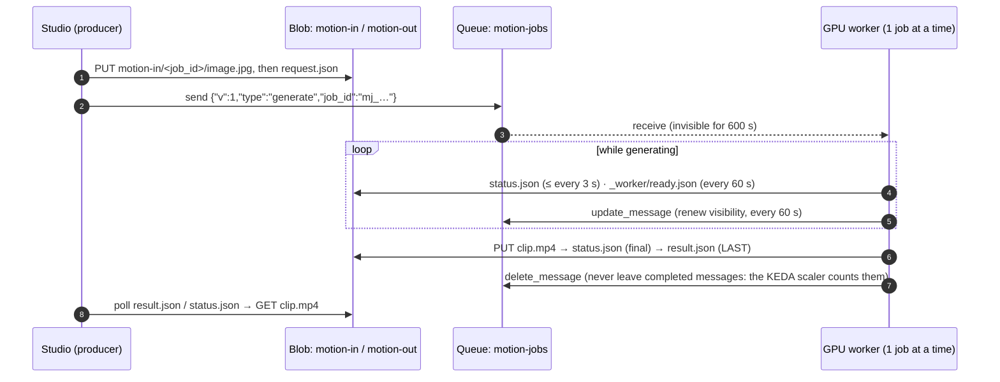

# Cinematic-motion wire contract — v1

> **Owner:** Agent W (`motion-worker`). **Consumers:** Studio backend (`app/src/spotlight/motion`), the GPU worker
> (`motion-worker/`), tests/tools on both sides.
> **Authoritative files:** [`motion-v1.schema.json`](motion-v1.schema.json) (JSON Schema 2020-12) and
> [`job-id-vectors.json`](job-id-vectors.json) (golden vectors). This README explains them and fixes everything a schema
> cannot express. Reference implementation: `motion-worker/motion_worker/contract.py`.

The Studio asks a self-hosted GPU worker (Wan 2.2 TI2V-5B on Azure Container Apps serverless GPU, scale-to-zero, no ingress)
for a short *image-to-video clip* through **one Azure Storage queue plus blob containers** — keyless (Entra / managed
identity), data never leaves the tenant. The same contract runs against a plain directory (`local` transport) for tests and
laptops.



## 1. Resources and names

| What | Name (defaults) | Notes |
|---|---|---|
| Queue | `motion-jobs` | text messages, JSON (§3) |
| Input container | `motion-in` | `<job_id>/request.json`, `<job_id>/<image>` — written by the Studio |
| Output container | `motion-out` | `<job_id>/status.json`, `result.json`, `clip.mp4`; `_worker/ready.json` — written by the worker |
| Weights mirror | `motion-models` | worker-private (`<model>/<revision>/…` + `manifest.json`); the Studio never touches it |

All blob names are relative; the **local transport** uses the same relative paths under a root directory (§9).

## 2. Versioning and compatibility

* Every document carries `"v": 1`. A worker rejects another `v` with `bad_request`.
* **Consumers MUST ignore unknown fields** in every document. Producers MUST NOT remove or rename fields within v1; new
  optional fields may be added (the schema is then updated and the worker tests keep it exact).
* Documents the worker **writes** (`status`, `result`, `ready`) are strict in the schema (`additionalProperties: false`),
  documents it **reads** (queue message, request) tolerate extras.
* Timestamps: UTC, ISO-8601, `…Z` (seconds precision).

## 3. Queue message

Message text is JSON (plain; the worker also tolerates base64-wrapped JSON):

```json
{"v":1,"type":"generate","job_id":"mj_0123456789abcdef01234567"}
{"v":1,"type":"warmup","job_id":"mw_4a0a1c3e5f6d4b7a8c9d0e1f2a3b4c5d"}
```

* `generate` → the worker reads `motion-in/<job_id>/request.json`.
* `warmup` (`mw_` + uuid4 hex) carries no data; it exists to wake the scale-to-zero replica. The worker deletes it as soon as
  it is up (it is only consumed once the model is loaded, so a deleted warm-up message means *ready*).

## 4. Request — `motion-in/<job_id>/request.json`

Write the **image first, then `request.json`, then enqueue** (so the worker never dequeues a job whose inputs are missing).

| Field | Type | Rule |
|---|---|---|
| `v` | int | `1` |
| `job_id` | string | `mj_` + 24 lowercase hex — the deterministic id of §5 |
| `model` | string | `^[a-z0-9][a-z0-9._-]{0,63}$`; must equal the worker's model id (`wan2.2-ti2v-5b`), else `bad_request` |
| `model_revision` | string, optional | pinned model revision the id was computed with; default = the contract revision of `model` (`wan2.2-ti2v-5b` → `b8fff7315c768468a5333511427288870b2e9635`) |
| `prompt` | string | 1…4000 chars, not blank |
| `negative_prompt` | string, optional | ≤ 4000 chars; absent ≡ `""` |
| `width`, `height` | int | multiples of 32, 256…1280 each, and `width·height ≤ 1280·704` (worker-side rule; not expressible in JSON Schema) |
| `num_frames` | int | **4n+1**, 25…121 (25 values) |
| `fps` | int | `24` |
| `steps` | int | 8…40 |
| `guidance_scale` | number | 1…8 |
| `seed` | int | 0…4294967295 |
| `image` | string | blob name inside the job prefix, `^[A-Za-z0-9_][A-Za-z0-9_-]{0,100}\.(jpg\|jpeg\|png\|webp)$` (no `/`, no dots in the stem) |
| `image_sha256` | string, optional | lowercase hex SHA-256 of the uploaded image bytes; when present the worker verifies it (`bad_request` on mismatch) |
| `campaign_id`, `shot_id` | string, optional | ≤ 128 chars; logging/correlation only |
| `created_at` | timestamp, optional | used for `queue_wait_s` when the queue gives no insertion time |

Image handling (worker side): decode JPEG/PNG/WEBP (≤ 20 MiB, ≤ 40 MP, EXIF orientation applied, transparency flattened on
white) → **centre-crop to the `width:height` aspect → resize to exactly `width×height` with LANCZOS** → first-frame
conditioning. The Studio may therefore upload the keyframe as is. Keyframes must be ONE single frame (no diptychs).
`request.json` itself must stay below 256 KiB.

## 5. Deterministic job id

`job_id = "mj_" + sha256(canonical)[:24 hex chars]` — same inputs ⇒ same id ⇒ transport-level idempotency/cache (the Studio
additionally caches the clip as a library asset). `canonical` is the UTF-8 encoding of these twelve fields **joined with `|`**,
in this exact order:

| # | Field | Canonical form |
|---|---|---|
| 1 | model | as is (`wan2.2-ti2v-5b`) |
| 2 | revision | `request.model_revision` or the contract revision of the model (see §4) |
| 3 | prompt | **escaped** (below), otherwise byte-exact: no trimming, no Unicode normalisation |
| 4 | negative_prompt | escaped; empty string if absent |
| 5 | width | decimal integer |
| 6 | height | decimal integer |
| 7 | num_frames | decimal integer |
| 8 | fps | decimal integer (`24`) |
| 9 | steps | decimal integer |
| 10 | guidance_scale | `format(x, ".6g")` — `4.0`→`4`, `3.5`→`3.5`, `7.123456789`→`7.12346` (JS: `String(Number(x.toPrecision(6)))`) |
| 11 | seed | decimal integer |
| 12 | image_sha256 | lowercase hex SHA-256 of the **exact bytes of the uploaded image blob** |

**Escaping** (free-text fields only, so a `|` or `\` inside a prompt can never shift a field boundary):
`esc(s) = s.replace("\\", "\\\\").replace("|", "\\|")`. For prompts without `|`/`\` the id equals the naive join.

Reference implementation (Python; this is `motion_worker.contract.compute_job_id`):

```python
import hashlib

def esc(s: str) -> str:
    return s.replace("\\", "\\\\").replace("|", "\\|")

def compute_job_id(*, model, revision, prompt, negative_prompt, width, height, num_frames, fps, steps,
                   guidance_scale, seed, image_sha256) -> str:
    canonical = "|".join([
        model, revision, esc(prompt), esc(negative_prompt),
        str(int(width)), str(int(height)), str(int(num_frames)), str(int(fps)), str(int(steps)),
        format(float(guidance_scale), ".6g"), str(int(seed)), image_sha256.lower(),
    ])
    return "mj_" + hashlib.sha256(canonical.encode("utf-8")).hexdigest()[:24]
```

The worker recomputes the id from the request and the downloaded image; a mismatch is only **logged** (`job_id_mismatch`) —
the id is merely the key both sides agree on, results are always written under the id of the queue message.

### Golden vectors (both sides MUST reproduce them)

Machine-readable copy: [`job-id-vectors.json`](job-id-vectors.json). `image_sha256` is the SHA-256 of the ASCII text in
"image bytes" (so no binary fixture is needed). Common inputs: `model=wan2.2-ti2v-5b`,
`revision=b8fff7315c768468a5333511427288870b2e9635`, `fps=24`.

**Vector 1 — `plain`** (the spec's request example) → **`mj_380b932f37f39c944afce70d`**

| width×height | frames | steps | guidance | seed | image bytes → `image_sha256` |
|---|---|---|---|---|---|
| 1024×576 | 93 | 20 | `4.0` | 123456 | `spotlight-motion-golden-image-1` → `830e4d0a125dc83c76a53baf8f2c6c1408e90145151e3b1636f73116c44545aa` |

* prompt: `A hand gently lifts the speckled ceramic mug; steam rises; slow cinematic push-in.`
* negative: `blurry, distorted, text, watermark`
* canonical:

```text
wan2.2-ti2v-5b|b8fff7315c768468a5333511427288870b2e9635|A hand gently lifts the speckled ceramic mug; steam rises; slow cinematic push-in.|blurry, distorted, text, watermark|1024|576|93|24|20|4|123456|830e4d0a125dc83c76a53baf8f2c6c1408e90145151e3b1636f73116c44545aa
```

**Vector 2 — `escaping-unicode`** (Polish text, emoji, `|` and `\` in the prompt, empty negative) → **`mj_7312d03e1865eeb0c0d6cfc6`**

| width×height | frames | steps | guidance | seed | image bytes → `image_sha256` |
|---|---|---|---|---|---|
| 768×768 | 25 | 12 | `3.5` | 4294967295 | `spotlight-motion-golden-image-2` → `e946bc689b60488d3709a245c74edbe947b738631710723062041beb8e401ec8` |

* prompt (raw): `Dłoń unosi kubek | para wznosi się\ powoli — zbliżenie 🎬` (contains one `|` and one `\`)
* negative: `` (empty)
* canonical:

```text
wan2.2-ti2v-5b|b8fff7315c768468a5333511427288870b2e9635|Dłoń unosi kubek \| para wznosi się\\ powoli — zbliżenie 🎬||768|768|25|24|12|3.5|4294967295|e946bc689b60488d3709a245c74edbe947b738631710723062041beb8e401ec8
```

**Vector 3 — `guidance-rounding`** (`.6g` rounding, `|` in the negative prompt, 9:16, max frames, seed 0) → **`mj_04cc9e66b42e6b872d7ceb09`**

| width×height | frames | steps | guidance | seed | image bytes → `image_sha256` |
|---|---|---|---|---|---|
| 576×1024 | 121 | 40 | `7.123456789` | 0 | `spotlight-motion-golden-image-3` → `3501e4bdb6ff91eb3777744c93a2b68ce91ad0f3431fafbfa4aa624afcf1d409` |

* prompt: `Slow truck left across the counter.`  · negative: `a|b`
* canonical:

```text
wan2.2-ti2v-5b|b8fff7315c768468a5333511427288870b2e9635|Slow truck left across the counter.|a\|b|576|1024|121|24|40|7.12346|0|3501e4bdb6ff91eb3777744c93a2b68ce91ad0f3431fafbfa4aa624afcf1d409
```

> Vector 1 needs no escaping, so a naive `'|'.join` reproduces it; vectors 2 and 3 pin the escaping rule. (The three
> vectors were also reproduced by an independent Node.js implementation.)

## 6. Worker-written documents

### `motion-out/<job_id>/status.json`

Overwritten by the worker **at least every 3 s** while the job runs (default 2 s); `progress` is monotonic.

```json
{"v":1,"job_id":"mj_…","state":"running","progress":0.42,"step":9,"steps":20,"message":"denoising",
 "replica":"ca-studio-motion--0000001-abcde","updated_at":"2026-11-18T18:00:30Z"}
```

`state`: `queued | running | succeeded | failed` (the worker writes `running`, then the terminal state; `queued` is reserved
for producers that want to model "enqueued, not picked up yet" — a missing `status.json` also means that). Progress map:
`0.02` preparing → `0.05…0.85` denoising (`step/steps`) → `0.85` "decoding frames" → `0.93` encoding → `0.97` uploading →
`1.0` done. A failed job keeps the last progress. **The terminal marker is `result.json`, not `status.json`.**

### `motion-out/<job_id>/result.json` — written LAST; presence ⇒ the job is terminal

```json
{"v":1,"job_id":"mj_…","state":"succeeded","clip":"clip.mp4","width":1024,"height":576,"fps":24,"num_frames":93,
 "seed":123456,"model":"wan2.2-ti2v-5b","model_revision":"b8fff7315c768468a5333511427288870b2e9635",
 "gpu_seconds":74.2,"timings":{"queue_wait_s":3.1,"generate_s":70.5,"encode_s":2.4},"error":null}
```

* Order of writes: `clip.mp4` → `status.json` (terminal) → `result.json`. If `result.json` exists, `clip.mp4` exists.
* `gpu_seconds` = wall seconds the worker spent on the job (request/image fetch + generation + encode + clip upload; excludes
  queue wait). It is the basis of Studio cost metering and is also reported for **failed** jobs (GPU time was spent).
  `timings.queue_wait_s` = enqueue → start; `generate_s` includes the VAE decode.
* `width/height/num_frames` describe the produced clip. A `failed` result has `"clip": null` and an `error`; the echo fields
  (`width…seed`) are `null` when the failure happened before the request could be read/validated (`model`/`model_revision` are
  always set).
* The fake pipeline (`MOTION_PIPELINE=fake`) reports `"model_revision": "fake"` — never present such a clip as Wan output.

**Error codes** (`error: {"code", "message", "retryable"}`; messages are short, human-readable, English, no tracebacks):

| `code` | When | `retryable` | Suggested Studio reaction |
|---|---|---|---|
| `bad_request` | invalid request/id/model/image (never succeeds as sent) | `false` | fix the producer; fall back to the still for this shot |
| `oom` | CUDA (or host) out of memory | `false` | do not retry the same parameters; fall back to the still (or retry smaller) |
| `timeout` | job exceeded the worker limit (default 600 s) or the GPU call hung and the replica was restarted | `true` | may retry once (§8), else fall back |
| `internal` | anything unexpected; also *poison*: the message was delivered > 3 times without completing | `true` (poison: `false`) | may retry once (§8), else fall back |

### `motion-out/_worker/ready.json`

```json
{"v":1,"state":"ready","replica":"…","model":"wan2.2-ti2v-5b","model_revision":"b8fff73…","vram_gib":22.6,
 "started_at":"2026-11-18T17:55:00Z","updated_at":"2026-11-18T18:00:30Z"}
```

Written immediately at process start (`state: loading`), again when start-up completes (`ready`), then **refreshed every 60 s
for as long as the process is alive — also while it is generating**; on a queue outage it flips back to `loading` until the
queue answers; on graceful shutdown it is deleted (only if it still belongs to the same `replica`).

**Studio readiness rule:**

| Observation | State |
|---|---|
| `state="ready"` and `now − updated_at < 150 s` | **ready** |
| `state="loading"` and `now − updated_at < 150 s`, **or** a warmup/generate message is pending in the queue | **warming** |
| anything else (no document, stale document) | **cold** |

## 7. Worker semantics (what a producer can rely on)

* **One job at a time** (quota: one A100 replica). Messages are dequeued with a **visibility timeout of 600 s**, renewed every
  ≤ 120 s (default 60 s) while a job runs; `update_message` always carries an explicit timeout.
* **Idempotent:** if `result.json` already exists (any state) the message is deleted and nothing runs.
* **Poison guard:** `dequeue_count > 3` ⇒ a `failed`/`internal`/`retryable:false` result is written and the message deleted.
* **Completed messages are always deleted** (the KEDA queue scaler counts messages).
* **Graceful stop (SIGTERM):** the current job finishes if the grace period (default 600 s; set the container's
  `terminationGracePeriodSeconds` accordingly) allows it; otherwise the job is aborted, **no result is written** and the
  message is released immediately for the next replica. No new job is started after SIGTERM.
* **Hang watchdog:** a job running longer than `timeout + 120 s` is failed (`timeout`) and the replica exits so the platform
  restarts it.
* Logs: JSON lines on stdout (`job_id`, `shot_id`, `gpu_seconds`, `state`, …); prompts are never logged.

## 8. Producer protocol (Studio)

1. **Cache check:** compute the id; if `motion-out/<id>/result.json` exists and is `succeeded` → reuse `clip.mp4`, do not enqueue.
2. Upload `motion-in/<id>/<image>`, then `request.json` (`overwrite=True`), then send the queue message.
3. Poll `status.json` / `result.json` every ~3 s; show `progress`/`message`. Treat a `status.json` whose `updated_at` stopped
   advancing for > 60 s while the worker is `ready` as a stall. Re-enqueue the same message if the job stays unclaimed for
   > 20 min with no worker.
4. On `succeeded` download `clip.mp4`, meter `gpu_seconds`, store the clip as a library asset.
5. **Retrying a finished job with the same id:** delete `motion-out/<id>/result.json` (and `status.json`) first, then enqueue
   again. Re-enqueueing without deleting `result.json` is a no-op by design (idempotency).
6. **Warm-up:** `{"v":1,"type":"warmup","job_id":"mw_<uuid4 hex>"}` once after the storyboard frames exist (best effort).
7. Suggested lifecycle rule on `motion-out`: delete after 7 days (the Studio keeps clips in its own library).

## 9. Local-dir transport (tests, laptops, orchestrator integration)

Worker: `MOTION_TRANSPORT=local MOTION_LOCAL_DIR=D`; Studio: `MOTION_MODE=local MOTION_LOCAL_DIR=D`. Layout under `D`:

| Path | Meaning |
|---|---|
| `D/queue/<ts>-<uuid>.json` | pending message (name sorts FIFO, e.g. `f"{time.time_ns():020d}-{uuid4().hex}.json"`) |
| `D/queue/<ts>-<uuid>.claimed` | in flight: the consumer claimed it by **atomic rename** of the `.json` file |
| `D/queue/<ts>-<uuid>.state` | consumer bookkeeping `{"dequeue_count", "visible_at", "receipt"}` (visibility timeout, poison guard) |
| `D/motion-in/…`, `D/motion-out/…`, `D/motion-models/…` | the blob containers, same relative names as in Azure |

* **Producers MUST write atomically**: write to a temporary name (e.g. `.<name>.tmp`) in the same directory, then `os.replace`
  it to the final name. (The worker ignores empty message files and hidden `.tmp` files, but a half-written JSON would be
  consumed as a message.)
* Queue depth for the Studio = number of `*.json` (+ `*.claimed` if it wants in-flight jobs).
* A claimed message whose `visible_at` passed returns to `*.json` with its `dequeue_count` kept — exactly Azure's semantics.
* Blob names are validated against path traversal on the worker side.

## 10. Permissions (what the infra must grant)

| Principal | Role | Why |
|---|---|---|
| Studio identity | Storage Queue Data Message Sender; Storage Blob Data Contributor | enqueue; write `motion-in`, read `motion-out` |
| Studio identity | + queue **read** (Storage Queue Data Reader) | `approximate_message_count` for `queue_depth` (Get Queue Properties) |
| Worker identity | Storage Queue Data Message Processor | receive, delete, **update** (visibility renewal) |
| Worker identity | Storage Blob Data Contributor | read `motion-in`, write `motion-out` and `motion-models` |
| KEDA scale rule identity | queue read (Storage Queue Data Reader/Contributor) | reads the queue length (Get Queue Properties) |

If visibility renewals return 403 (`AuthorizationPermissionMismatch`) with *Message Processor* only, grant *Storage Queue Data
Contributor* to the worker (jobs shorter than the 600 s visibility timeout still complete; renewal failures are only logged).

## 11. Validating documents

```python
import json, jsonschema
schema = json.load(open("contracts/motion-v1.schema.json"))
check = lambda name, doc: jsonschema.Draft202012Validator(
    {"$schema": schema["$schema"], "$defs": schema["$defs"], "$ref": f"#/$defs/{name}"}).validate(doc)
check("request", request_doc)   # also: queueMessage, status, result, ready
```

The worker's tests validate **every JSON it writes** against this schema, check all `examples` in it, run the golden vectors,
and assert that this README lists the same ids.

## 12. Clarifications relative to the first spec draft (§2.1)

* `request.json` gains two **optional** fields: `model_revision` and `image_sha256` (both used for verification only).
* The id canonicalisation is now exact (§5), including the `|`/`\` escaping of the two free-text fields and `.6g` guidance.
* A `failed` result carries the same keys as a `succeeded` one (echo fields may be `null`), plus `gpu_seconds`.
* `ready.json` is refreshed while the worker is busy; `loading` is also published during a queue outage.
* Aborted-by-shutdown jobs write **no** result (the message is released instead).
