# SwarmAI Contact Center ("Concierge") — Azure Architecture

| | |
|---|---|
| **Status / version** | Target architecture v1.0 · 17 Nov 2026 · grounded in Microsoft Learn as of that date |
| **Scope** | Enterprise target architecture on Azure, and — in §21 — exactly how the **reference implementation in this repository** (one Container App, Cosmos DB serverless, one Foundry/AIServices account) maps to it |
| **Read with** | [`PRD.md`](PRD.md) (requirements, KPIs, business case) · [`FEATURES.md`](FEATURES.md) (24 features) · [`business-case/`](business-case/README.md) (the cost and ACR model quoted in §15) |
| **Conventions** | ADR-nn = architecture decision (§19) · `CC-nn` = feature · `[L#]` = Microsoft Learn or other reference (§22) · numbers marked *model* come from `business-case/outputs.json` · numbers marked *budget* are design allocations to be validated by measurement (CC-22) |

## 1. Purpose and scope

Concierge is an AI-first contact center: a swarm of specialised AI agents resolves voice and digital contacts, a deterministic policy engine owns every action that moves money or touches identity, humans handle what needs judgement with full context, and a quality and learning loop scores, mines, forecasts and tests everything. This document defines how that is built on Azure: the logical architecture, the agent topology, the voice media path and its latency budget, data, AI, security, integration, deployment topology, reliability, capacity, cost, observability and delivery — with the decisions and alternatives behind them.

**Platform facts that shape the design (verified in Microsoft Learn on 17 Nov 2026)**

| Fact | Consequence |
|---|---|
| **Azure OpenAI Realtime accepts SIP calls directly** (SIP trunk → `sip:proj_<id>@<region>.sip.ai.azure.com`, webhook `realtime.call.incoming`, accept / reject / refer / hang-up APIs, WebSocket side-channel by `call_id`); supported in East US 2, **France Central** and **Sweden Central**; models include `gpt-realtime-2.1` and `gpt-realtime-2.1-mini` [L1][L2] | The production voice path can be *SIP trunk → Azure OpenAI Realtime* with no media server of our own (ADR-02, ADR-03) and an EU active/active pair (Sweden Central + France Central) |
| **Azure Communication Services is being retired as a standalone offering on 30 Sep 2028**: Direct Routing, Direct Offer numbers, SMS, Email, Chat, Advanced Messaging (WhatsApp) and Job Router are retired; Call Automation, audio streaming and recording continue only for Teams-aligned scenarios (Teams Phone Extensibility); tenants without an ACS resource created before 23 Oct 2026 cannot acquire ACS numbers or SMS [L3] | Telephony, messaging and routing stay **behind adapters**; ACS is supported only for tenants that already run on it (ADR-02) |
| **Data Zone Standard** deployments process prompts inside the EU data zone while data at rest stays in the resource's geography; a regional interruption affects traffic routed there [L4] | EU customers use Data Zone deployments in more than one region (ADR-09) |
| **Realtime models have separate audio-token and concurrent-session quotas**; the 2.x models do not support the `truncation` session property [L2] | Capacity is planned per region (§14); context is managed with item truncate / delete events |
| **Prompt Shields** analyse user-prompt attacks and document attacks (and, in preview, tool responses for agents) [L5] | Used on user text, KB documents and tool results (§9.4) |
| **Voice Live API** adds noise suppression, echo cancellation, semantic end-of-turn detection, 146 input locales and 600+ voices, and avatars on top of the Realtime events [L6]. Its **SIP connection** (PSTN or SBC; TLS and SRTP; G.711, AMR-WB or Opus; East US 2, France Central, Sweden Central and others) is a **public preview without an SLA and not recommended for production**; the Voice Live FAQ still lists SIP as unsupported, so treat the dedicated SIP page as newer and re-verify at build time [L7] | Voice Live is an option for browser and app voice and for locales or voices the Realtime models lack; its SIP path is evaluated in Release 2 once it is generally available |

## 2. Architecture principles

1. **Resolve, not deflect** — design for verified outcomes; every decision is checked against KPI-01 / 02.
2. **Models propose, code disposes** — identity, money, consent and data access are enforced by deterministic services outside the model (ADR-05).
3. **Human + AI continuum** — every path has a human escape hatch and a context-preserving handoff.
4. **Provider-neutral edges, Azure-native core** — telephony, channels, routing, CRM and CCaaS sit behind interfaces; AI, data and platform are Azure services (ADR-02).
5. **Keyless and least-privilege** — managed identities and RBAC, no keys or connection strings anywhere (ADR-08).
6. **Everything that changes behaviour passes a gate** — prompts, knowledge, tools, policies and model deployments are versioned, evaluated, canaried and reversible (ADR-10).
7. **Measure every interaction** — tokens, audio minutes, latency, outcome and cost are recorded per conversation (CC-22).
8. **Data minimisation and residency by default** — only needed fields reach a model; card data never does; EU processing for EU customers (ADR-09, ADR-12).
9. **Design for the peak, pay for the average** — elastic compute, consumption AI, capacity planned from concurrent sessions (§14).
10. **Honest simulation** — where a physical or third-party system is unavailable (PSTN), the interface is real and the simulator is tested software (§21).

## 3. System context

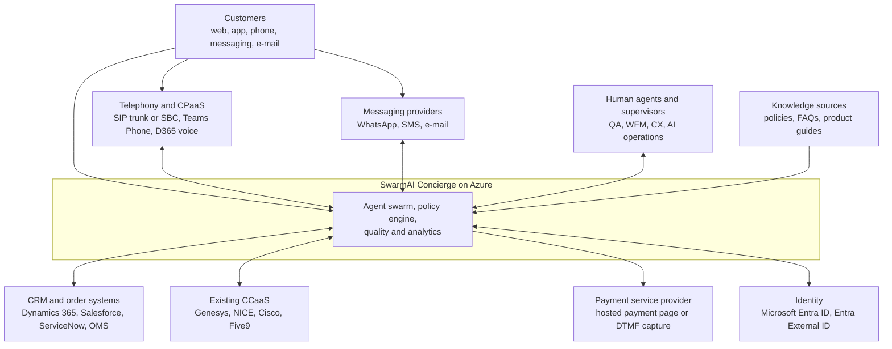

## 4. Logical architecture

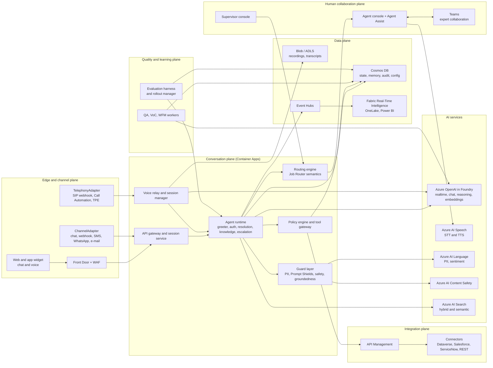

**Planes and responsibilities**

| Plane | Responsibility | Scaling unit | Key features |
|---|---|---|---|
| Edge and channel | Terminate customer connections (WebRTC, WebSocket, SIP webhooks, messaging webhooks); normalise to internal events; WAF and rate limits | Front Door, adapter replicas | CC-01, 02, 24 |
| Conversation | Session state, agent runtime, tool gateway and policy engine, guard layer, routing | Container Apps replicas by concurrent sessions | CC-01…07, 11 |
| AI services | Models, speech, language, safety, retrieval | Quota and deployment capacity | CC-02, 03, 06, 08, 10, 11 |
| Human collaboration | Console, copilot, takeover, supervisor, Teams experts | Replicas by connected agents | CC-07, 08, 15 |
| Data | Operational state, recordings, event stream, analytics lake | RU/s, storage, capacity units | CC-09, 10, 12, 13 |
| Quality and learning | QA scoring, VoC, forecasting, evaluation, rollout | Queue-driven workers | CC-10, 12, 14, 16, 17 |
| Integration | Connectors and gateway to CRM, OMS, CCaaS | APIM units, connector replicas | CC-04, 20 |

## 5. The agent-swarm topology

The swarm is a **supervisor pattern**: the *Resolution agent* owns the conversation and delegates to specialists; specialists never talk to the customer directly except the Authentication agent during verification. Control flow is an explicit state machine (greet → disclose → classify → authenticate → resolve → confirm → wrap-up, with escalate reachable from every state), so behaviour is testable and a model failure degrades to a human, not to a loop.

| Agent | Decides | Reads | Writes (only via the policy engine) | Model tier | Features |
|---|---|---|---|---|---|
| **Greeter / Router** | Language, intent, urgency, risk flags, AI-first vs human-first | Utterance, customer segment | Routing request | nano / mini | CC-06 |
| **Authentication** | Verification level; step-up; consent state | Consent store, OTP service | Consent events, verification level | mini | CC-05 |
| **Resolution** | Plan, tool use, offer, when to escalate | Memory, knowledge, order data | Tool requests, escalation | realtime mini/full, chat mini/full | CC-01, 02 |
| **Knowledge** | Which sources answer the question; grounded or not | Search index, KB versions | Citations | mini + groundedness check | CC-03 |
| **Action** | Parameter validation, which tool | Tool registry | Back-office calls (through policy) | code + function calling | CC-04, 20 |
| **Escalation / Handoff** | Destination queue, package contents, whisper | Transcript, tool log, sentiment | Context package, routing job | mini | CC-07, 08 |
| **QA** | Rubric scores with evidence | Transcripts, rubric | QA record, coaching | mini / full for borderline | CC-10 |
| **Insights** | Topics, anomalies | Summaries, embeddings | Alerts, aggregates | embeddings + mini | CC-12 |
| **WFM** | Forecast, staffing | History, containment | Plans | statistical | CC-14 |
| **Simulator** | Customer behaviour in tests | Scenario library | Synthetic conversations | mini / full | CC-16 |

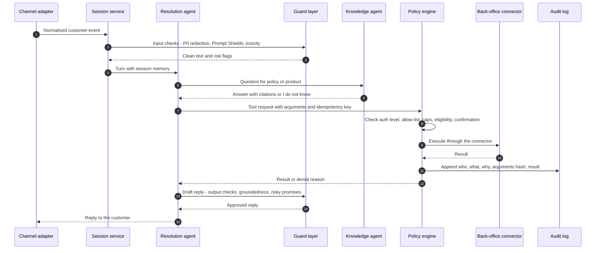

**Concurrency and state.** A conversation is pinned to one replica per turn but its state lives in Cosmos DB, so any replica can continue it; the voice relay is pinned for the life of the call. Specialist calls are asynchronous where independent (for example retrieval and order lookup run in parallel). A conversation is partitioned by `conversationId`; the customer timeline is a separate container partitioned by `customerId` (§8).

## 6. Azure service map

| Capability | Target Azure service(s) | Why | Alternatives considered | Demo slice |
|---|---|---|---|---|
| **Speech-to-speech voice agent** | Azure OpenAI Realtime — `gpt-realtime-2.1` and `gpt-realtime-2.1-mini` over SIP, WebRTC or WebSocket [L1][L2] | Native audio in/out with built-in reasoning, barge-in, tool calls and SIP in Sweden Central and France Central | **Voice Live API** (more locales and voices, noise suppression, avatars; SIP connection in public preview, no SLA) [L6][L7]; STT → LLM → TTS pipeline (kept as the fallback); partner voice stacks | `gpt-realtime-2.1-mini` (fallback `gpt-realtime-mini`) over a WebSocket relay |
| **Telephony (PSTN, SIP)** | SIP trunk or SBC → Realtime SIP endpoint; **or** Teams Phone Extensibility; **or** Dynamics 365 Contact Center voice; **or** ACS for tenants that already run on it (for example the Call Center Voice Agent Accelerator pattern [L29]); Voice Live SIP when it leaves preview [L1][L3][L7][L8] | Carrier-neutral; ACS is retiring as a standalone offering (ADR-02) | Partner CPaaS media streams (Twilio, Vonage, Bandwidth, Infobip and others) into a relay | **Not provisioned**; `TelephonyAdapter` + simulator |
| **Digital channels** | Own channel plane on Container Apps (web chat, webhook) with Azure Web PubSub for fan-out; messaging via Dynamics 365 Contact Center channels or partner CPaaS (Infobip, Telesign, Blip are the partners Microsoft lists for ACS Chat/SMS/WhatsApp) [L3] | ACS Chat, SMS, Email and WhatsApp are retiring | Teams / Graph chat for internal use | FastAPI WebSocket / SSE; SMS, WhatsApp, e-mail as tested stubs |
| **LLMs** | Azure OpenAI in Foundry: `gpt-5.4-mini` (workhorse), `gpt-5.4` (reasoning, QA), `gpt-5.4-nano` (classifiers), newer `gpt-5.5` / `gpt-5.6` family as evaluated candidates; **Data Zone Standard** for EU [L4] | Price/performance tiers; EU processing; harness-gated upgrades | Provisioned throughput (PTU) where latency variance at volume matters (blocked by policy in the demo subscription) | `chat`, `reasoning` deployments, GlobalStandard |
| **Embeddings** | `text-embedding-3-small` | Cheap, adequate for hybrid retrieval and VoC clustering | `text-embedding-3-large` | `embed` deployment |
| **Speech (STT, TTS)** | Azure AI Speech: streaming STT with diarization for human calls; neural / HD TTS; custom neural voice. `gpt-live-transcribe` is the model Learn recommends for realtime transcription and is an alternative [L9] | 140+ locales; diarization; brand voice | `gpt-realtime-whisper`, MAI-Transcribe | Same AIServices account (fallback path) |
| **Language** | Azure AI Language: conversation PII redaction, sentiment, summarisation, CLU [L10] | Managed, auditable PII detection with redaction | LLM-only PII (weaker guarantees) | AIServices account |
| **Safety** | Azure AI Content Safety: **Prompt Shields** (user prompt and document attacks), text moderation, groundedness detection [L5] | First-party defences; documents and tool results are untrusted | Open-source guard models | AIServices account |
| **Knowledge retrieval** | Azure AI Search: hybrid (vector + keyword), semantic ranker, integrated vectorization; Document Intelligence for PDFs | Hybrid recall and ranking at scale; versions via index aliases | Cosmos DB vector search; pgvector | In-process index persisted to Cosmos DB behind a `Retriever` interface |
| **Conversation state, memory, audit, config** | Azure Cosmos DB for NoSQL: autoscale, multi-region, TTL, change feed | Low-latency JSON, partitioning by conversation, global distribution | Redis (volatile), SQL (rigid) | Cosmos DB serverless |
| **Recordings and transcripts** | Blob Storage / ADLS Gen2: GRS or ZRS, lifecycle tiers, immutability (legal hold) | Cheap, tiered, governed | Cosmos for audio (no) | Blob container (Entra-only) |
| **Streaming and analytics** | Event Hubs → **Fabric Real-Time Intelligence** (Eventstream, Eventhouse, Activator) → OneLake → Power BI [L11] | One lake for real-time and batch; KQL for anomaly detection; business-user BI | Azure Data Explorer, Synapse, Cosmos analytical store | In-app aggregates in Cosmos DB |
| **Compute** | Azure Container Apps (WebSockets, zone redundancy, scale rules, VNet) [L16][L17] | Simple, elastic, scale-to-load for long-lived sessions | AKS for very large estates (ADR-11) | One Container App |
| **Asynchronous work and outbox** | Azure Service Bus queues and topics for QA scoring, wrap-up, notifications and the outbox for back-office writes; Cosmos DB change feed for lightweight fan-out | Ordering, dead-lettering, retries without losing audit | Storage Queues; Event Hubs only for telemetry | In-process background tasks |
| **Gateway and edge** | Front Door Premium + WAF; API Management; Private Link | Global entry, bot/DDoS protection, policy, token and rate limits | Application Gateway | Container Apps ingress |
| **Routing** | Job-Router-semantics engine: Dynamics 365 Contact Center routing, a partner engine (Talkdesk, Luware are listed by Microsoft as Job Router alternatives [L3]) or the in-process router | ACS Job Router is retiring | Build-your-own queueing | In-process router |
| **CRM / OMS** | Dynamics 365 Customer Service / Contact Center and Dataverse; Salesforce; ServiceNow; through APIM and connectors | Integrates where the data lives | Direct DB access (no) | Mock back-office + adapters tested against mocked HTTP |
| **Human collaboration** | Microsoft Teams (expert swarming), Teams Phone Extensibility | Experts are already in Teams [L8] | — | In-app consoles |
| **Identity** | Microsoft Entra ID (workforce), **Entra External ID** (customers), managed identities, Conditional Access | Keyless, least privilege, MFA | Custom auth (no) | Demo role switcher; Entra-ready JWT validation; managed identity to Azure |
| **Secrets and keys** | Key Vault (SBC certificates, webhook secrets, CMK) | HSM-backed, audited | — | None needed (keyless) |
| **Protection and governance** | Defender for Cloud (incl. AI workload protection), Purview (classification, lifecycle), Azure Policy | Posture, threat detection, data governance | — | Not deployed |
| **Observability** | Azure Monitor, Application Insights (OpenTelemetry), Log Analytics, Workbooks / Managed Grafana | Single pane; OpenTelemetry standard | Third-party APM | Application Insights + Log Analytics (1 GB/day cap) |
| **LLMOps** | Foundry evaluations and red-teaming, App Configuration (flags), CI/CD gates | Gate every change; staged rollout | Manual testing (no) | In-app harness (CC-16/17) |
| **Agent orchestration (Release 2)** | Foundry Agent Service with MCP tool servers | Standard plumbing, easier partner extension | Keep the in-house runtime | In-house runtime |
| **IaC and delivery** | Bicep, `azd`, GitHub Actions or Azure DevOps, Deployment Stacks | Reproducible and policy-checked | Terraform | Bicep + `azd`, remote build in ACR |

## 7. Media and voice path

### 7.1 Three paths, one agent

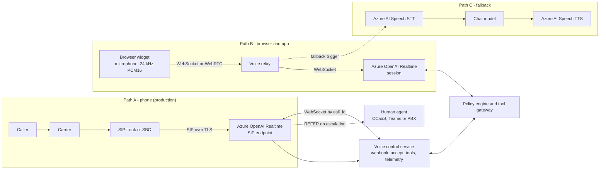

| Path | When | Notes |
|---|---|---|
| **A — phone (production)** | PSTN callers | SIP trunk or SBC routes to `sip:proj_<id>@<region>.sip.ai.azure.com;transport=tls`; our webhook receives `realtime.call.incoming` and accepts with the session configuration (instructions, voice, tools); a WebSocket by `call_id` carries tool calls, transcripts and telemetry; escalation is a SIP REFER to the human endpoint [L1]. Recording comes from the SBC or CPaaS fork (SIPREC) and from transcript events. **Not provisioned in the demo.** |
| **B — browser and app** | Web "Call us", mobile app | The reference implementation streams 24 kHz mono PCM16 over a WebSocket to a relay that holds the Realtime session [L2]. A WebRTC transport is available for lower latency in the target [L2] (to be confirmed per region). **This is the live voice channel of the demo.** |
| **C — fallback** | Realtime unavailable, or a language/voice not supported | STT → LLM → TTS through Azure AI Speech and a chat model, same tool gateway; the transcript stays continuous and the UI shows a fallback marker (CC-02) |

### 7.2 Latency budget (target: p95 < 800 ms, end of customer speech → first agent audio)

*Design budget (assumption); the demo and the pilot report measured values per turn (CC-22).*

| Segment | p50 (ms) | p95 (ms) | Notes |
|---|---:|---:|---|
| Carrier and SBC to the Azure edge, in-region | 30 | 60 | Choose a trunk provider with a point of presence near the region |
| Network to the SIP/Realtime endpoint | 10 | 20 | Same region |
| End-of-turn detection (server or semantic VAD) | 200 | 300 | Tuned per language; shorter silence risks cutting people off |
| Model time to first audio (`gpt-realtime-2.1-mini`, minimal reasoning) | 200 | 300 | Tool calls add time (below) |
| Audio return, jitter buffer, playback | 40 | 80 | |
| **Total without a tool call** | **480** | **760** | Inside the 800 ms budget |
| Tool call (lookup, policy check) | +150 | +400 | Hidden behind a short spoken preamble: Realtime 2.x supports "commentary" preambles that reduce perceived latency [L2] |

Design rules that protect the budget: run in the region of the SIP endpoint; keep the system prompt and tool schemas in a stable, cacheable prefix; cap reasoning effort at `minimal` or `low` for routine turns; pre-fetch customer context after authentication; make slow back-office calls asynchronous with a spoken status; keep p95, not the average, as the SLO.

### 7.3 Barge-in

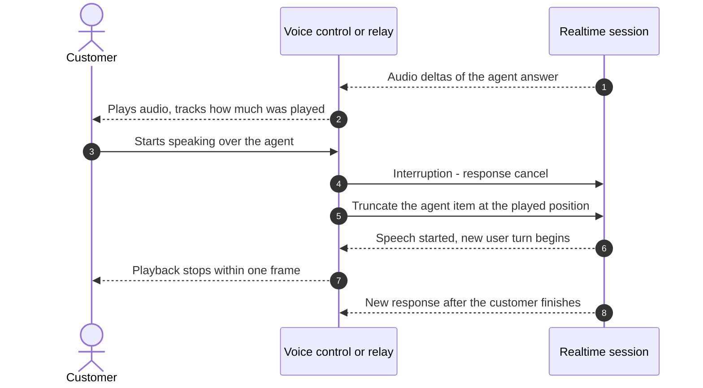

The relay tracks the audio actually played so the model's memory of what the customer heard stays accurate; interruptions during reasoning discard the chain of thought and start a new turn [L2].

### 7.4 Voice handoff to a human

1. The Escalation agent builds the context package (CC-07) and stores it under a `contextId`.
2. The router (§4) offers the contact to a human agent; the console shows the package **before** the agent accepts.
3. The AI tells the customer a colleague is joining and what is shared.
4. Path A: SIP REFER to the human endpoint (CCaaS, Teams or PBX) carrying the `contextId` in a header or user-to-user information; the agent desktop fetches the package by id. Path B: the human joins the web session. In both cases Agent Assist attaches to the live transcript (streaming STT with diarization for the human leg).
5. Wrap-up is pre-filled and QA scores the whole conversation.

### 7.5 Recording and consent on the media path

Consent is captured by the Authentication agent before any recording starts (CC-05). If the customer declines, recording is disabled for the call and only the minimum transcript needed to complete the contact is retained (or the call routes to a human), and the decision is logged. Recordings are written by the SBC/CPaaS fork or the platform recorder to Blob Storage with the consent reference in metadata; the lifecycle policy deletes them at the end of the retention period.

### 7.6 Voice-path resilience

Two SIP trunk destinations (Sweden Central and France Central endpoints) with provider-side failover on 486 / 503 / 408 responses [L1]; health probes on the webhook service; if both realtime regions fail, the SBC plays a short message and routes to the human queue or a callback; chat remains available.

## 8. Data architecture

### 8.1 Data classes and stores

| Data class | Examples | Store | Default retention | PII | Notes |
|---|---|---|---|---|---|
| Conversation state and memory | Session, turns, working memory | Cosmos DB (`conversations`, `turns`) | 90 days hot (TTL) | Redacted | Partition `/conversationId` |
| Customer timeline | Orders, contacts, cases, sentiment | Cosmos DB (`timeline`) | Relationship + policy | Masked by role | Partition `/customerId` |
| Tool audit | Who / what / why / arguments hash / result | Cosmos DB (`tool_audit`, append-only, hash-chained) | 7 years (finance) — per market | Minimal | Immutable |
| Consent and verification | Disclosure, recording consent, OTP result | Cosmos DB (`consents`) | Life of relationship + statutory | Yes | Evidence |
| Recordings | Call audio | Blob / ADLS (hot 90 days → cool → delete) | 12 months, per market | Yes | Immutability for legal hold |
| Redacted transcripts | Per conversation | Blob / ADLS + Cosmos | 24 months | Redacted | Analytics and QA input |
| QA, wrap-up, VoC | Scores, summaries, topics | Cosmos DB + OneLake | 24 months | Redacted | |
| Knowledge | Sources, chunks, embeddings, versions | Blob + AI Search index | Versions kept | None | Publish workflow |
| Configuration and prompts | Versions, diffs, eval reports | Cosmos DB (`configs`) | Indefinite | None | Rollback |
| Telemetry | Traces, metrics, logs | Log Analytics / App Insights | 90 days | Redacted | Not a PII store |
| Analytics lake | Curated Delta tables | OneLake | 24 months | Pseudonymised | Power BI semantic model |

### 8.2 PII handling

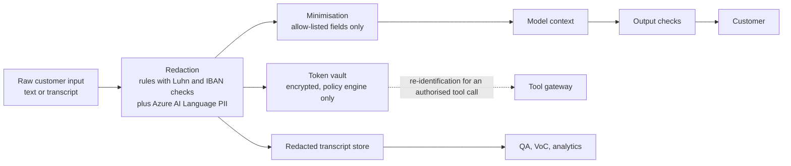

Card numbers and other payment data never enter this flow at all: payment capture is handed off (ADR-12). Names, e-mail addresses and phone numbers are replaced by placeholders in model context and stored transcripts; the policy engine can resolve a placeholder for an authorised tool call (for example sending a confirmation) without the model ever seeing the value.

### 8.3 Analytics data flow

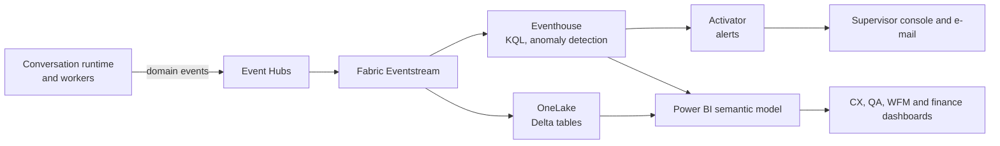

Domain events: `conversation.started`, `turn.completed`, `tool.executed`, `escalation.created`, `handoff.accepted`, `conversation.ended`, `wrapup.completed`, `qa.scored`, `kb.published`, `config.promoted`, `consent.captured`, `usage.metered`. Events carry ids, timings, labels and costs — never raw PII.

### 8.4 Residency

Processing for EU customers uses **Data Zone Standard** deployments in Sweden Central and France Central (prompts and responses are processed inside EU member-nation geographies; data at rest stays in the resource's geography [L4]); Cosmos DB, Blob and AI Search live in the same two regions; Fabric capacity and OneLake sit in the primary region. Cross-region replication is within the EU.

## 9. AI architecture

### 9.1 Model portfolio

| Role | Deployment | Why | Fallback |
|---|---|---|---|
| Voice agent (routine) | `gpt-realtime-2.1-mini` | Lowest cost per minute (≈ $0.026 of realtime tokens per minute against ≈ $0.093 for the full model, *model*) | `gpt-realtime-mini`, then pipeline path |
| Voice agent (hard cases, hard languages) | `gpt-realtime-2.1` | Stronger instruction following and reasoning | `gpt-realtime-2.1-mini` |
| Chat agent, Agent Assist, wrap-up | `gpt-5.4-mini` | Best price/performance for streaming turns | `gpt-5.4` |
| QA scoring of borderline cases, reasoning, eval judges | `gpt-5.4` | Reasoning quality | `gpt-5.5` / `gpt-5.6` candidates via harness |
| Intent, sentiment, risk labels | `gpt-5.4-nano` (+ Azure AI Language) | Cheap, fast classifiers | `gpt-5.4-mini` |
| Embeddings | `text-embedding-3-small` | Cost | `text-embedding-3-large` |
| Live transcription of human calls | Azure AI Speech streaming STT with diarization (or `gpt-live-transcribe`) | Locales, diarization | Batch fast transcription for QA only |

In the business case, 30 % of voice minutes run on `gpt-realtime-2.1` and 70 % on `-mini`; Azure cost per AI voice minute is $0.047 (*model*).

### 9.2 Prompt and context architecture

Prompts are layered: (1) **platform policy** (never changes at runtime), (2) **tenant configuration** (brand voice, languages, escalation rules), (3) **tool schemas**, (4) **customer context** (masked), (5) **turn**. Layers 1–3 form a stable prefix so that prompt caching applies (cached input is 10× cheaper than uncached for text tokens and 33× to 80× cheaper for realtime audio tokens in the price list). For long calls, the conversation is compacted with item-truncate and item-delete events because the 2.x realtime models do not support the `truncation` session property [L2].

### 9.3 Tools and the policy engine

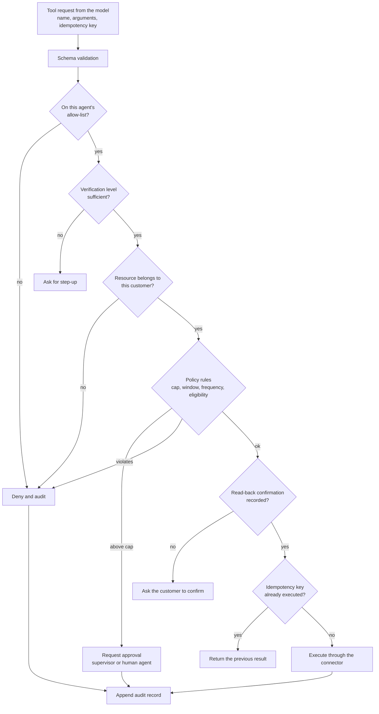

Illustrative policy table (configurable, versioned in CC-17):

| Tool | Autonomous limit | Above the limit | Other rules |
|---|---|---|---|
| `issue_refund` | ≤ €750 for damage in transit within 14 days | Approval by supervisor | One refund per order line; verification level L1+; step-up above €300 |
| `goodwill_credit` | ≤ €30 | Human agent | At most 2 per customer per 90 days |
| `update_address` | Before dispatch only | Human agent | Verification level L2 |
| `initiate_return` | Within the returns window | Human agent | Item eligibility from the OMS |

### 9.4 Retrieval, groundedness and untrusted content

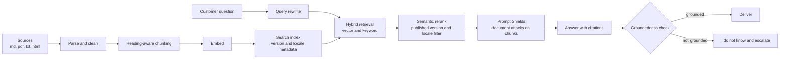

Retrieved text, tool results and documents are **data, never instructions**: they are scanned for document attacks, wrapped so the model treats them as quoted material, and cannot grant tool access.

### 9.5 Guardrail pipeline

| Stage | Input path | Output path |
|---|---|---|
| 1 | Normalise and detect language | Schema validation of tool arguments and structured output |
| 2 | PII / PCI redaction | Policy claims check: no unsupported promise ("guaranteed refund") |
| 3 | Prompt Shields — user prompt attacks | Groundedness check against cited sources |
| 4 | Toxicity and abuse filters | Required-disclosure check by intent and market |
| 5 | Intent, sentiment, risk flags (text only) | PII-leak and secret-leak scan |
| 6 | Escalation triggers evaluated | Brand and tone check; length and language match |

### 9.6 Evaluation harness and staged rollout (LLMOps)

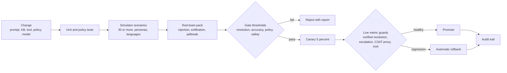

Every model upgrade (for example a new realtime version) runs the same gate; model and prompt versions are pinned per configuration; deprecations are tracked as backlog items.

## 10. Security and compliance

### 10.1 Trust boundaries and controls

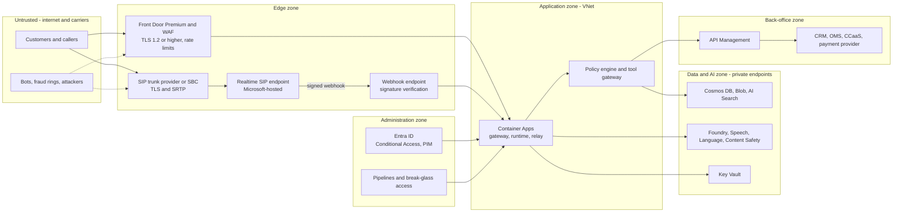

| Boundary | Controls |
|---|---|
| Internet → edge | WAF managed and custom rules, bot protection, per-IP and per-tenant rate limits, TLS 1.2 or higher, DDoS protection on the public IPs; SIP: unknown destination numbers and unsupported country prefixes rejected with a SIP status code by the webhook (the reject endpoint exists for this) [L1] |
| Edge → application | Webhooks verified against the raw body, timestamp and signature, de-duplicated by `webhook-id`; origin accepts traffic only from Front Door; Container Apps in a VNet-integrated environment [L1][L18] |
| Application → data and AI | Private endpoints and private DNS; public network access disabled in the target; managed identities with data-plane RBAC; local (key) authentication disabled [L24] |
| Application → back office | Only through the tool gateway and API Management (OAuth 2.0 client credentials, per-connector scopes, per-tool rate limits and circuit breakers) [L20] |
| Administration | Entra ID with Conditional Access, MFA and compliant devices; Privileged Identity Management for Admin; break-glass accounts monitored; changes only through pipelines |

### 10.2 Identity and access

| Principal | Mechanism | Controls |
|---|---|---|
| Customer, authenticated (web, app) | Microsoft Entra **External ID** external tenant: sign-up and sign-in, e-mail one-time passcode, social identity providers [L12] | Token claims set the starting verification level; step-up for risky actions |
| Customer, anonymous or phone | Caller ID and chat identity are hints, never proof; OTP to the channel on file (L1), knowledge-based fallback, step-up (L2) (CC-05) | Attempt limits, lock-out and human offer; consent state stored with the verification event |
| Workforce | Entra ID; roles **Agent, Supervisor, QA, WFM, Admin, Auditor** enforced at the API (CC-21) | Conditional Access, PIM for Admin, default-deny permission matrix, every transcript or record access written to the access-audit log |
| Services | One user-assigned managed identity per service tier; data-plane roles such as Cognitive Services OpenAI User, Cosmos DB data contributor, Storage Blob Data Contributor, Search Index Data Reader | No keys or connection strings; Key Vault only for third-party secrets (SBC certificates, webhook secrets, payment-provider credentials) [L24] |
| AI agents | Each agent has its own **tool allow-list**; the model never holds credentials; tools run in the gateway with a customer-scoped grant | Least privilege by construction; denied requests are audited (§9.3) |

### 10.3 Network and data protection

- **Private by default in the target:** private endpoints for Cosmos DB, Blob, AI Search, Foundry, Key Vault and Event Hubs; public network access disabled; egress through a NAT gateway or firewall with a destination allow-list for connectors.
- **SIP path:** the trunk provider reaches a Microsoft-hosted TLS endpoint (`<region>.sip.ai.azure.com`) [L1]; confirm network allow-listing and private-connectivity options with Microsoft before production (open item OQ-A1, §20).
- **Encryption:** TLS in transit everywhere; SRTP on the media leg where the carrier supports it; platform-managed encryption at rest, with customer-managed keys in Key Vault where a customer requires them.
- **Secrets and keys:** none in code or configuration; certificates and webhook secrets in Key Vault with rotation.
- **Data protection:** redaction before model context and before storage (§8.2); allow-listed fields only; role-based masking in consoles (CC-21); retention classes with TTL and lifecycle rules (§8.1).

### 10.4 Payment scope reduction (PCI DSS)

The AI never hears, reads, stores or logs card data. When a payment is needed, the policy engine starts a **hand-off session** with a certified payment provider; card data goes from the customer to the provider (keypad tones on a call or a hosted page in chat), and only a token and a result come back [S13].

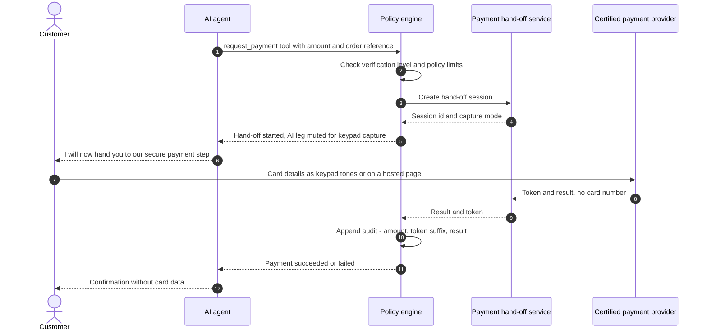

Defence in depth: the guard layer redacts anything that looks like a card number (Luhn check) if the customer speaks or types digits outside the hand-off, tones are masked in recordings, and a golden test proves that no PAN or CVV reaches transcripts, logs, tool arguments or model context (CC-05). Where the payment is taken in a non-Microsoft telephony stack, the DTMF-masking capability of the SBC or CPaaS is used. See ADR-12.

### 10.5 Disclosure and recording consent

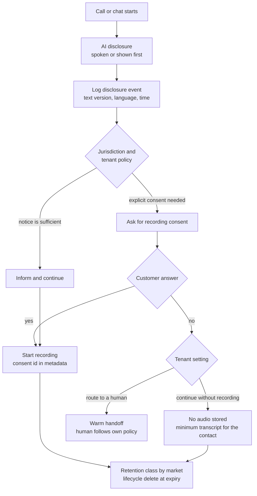

### 10.6 Threat model (STRIDE summary)

Method: STRIDE per trust boundary [L25], extended with AI-specific threats; the full register is maintained with the code and re-run at every architecture change.

| # | STRIDE | Threat | Primary mitigations | Verified by |
|---|---|---|---|---|
| T1 | Spoofing | Caller impersonates a customer (social engineering, caller-ID spoofing, cloned voice) | Caller ID is never proof; OTP to the channel on file; step-up above a value; consent-based voice biometrics and deepfake signals in R3-01 | CC-05 tests; red-team pack |
| T2 | Spoofing | Forged webhook or fake call event | Signature verification on the raw body, timestamp tolerance, `webhook-id` de-duplication, secret rotation [L1] | Unit tests; pen-test |
| T3 | Tampering | **Direct prompt injection** to change policy or call tools | Prompt Shields on user prompts [L5]; policy engine outside the model; tool allow-lists; instruction layering | Red-team gate (CC-16, CC-17) [L22] |
| T4 | Tampering | **Indirect injection** through KB pages, tool results or customer e-mails | Prompt Shields on documents (and tool responses where available) [L5]; retrieved text treated as data; no tool grants from retrieved text; KB publish review | Injection scenarios in the harness |
| T5 | Tampering | Audit trail altered | Append-only, hash-chained audit; immutable export; Auditor role read-only | Integrity check job |
| T6 | Repudiation | "You promised me a refund" | Disclosure and consent events, tool audit with read-back confirmation, transcript retention | Audit queries (CC-21) |
| T7 | Information disclosure | PII or card data in prompts, logs or transcripts | Redaction, allow-listed context, payment hand-off, telemetry redaction, private endpoints, role masking | Golden tests (CC-05, CC-11) |
| T8 | Information disclosure | Model reveals its instructions or another customer's data | Customer-scoped retrieval only; output leak scan; no cross-customer data in context | Leak tests in the harness |
| T9 | Denial of service | Call flooding, toll fraud or **denial of wallet** (runaway realtime minutes) | WAF and SIP reject rules; per-tenant concurrency and minute budgets and a maximum call duration in the relay; token limits at the AI gateway for text models [L20]; daily budget guards; anomaly alerts; threat protection for AI workloads [L23] | Load and abuse tests |
| T10 | Denial of service | Model region or quota unavailable | Active/active regions, fallback pipeline, degradation ladder (§13) | Game days |
| T11 | Elevation of privilege | Model talked into an out-of-policy refund or address change | Caps, windows, eligibility, approvals, idempotency, step-up; separate identity per connector | Policy test suite |
| T12 | Elevation of privilege | Compromised console user or admin | Conditional Access, MFA, PIM, session binding, access audit and anomaly alerts | Access reviews |
| T13 | Supply chain | Malicious dependency, tampered image, unreviewed model change | SBOM, signed images, pinned model versions, staged rollout gated by evaluation | CI checks (§17) |
| T14 | Tampering | Poisoned QA labels or rubric drift | Calibration set, change control on rubrics, drift monitoring | Calibration agreement (KPI-08) |
| T15 | Harm | Off-brand or harmful output; unequal quality by language or accent | Output filters, brand and tone checks, escalation triggers, per-language evaluation | KPI-12, KPI-19 |

### 10.7 Responsible AI and regulatory mapping

| Obligation or principle | How the architecture meets it | Features |
|---|---|---|
| **EU AI Act Article 50** — people must be told they are interacting with an AI system (applies from 2 Aug 2026) [S11][S26] | Disclosure first in 100 % of conversations, per channel and language, logged as an event | CC-05 |
| **AI Act Article 5(1)(f)** — emotion recognition in the workplace is prohibited [S28][S29] | Sentiment and escalation signals come from **text only**; no voice or biometric emotion inference on agents; customer signals are not used to rate agents (ADR-14) | CC-06, CC-08, CC-10 |
| **AI Act Annex III** — AI that monitors or evaluates workers can be high-risk [S26] | QA and coaching keep a human in the loop, give evidence-linked scores, are calibrated and explainable; timing and scope to be confirmed with counsel and works councils | CC-10, CC-15 |
| **GDPR** — lawful basis, transparency, minimisation, access and erasure, processor terms, security, DPIA [S27] | Retention classes, per-customer export and erase workflow, redaction, EU data zone, DPIA template in the project pack | CC-05, CC-11, CC-21 |
| **PCI DSS** — keep card data out of scope [S13] | Payment hand-off (§10.4) | CC-05 |
| **Call-recording consent** | Consent flow with decline path (§10.5) | CC-05 |
| **TCPA and FCC 24-17** — AI-generated voices in outbound calls need prior consent [S12] | Outbound only with recorded consent, quiet hours and suppression lists; simulated in the demo | CC-18 |
| **Accessibility (WCAG 2.1 AA)** [S25] | Keyboard and screen-reader support, captions and transcripts, language and voice choices | CC-19, KPI-19 |
| **Microsoft Responsible AI practices** | Content filtering and Prompt Shields, red-team testing before release [L22], monitoring of AI workloads [L23], human oversight, transparent disclosure | CC-11, CC-16 |

This is a design mapping, not legal advice; certification claims (SOC 2, ISO 27001 and similar) belong to the operating organisation and the underlying Azure services, not to the reference implementation.

### 10.8 Governance tags and the demo environment

Every resource group and resource in the demo deployment carries the tags `SecurityControl=Ignore` and `SecurityExemption=StorageAccountKeyAccess`, plus `project=SwarmAI`, `concept=contactcenter`, `owner=michalfu` and `environment=demo`. These are **sandbox conventions of the managed subscription used for the demo**. They must not be copied into a customer or production landing zone: the target pattern is private endpoints, no public network access, no shared-key access, customer-managed keys where required and policy-compliant resources with no security exemptions. The demo itself already runs keyless (Entra-only data plane on Cosmos DB, Storage and AI Services); see §21.

## 11. Integration architecture

### 11.1 Principles

1. The swarm never calls a back-office system directly: every call goes through the **tool gateway** (policy checks, audit, idempotency).
2. Providers sit behind **canonical interfaces** (telephony, channel, retrieval, connector); mapping to vendor models happens in an anti-corruption layer.
3. Writes are **idempotent** (client-generated key, outbox) and confirmed by reading back the system of record (verified resolution, KPI-01).
4. Voice-path calls have a hard timeout budget (§7.2); slow systems are handled asynchronously with a spoken status and a follow-up.

### 11.2 Three ways to fit an existing contact center

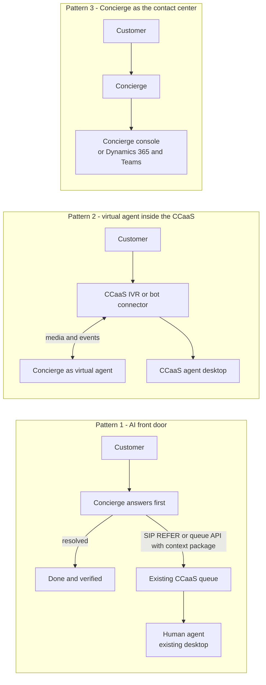

| Pattern | Best for | What changes for the customer | Notes |
|---|---|---|---|
| 1 — AI front door | Pilots and first queues | Route a number or a queue to the SIP endpoint; add a REFER target back to the CCaaS | Fewest moving parts; context package delivered through the CCaaS queue or screen-pop API |
| 2 — Virtual agent inside the CCaaS | Customers standardised on one CCaaS | Use the vendor's bot or virtual-agent connector | Availability and media options vary by vendor; validate per product |
| 3 — Concierge as the contact center | New builds; Microsoft-centred estates | Human side on the Concierge console or Dynamics 365 Contact Center with Teams [L27] | Dynamics 365 Contact Center already offers AI agents, routing and quality evaluation; Concierge can complement it |

### 11.3 Interfaces (illustrative names)

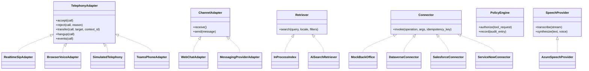

### 11.4 Context package and connector contract

The **context package** is a versioned JSON document stored under a `contextId` and handed to the human side by reference (SIP header, queue attribute or API call); consoles fetch it before the agent accepts.

```json
{
  "contextId": "ctx_0001",
  "version": 1,
  "conversationId": "conv_0001",
  "customer": { "id": "cust_0001", "language": "de", "verificationLevel": "L1" },
  "intent": { "label": "damaged_on_delivery", "confidence": 0.93 },
  "summary": "Sofa arrived with a torn leg; customer wants a replacement or refund.",
  "stepsTried": [ { "tool": "lookup_order", "result": "ok" }, { "tool": "issue_refund", "result": "needs_approval" } ],
  "sentiment": { "current": "frustrated", "trajectory": [ "neutral", "negative", "frustrated" ] },
  "risk": [ "churn_risk" ],
  "recommendedNextAction": "Offer replacement with express delivery, or refund above the autonomous limit",
  "consent": { "recording": true, "disclosureVersion": "v3" }
}
```

| Canonical operation | Typical system of record | Mode |
|---|---|---|
| `get_customer`, `get_timeline` | Dataverse or Dynamics 365 Customer Service, Salesforce, ServiceNow | Read |
| `lookup_order`, `get_shipment` | Order management or ERP over REST | Read |
| `issue_refund`, `issue_credit`, `initiate_return`, `update_address` | Order management or payments back end | Write — policy engine, idempotent, read-back |
| `create_case`, `update_case` | CRM case tables | Write — idempotent |
| `book_appointment`, `send_notification` | Scheduling and messaging providers | Write |

### 11.5 Events, webhooks and resilience

- **Inbound:** telephony call events, messaging-provider webhooks, payment-provider callbacks — all verified, de-duplicated and acknowledged quickly, with work done asynchronously.
- **Outbound:** domain events (§8.3) with ids and labels only, to Event Hubs; connectors expose callbacks for case and order changes.
- **Resilience:** per-connector timeouts, circuit breakers and bulkheads (API Management backends offer circuit breakers and load-balanced pools [L20]), retries with jitter for idempotent operations only, dead-letter plus a human follow-up task for failed writes.

## 12. Deployment topology

### 12.1 Reference topology (EU, two active regions)

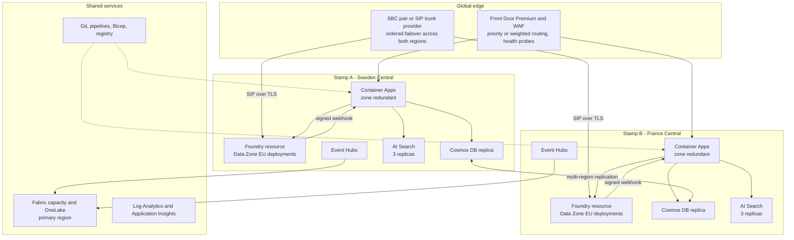

### 12.2 Design rules

- **Stamp = scale unit.** A stamp is one Container Apps environment, one Foundry resource set with its quotas, and a data-tier replica. Realtime capacity is bounded per region and deployment type [L2], so capacity grows by adding quota, deployments and stamps.
- **Sized for N − 1.** Each region carries the **full peak** so that losing one region does not drop calls. Pay-per-token deployments bill usage, not allocated quota, so the idle headroom costs nothing; reserved provisioned throughput would [L4].
- **Call affinity.** A conversation stays in the region that accepted it; its state replicates, so another region can resume a chat and re-establish a voice session from the transcript and context.
- **Data zones.** EU tenants use **Data Zone Standard** in Sweden Central and France Central, both of which support Realtime over SIP [L1][L4]; a US tenant would use a US Data Zone stamp (East US 2 also supports SIP) — a tenant-to-geography mapping decides.
- **Cosmos DB.** Multi-region with zone redundancy; multi-region writes are available for 99.999 % read and write availability [L13]; conversation affinity keeps write conflicts rare and last-writer-wins is acceptable for session state; audit entries are append-only so they never conflict.
- **AI Search.** Three or more replicas per region for the read-write SLA and zone redundancy [L15].
- **Event Hubs.** Zone-redundant namespaces; geo-replication on Premium or Dedicated tiers where a low event-loss tolerance is needed [L19].
- **Container Apps.** Zone redundancy at no extra charge, active-active across zones [L16]; WebSocket-capable ingress [L17]; scale on concurrent sessions, not CPU.
- **Fabric and analytics** are off the call path; they run in the primary region with a documented rebuild from OneLake/Event Hubs capture.
- **Backups.** Cosmos DB continuous backup with point-in-time restore (7, 30 or 35 days) [L14]; Blob soft delete and immutability; infrastructure and configuration rebuilt from Git.

### 12.3 Topology by tier

| Tier | Regions | Availability design | RTO / RPO target |
|---|---|---|---|
| Pilot (50 seats) | 1 | Zone-redundant where offered; fallback to human queue on outage | ≤ 4 h / ≤ 1 h |
| Department (500) | 2 (active and warm standby) | Standby holds deployments and quota; failover by routing change | ≤ 30 min / ≤ 5 min |
| Reference (1,500) | 2 active/active | Both regions serve; each sized for full peak | ≤ 15 min / ≤ 5 min |
| Enterprise (10,000) | 3 stamps | Two EU stamps plus a second geography or a third EU stamp where quota demands; per-geography residency | ≤ 15 min / ≤ 5 min |

*Design targets for the target architecture; the demo slice has no disaster recovery.*

### 12.4 Environments and promotion

Separate subscriptions for development, test, staging and production under a management-group hierarchy with Azure Policy guardrails (deny public network access, require tags, deny shared-key access); infrastructure from Bicep modules deployed with `azd` and Deployment Stacks; the same pipeline promotes dev → test → staging (production-like, synthetic traffic and the evaluation gate) → production (canary) (§17).

## 13. Reliability

### 13.1 Service-level objectives (design targets)

*Targets to be validated in the pilot; Microsoft's published SLAs apply to each Azure service and are deliberately not multiplied together here. The demo slice does not run an SLO programme.*

| SLI | Definition | Target |
|---|---|---|
| Voice call set-up success | Calls accepted ÷ calls presented (excluding caller abandon) | ≥ 99.9 % per month |
| Voice turn latency | End of customer speech → first agent audio, per turn (KPI-10) | p95 < 800 ms; ≥ 95 % of 5-minute windows in budget |
| Chat time to first token | Customer message → first streamed token | p95 < 1.5 s |
| API and console availability | Successful ÷ valid requests | ≥ 99.95 % per month |
| Tool-call success | Successful ÷ attempted (policy denials excluded) | ≥ 99.5 % |
| Handoff delivery | Context package available before the human accepts (KPI-09) | ≥ 99.5 % |
| Audit completeness | Tool calls with an audit record (writes fail closed without one) | 100 % |

Burn-rate alerts on the voice-latency, set-up-success and availability SLOs page the on-call engineer; every breach feeds the error budget that gates risky releases (CC-17).

### 13.2 Degradation ladder

The system degrades in steps that always end at a human, never at a dead end.

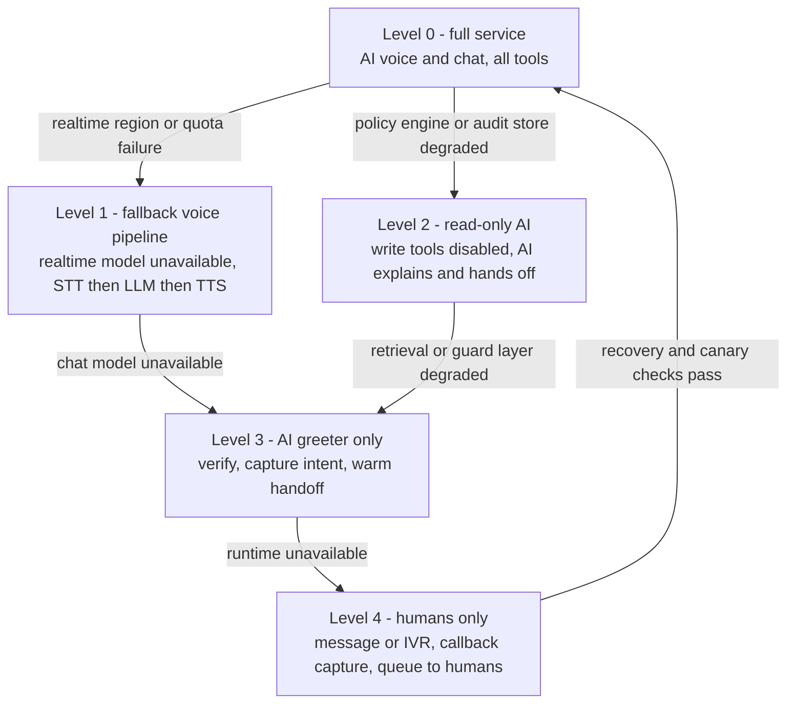

**Fail-closed rules:** if the guard layer (Prompt Shields, PII redaction) or the policy engine cannot be reached, the AI stops taking write actions and hands off; if retrieval is down, the AI does not answer from memory — it says it cannot look that up and offers a human; an action is never executed without its audit record.

### 13.3 Failure modes

| Failure | Detection | Automatic response | Customer impact |
|---|---|---|---|
| Realtime deployment throttled (HTTP 429) or quota exhausted | Rate and error metrics; admission-control threshold | Spill to the other region's deployment, then to the fallback pipeline; new calls beyond capacity are rejected with SIP 486 so the carrier can try another route [L1] | Slightly higher latency or a different voice |
| Region outage (Foundry or Container Apps) | Front Door health probes; SBC failure responses (486, 503, 408) [L1][L18] | Traffic and new calls move to the surviving region, which is sized for the full peak (§12.2) | In-flight calls drop; callers redial or are called back |
| Cosmos DB write region unavailable | SDK and platform failover signals | Writes continue in the other write region [L13]; audit entries buffered in a persisted queue and replayed, as the mission-critical guidance recommends for write unavailability [L30] | None, or a short pause |
| AI Search unavailable | Dependency health | Knowledge answers disabled; AI offers a human (Level 2 or 3) | Fewer self-service answers |
| Content Safety or guard layer unavailable | Dependency health | Fail closed for write actions; template answers only; handoff | More handoffs |
| Back-office slow or down | Timeouts; circuit breaker [L20] | Spoken status message, follow-up task, no blind retries of writes | Delayed fulfilment, no duplicates |
| Streaming transcription of the human leg down | Stream health | Agent Assist falls back to chat and notes only; QA runs later from the recording | Fewer suggestions |
| Event Hubs or Fabric down | Lag metrics | Events buffered at the source with an outbox; dashboards lag | None for customers |
| SIP trunk or SBC failure | Provider monitoring | Second trunk or provider-side failover; announcement and callback option | Short outage |
| Faulty release (prompt, policy, knowledge, model) | Canary guard metrics | Automatic rollback to the previous pinned version (CC-17) | Limited to the canary share |

### 13.4 Backup, recovery and testing

| Data | RPO (target) | RTO (target) | Mechanism |
|---|---|---|---|
| Conversation state, timeline | ≤ 5 min | ≤ 15 min | Cosmos DB multi-region replication; point-in-time restore over 7, 30 or 35 days [L14] |
| Audit log | 0 for acknowledged writes | ≤ 15 min | Append-only; multi-region; persisted queue buffer |
| Recordings and transcripts | ≤ 1 h | ≤ 4 h | Geo-redundant Blob storage (asynchronous); soft delete and immutability |
| Knowledge index | Rebuild from sources | ≤ 60 min | Sources in Blob and Git; index rebuilt by the ingestion pipeline |
| Configuration, prompts, policies | 0 | ≤ 15 min | Git plus the configuration store; versions pinned |
| Analytics lake | ≤ 1 h | ≤ 8 h | Event Hubs retention and capture; OneLake rebuild |

Game days run every quarter: lose a region, throttle the realtime deployment to 429, inject back-office latency, fail the guard layer, and run a prompt-injection incident tabletop. Two regions that are each 99.9 % available would give 99.9999 % in an ideal independent model; the real ceiling is set by shared dependencies (edge, identity, carrier, control planes), which is why SLOs are measured, not computed.

## 14. Performance and scalability

### 14.1 From seats to quota

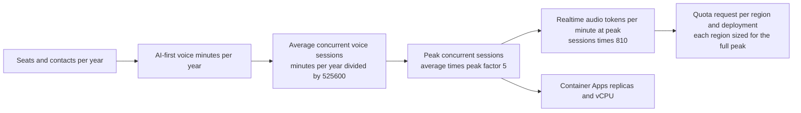

Worked example (reference customer, Year 3, *model*): 19.97 M AI voice minutes ÷ 525,600 min per year = 38.0 average concurrent sessions × peak factor 5.0 = **190 peak concurrent voice sessions** (and 437 chat sessions).

### 14.2 Realtime usage per voice minute (model assumptions)

| Component | Per voice minute | Basis |
|---|---:|---|
| New customer audio in | 270 tokens | 60 s × 45 % customer speech × 10 tokens/s (Learn estimate ≈ 10 in / 20 out per second) [L6] |
| Agent audio out | 540 tokens | 60 s × 45 % agent speech × 20 tokens/s |
| Cached context re-read | ≈ 21,500 tokens | 5 responses × (1,800 audio context + 2,500 system prompt and tool schemas) |
| Reasoning and text output | ≈ 600 tokens | 5 responses × 120 |
| Tool-result text in | 150 tokens | Assumption |

*Open item OQ-A2:* whether cached tokens count against the realtime token quota is not stated in the pages used here; the pilot load test must measure it before quota is requested.

### 14.3 Capacity by tier

| Tier | Seats | Peak voice | Peak chat | New audio tokens per min at peak | vCPU (all regions, with headroom) | Regions | Search replicas per region | Cosmos max RU/s | Fabric CU | Event Hubs units per region |
|---|---:|---:|---:|---:|---:|---:|---:|---:|---:|---:|
| Pilot | 50 | 6 | 15 | 5.1 K | 6.3 | 1 | 1 | 1,000 | 2 | 1 |
| Department | 500 | 63 | 146 | 51 K | 18.8 | 2 | 3 | 1,000 | 8 | 1 |
| **Reference** | **1,500** | **190** | **437** | **154 K** | **32.4** | **2** | **3** | **3,000** | **32** | **1** |
| Enterprise | 10,000 | 1,266 | 2,911 | 1.03 M | 222 | 3 | 15 | 16,000 | 128 | 2 |

*Source: `outputs.json` (sizing at Year 3, base case). Sizing assumptions to validate with load tests: 60 voice sessions and 400 chat sessions per vCPU, 15 queries per second per search replica, 700 request units per contact, peak factors 5 (sessions), 8 (search) and 6 (Cosmos DB).*

### 14.4 Scaling and admission control

- **Container Apps:** scale on concurrent sessions with a custom or concurrency rule rather than CPU; keep at least two replicas per zone-redundant region; WebSocket ingress is supported [L16][L17]. The voice relay reconnects and resumes sessions because platform maintenance can recycle replicas.
- **Pre-warming:** the workforce forecast (CC-14) pre-scales replicas and flags when quota must be raised ahead of known peaks such as campaigns or seasonal events.
- **Realtime quota:** audio-token and concurrent-session quotas are separate and per deployment type and region [L2]; request quota for the full peak in each region (§12.2). Keep `gpt-realtime-2.1` for hard cases (30 % of minutes in the model) and `-mini` for the rest.
- **Admission control:** the voice control service tracks live sessions and quota headroom; below a threshold it stops accepting new calls in that region (reject with SIP 486 so the carrier retries another route) rather than degrade calls in progress [L1].
- **Digital backpressure:** queue with an honest wait message and offer callback or a human.
- **Caching and context:** stable prompt prefixes for caching, session compaction for long calls (§9.2); semantic caching at the AI gateway only for non-personalised knowledge answers [L20].

### 14.5 Performance targets and testing

| Path | Target (design) |
|---|---|
| Voice turn (end of speech → first audio) | p95 < 800 ms (§7.2) |
| Chat time to first token | p95 < 1.5 s |
| Retrieval (hybrid query plus rerank) | p95 < 400 ms |
| Agent Assist suggestion | p95 < 2 s |
| Wrap-up draft after call end | p95 < 5 s |

The simulator (CC-16) doubles as the load generator: ramp to 1.5 × the forecast peak, repeat with one region removed (N − 1), run a four-hour soak, and read KPI-10 from telemetry. Measured values replace the model's sizing assumptions in `business-case/assumptions.json`.

## 15. Cost and ACR drivers

All numbers in this section come from `business-case/outputs.json` (base case, list prices, USD, pay-as-you-go, no enterprise discount, retrieved from the Azure Retail Prices API on 17 Nov 2026 [L28]); see [`business-case/README.md`](business-case/README.md) for the formulas. **Headline (base case, reference customer):** 3-year NPV $27.1 M, ROI 216 %, payback 15.8 months from project start (9.8 months from go-live); Year-3 Azure consumption $2.98 M ($6.78 M over Years 1–3, plus a $34 K Year-0 pilot).

### 15.1 Azure consumption by service family (reference customer: 1,500 seats, 18 M contacts a year)

| Family | Main driver | Y1 ($K) | Y2 ($K) | Y3 ($K) | Y3 share |
|---|---|---:|---:|---:|---:|
| Azure OpenAI realtime audio | AI voice minutes × audio tokens per minute × model mix (70 % mini, 30 % full) | 237 | 619 | **920** | 30.9 % |
| Azure OpenAI chat and reasoning tokens | Agent Assist calls, 100 % auto-QA, digital AI turns | 355 | 663 | **777** | 26.1 % |
| Azure AI Speech | Streaming transcription with diarization of **human-handled** calls (581 K hours in Y3), TTS for the fallback path | 489 | 784 | **773** | 25.9 % |
| Azure AI Search | Search units × regions, semantic-ranker queries | 71 | 122 | 148 | 5.0 % |
| Fabric RTI, OneLake, Event Hubs | Capacity units, event throughput | 45 | 61 | 93 | 3.1 % |
| Content Safety | Prompt Shields, moderation, groundedness text records | 26 | 58 | 78 | 2.6 % |
| Front Door, API Management, networking | Base fees, requests, private endpoints | 40 | 40 | 68 | 2.3 % |
| Azure AI Language | PII and sentiment records | 43 | 62 | 66 | 2.2 % |
| Container Apps compute | vCPU-seconds, memory | 21 | 31 | 38 | 1.3 % |
| Monitor, Defender, Key Vault, Purview | Ingestion, plans | 10 | 10 | 10 | 0.3 % |
| Cosmos DB | Request units, storage | 5 | 5 | 5 | 0.2 % |
| Blob and ADLS | Recordings and transcripts | 1 | 3 | 5 | 0.2 % |
| Communications billed through Azure | Telephony and messaging meters | 0 | 0 | 0 | 0 % |
| **Total Azure-billed** | | **1,342** | **2,458** | **2,980** | **100 %** |

AI models and services (realtime audio, chat and reasoning tokens, Speech, AI Search, Content Safety and Language) are **93 %** of Year-3 consumption. Communications spend of $1.16 M a year at Year 3 sits **outside** Azure in the base case because the retirement of standalone ACS services moves telephony and messaging to carriers and partners (ADR-02); the model can bill a share through Azure with `comms_azure_billed_share`.

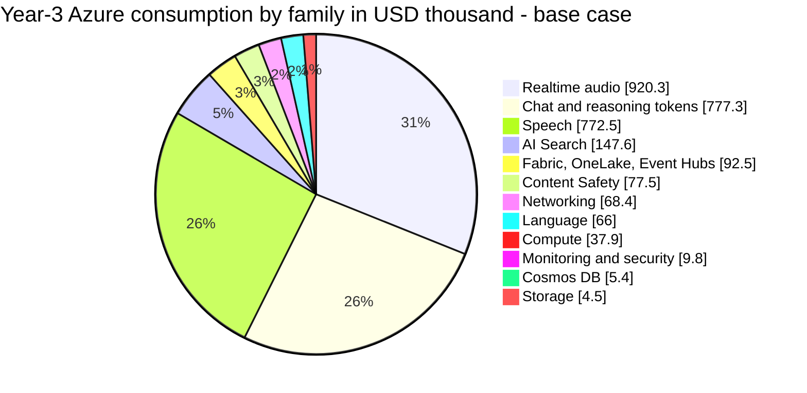

### 15.2 Unit economics (so that a CFO can audit the unit costs)

| Measure | Value | Note |
|---|---:|---|
| Azure cost per AI voice minute | **$0.047** | $0.058 with the telephony legs priced at proxy rates |
| Azure cost per digital AI contact | $0.0093 | $0.041 with messaging at partner rates |
| Azure cost per AI-first contact | $0.081 | Year 3, the AI leg only |
| Azure cost per AI-**resolved** contact | $0.65 | All Azure consumption ÷ AI-resolved contacts (4.59 M) |
| Azure cost per assisted human contact | $0.094 | Agent Assist plus transcription |
| Azure cost per QA-scored contact | $0.013 | 100 % auto-QA |
| **All-in AI cost per resolved contact** | **$1.46** | Azure + communications + licences + operating team + support, amortised |
| Human cost per resolved contact (baseline) | $6.34 | $5.58 per contact grossed up for the 12 % repeat-contact share; loaded cost $67 K per agent |
| Human-to-AI cost ratio | 4.35 × | Conservative case $2.62, upside $1.00 per AI-resolved contact |

### 15.3 ACR by seat tier (steady state)

| Tier | Azure consumption per year | $ per seat-month | $ per contact | Communications outside Azure |
|---|---:|---:|---:|---:|
| Pilot (50 seats) | $128 K | $213 | $0.213 | $39 K |
| Department (500) | $1.07 M | $178 | $0.178 | $388 K |
| **Reference (1,500)** | **$2.98 M** | **$166** | **$0.166** | **$1.16 M** |
| Enterprise (10,000) | $19.5 M | $162 | $0.162 | $7.76 M |

Fixed platform components (search replicas, Fabric capacity, Front Door, observability) are a larger share of a small deployment, which is why the price per seat falls from $213 to $162 as the tier grows. Year-3 consumption is $2.79 M in the Conservative and $2.99 M in the Upside scenario: **ACR is insensitive to AI success**, because higher containment moves spend from streaming transcription of human calls to realtime AI minutes.

### 15.4 Cost levers

| Lever | Effect |
|---|---|
| Model tiering and the share of minutes on the full realtime model | The largest controllable item in the AI-first leg: every 10 points of voice minutes moved from the full to the mini model lowers Year-3 realtime consumption by about $128 K (14 % of that family; full-model audio tokens cost 3.2 × mini) |
| **Streaming transcription of human calls** | The single largest line ($755 K at Year 3): stream only for queues where Agent Assist needs it and transcribe the rest in batch from recordings; each 10 % of human-handled voice hours that need no real-time transcript is worth up to about $75 K a year before batch costs |
| Prompt caching and stable prefixes | Cached input is 10 × cheaper than uncached input for text tokens and 33 × to 80 × cheaper for realtime audio tokens in the price list |
| Data Zone versus Global deployments | Global deployments are about 9 % cheaper per token but give up EU data-zone processing [L4] |
| Retention and tiering | Recordings move to cool storage and are deleted at expiry (§8.1) |
| Quota versus reservation | Pay-per-token deployments bill usage, not quota, so the standby region is free; provisioned throughput trades that for latency stability at volume [L4] |
| Stress test | Azure prices and usage ±30–50 % move 3-year NPV between $23.4 M and $29.4 M on a base of $27.1 M — the business case is far more sensitive to containment and headcount than to Azure prices |

### 15.5 FinOps

Every conversation is metered (audio minutes, tokens by deployment, tool and retrieval counts) and priced from a versioned price table (CC-22); budgets and anomaly alerts run per tenant and queue; the demo enforces a daily AI budget in the application; showback reports cost per queue, channel and resolved contact. Prices are refreshed with `business-case/refresh_prices.py`, which diffs the pricing snapshot against the live Retail Prices API.

## 16. Observability

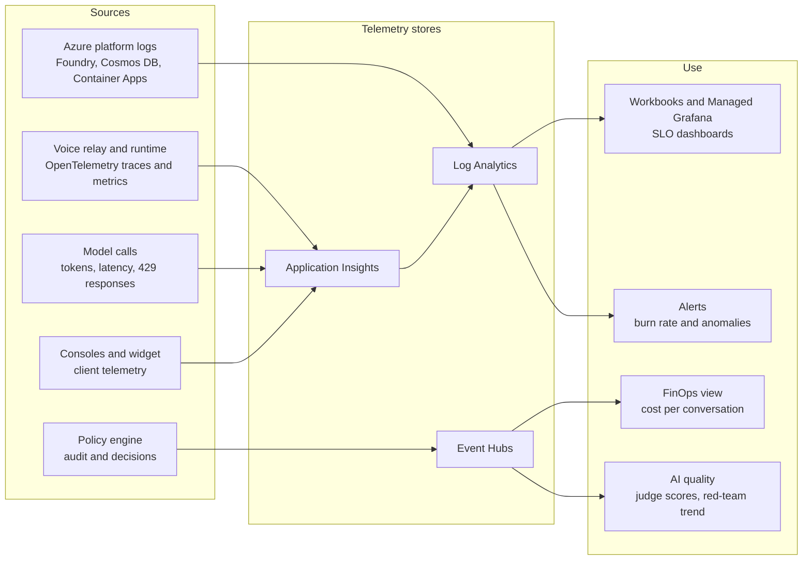

- **Traces:** one trace per conversation (`conversationId` as the correlation id) with a span per turn and child spans for end-of-turn detection, model time to first audio, guard checks, retrieval and each tool call; this is how the 800 ms budget (§7.2) is measured, not guessed.
- **Metrics:** concurrent sessions, turn latency p50 / p95 / p99, barge-ins, 429 rates, tokens and audio minutes by deployment, containment, handoff and abandonment, cost per conversation.
- **Logs:** structured and redacted; audit is a separate append-only store, not a log.
- **AI quality in production:** sampled live conversations scored by judge models (groundedness, policy adherence, tone), attack-success-rate trend from scheduled red-team runs [L22], and threat-protection alerts for AI workloads [L23].
- **KPI traceability:** every KPI in [`FEATURES.md`](FEATURES.md) has a source event; for example KPI-01 and KPI-02 come from `conversation.ended` plus the system-of-record read-back, KPI-10 from turn spans, KPI-07 from `usage.metered`, KPI-12 from `consent.captured`, guard and policy events.

## 17. DevSecOps and infrastructure as code

```mermaid
flowchart LR
    PR["Pull request"] --> CHK["Lint, type checks, unit and policy tests"]
    CHK --> SEC["Secret and dependency scans, SBOM, image scan"]
    SEC --> BLD["Build and sign image<br/>remote build in the registry"]
    BLD --> IAC["Bicep what-if and policy checks"]
    IAC --> DEV["Deploy to dev"]
    DEV --> EVAL["Evaluation gate<br/>simulator, red team, regression"]
    EVAL -->|"pass"| STG["Staging with synthetic traffic"]
    EVAL -->|"fail"| STOP["Stop and report"]
    STG --> CAN["Production canary - 5 percent"]
    CAN -->|"guards healthy"| PRD["Full rollout"]
    CAN -->|"regression"| RBK["Automatic rollback"]
```

- **Everything as code:** infrastructure (Bicep modules deployed with `azd`; Deployment Stacks for lifecycle), agent prompts, policies, rubrics, knowledge sources and evaluation scenarios live in Git and move through the same pipeline (CC-17, CC-23).
- **Secure supply chain:** pinned dependencies, SBOM, signed images, vulnerability scanning of images and base layers, Defender for Containers in production; model versions pinned (the demo deploys with `NoAutoUpgrade`).
- **Guardrails:** Azure Policy denies public network access, shared-key access and untagged resources in production subscriptions; infrastructure changes are previewed with what-if before deployment.
- **Release safety:** the evaluation gate (§9.6) is a required check; canary with automatic rollback; error-budget policy freezes risky changes when SLOs burn.
- **Demo:** `azd up` provisions the slice and builds the image in the registry (remote build); see §21.

## 18. Well-Architected checklist

Mapped to the Azure Well-Architected Framework pillars [L26] and its AI-workload design guidance [L21].

| Pillar | Design choices | Where | Demo slice |
|---|---|---|---|
| **Reliability** | Active/active EU regions each sized for full peak; zone-redundant Container Apps and Search; degradation ladder ending at humans; fail-closed guards; SLOs with burn-rate alerts; quarterly game days | §12, §13 | Single region; fallback realtime model and pipeline; fail-closed policy engine |
| **Security** | Keyless identity and RBAC; private endpoints; policy engine outside the model; Prompt Shields; PCI hand-off; STRIDE register; threat protection for AI workloads | §10 | Keyless data plane; Entra-ready JWT; redaction; audit |
| **Cost optimisation** | Model tiering; caching; stream transcription only where it pays; pay-per-token quota; per-conversation metering and budgets; price refresh | §15 | Metering and a daily AI budget guard |
| **Operational excellence** | IaC; evaluation gate and canary; observability with correlation per conversation; runbooks and game days; config versioning and rollback | §16, §17 | `azd`, Bicep, Application Insights, rollout manager |
| **Performance efficiency** | Latency budget; realtime SIP with no media hop; admission control; scale on sessions; capacity model from seats to quota; load tests with the simulator | §7, §14 | Latency telemetry per turn; simulator |
| **AI workload principles** [L21] | Gateway-style policy enforcement, token and prompt caps, grounded outputs, evaluation before and after release, human oversight, responsible-AI controls | §9, §10 | Harness with 30 or more scenarios; disclosure and handoff |

## 19. Architecture decision records

Format: status · context · decision · alternatives considered · consequences. All ADRs are **Accepted** for the target architecture v1.0 unless marked otherwise.

### ADR-01 — A swarm of specialised agents under a deterministic state machine

- **Context.** One prompt that verifies, answers, acts and escalates is hard to test, to secure and to evolve; contact-center work has distinct roles with different risk.
- **Decision.** A supervisor pattern: the Resolution agent owns the conversation and delegates to specialists with narrow prompts, narrow tool allow-lists and separate evaluations; the flow (greet → disclose → classify → authenticate → resolve → confirm → wrap up, with escalate reachable from every state) is an explicit state machine.
- **Alternatives.** One monolithic agent; free-form agent-to-agent negotiation; a workflow engine without LLM routing.
- **Consequences.** Testable, least-privilege and cost-tiered by role; more prompts to maintain (mitigated by CC-17) and extra hops (mitigated by parallel specialist calls and by letting the realtime agent handle routine turns itself).

### ADR-02 — Pluggable telephony and channels; Realtime SIP as the default voice path

- **Context.** Azure Communication Services is retired as a standalone offering on 30 Sep 2028 (Direct Routing, Direct Offer numbers, SMS, Email, Chat, WhatsApp and Job Router; Call Automation, audio streaming and recording continue only for Teams-aligned scenarios) [L3]. Azure OpenAI Realtime accepts SIP calls directly in Sweden Central, France Central and East US 2 [L1]. Customers run many different telephony stacks.
- **Decision.** Telephony and channels sit behind `TelephonyAdapter` and `ChannelAdapter`. The default production voice path is **SIP trunk or SBC → Realtime SIP endpoint** with webhook call control. Alternatives behind the same interface: Teams Phone Extensibility [L8], Dynamics 365 Contact Center voice [L27], partner CPaaS media streaming into a relay, and ACS only for tenants that already run on it. Routing keeps Job-Router semantics in-process or in Dynamics 365.
- **Alternatives.** Build new on ACS Call Automation (retiring); run our own media server (more components, more operations); tie to one CPaaS.
- **Consequences.** No media hop of our own, carrier choice and lower latency; the customer procures a SIP trunk provider; recording comes from the SBC or CPaaS fork and from transcript events; DTMF and transfer behaviour depend on the provider. Revisit when Voice Live SIP leaves public preview [L7].

### ADR-03 — Speech-to-speech realtime model first; STT → LLM → TTS fallback; Voice Live as an option

- **Context.** Native audio models give the lowest turn latency and the most natural barge-in, but depend on regional quotas and on language and voice coverage.
- **Decision.** `gpt-realtime-2.1` / `-2.1-mini` is the primary voice engine; a pipeline of Azure AI Speech and a chat model sits behind the same tool gateway as the fallback; the Voice Live API (more locales and voices, avatars; SIP in public preview) is evaluated in Release 2 (R2-02) [L6][L7].
- **Alternatives.** Pipeline only (more control, more hops, more latency); Voice Live as the primary path (SIP preview without an SLA).
- **Consequences.** Best latency and naturalness; dependency on realtime quota; two paths to test, so the harness runs both (CC-16).

### ADR-04 — Model tiering by task, versions pinned

- **Decision.** Realtime mini for routine voice and the full realtime model for hard cases and languages; chat mini for chat, assist and wrap-up; the reasoning model for borderline QA and judges; nano for classifiers; embeddings small. Versions are pinned (no automatic upgrade) and promoted through the evaluation gate.
- **Alternatives.** One top model everywhere (cost); small open models on AKS (operations burden, lower accuracy today; revisit).
- **Consequences.** Lower unit cost (30 % of voice minutes on the full model in the base case); routing and prompt variants per model to maintain.

### ADR-05 — The policy engine, not the model, authorises every action

- **Decision.** The tool gateway enforces allow-list, verification level, ownership, caps, windows, eligibility, approvals, idempotency and read-back confirmation, and writes an append-only audit record (§9.3).
- **Alternatives.** Rely on prompt instructions; rely on model-side function constraints; per-connector checks (inconsistent).
- **Consequences.** Deterministic, testable and auditable; a successful prompt injection still cannot exceed caps; policies become a product surface to author and version (CC-17).

### ADR-06 — Hybrid retrieval with Azure AI Search; an in-process index behind a `Retriever` interface in the demo

- **Decision.** Target: Azure AI Search hybrid retrieval with the semantic ranker, heading-aware chunking and version and locale metadata. Demo: an in-process index persisted in Cosmos DB behind the same interface, which avoids a standing search-unit cost in a sandbox.
- **Alternatives.** Cosmos DB vector search only; PostgreSQL with pgvector; stuffing documents into long contexts.
- **Consequences.** Search has a fixed hourly cost (replicas × regions) that appears in the ACR model; retrieval quality is tested by the harness; swapping implementations is configuration.

### ADR-07 — Data stores chosen by access pattern

- **Decision.** Operational JSON state, memory, audit and configuration in Cosmos DB; recordings and files in Blob / ADLS; analytics in OneLake fed through Event Hubs and Fabric Real-Time Intelligence; no analytical queries against the operational store.
- **Alternatives.** One relational database; Cosmos DB analytical store only; Azure Data Explorer alone.
- **Consequences.** Three stores to govern with explicit retention per data class (§8.1); real-time and historical analytics in one lake [L11].

### ADR-08 — Keyless identity, least privilege and private networking

- **Decision.** Managed identities and data-plane RBAC; local (key) authentication disabled on Foundry, Cosmos DB and Storage [L24]; Entra ID for the workforce and External ID for customers [L12]; private endpoints in the target; Key Vault for third-party secrets only.
- **Alternatives.** API keys and connection strings; network rules without identity.
- **Consequences.** No secrets to rotate or leak; more role assignments and private DNS to manage. The demo is keyless but uses public endpoints (§10.8).

### ADR-09 — EU Data Zone processing with Sweden Central and France Central as the active pair

- **Decision.** Data Zone Standard deployments for EU tenants in two regions that both support Realtime over SIP; Global deployments only for development or non-regulated tenants; an Azure Policy rule blocks Global SKUs in regulated subscriptions [L4].
- **Alternatives.** Global Standard (about 9 % cheaper, no EU-only processing guarantee); regional deployments (single geography, less capacity); provisioned throughput.
- **Consequences.** EU processing and data at rest in the EU geography; slightly higher unit price; capacity and quota planned per region.

### ADR-10 — Evaluation gate and staged rollout for every behaviour change

- **Decision.** Any change to a prompt, knowledge source, tool, policy or model passes unit and policy tests, simulator scenarios and the red-team pack [L22]; then a 5 % canary with live guard metrics and automatic rollback (§9.6).
- **Alternatives.** Manual prompt review; ship and monitor.
- **Consequences.** Safe, fast iteration; a scenario library and thresholds to curate; a few minutes of pipeline time per change.

### ADR-11 — Azure Container Apps first; AKS when scale or control demands it

- **Context.** Long-lived WebSocket sessions, elastic load and a small operations team [L16][L17].
- **Decision.** Container Apps (zone redundant, scale rules, VNet integration) for the conversation plane and workers; AKS for estates of 10,000 seats or more that need node-level control, custom networking or heavy SBC and media sidecars.
- **Alternatives.** AKS from day one; App Service; Functions (poor fit for long-lived sessions).
- **Consequences.** Simpler operations now; less low-level control; images and configuration remain portable to AKS.

### ADR-12 — Payment hand-off to keep card data out of scope

- **Decision.** The AI never handles a card number: keypad capture or a hosted page at a certified payment provider returns a token and a result (§10.4) [S13].
- **Alternatives.** Pause-and-resume recording with an agent hearing the card (agent in scope); AI-collected card numbers on a fully compliant voice stack (largest scope).
- **Consequences.** Smallest compliance scope; depends on a certified provider and on DTMF capture in the telephony path; a visible change of step for the customer.

### ADR-13 — Active/active voice across two regions, call affinity, N − 1 sizing

- **Decision.** Two active regions, each with quota for the full peak; conversations pinned to the accepting region with replicated state; admission control rejects new calls with SIP 486 when headroom is low; the SBC fails over in order (§12).
- **Alternatives.** Active/passive (simpler, slower failover, an untested standby); a single zone-redundant region (cheaper; a regional outage is an outage).
- **Consequences.** RTO ≤ 15 min; pay-per-token quota makes idle headroom free; quota must be requested and maintained in both regions; replication conflicts are avoided by affinity and append-only audit.

### ADR-14 — Sentiment and risk signals from text only

- **Decision.** Sentiment, urgency and escalation signals are derived from transcribed text and structured signals (repeat contact, explicit requests, interruptions), not from voice emotion analysis or biometrics; customer sentiment is never used to rate agents (CC-06, CC-08, CC-10).
- **Alternatives.** Voice-emotion models: they would add risk under the AI Act's ban on emotion recognition in the workplace and are a regulatory and ethical risk even for customers [S28][S29].
- **Consequences.** A clean compliance posture; some non-verbal cues are missed, compensated by behavioural signals.

## 20. Architecture risks and open items

| ID | Risk | L | I | Mitigation |
|---|---|:-:|:-:|---|
| AR-01 | Realtime quota or capacity is insufficient at peak | M | H | Request quota early in both regions for the full peak; admission control; fallback pipeline; spill to a second deployment |
| AR-02 | Model or version deprecation changes behaviour | M | M | Pinned versions; evaluation gate; deprecation tracker in the backlog |
| AR-03 | Telephony platform churn: ACS retirement on 30 Sep 2028 [L3]; Voice Live SIP still in preview [L7] | H | M | Adapters; no new builds on ACS; track Voice Live SIP general availability |
| AR-04 | p95 turn latency above 800 ms on real PSTN paths | M | H | Measure on real trunks in the pilot; region-local trunks; preambles; tune end-of-turn detection |
| AR-05 | SIP interoperability gaps (codecs, DTMF, REFER semantics) across SBCs and carriers | M | M | Interop test plan with two carriers; contract tests against the SIP API |
| AR-06 | Hallucinated commitments | L | H | Groundedness checks; policy engine; read-back confirmation; evaluation gate |
| AR-07 | Prompt injection or data exfiltration | L | H | Layered defences (§9.5, §10.6); red-team gating; threat protection for AI workloads |
| AR-08 | Regulatory change (AI Act timing, recording consent, outbound AI-voice rules) | M | M | Compliance register; configurable policies; counsel review |
| AR-09 | Cost drift (tokens, transcription hours) | M | M | Per-conversation metering, budgets, model tiering, monthly price refresh |
| AR-10 | Data-residency drift (a Global deployment slips into a regulated tenant) | M | H | Azure Policy on deployment SKUs; deployment inventory checks |
| AR-11 | Realtime SIP exists in only a few regions | L | H | Two-region EU pair; a third stamp for a second geography; fallback pipeline |
| AR-12 | Language and accent coverage gaps | M | M | Per-language evaluation (CC-19); Voice Live locales as an option (146 input locales [L6]) |
| AR-13 | Back-office APIs not idempotent or too slow for voice | M | M | Contract tests; asynchronous patterns with spoken status; connector SLAs |
| AR-14 | Dependence on one model provider protocol | L | M | Fallback pipeline; interfaces; evaluation on alternative models |

**Open items to close before production**

| ID | Question | Why it matters |
|---|---|---|
| OQ-A1 | Private connectivity and source allow-listing options for the Realtime SIP endpoint and webhooks | Network design of the voice path |
| OQ-A2 | Do cached tokens count against realtime token quotas, and what are the default quotas and lead times per region? | Quota requests and the capacity table (§14) |
| OQ-A3 | WebRTC transport availability by region and model | Browser and app voice latency |
| OQ-A4 | Voice Live SIP general availability and SLA; the FAQ still lists SIP as unsupported [L7] | Whether it can replace the direct SIP path |
| OQ-A5 | Call-recording options on the SIP path (SIPREC from the SBC versus transcript-only) | Consent and retention design |
| OQ-A6 | Feasibility of Teams Phone Extensibility for the customer's numbers and licences [L8] | Microsoft-telephony tenants |
| OQ-A7 | Scope and timing of AI Act high-risk obligations for QA and coaching | QA and coaching design |

## 21. Reference implementation in this repository: implemented vs target

The repository contains a **working reference implementation** that proves the product behaviour end to end in a deliberately small Azure slice. The table states, component by component, what is deployed and how it plugs into the target architecture. *Verified against the live environment at the end of the build (18 Nov 2026): resource settings were read back with the Azure CLI, and the behaviour was exercised by the smoke test, the load check and the evaluation harness; the evidence is in [`REPORT-TEST-AND-DEPLOYMENT.md`](REPORT-TEST-AND-DEPLOYMENT.md).*

| Component | Target Azure service | Deployed in the demo slice | How it plugs in later |
|---|---|---|---|
| Compute | Container Apps (zone redundant, VNet, several replicas per region) or AKS | **One Container App** (FastAPI, WebSocket voice relay and the single-page web app in one image) in a Consumption Container Apps environment (1 vCPU, 2 GiB, **one always-on replica**, min = max = 1, because the event bus, rate limits and retrieval index are per process); image built remotely in an ACR Basic registry | Workload profiles, VNet, zones and scale rules; split relay and workers (§12, §14) |
| Edge | Front Door Premium + WAF; API Management | Container Apps HTTPS ingress | Front Door in front of the origin; API Management for connectors |
| Voice (live channel) | Azure OpenAI Realtime over SIP, WebRTC or WebSocket | **Web voice**: browser microphone → WebSocket relay → `gpt-realtime-2.1-mini` (fallback `gpt-realtime-mini`), transcription deployment `gpt-4o-mini-transcribe`; fallback pipeline on Azure AI Speech; both realtime deployments have capacity 10 (about one to two concurrent calls); measured from a laptop with typed turns: first audio 0.35 s in the smoke test and p50 1.1 s / p95 1.8 s over three calls, above the 800 ms p95 design target (§7.2), which applies to the production SIP path and is measured in the pilot | SIP trunk → Realtime SIP endpoint with webhook call control (§7.1) |
| **Telephony / PSTN** | SIP trunk or SBC; Teams Phone Extensibility; Dynamics 365 voice | **Not provisioned.** No phone numbers, no carrier, no Azure Communication Services resource. A provider-neutral `TelephonyAdapter` and call state machine with three adapters (SIP → Azure OpenAI Realtime, Teams Phone Extensibility, ACS Call Automation as the legacy path) exercised by a **simulator** in the unit tests and in the UI (`/call` → *Telephony adapters*) — the same interface and flows | Implement `TelephonyAdapter` for the chosen path (§11.2); the agent, tools and handoff are unchanged |
| Messaging channels | Provider adapters (SMS, WhatsApp, e-mail) | Web chat and webhook; SMS, WhatsApp and e-mail simulated through an outbox panel | Provider adapters behind `ChannelAdapter` |
| LLMs | Azure OpenAI in Foundry, Data Zone Standard, two regions | One Foundry (AI Services) account in Sweden Central with **GlobalStandard** deployments: `gpt-5.4-mini` (chat, capacity 400), `gpt-5.4` (reasoning, 30), `gpt-5.4-nano` (100), `text-embedding-3-small` (50), `gpt-realtime-2.1-mini` and `gpt-realtime-mini` (10 each), `gpt-4o-mini-transcribe` (50); versions pinned | Data Zone deployments in two regions; `gpt-realtime-2.1` for hard cases (ADR-04, ADR-09) |
| Speech, Language, Content Safety | Same services at scale | Called through the same account with managed-identity tokens (Prompt Shields, text analysis, groundedness, PII, sentiment, speech); deterministic rule-based implementations are the always-on baseline | Dedicated resources per region; private endpoints |
| Knowledge retrieval | Azure AI Search (hybrid, semantic ranker) | In-process hybrid index (embeddings from `text-embedding-3-small`) persisted in Cosmos DB behind a retriever interface | Azure AI Search implementation of the interface (ADR-06) |
| State, memory, audit, configuration | Cosmos DB for NoSQL, multi-region, zone redundant | **Cosmos DB serverless**, one region, Session consistency, 34 containers on a `/pk` partition key; Entra-only (local authentication disabled) | Provisioned autoscale, zone redundancy, multi-region writes, partition keys per access pattern (§8) |
| Back office | Dynamics 365, Salesforce, ServiceNow, OMS through API Management | A **mock back office** in Cosmos DB (customers, orders, shipments, returns, refunds, credits, tickets) with the same tool contracts | Connectors implementing the canonical operations (§11.4) |
| Recordings and transcripts | Blob / ADLS, geo-redundant, immutable, private | Storage account (Standard_LRS, shared-key access disabled, no public blob access) with `recordings`, `kb-sources`, `exports` containers; transcripts in Cosmos DB | GRS or ZRS, lifecycle rules, immutability, private endpoint |
| Analytics | Event Hubs → Fabric Real-Time Intelligence → OneLake → Power BI | **Not deployed.** In-app aggregates (CX metrics, ROI view, VoC, forecasting) computed from the operational collections | Domain events to Event Hubs and Fabric (§8.3) |
| Identity | Entra ID, External ID, Conditional Access, PIM | Entra-ready JWT validation with a clearly labelled demo role switcher; optional Container Apps built-in Entra authentication; managed identity to every Azure service | Customer External ID tenant; workforce Conditional Access and PIM |
| Secrets | Key Vault | None needed (keyless); an optional Entra client secret is held as a Container Apps secret only when built-in authentication is enabled | Key Vault for SBC and payment-provider secrets |
| Observability and FinOps | Azure Monitor, Application Insights, Grafana, SLO alerts | Log Analytics, Application Insights and Container Apps diagnostics; in-app metering of tokens, minutes and cost with a **daily AI budget guard** | SLO workbooks, burn-rate alerts, cost showback (§16) |
| Evaluation and rollout | Foundry evaluations, CI/CD gates | In-app **evaluation and simulation harness** (42 scripted and persona-simulated scenarios, 44-attack red-team pack, regression gate that fails for four deliberately broken configurations; also runnable as a CI step with `scripts/eval_gate.py`) and rollout manager (CC-16, CC-17) | Same harness as a required pipeline check (§17) |
| IaC and delivery | Bicep, `azd`, pipelines, Deployment Stacks | Bicep in `infra/`, `azd` (`azure.yaml`), remote image build | Subscriptions per environment, policy guardrails, CI pipeline |
| Governance tags | Azure Policy (private endpoints, no shared keys, no exemptions) | Every resource group and resource carries `SecurityControl=Ignore` and `SecurityExemption=StorageAccountKeyAccess` plus `project=SwarmAI`, `concept=contactcenter`, `owner=michalfu`, `environment=demo` — **sandbox conventions** of the managed subscription, verified on the resource group and on all 14 resources (including the five alert and system-topic resources that Azure creates automatically); shared-key access on Storage stays disabled although the exemption tag would allow it | Production landing zone follows policy-compliant patterns (§10.8) |

**What the demo proves and what it does not.** It proves the product logic (agents, guardrails, policy engine, handoff, QA, insights, WFM, evaluation, cost metering) against real Azure AI services and a real realtime voice session in the browser. It does not prove carrier-grade telephony, multi-region failover, private networking, scale or the 800 ms budget on PSTN paths; those are the first things the pilot measures (§14.5, §20).

## 22. References

Microsoft Learn pages were read on 17 Nov 2026; pricing was retrieved from the Azure Retail Prices API on the same day. Statements about preview features (marked in the text) are not commitments of any Microsoft roadmap.

| Ref | Title | URL |
|---|---|---|
| L1 | Use the GPT Realtime API via SIP | https://learn.microsoft.com/azure/foundry/openai/how-to/realtime-audio-sip |
| L2 | GPT Realtime 2.1 overview | https://learn.microsoft.com/azure/foundry/openai/concepts/realtime-2 |
| L3 | Retirement and breaking changes guide for Azure Communication Services; Plan migration from Azure Communication Services (Dynamics 365 Contact Center) | https://learn.microsoft.com/azure/communication-services/acs-retirement-and-breaking-changes-guide · https://learn.microsoft.com/dynamics365/contact-center/administer/migrate-from-azure-communication-services |
| L4 | Deployment types for Microsoft Foundry Models | https://learn.microsoft.com/azure/foundry/foundry-models/concepts/deployment-types |
| L5 | Prompt Shields | https://learn.microsoft.com/azure/ai-services/content-safety/concepts/jailbreak-detection |
| L6 | Voice Live API for real-time voice agents; Voice Live FAQ | https://learn.microsoft.com/azure/ai-services/speech-service/voice-live · https://learn.microsoft.com/azure/ai-services/speech-service/voice-live-faq |
| L7 | Connect Voice Live API to telephony by using SIP (public preview) | https://learn.microsoft.com/azure/ai-services/speech-service/voice-live-sip |
| L8 | Teams Phone extensibility overview | https://learn.microsoft.com/azure/communication-services/concepts/interop/tpe/teams-phone-extensibility-overview |
| L9 | Foundry Models sold by Azure — audio models (`gpt-live-transcribe`, realtime models) | https://learn.microsoft.com/azure/foundry/foundry-models/concepts/models-sold-directly-by-azure#audio-models |
| L10 | Conversation PII redaction overview (Azure AI Language) | https://learn.microsoft.com/azure/ai-services/language-service/personally-identifiable-information/conversation-pii-overview |
| L11 | Get started with Real-Time Intelligence (Microsoft Fabric) | https://learn.microsoft.com/fabric/real-time-intelligence/get-started-with-real-time-intelligence |
| L12 | Introduction to Microsoft Entra External ID | https://learn.microsoft.com/entra/external-id/external-identities-overview |
| L13 | Distribute your data globally with Azure Cosmos DB | https://learn.microsoft.com/azure/cosmos-db/distribute-data-globally |
| L14 | Continuous backup with point-in-time restore in Azure Cosmos DB | https://learn.microsoft.com/azure/cosmos-db/continuous-backup-restore-introduction |
| L15 | Reliability in Azure AI Search | https://learn.microsoft.com/azure/reliability/reliability-ai-search |
| L16 | Reliability in Azure Container Apps | https://learn.microsoft.com/azure/reliability/reliability-container-apps |
| L17 | Ingress in Azure Container Apps | https://learn.microsoft.com/azure/container-apps/ingress-overview |
| L18 | Architecture best practices for Azure Front Door | https://learn.microsoft.com/azure/well-architected/service-guides/azure-front-door |
| L19 | Reliability in Azure Event Hubs | https://learn.microsoft.com/azure/reliability/reliability-event-hubs |
| L20 | AI gateway in Azure API Management | https://learn.microsoft.com/azure/api-management/genai-gateway-capabilities |
| L21 | Application design for AI workloads on Azure | https://learn.microsoft.com/azure/well-architected/ai/application-design |
| L22 | AI Red Teaming Agent | https://learn.microsoft.com/azure/foundry/concepts/ai-red-teaming-agent |
| L23 | Protect your organization's use of AI apps and data (threat protection for AI workloads) | https://learn.microsoft.com/security/security-for-ai/protect |
| L24 | Configure keyless authentication with Microsoft Entra ID (Foundry Models) | https://learn.microsoft.com/azure/foundry/foundry-models/how-to/configure-entra-id |
| L25 | Microsoft Threat Modeling Tool threats (STRIDE) | https://learn.microsoft.com/azure/security/develop/threat-modeling-tool-threats |
| L26 | Microsoft Azure Well-Architected Framework pillars | https://learn.microsoft.com/azure/well-architected/pillars |
| L27 | Dynamics 365 Contact Center overview | https://learn.microsoft.com/dynamics365/contact-center/implement/overview-contact-center |
| L28 | Azure Retail Prices API | https://prices.azure.com/api/retail/prices |
| L29 | Use the Call Center Voice Agent Accelerator (Voice Live with Azure Communication Services) | https://learn.microsoft.com/azure/ai-services/speech-service/voice-live-telephony |
| L30 | Data platform considerations for mission-critical workloads on Azure | https://learn.microsoft.com/azure/well-architected/mission-critical/mission-critical-data-platform |

Sources shared with the PRD (see [`PRD.md`](PRD.md) §20): [S11] European Commission, transparency rules for AI systems; [S12] FCC 24-17; [S13] PCI SSC, protecting telephone-based payment card data; [S25] WCAG 2.1; [S26] EU AI Act; [S27] GDPR; [S28][S29] commentary on AI Act Article 5(1)(f).


