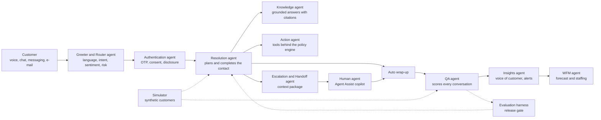
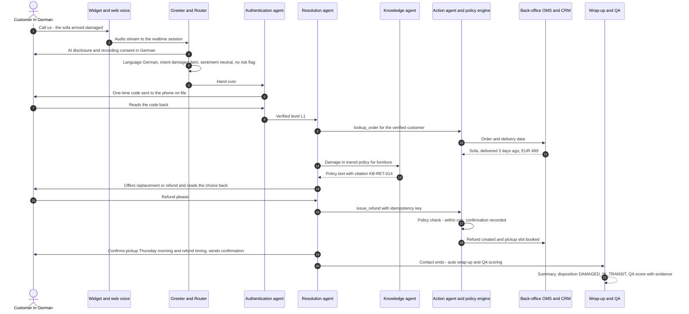
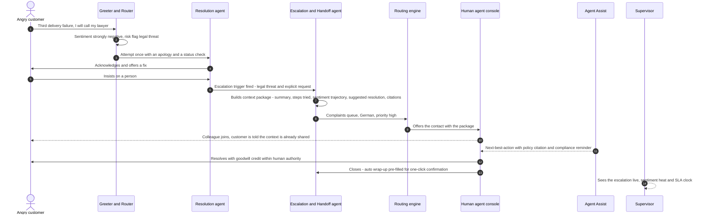
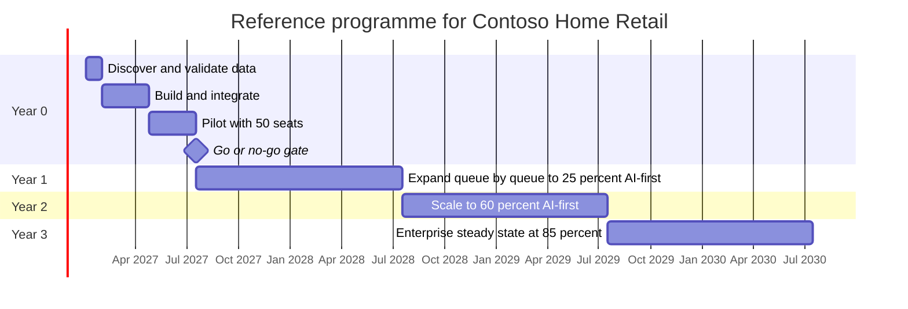

# SwarmAI Contact Center ("Concierge") — Product Requirements Document

| | |
|---|---|
| **Product** | SwarmAI Contact Center, codename **Concierge** — an AI-first contact center on Azure |
| **Status / version** | Release 1 specification, v1.0 · 17 Nov 2026 |
| **Audience** | Customer executives (COO, CFO, CIO, CISO), product and engineering, Microsoft and partner leadership |
| **Companion documents** | [`ARCHITECTURE.md`](ARCHITECTURE.md) · [`FEATURES.md`](FEATURES.md) (status board, acceptance criteria) · [`business-case/`](business-case/README.md) (model, assumptions, outputs) · `deck/` (executive deck) · `README.md` and `REPORT-TEST-AND-DEPLOYMENT.md` (engineering evidence) |
| **Conventions** | Requirement IDs `FR-*` / `NFR-*`, KPIs `KPI-01…19`, features `CC-01…24`, sources `[S#]` (see §20). All money in USD at Azure list prices unless stated. Every number in §1 and §11 is produced by `business-case/model.py` and quoted from `business-case/outputs.json`; anything else is either sourced or labelled **Assumption**. Customer, brands and data are fictional (Contoso, Northwind, …). |

## 1. Executive summary

**Concierge is an AI-first contact center on Azure.** Every contact — voice, chat, messaging, e-mail — starts with an AI agent that can actually *resolve* it: grounded in the customer's own knowledge and able to act (orders, returns, refunds, appointments, billing, warranty) through policy-guarded tools. **Humans become the escalation and expertise layer**, supported by a real-time Agent Assist copilot and automatic wrap-up. Behind the front line, **100 % of conversations are quality-scored**, customer voice is mined for root causes, workforce plans account for AI containment, and a continuous **evaluation harness** tests every prompt, policy and knowledge change before it reaches a customer.

**Why now.** Labour is up to 95 % of contact-center cost and there are about 17 million agents worldwide [S5]; yet only 14 % of customer issues are fully resolved in self-service [S3], and manual QA reviews a small fraction of conversations [S8]. Analysts expect agentic AI to resolve 80 % of common service issues autonomously by 2029 with 30 % lower operating cost [S1], and a field study of 5,172 support agents measured +15 % issues resolved per hour with a generative-AI assistant [S6]. But 64 % of customers say they would rather companies did not use AI in customer service [S2] — so the winning design **resolves rather than deflects, discloses, and always offers a human**.

**Reference customer — Contoso Home Retail** (fictional omnichannel retailer: 1,500 agents, ≈ 18 M contacts a year, 8 markets, baseline $5.58 per contact ≈ $100 M a year):

| 3-year view, USD, Azure list prices | Conservative | **Base** | Upside |
|---|---:|---:|---:|
| **NPV** (10 % discount rate) | $3.0 M | **$27.1 M** | $58.0 M |
| **ROI** (benefits − costs) / costs | 28 % | **216 %** | 485 % |
| **Payback** from project start (months) | 32.5 | **15.8** (9.8 after go-live) | 11.5 |
| Risk-adjusted benefits / total cost | $22.7 M / $17.8 M | **$50.9 M / $16.1 M** | $87.8 M / $15.0 M |
| **Year-3 Azure consumption (ACR)** | $2.79 M | **$2.98 M** (≈ $166 per seat per month) | $2.99 M |

* **Unit economics (Year 3, base):** $0.047 of Azure cost per AI voice minute; **$1.46 all-in cost per verified-resolved AI contact versus $6.34 per resolved human contact** (4.4×); blended cost per contact falls 17 % ($5.58 → $4.62) after paying for Azure, AI operations, licences, support and amortised one-off costs.
* **Honest bounds:** conservative and upside move each uncertain driver 60 % of the way to its bound; a *stacked* stress test with **every** uncertain driver at its unfavourable bound gives NPV −$6.8 M (not a forecast). The headline driver is verified AI resolution (base 30 % of AI-first contacts at maturity).
* **ACR is robust to AI success** — better containment shifts spend from speech-to-text on human calls to realtime AI minutes — and is dominated by AI models and services (93 % in Year 3). Communications (SIP/CPaaS, messaging; $1.16 M in Year 3) is a real customer cost but billed outside Azure by default because Azure Communication Services is being retired as a standalone offering [S16]; see §11.4.

**The ask.** Approve a **6-month build-and-pilot** (3 months integration and knowledge preparation, then a 3-month, 50-seat pilot on selected queues) with go/no-go gates on *verified* outcomes (§10.3): verified resolution ≥ 15 % on pilot queues (half of the 30 % mature target), CSAT not lower than the human baseline, zero PII/PCI leakage, and Azure cost per verified-resolved contact below $2 on pilot volumes. The one-off investment in the base case is $2.7 M (implementation, change management, contingency and pilot consumption); recurring run cost reaches $5.8 M a year in Year 3 against $25.8 M of risk-adjusted benefit.

**What exists.** Release 1 is a working reference implementation of **24 features** (`CC-01…CC-24`) in this repository — voice and chat agents, RAG with citations, policy-guarded tools, warm handoff, Agent Assist, auto wrap-up, 100 % auto-QA, compliance guard, VoC, CX/ROI view, forecasting, supervisor console, evaluation harness, staged rollout, multilingual UI, CRM connectors, RBAC, FinOps metering, IaC and a polished Agent Studio UI — running on a synthetic Contoso Home environment (see `README.md` and `REPORT-TEST-AND-DEPLOYMENT.md` for what is deployed and tested). **Verified on the live Azure deployment** (Sweden Central; final build `20261118-013951`, measured on the identical-code build `20261118-010642`): all 24 features deployed; 212 unit/API tests and 27 browser tests (85 % line coverage on domain logic); live smoke test 21 / 21; evaluation harness 42 / 42 scenarios on real models (run-to-run 40–42 / 42); chat turn p50 / p95 1.6 / 1.9 s; estimated idle cost ≈ US$28 per month. PSTN telephony is **not** provisioned in the demo; web voice is the live channel.

**What we need from the customer to firm up the case:** contact volumes by queue and channel, the real cost per contact, handle-time and wrap-up data, attrition and replacement cost, QA coverage, abandonment, overflow outsourcing and compliance-incident data (every assumption flagged *validate* in `business-case/assumptions.json`).

## 2. Problem and market context

### 2.1 The problem in contact centers today

| Pain | Evidence | Consequence |
|---|---|---|
| **Cost-heavy and labour-bound** | Labour can be up to 95 % of contact-center cost; ≈ 17 M agents worldwide [S5]. Gartner's 2019 poll put live-channel contacts at $8.01 versus $0.10 in self-service [S4] (older, US-centric; the model's $5.58 baseline is below it). | Volume growth means linear cost growth |
| **Self-service does not resolve** | Only 14 % of issues are fully resolved in self-service, and 36 % even for issues customers call "very simple" [S3]; in 2019 the figure was 9 % [S4]. | Customers fall back to expensive live channels — **deflection is not resolution** |
| **High attrition** | ContactBabel's survey of 189 US centers (year-end 2023) found a 31 % mean and 24 % median [S7]; multi-country retail with seasonal peaks often runs higher (Contoso: 35–45 %, customer input). | Constant hiring, training and ramp cost; inconsistent quality |
| **Thin quality assurance** | Manual QA commonly reviews 1–3 % of interactions (vendor-reported, no regulated benchmark) [S8]. | Problems found late, from a tiny sample; AI agents also need QA |
| **Inconsistent answers, repeated questions, long waits** | Customers repeat themselves at every transfer; peaks (promotions, delivery failures) overflow capacity. | Abandonment, repeat contacts, outsourcing premiums |
| **Language fragmentation** | 8 markets mean small queues that pool badly and need 24/7 cover. | Over-staffing and uneven service |

### 2.2 Market forces

* **AI is moving from assisting to resolving.** Gartner (2022) projected one in ten agent interactions would be automated by 2026, up from 1.6 %, and $80 B of agent labour savings in 2026 [S5]; its 2025 prediction is autonomous resolution of 80 % of common issues by 2029 with a 30 % reduction in operating cost [S1]. These are analyst predictions, not guarantees; the business case deliberately assumes far less (30 % verified resolution of AI-first contacts at maturity, 17 % blended cost reduction in Year 3).
* **Evidence of productivity.** A field study of 5,172 customer-support agents found generative-AI assistance raised issues resolved per hour by 15 % on average, with the largest gains for less-experienced agents [S6].
* **Lessons from early adopters.** Klarna reported that its AI assistant handled 2.3 M conversations — two-thirds of customer-service chats — in its first month, equivalent to 700 full-time agents [S9]. In 2025 the CEO said an over-emphasis on cost had lowered quality and the company added human support again; Klarna states it is not reversing on AI and continues a dual-track approach [S10]. **Design implication:** optimise for verified resolution and quality, keep a human path, and measure both.
* **Customers are wary.** In a Gartner survey of 5,728 customers, 64 % would prefer companies did not use AI in customer service and 53 % would consider switching if they learned a company would [S2]. **Design implication:** transparent disclosure, a visible human option, and AI that is demonstrably better (faster, consistent, able to act).
* **Regulation is arriving.** EU AI Act Article 50 transparency rules (people must be told they are interacting with an AI system) apply from 2 August 2026 [S11]; the FCC ruled in 2024 that AI-generated voices are "artificial voices" under the US TCPA, requiring prior express consent for such calls [S12]. See §16.
* **The platform layer is shifting.** Microsoft announced on 23 Sep 2026 that Azure Communication Services is retired as a standalone offering effective 30 Sep 2028 (Direct Routing, SMS, Email, Chat, Job Router retired; Call Automation continues only for Teams-aligned scenarios), and the Azure OpenAI Realtime API now accepts SIP calls directly in Sweden Central [S16][S17]. **Design implication:** keep telephony and messaging behind adapters (ADR-02 in `ARCHITECTURE.md`).

### 2.3 Market size (context, not a forecast)

| Measure | Value | Source |
|---|---|---|
| Contact-center agents worldwide | ≈ 17 million | [S5] |
| CCaaS software market, 2025 | $7.2 B (Emergen Research) to $8.4 B (Metrigy, secondary citation) — definitions differ | [S14][S15] |
| CCaaS growth outlook | 19.1 % CAGR to 2035 (Emergen Research) versus 9.8 % CAGR to 2030 (Metrigy) — wide spread | [S14][S15] |
| Value pool that AI targets | the *labour* behind those seats, not the software subscription | [S5] |

Illustrative Azure opportunity (assumption-driven, see §11.6): if 2–10 % of an addressable 30 % of the world's agent seats ran an AI-first service at the reference tier's consumption ($1,986 per seat per year), annual Azure consumption would be about $0.2–1.0 B. This is a sizing aid, **not** a forecast.

## 3. Vision and positioning

**Vision.** *Every conversation answered, resolved and learned from.* Customers get an answer in seconds, in their language, from an agent that can act; people spend their time on the conversations that need judgement and empathy; the operation improves continuously because every conversation is scored, mined and fed back into a tested release process.

**Positioning statement.** *For heads of customer care who must cut cost-to-serve without losing customers, **Concierge** is an Azure-native AI contact center that **resolves** contacts end-to-end — voice and digital — with policy-guarded actions, hands off to humans with full context, and scores 100 % of conversations. Unlike deflection bots and black-box AI add-ons, Concierge measures success on verified outcomes, ships changes through an evaluation gate, runs on the customer's own Azure tenant with open adapters to the CCaaS and CRM they already use, and is auditable line by line.*

**Differentiators (what must show up in product, deck and demo)**

| # | Differentiator | How it is proven |
|---|---|---|
| 1 | **Resolve, not deflect** — transactional tools with caps, confirmations, idempotency and audit; resolution measured on verified outcomes | CC-04, CC-13; KPI-01/02 gap; GJ-1 |
| 2 | **Voice-native** — speech-to-speech with barge-in and in-session tool calls, with a fallback pipeline and a provider-neutral telephony adapter | CC-02; live web voice; latency metrics |
| 3 | **Human + AI continuum** — smart routing, warm handoff with context package, Agent Assist, auto wrap-up | CC-06…CC-09; GJ-2 |
| 4 | **Quality at 100 %** — rubric auto-QA with evidence, calibration, coaching, plus LLMOps: synthetic customers, regression gate, red-team, staged rollout | CC-10, CC-16, CC-17; GJ-6 |
| 5 | **Compliance and trust by design** — disclosure, consent, PII redaction, PCI-safe hand-off, prompt-injection defences, retention, audit | CC-05, CC-11; GJ-7 |
| 6 | **Microsoft-native and open** — Azure OpenAI/Foundry, Speech, Language, Content Safety, AI Search, Cosmos DB, Fabric; adapters for Dynamics 365, Salesforce, ServiceNow, Genesys/NICE | CC-20; ARCHITECTURE.md |

**Principles.** (1) Verified outcomes over containment. (2) Tools act, models propose — a deterministic policy engine owns money, identity and consent. (3) Humans are the escalation layer, never the afterthought. (4) Everything that changes behaviour passes an evaluation gate. (5) Provider-neutral at the edges (telephony, CRM, CCaaS), Azure-native at the core. (6) Disclosure and data minimisation by default.

## 4. Personas and jobs-to-be-done

| ID | Persona | Jobs to be done | Pains today | What Concierge gives them | Features | KPIs |
|---|---|---|---|---|---|---|
| P1 | **COO / Head of Customer Care** (economic buyer) | Cut cost-to-serve, protect CSAT, stay resilient at peaks, justify AI to the board | Linear cost growth, outsourcing premiums, no proof AI resolves | Cost per *resolved* contact AI vs human, verified resolution, peak elasticity | CC-13, 14, 15 | 01, 06, 07, 11 |
| P2 | **Contact-center director** | Hit service levels, staff correctly, run change safely | Forecast misses, attrition, inconsistent quality | AI-aware forecast and staffing, quality at 100 %, safe release process | CC-14, 15, 17 | 11, 14, 15 |
| P3 | **Supervisor** | Manage live queues by exception, step in, coach | Blind spots on AI conversations, late escalations | One live view of AI and human work, take-over / whisper / approve | CC-15, 07, 08 | 09, 11 |
| P4 | **Human agent** | Resolve the hard cases well, spend less time on repetition and wrap-up | Customers repeat themselves, knowledge hunting, ACW | Warm handoff with full context, Agent Assist with citations, auto wrap-up | CC-07, 08, 09 | 03, 04, 14 |
| P5 | **QA analyst** | Judge quality, calibrate, coach | Reviews 1–3 % of contacts, subjective scoring | Every conversation scored with evidence; calibrate instead of listen | CC-10 | 08 |
| P6 | **WFM analyst** | Forecast demand, plan capacity and schedules | AI changes the demand shape; static rules | Interval forecast, Erlang-C, containment what-ifs | CC-14 | 15 |
| P7 | **CX / CRM lead** | Understand contact drivers, fix root causes, integrate systems | Insight limited to disposition codes; brittle integrations | VoC drivers and alerts, Customer 360, connectors | CC-12, 20 | 17, 05 |
| P8 | **CISO / Compliance** | Control AI risk, evidence compliance, protect data | Prompt injection, PII/PCI leakage, unclear audit | Guard layer, redaction, PCI-safe hand-off, audit, retention, RBAC | CC-05, 11, 21 | 12 |
| P9 | **CFO** | Approve investment, track realised benefit | Unaudited vendor claims | Line-by-line, list-price model; live cost per resolved contact | CC-13, 22 | 07 |
| P10 | **Customer** | Get it fixed fast, in my language, with a human on request | Waiting, repeating, inconsistent answers | Instant, grounded, actionable service; clear disclosure; no dead ends | CC-01, 02, 05, 19 | 06, 05, 11 |
| P11 | **AI operations lead** | Own prompts, policies, knowledge and evaluation gates | Changes ship untested; no rollback | Versioned configs, eval gate, canary, rollback, red-team pack | CC-16, 17, 03 | 16, 13 |

## 5. Goals and non-goals

**Goals (Release 1 and the pilot)**

| # | Goal | Measured by |
|---|---|---|
| G1 | Resolve a material share of Tier-1 contacts without a human, on **verified** outcomes | KPI-01 (base 30 % of AI-first contacts at maturity), KPI-02 gap ≤ 5 pts |
| G2 | Make human work faster and better | KPI-03 / 04 (AHT −12 % on assisted contacts), KPI-09 |
| G3 | Score 100 % of conversations, human and AI | KPI-08 (coverage 100 %, agreement within ± 1 band) |
| G4 | Voice that feels natural | KPI-10 (target p95 < 800 ms turn latency on the production path) |
| G5 | Compliance and trust by design | KPI-12 (100 % disclosure, 0 PII/PCI leaks, 100 % red-team must-pass) |
| G6 | Prove unit economics | KPI-07 ($1.46 all-in AI cost per resolved contact vs $6.34 human in the base case) |
| G7 | Make change safe | KPI-16 (no change reaches customers without a passing evaluation run) |
| G8 | Be deployable and auditable on the customer's Azure tenant | IaC re-deploy, keyless identity, open adapters, line-item cost model |

**Non-goals**

* **Not a carrier or a complete CCaaS/ACD replacement.** Concierge integrates with the customer's telephony, CCaaS and CRM through adapters (SIP trunk, Dynamics 365, Genesys/NICE, Salesforce, ServiceNow).
* **Not a replacement for the CRM/OMS** — it reads and writes through connectors.
* **No autonomous outbound voice campaigns at scale in Release 1** (CC-18 is a thin, consent-first slice).
* **No biometric or acoustic emotion inference on staff**; agent-facing coaching and QA use text and linguistic signals only (§16).
* **No legal, medical or investment advice** flows; regulated-advice journeys are out of scope.
* **No claims about Microsoft product roadmaps.** Where Microsoft services are named, only generally available or documented behaviour is relied upon.

## 6. Solution overview

### 6.1 Concept

A **swarm of specialised AI agents** answers every contact; a **deterministic policy engine** owns anything that moves money, touches identity or changes records; **humans** handle what needs judgement, with the full context and a copilot; and a **quality and learning loop** scores, mines, forecasts and tests everything.

### 6.2 The agent swarm

| Agent | Responsibility | Tools / data | Model tier (illustrative) | Features |
|---|---|---|---|---|
| **Greeter / Router** | Detect language, intent, entities, sentiment, urgency and risk flags; choose AI-first or human-first path; route escalations by skills, priority, SLA | Classifiers, routing rules, queue state | nano / mini | CC-06 |
| **Authentication** | Disclosure, recording consent, OTP/KBA, step-up, PII minimisation, payment hand-off | OTP service, consent store, payment hand-off | mini | CC-05 |
| **Resolution** | Plan and complete the contact; calls Knowledge and Action agents; decides to escalate | Conversation memory, tool registry | realtime mini/full, chat mini/full | CC-01, 02 |
| **Knowledge** | Retrieve and answer with citations; say "I don't know" | Hybrid retrieval, groundedness check | mini | CC-03 |
| **Action (tools)** | Execute transactions through the policy engine: lookup, track, return, refund, reschedule, address, credit, warranty, ticket | Back-office connector, policy engine, audit | deterministic code behind LLM function calls | CC-04, 20 |
| **Escalation / Handoff** | Build the context package, pick the destination, brief the human, whisper next-best-actions | Summaries, sentiment trajectory, citations | mini | CC-07, 08 |
| **QA** | Score every conversation against the rubric with evidence; feed coaching and prompt fixes | Rubric, transcripts | mini + full for borderline cases | CC-10 |
| **Insights** | Cluster topics, detect emerging issues, repeat-contact and churn signals | Embeddings, anomaly detection | embeddings + mini | CC-12 |
| **WFM** | Forecast intervals, compute staffing, model containment what-ifs | Forecast models, Erlang-C | statistical (no LLM) | CC-14 |
| **Simulator** | Play synthetic customers (angry, confused, multilingual, fraudster, prompt-injector) against any configuration | Scenario library, judges | mini / full | CC-16 |

### 6.3 Human + AI continuum

| Level | Who resolves | Typical triggers | Human role |
|---|---|---|---|
| **L0 — AI-resolved** | Resolution agent, verified outcome | Tier-1 transactional or informational contact, authentication passed, within policy | None (QA scored afterwards) |
| **L1 — AI with approval** | AI prepares, a human or supervisor approves | Refund above the cap, goodwill above limit, policy exception | Approve / deny in seconds |
| **L2 — Human with copilot** | Human agent, AI whispering next-best-actions with citations | Explicit request, loop, sentiment drop, tool failure, vulnerable or VIP customer | Own the conversation; wrap-up pre-filled |
| **L3 — Expert swarm** | Human plus experts (Teams) | Legal threat, complex complaint, safety | Lead; AI summarises and documents |

### 6.4 Guardrails (defence in depth)

| Layer | Control | Feature |
|---|---|---|
| Identity | OTP / KBA with step-up; unauthenticated sessions cannot read account data; cross-customer access rejected | CC-05, 04 |
| Policy engine | Per-agent tool allow-lists, monetary caps, frequency limits, eligibility windows, confirmation before writes, idempotency keys, append-only audit | CC-04 |
| Input and output | PII redaction, Prompt Shields for user text and documents, toxicity filters, risky-promise and missing-disclosure detectors | CC-11 |
| Grounding | Citations required; groundedness check; "don't know → escalate" | CC-03 |
| Payments | Card data never reaches transcripts, logs or model context (hosted-link or DTMF hand-off) | CC-05 |
| Release | Evaluation gate, red-team pack, canary, rollback, audit | CC-16, 17 |
| Oversight | Supervisor take-over, whisper, approvals; QA at 100 % | CC-15, 10 |

### 6.5 Resolve, not deflect — how success is defined

**Verified resolution (KPI-01)** counts an AI-first contact only if (a) the AI completed the customer's intent, (b) the outcome is **confirmed in the system of record** (for example a refund or pickup exists) or the customer confirmed the answer, and (c) there is **no re-contact on the same intent within 7 days**. **Containment (KPI-02)** — no human touched the contact — is reported next to it, and the gap (false containment) is a first-class metric. Only verified resolutions are monetised in the business case.

## 7. User journeys

### 7.1 Journey 1 — "Damaged sofa", in German, resolved by AI in three minutes (GJ-1)

*Persona P10 (customer) with Contoso Home. Demo policy: damage in transit is refundable or replaceable without approval up to a configurable cap (€750).*

| Step group | What the customer experiences | Features | KPIs |
|---|---|---|---|
| Greeting and identification | Immediate answer in German; AI disclosure; consent; OTP | CC-02, 19, 05 | 10, 12 |
| Understand and decide | Order found, policy cited, options offered; refund cap enforced | CC-03, 04, 06 | 01, 13 |
| Act and confirm | Refund and pickup created; confirmation sent | CC-04, 20 | 01, 05 |
| Learn | Summary and disposition; QA score; cost per resolved contact recorded | CC-09, 10, 13, 22 | 04, 08, 07 |

**Acceptance:** end-to-end in ≤ 3 minutes with no human; the outcome verified in the back-office; the transcript contains no card data; the QA record cites evidence turns (see `FEATURES.md`, GJ-1).

### 7.2 Journey 2 — Angry customer, legal threat, warm handoff (GJ-2)

**Acceptance:** the human sees the package before the first word and the customer is not asked to repeat identity, order or issue; Agent Assist suggestions cite policy; wrap-up is pre-filled; the supervisor view shows the escalation (`FEATURES.md`, GJ-2).

### 7.3 Other journeys

| # | Journey | Persona | What happens | Features | Acceptance (see `FEATURES.md`) |
|---|---|---|---|---|---|
| J3 | **Supervisor in control** | P3 | Live queues, active AI and human conversations, sentiment heat, SLA-risk alert; take over a chat, whisper to an agent, approve an above-cap refund | CC-15, 04, 06 | GJ-3 |
| J4 | **Quality and insight** | P5, P7 | Both journeys auto-scored with evidence; analyst calibrates a score; VoC flags a spike in "damaged on delivery" for one carrier with a link to evidence conversations | CC-10, 12 | GJ-4 |
| J5 | **Staffing what-if** | P6, P2 | Forecast per queue, Erlang-C staffing; moving the containment slider changes the human requirement and the AI capacity needed | CC-14, 13 | GJ-5 |
| J6 | **Safe change** | P11 | A deliberately broken prompt is rejected by the evaluation gate; a good change goes canary → promote; rollback works | CC-16, 17 | GJ-6 |
| J7 | **Attack and leak resistance** | P8 | Prompt injection in user text and in a KB document does not trigger a forbidden tool call; a card number never appears in transcript, logs or model context | CC-11, 05, 04, 03 | GJ-7 |
| J8 | **ROI view** | P1, P9 | Calculator reproduces the model outputs; live cost per resolved contact AI vs human | CC-13, 22 | GJ-8 |

## 8. Functional requirements

Requirements are stated as testable "shall" sentences and traced to features; acceptance criteria are in [`FEATURES.md`](FEATURES.md). Priority is the feature's priority.

### Epic A — Conversational AI agents

| ID | Requirement | Feature | Pri |
|---|---|---|---|
| FR-A01 | The system shall provide a web chat widget and REST/WebSocket (SSE) API that streams replies token by token, keeps multi-turn session memory that survives restarts, and answers in the customer's language without being told. | CC-01 | P0 |
| FR-A02 | The system shall serve every channel through a `ChannelAdapter` interface, with implemented adapters for web chat and a generic webhook and tested stubs for SMS, WhatsApp and e-mail. | CC-01 | P0 |
| FR-A03 | The system shall provide browser voice over a WebSocket relay to Azure OpenAI Realtime (`gpt-realtime-2.1-mini`, fallback `gpt-realtime-mini`) with server-side voice-activity detection, barge-in, live transcript, tool calls inside the realtime session and per-turn latency metrics. | CC-02 | P0 |
| FR-A04 | The system shall fall back to an STT → LLM → TTS pipeline when the realtime path is unavailable, and shall implement a provider-neutral `TelephonyAdapter` (call-automation-style events: incoming call, connected, play, recognize, disconnected) exercised by a simulator. | CC-02 | P0 |
| FR-A05 | The system shall ingest knowledge (markdown, PDF, text, HTML), chunk and embed it, retrieve it with hybrid search and return **citations**, and provide KB administration with versions and publish. | CC-03 | P0 |
| FR-A06 | The system shall verify groundedness before delivering an answer and shall answer "I don't know" and offer escalation when the knowledge does not support an answer. | CC-03 | P0 |
| FR-A07 | The system shall execute transactions only through policy-guarded tools (look up customer/order, track shipment, initiate return, refund with cap and approval above cap, reschedule, update address, goodwill credit with cap, warranty claim, ticket, escalate) with read-back confirmation, idempotency keys, per-agent allow-lists and an append-only audit trail. | CC-04 | P0 |
| FR-A08 | The system shall verify identity by one-time code or knowledge-based fallback, enforce verification levels (anonymous, OTP, step-up) on tools, and lock the flow after repeated failures. | CC-05 | P0 |
| FR-A09 | The system shall disclose AI use at the start of every conversation, capture recording consent (with a decline path), minimise PII in model context, and hand payments to a secure link or DTMF capture so that card data never enters transcripts, logs or model context. | CC-05 | P0 |

### Epic B — Routing and human collaboration

| ID | Requirement | Feature | Pri |
|---|---|---|---|
| FR-B01 | The system shall extract intent, entities, sentiment/emotion, urgency and risk flags (legal threat, vulnerable customer, fraud suspicion, safety, regulatory complaint, churn risk) on every turn from text. | CC-06 | P0 |
| FR-B02 | The system shall route escalations deterministically by skills, priority, SLA, VIP and vulnerable status (Job Router semantics) and fire explicit, configurable escalation triggers (sentiment, loops, explicit request, policy block, tool failure, risk flag). | CC-06 | P0 |
| FR-B03 | The system shall deliver a **context package** (summary, intent, entities, steps tried, sentiment trajectory, risk flags, suggested resolution, citations) to the human console in real time, before the human speaks. | CC-07 | P0 |
| FR-B04 | The system shall provide Agent Assist: live transcript, ranked next-best-action with citations, editable suggested replies, compliance reminders and knowledge search. | CC-08 | P0 |
| FR-B05 | The human-agent console shall support chat takeover of an AI conversation, form auto-fill and tone coaching based on text signals. | CC-08, CC-24 | P0 |
| FR-B06 | The system shall produce an automatic wrap-up (summary, disposition, CRM note, follow-up tasks, QA flags) for every conversation and measure after-call-work reduction. | CC-09 | P0 |

### Epic C — Quality, compliance, insight

| ID | Requirement | Feature | Pri |
|---|---|---|---|
| FR-C01 | The system shall score 100 % of conversations (human and AI) against a rubric (greeting, empathy, accuracy, policy adherence, resolution, compliance) with evidence snippets and auto-fail rules. | CC-10 | P0 |
| FR-C02 | The system shall support human QA calibration with agreement metrics, per-agent (human and AI) coaching suggestions and QA dashboards. | CC-10 | P0 |
| FR-C03 | The system shall redact PII/PCI (rules with checksum validation plus Azure AI Language), defend against prompt injection and jailbreaks (Prompt Shields plus validation) and filter toxicity on all inputs and outputs. | CC-11 | P0 |
| FR-C04 | The system shall detect missing disclosures and risky promises, enforce retention policies, keep a tamper-evident audit log and ship a red-team regression pack. | CC-11 | P0 |
| FR-C05 | The system shall discover contact drivers by embedding clustering and show sentiment trends, a driver Pareto and repeat-contact and churn-risk signals. | CC-12 | P1 |
| FR-C06 | The system shall alert on emerging issues by anomaly detection on topic volumes, with attribution and evidence links. | CC-12 | P1 |
| FR-C07 | The system shall report containment, verified resolution, AHT, FCR, predicted CSAT, cost per contact and per resolved contact, SLA and abandonment with AI-vs-human comparison per queue and interval. | CC-13 | P0 |
| FR-C08 | The system shall include an ROI and ACR calculator that reuses `business-case/model.py` and reproduces `outputs.json` for the reference scenario within 0.5 %. | CC-13 | P0 |

### Epic D — Operations and LLMOps

| ID | Requirement | Feature | Pri |
|---|---|---|---|
| FR-D01 | The system shall forecast interval volumes per queue (seasonal-naive baseline and exponential smoothing) and report backtest MAPE. | CC-14 | P1 |
| FR-D02 | The system shall compute Erlang-C staffing, an AI-vs-human capacity plan with containment what-ifs and a schedule recommendation that meets the service-level target in simulation. | CC-14 | P1 |
| FR-D03 | The supervisor console shall show live queues, AI and human conversations, sentiment heat and SLA-risk alerts, and support take-over, whisper, coach (simulated for voice) and approve/deny. | CC-15 | P0 |
| FR-D04 | The system shall run ≥ 30 scripted and LLM-driven scenarios against any agent configuration, score them, gate changes in CI, fail on a deliberately broken prompt and include a red-team pack. | CC-16 | P0 |
| FR-D05 | The system shall version prompts, tools, policies and model deployments, require a passing evaluation to promote, support canary and A/B, one-click rollback and audit. | CC-17 | P1 |
| FR-D06 | The system shall trigger proactive outreach from events with consent and opt-out enforcement, quiet hours, frequency caps, callback scheduling and campaign controls. | CC-18 | P2 |

### Epic E — Platform

| ID | Requirement | Feature | Pri |
|---|---|---|---|
| FR-E01 | The system shall detect language per utterance, support 40+ languages in chat and voice (quality-evaluated for the eight Contoso markets) and translate for human agents in real time. | CC-19 | P1 |
| FR-E02 | The system shall provide captions and transcripts and an accessible UI that targets WCAG 2.1 AA [S25]. | CC-19, CC-24 | P1 |
| FR-E03 | The system shall access back-office systems only through connector interfaces (mock CRM/OMS, Dynamics 365 / Dataverse, generic REST/OData) and show a Customer 360 timeline. | CC-20 | P1 |
| FR-E04 | The system shall enforce roles (Customer, Agent, Supervisor, QA, WFM, Admin, Auditor) at the API, validate Entra-style JWTs, and keep retention and access audit. | CC-21 | P1 |
| FR-E05 | The system shall meter tokens, audio minutes and tool calls per interaction with a cost estimate, report cost per resolved contact and latency SLOs, and expose health endpoints. | CC-22 | P1 |
| FR-E06 | The system shall deploy reproducibly with IaC and remote build, ship smoke tests against the deployed app and document teardown. | CC-23 | P0 |
| FR-E07 | The system shall provide one polished, responsive, accessible UI for every persona (widget, agent console, supervisor console, QA workbench, KB admin, evaluation UI, analytics, WFM, settings, calculator, feature map). | CC-24 | P0 |

## 9. Non-functional requirements

| ID | Requirement | Target | Verification |
|---|---|---|---|
| NFR-01 | **Voice turn latency** (end of customer speech → first agent audio) | p95 < 800 ms on the production path (in-region realtime over SIP/WebRTC); demo reports what it measures | per-turn server timing, SLO panel (CC-22); latency budget in `ARCHITECTURE.md` |
| NFR-02 | **Text and assist latency** | chat time-to-first-token p95 ≤ 2 s; Agent Assist suggestion ≤ 2 s p95; routing decision ≤ 300 ms; handoff package ≤ 2 s | load test, SLO panel |
| NFR-03 | **Concurrency and elasticity** | Reference tier (1,500 seats, Year 3): ≈ 190 concurrent AI voice sessions and ≈ 440 concurrent chat sessions at peak [model]; scale to 10,000 seats; realtime quota planned per region | capacity model in `ARCHITECTURE.md`, load test |
| NFR-04 | **Availability and resilience** | 99.9 % monthly for web/API; 99.95 % for the voice path with multi-region active/active; RTO ≤ 15 min, RPO ≤ 5 min for conversation state (≤ 1 h for recordings) | architecture review, failover drill (R2) |
| NFR-05 | **Accessibility** | WCAG 2.1 AA targets; keyboard-only completion; captions; screen-reader support | automated + manual checks |
| NFR-06 | **Security** | Entra ID and managed identities, no keys or connection strings, TLS 1.2+, secrets in Key Vault, least-privilege RBAC, private endpoints and WAF in the target, dependency and image scanning, penetration test before GA | IaC scan, `pip-audit` / `npm audit`, threat model |
| NFR-07 | **Privacy and data residency** | EU Data Zone inference for EU customers; primary region Sweden Central with an EU secondary; data minimisation; retention per data class (default recordings 12 months, redacted transcripts per policy); DSAR and deletion support; no use of customer data to train foundation models | data-flow review, retention job tests |
| NFR-08 | **Safety and responsible AI** | Guard layer on 100 % of inputs and outputs; red-team must-pass 100 %; AI disclosure 100 %; a human path always available; no biometric emotion inference on staff | CC-11/16 tests, audits |
| NFR-09 | **Observability and auditability** | OpenTelemetry traces, metrics and logs; metering completeness 100 %; append-only audit of tool calls, approvals, config changes and data access | CC-22 reports, audit queries |
| NFR-10 | **Cost efficiency** | Azure cost ≤ $0.06 per AI voice minute and all-in AI cost ≤ $2 per verified-resolved contact (base case: $0.047 and $1.46); daily AI budget caps that fail closed in the demo | metering, FinOps view |
| NFR-11 | **Maintainability and testability** | Feature-sliced modules; ≥ 80 % line coverage on domain logic; evaluation gate in CI; reproducible IaC | CI results, report |
| NFR-12 | **Interoperability** | Open interfaces: SIP/SIPREC, REST/OData, webhooks, Event Grid; adapters for CRM, CCaaS and telephony; OpenAPI for every service | contract tests |

## 10. Success metrics and measurement plan

### 10.1 KPI catalogue and targets

Targets are illustrative and tied to the base case unless stated; replace baselines with the customer's data.

| KPI | Definition (summary) | Baseline | Target |
|---|---|---|---|
| KPI-01 Verified AI resolution | AI-first contacts closed with a verified outcome and no 7-day re-contact | 0 % | 30 % of AI-first contacts at maturity (pilot ≥ 15 %) |
| KPI-02 AI containment | AI-first contacts completed without a human | — | KPI-02 − KPI-01 ≤ 5 points |
| KPI-03 AHT (human-handled) | Talk/chat handling plus wrap-up | customer ACD data | −12 % on assisted contacts |
| KPI-04 After-call work | Wrap-up seconds per human contact | customer data | ≈ −50 % (auto wrap-up with edit rate tracked) |
| KPI-05 First-contact resolution | No repeat on the same intent within 7 days | ≈ 88 % (12 % repeat, assumption) | repeat share −8 % relative |
| KPI-06 CSAT | Surveyed and predicted | customer survey | AI-resolved CSAT not lower than human baseline; predicted CSAT on 100 % of contacts |
| KPI-07 Cost per (resolved) contact | Fully-loaded human cost + metered Azure/AI cost | $5.58 per contact, $6.34 per resolved | $1.46 all-in per AI-resolved contact (Year 3) |
| KPI-08 QA coverage and agreement | Share scored; auto vs human QA | 1–3 % | 100 %; ≥ 85 % within ± 1 band, κ ≥ 0.6 |
| KPI-09 Escalation quality | Handoff completeness, re-ask rate, time to first human response | n/a | ≥ 90 % complete; re-ask < 5 % |
| KPI-10 Voice turn latency | p50/p95 end of speech → first audio | n/a | p95 < 800 ms (production path); chat TTFT p95 ≤ 2 s |
| KPI-11 Service level and abandonment | Answered within threshold; abandon rate | customer ACD | abandon −50 % on AI-first voice queues |
| KPI-12 Compliance and safety | Disclosure rate, PII/PCI leaks, policy-violating tool calls, red-team must-pass | n/a | 100 % / 0 / 0 / 100 % |
| KPI-13 Groundedness | Answers grounded in cited sources; fabricated-answer detection | n/a | ≥ 95 % grounded on the eval set |
| KPI-14 Agent experience and attrition | Attrition, eNPS, occupancy | 40 % (customer input) | −4 points attrition |
| KPI-15 Forecast accuracy | Interval / daily MAPE; schedule fit | customer WFM | daily ≤ 8 %, interval ≤ 15 % (assumption) |
| KPI-16 Release quality | Gate pass rate, change-failure rate, time to rollback | n/a | 100 % of releases gated; rollback < 5 min |
| KPI-17 Insight latency | Time to detect an emerging issue | weeks (manual) | < 24 h from onset (assumption) |
| KPI-18 Reliability and cost telemetry | Availability SLO; metering completeness | n/a | ≥ 99.9 %; 100 % |
| KPI-19 Language coverage and accessibility | Languages evaluated; WCAG 2.1 AA | n/a | 8 markets evaluated; AA on main screens |

### 10.2 Measurement plan

1. **Instrument everything at source** — every conversation records channel, language, intents, tool calls and results, sentiment per turn, escalation reason, handoff package completeness, tokens/audio minutes and cost (CC-22), QA record and wrap-up. The system of record (OMS/CRM) is the arbiter of *verified* outcomes.
2. **Verified-resolution audit** — a weekly sample of AI-"contained" contacts is checked against the back-office and for 7-day re-contact; the KPI-02 − KPI-01 gap is published, never hidden.
3. **Holdout and A/B** — in the pilot, comparable queues (or a random share of contacts) stay human-first as a control for CSAT, AHT, FCR and cost; canary and A/B are built into CC-17.
4. **Cost** — cost per contact and per resolved contact are computed from the customer's cost ledger plus metered Azure cost using the same unit prices as `assumptions.json`; the live calculator (CC-13) is recalibrated with pilot data.
5. **Quality** — auto-QA scores every conversation; QA analysts calibrate a sample weekly and agreement drift triggers rubric review.
6. **Cadence** — daily operational dashboard (supervisors), weekly quality and safety review (QA, compliance, AI operations), monthly value review (COO, CFO).

### 10.3 Pilot go/no-go gates (3-month, 50 seats)

| Gate | Threshold |
|---|---|
| Verified resolution (pilot queues) | ≥ 15 % of AI-first contacts, trending to ≥ 25 % |
| Customer outcome | AI-resolved CSAT not lower than the human baseline; repeat contact on the same intent not higher |
| Safety and compliance | 0 PII/PCI leaks in transcripts, logs and model context; 100 % disclosure and consent capture; red-team must-pass 100 % |
| Escalation quality | ≥ 90 % handoffs with a complete package; re-ask rate < 5 % |
| Economics | Azure cost per verified-resolved contact < $2 on pilot volumes; metering complete |
| Operations | No P1 incident; evaluation gate used for every change |

## 11. Business case

All figures below are produced by [`business-case/model.py`](business-case/README.md) from `assumptions.json` and quoted from `outputs.json`: pure Python, deterministic, **list prices** (Azure Retail Prices API, swedencentral, EU Data Zone deployments for Azure OpenAI, retrieved 17 Nov 2026 [S22]), no EA discount, three-year horizon, Year 0 = build and pilot. Everything is **illustrative and assumption-driven**; items flagged *validate* in `assumptions.json` must be replaced with the customer's data before the case supports a commitment.

### 11.1 Value drivers (base case, risk-adjusted)

| Value driver | Mechanism | 3-year benefit | Share | Key assumptions (base) | Confidence factor |
|---|---|---:|---:|---|---:|
| **AI containment and resolution of Tier-1 contacts** | Verified AI resolutions avoid human handling | $24.8 M | 49 % | 30 % verified resolution of AI-first contacts at maturity; adoption 25 → 60 → 85 % of contacts; contained contacts cost 85 % of average; 80 % of loaded cost is cashable | 0.80 |
| **AHT reduction** | Agent Assist, auto wrap-up and warm-handoff context shorten human contacts | $13.7 M | 27 % | −12 % AHT on assisted contacts (field study: +15 % productivity [S6]) | 0.80 |
| **100 % auto-QA and quality uplift** | Fewer manual QA hours; fewer repeat contacts through coaching and VoC | $4.1 M | 8 % | 45 % of QA effort removed (50 analysts at 1:30); repeat contacts −8 % relative | 0.70 |
| **Attrition, hiring and training avoidance** | Less repetitive work; fewer hires because the workforce is smaller | $2.4 M | 5 % | Attrition −4 points from 40 %; $9,500 per replacement | 0.70 |
| **Abandonment, CSAT and retention** (revenue effect) | Instant answers recover abandoned voice contacts; better service reduces churn | $3.2 M | 6 % | Voice abandonment 8 % → −50 %; churn −0.15 points | 0.50 |
| **Peak resilience** | AI absorbs overflow that was outsourced at a premium | $1.0 M | 2 % | 8 % of contacts overflow; 35 % absorbed; premium $1.80 | 0.70 |
| **Compliance-risk reduction** | 100 % monitoring, real-time prompts, redaction | $0.7 M | 1 % | 150 incidents × $14,000 × −30 % | 0.50 |
| **Multilingual coverage without hiring** | AI and translation pool small-language queues | $1.0 M | 2 % | 15 % of contacts; 15 % fragmentation overhead; half recovered | 0.60 |
| **Total** | | **$50.9 M** | 100 % | | |

*Deliberately excluded:* cross-sell and upsell revenue, outbound/proactive deflection (CC-18), wage inflation, tool consolidation, any Microsoft or partner licence discount. Gartner's 2025 prediction of a 30 % operating-cost reduction by 2029 [S1] is above the model's Year-3 blended reduction of 17 % — the case does not depend on it.

### 11.2 Scenarios and returns

| | Conservative | **Base** | Upside |
|---|---:|---:|---:|
| NPV (10 %) | $3.0 M | **$27.1 M** | $58.0 M |
| ROI (3-year, undiscounted) | 28 % | **216 %** | 485 % |
| IRR | 38 % | **259 %** | 651 % |
| Payback from project start / from go-live (months) | 32.5 / 26.5 | **15.8 / 9.8** | 11.5 / 5.5 |
| Benefits, risk-adjusted | $22.7 M | **$50.9 M** | $87.8 M |
| Total cost (incl. Azure) | $17.8 M | **$16.1 M** | $15.0 M |
| Year-3 benefits / Year-3 net benefit | $12.1 M / $5.9 M | **$25.8 M / $20.0 M** | $41.5 M / $36.1 M |
| All-in AI cost per verified-resolved contact (Year 3) | $2.62 | **$1.46** | $1.00 |

*Definitions.* **Conservative / upside** move every *uncertain outcome and cost* assumption (containment, AHT reduction, adoption and maturity ramps, confidence factors, implementation and AI-operations costs) 60 % of the way from base to its low / high bound; customer facts, Azure usage drivers and prices stay at base. **Stacked stress tests** — every uncertain driver at its bound simultaneously — give NPV **−$6.8 M** (downside) and $85.6 M (upside); they are stress tests, not forecasts. Payback is measured from project start (6 months build and pilot) with benefits ramping inside each year and costs spread evenly.

### 11.3 Base case by year (USD M)

| | Year 0 (build + pilot) | Year 1 | Year 2 | Year 3 | Total |
|---|---:|---:|---:|---:|---:|
| AI-first share of contacts (average) | pilot (50 seats) | 25 % | 60 % | 85 % | |
| Verified-resolved AI contacts | 0.02 | 0.81 | 2.75 | 4.59 | |
| Benefits (risk-adjusted) | 0.0 | 7.2 | 17.9 | 25.8 | **50.9** |
| Azure consumption (ACR) | 0.03 | 1.34 | 2.46 | 2.98 | 6.8 |
| One-time: implementation, change management, contingency | 2.64 | — | — | — | 2.6 |
| Recurring: AI operations team, licences/SBC, support | — | 1.04 | 1.59 | 1.65 | 4.3 |
| Communications billed outside Azure (SIP/CPaaS, messaging) | 0.01 | 0.35 | 0.83 | 1.16 | 2.4 |
| **Total cost** | **2.69** | **2.73** | **4.88** | **5.79** | **16.1** |
| **Net benefit** | **−2.69** | **4.44** | **13.02** | **20.01** | **34.8** |
| Cumulative net benefit | −2.69 | 1.75 | 14.77 | 34.79 | |

Capacity released in Year 3 is the equivalent of ≈ 466 FTE gross (≈ 373 risk-adjusted), i.e. about 25 % of the 1,500 seats — realised through attrition, hiring freezes, redeployment and avoided overflow, not layoffs.

### 11.4 Azure consumed revenue (ACR), bottom-up

*Method.* Per service family: units × list price, where units come from volumes × usage drivers (for example realtime audio tokens per minute using Microsoft's estimate of ≈ 10 input and ≈ 20 output tokens per second [S19], cached re-reads of the growing context on every response, 5 model responses per minute, 30 % of minutes on `gpt-realtime-2.1`, 70 % on `-mini`). Fixed platform items are sized from peak load (190 concurrent AI voice sessions → 32 vCPU across two regions; 3 search replicas per region; Fabric F32; 3,000 RU/s autoscale) plus a 20 % non-production uplift. Every Year-3 line (quantity × unit price) is in `business-case/outputs.md`; every unit price is traceable to an exact API row in `pricing_snapshot.json`.

| Azure service family (USD thousand) | Year 0 (pilot) | Year 1 | Year 2 | **Year 3** |
|---|---:|---:|---:|---:|
| Azure OpenAI — realtime audio (voice agent) | 8 | 237 | 619 | **920** |
| Azure OpenAI — chat, reasoning, embeddings (assist, wrap-up, QA, digital agent, evaluation) | 10 | 355 | 663 | **777** |
| Azure AI Speech — streaming STT with diarization for human calls, fallback TTS | 7 | 489 | 784 | **772** |
| Azure AI Search (units + semantic ranker) | 2 | 71 | 122 | **148** |
| Azure AI Content Safety | 1 | 26 | 58 | **77** |
| Azure AI Language (PII, sentiment) | 2 | 43 | 62 | **66** |
| Fabric Real-Time Intelligence, OneLake, Event Hubs | 1 | 45 | 61 | **93** |
| Front Door, API Management, private networking | 1 | 40 | 40 | **68** |
| Container Apps compute | 2 | 21 | 31 | **38** |
| Monitor, Defender, Key Vault, Purview | 0 | 9 | 10 | **10** |
| Cosmos DB · Blob/ADLS storage | 0 | 7 | 9 | **10** |
| **Total ACR (Azure-billed)** | **34** | **1,342** | **2,458** | **2,980** |

* **By seat tier (steady state, annual):** pilot 50 seats **$128 K** · 500 seats **$1.07 M** · reference 1,500 seats **$2.98 M** · enterprise 10,000 seats **$19.5 M** — about **$162–213 per seat per month**, falling with scale as fixed platform items amortise (1,500 seats ≈ $166).
* **ACR is dominated by AI** (93 % in Year 3). **Pull-through** (Azure-billed spend outside AI models and services — data, analytics, compute, networking, security — per $1 of AI) is **$0.08**: the durable attach in this solution slice is small; the larger pull-through is in the customer's data estate and Microsoft business applications and is **not** quantified here.
* **Communications are a customer cost, not (by default) ACR.** Microsoft's retirement guide (announced 23 Sep 2026) retires Azure Communication Services as a standalone offering on 30 Sep 2028 and stops new tenants acquiring ACS numbers or SMS from 23 Oct 2026 [S16]. Concierge therefore keeps telephony and messaging pluggable; the model prices the incremental communications cost at ACS list rates as a proxy [S23] ($1.16 M in Year 3; $0.058 per voice AI minute including it versus $0.047 Azure-only) and counts **0 %** of it as Azure consumption. For a tenant already on ACS, setting `comms_azure_billed_share = 1` adds the $1.16 M to Year-3 ACR without changing the customer's total cost or NPV.
* **ACR does not depend on AI succeeding:** Year-3 ACR is $2.79 M in the conservative case and $2.99 M in the upside case, because higher containment moves spend from speech-to-text on human calls to realtime AI minutes.

### 11.5 Unit economics (Year 3, base) — so a sceptical COO or CFO can audit every line

| Metric | Value |
|---|---:|
| Human cost per contact (voice / digital / blended) | $7.02 / $4.15 / **$5.58** |
| Human cost per *resolved* contact (12 % repeat contacts) | **$6.34** |
| Azure cost per AI voice minute (realtime tokens, transcription, fallback) | **$0.047** |
| Platform cost per AI voice minute incl. communications proxy | $0.058 |
| Azure cost per digital AI-first contact | $0.009 (platform $0.041 incl. messaging) |
| Azure cost per assisted human contact | $0.094 (dominated by streaming speech-to-text) |
| Azure cost per QA-scored contact | $0.013 |
| AI-first leg Azure cost per AI-first contact / per AI-resolved contact | $0.081 / $0.27 |
| Total Azure cost per AI-resolved contact (all Azure, incl. assist and QA) | $0.65 |
| **All-in AI cost per verified-resolved contact** (Azure + communications + AI operations + licences + support + amortised one-off) | **$1.46** |
| Human-to-AI cost ratio per resolved contact | **4.4×** |
| Blended cost per contact with Concierge (all costs paid) | $4.62 (−17 %) |

### 11.6 Sensitivity — what moves the answer (NPV, base $27.1 M)

| Driver | Range tested | NPV range |
|---|---|---|
| AI verified resolution at maturity | 18 % – 42 % | $19.7 M – $34.6 M |
| Agents (cost base) | 1,200 – 1,800 | $20.3 M – $34.0 M |
| Fully-loaded cost per agent | $55 K – $80 K | $21.3 M – $33.5 M |
| AHT reduction | 6 % – 18 % | $21.3 M – $33.0 M |
| Cashable share of loaded cost | 65 % – 90 % | $21.0 M – $31.2 M |
| Adoption ramp (AI-first share) | Y3 65 % – 95 % | $22.6 M – $30.2 M |
| Handle time of contained contacts relative to average | 0.70× – 1.00× | $23.9 M – $30.4 M |
| Confidence in containment savings | 0.65 – 0.90 | $23.3 M – $29.7 M |
| **Azure consumption stress** | **0.7× – 1.5×** | **$29.4 M – $23.4 M** |

Azure cost is a second-order driver: +50 % on every Azure line still leaves NPV above $23 M.

### 11.7 Illustrative Azure opportunity (assumption-driven, not a forecast)

17 million agents worldwide [S5] × 30 % addressable (assumption) × penetration × $1,986 ACR per seat per year (reference tier):

| Penetration of addressable seats | Seats | Annual ACR |
|---:|---:|---:|
| 2 % | 102,000 | $203 M |
| 5 % | 255,000 | $507 M |
| 10 % | 510,000 | $1.0 B |

### 11.8 What must be validated with customer data

Contacts by queue and channel and the real cost per contact; handle time and wrap-up share; attrition and replacement cost; QA coverage; abandonment and overflow outsourcing; compliance-incident cost; the Tier-1 share and expected verified resolution (pilot); variable (cashable) share of loaded cost; language mix; and the telephony/CCaaS integration path (which drives the communications cost and the ACR classification).

## 12. Competitive landscape and differentiation

*Factual positioning, not a ranking. Capabilities change quickly; verify with each vendor before any customer comparison.*

### 12.1 The Microsoft ecosystem

| Offering | What it is (per Microsoft documentation) | How Concierge relates |
|---|---|---|
| **Dynamics 365 Contact Center / Customer Service** | A Copilot-first, cloud contact-center application: omnichannel routing, AI agents for self-service, intent discovery, AI-assisted quality evaluation, rollout management for autonomous agents, Teams collaboration [S20] | **Complement or alternative.** For a customer standardising on Dynamics, its native agents are the shortest path. Concierge adds a voice-native realtime path, a standalone evaluation harness and 100 % QA depth, and connects through the Dynamics 365 / Dataverse adapter (CC-20); the routing semantics follow Microsoft's stated successor to Job Router [S16] |
| **Copilot Studio** | Low-code agent builder, including voice-enabled agents [S20] | Concierge is a pro-code reference architecture; Copilot Studio agents can be tools or front ends behind the same policy engine |
| **Azure OpenAI Realtime, Voice Live API, Speech, Foundry** | The building blocks: speech-to-speech models with SIP, WebRTC and WebSocket transports [S17][S18], an integrated voice API with noise suppression, echo cancellation and 140+ locales for speech-to-text [S19] (its SIP telephony connection is documented as a public preview without an SLA [S31]; the Voice Live FAQ still lists SIP as unsupported [S30], so re-verify at build time) | Concierge consumes them (ADR-03, ADR-04) and adds the contact-center product layer |
| **Teams Phone Extensibility** | Lets CCaaS ISVs use Teams Phone numbers and calling through Call Automation APIs [S21] | One of the production telephony paths (ADR-02) |
| **Azure Communication Services** | Existing tenants only going forward; retired as a standalone offering on 30 Sep 2028 [S16] | Supported through the provider-neutral adapter, not relied on |
| **CCaaS partners** (Genesys, NICE, Five9, Talkdesk, Cisco, others) | Full contact-center suites | Interoperate over SIP/SIPREC and APIs; the customer keeps the suite and adds an AI-first layer |

### 12.2 Market alternatives

| Category | Examples | Typical strengths | Where Concierge differs or complements |
|---|---|---|---|
| CCaaS suites with built-in AI | Genesys Cloud, NICE CXone (which closed its acquisition of Cognigy on 8 Sep 2025 [S24]), Five9, Talkdesk, Cisco Webex Contact Center, Amazon Connect, Google Customer Engagement Suite | Telephony, ACD, WFM at carrier grade; integrated AI roadmaps | Concierge sits beside the suite (SIP, APIs), avoiding rip-and-replace; runs in the customer's Azure tenant |
| CRM-centred suites | Salesforce Service Cloud and Agentforce, ServiceNow Customer Service, Zendesk | Workflow and data gravity | Concierge integrates through CRM adapters and the same policy-guarded tools |
| AI-native agent platforms | Sierra, Decagon, PolyAI, Parloa, Kore.ai, Cognigy | Fast conversational automation | Concierge emphasises verified-resolution measurement, human+AI continuum, 100 % QA, an open evaluation gate and tenant-owned data |
| Outsourcers (BPO) | Many | Elastic human capacity | Reduces overflow and premium cost (peak-resilience benefit) |
| Build your own on Foundry | — | Maximum flexibility | Concierge is a tested accelerator: 24 features, evaluation harness, FinOps and IaC included |

### 12.3 Where Concierge is deliberately different

1. **Measured on verified outcomes**, with false containment reported.
2. **Evaluation harness as a release gate** for prompts, knowledge and tools, with synthetic customers and a red-team pack.
3. **Provider-neutral edges** (telephony, CRM, CCaaS) — a direct response to platform volatility such as the ACS retirement.
4. **Tenant-owned, auditable economics** — every cost line traceable to a list-price meter.
5. **Honest about limits** — simulated telephony in the demo, human path always available, no biometric emotion inference on staff.

## 13. Go-to-market and packaging

**Ideal customer profile.** Retail, consumer services, utilities, travel and telecom contact centers with 500–10,000 seats, multi-language operations, a CRM/OMS with an API, and a mandate to cut cost-to-serve without hurting CSAT.

**Pilot → scale motion**

| Phase | Duration | What happens | Exit gate |
|---|---|---|---|
| **0 Discover** | 3–4 weeks | Validate volumes, cost per contact, Tier-1 share, knowledge quality, integration path; tailor the business case | Customer-validated case; pilot queues selected |
| **1 Build and integrate** | ≈ 3 months | Connectors, knowledge ingestion, policies and tools, evaluation set, security review, telephony path | Evaluation gate passes |
| **2 Pilot** | 3 months, 50 seats | AI-first on selected queues with holdout; Agent Assist and QA at 100 % | Go/no-go gates (§10.3) |
| **3 Expand queue by queue** | Year 1 | Adoption grows from ≈ 25 % of contacts; weekly evaluation and release cadence | KPI-01 trend to ≥ 25 % |
| **4 Enterprise** | Years 2–3 | Most queues AI-first; multi-region voice; analytics at scale | Steady-state economics |

**Packaging and consumption hints (illustrative)**

| Tier | Seats | Azure consumption at list (annual, steady state) | Notes |
|---|---:|---:|---|
| Pilot | 50 | ≈ $128 K | One region, minimal platform |
| Department | 500 | ≈ $1.07 M | Two regions, premium front door and gateway |
| Reference | 1,500 | ≈ $2.98 M | Two regions, active/active voice |
| Enterprise | 10,000 | ≈ $19.5 M | Three regions, Premium gateway tiers |

Commercial elements: Azure consumption billed by Microsoft (list price; EA or committed-spend discounts apply separately); implementation and change management from a systems integrator ($2.4 M for the reference customer before contingency); solution subscription and support (partner or ISV) at ≈ 15 % of implementation per year in the model; the customer's existing CCaaS, Teams Phone or Dynamics 365 licences and carrier minutes are unchanged. An **outcome-priced option** (fee per verified-resolved contact) is possible because the platform meters verified outcomes: the base-case all-in cost is $1.46 per resolved contact against $6.34 for a human, so a fee well below the human cost still leaves the customer a large saving. Partner motions (SI, ISV, co-sell, marketplace) are to be agreed; nothing here implies a Microsoft commitment.

## 14. Release plan

| Release | Scope | Gate |
|---|---|---|
| **MVP** (core loop) | CC-01, 02, 03, 04, 05, 06, 07, 08, 09, 10, 11, 13, 15, 16, 23, 24 (all P0) | End-to-end journeys GJ-1/2 on the deployed slice; evaluation gate green |
| **Beta** | + CC-12, 14, 17, 19, 20, 21, 22 (P1) | Multilingual evaluation for the 8 markets; RBAC; FinOps metering; Customer 360 |
| **GA (Release 1)** | + CC-18 (P2) and hardening: accessibility, security review, documentation, deployed smoke tests | `FEATURES.md` board shows every feature *Deployed ✔*; reproducible IaC |
| **Release 2** | Production telephony, messaging GA, Foundry Agent Service and MCP tools, multimodal evidence, analytics at scale, private-network landing zone, multi-region voice (see `FEATURES.md` §4) | Customer pilot learnings |
| **Release 3** | Voice biometrics with consent, predictive CSAT, full WFM, expert swarming, outbound voice at scale, vertical compliance packs, partner marketplace | Demand and platform readiness |

## 15. Risks and mitigations

| # | Risk | L | I | Mitigation (features) |
|---|---|:-:|:-:|---|
| R1 | **Hallucinated facts or policy** | M | H | Citations required, groundedness check, "don't know → escalate", evaluation gate with seeded fabrications, 100 % QA with evidence (CC-03, 10, 16) |
| R2 | **Prompt injection or jailbreak** (user text, KB documents, tool results) | M | H | Prompt Shields on user prompts and documents, input/output validation, untrusted-content handling, tool allow-lists, **policy engine outside the model**, red-team regression pack with 100 % must-pass (CC-11, 04, 16) |
| R3 | **PII or card-data leakage** | L | H | Redaction (rules with Luhn/IBAN checks + Language PII) in transcripts, logs and model context; PCI-safe hand-off; RBAC and access audit; retention jobs; private endpoints in the target (CC-05, 11, 21) |
| R4 | **Wrong financial action** (double refund, fraud, social engineering) | L | H | Caps and approvals, idempotency keys, read-back confirmation, step-up authentication, audit and anomaly alerts, cross-customer rejection (CC-04, 05, 15) |
| R5 | **Customer rejection and brand damage** — 64 % prefer no AI [S2] | M | H | Disclosure, a human path on request at any time, CSAT guardrails and holdout in the pilot, quality KPIs next to cost (CC-05, 06, 13) |
| R6 | **False containment and over-automation** (the cost-first trap reported in the Klarna case [S10]) | M | H | Verified-resolution KPI with a published containment gap, weekly audits, dual-track staffing, quality targets as gates (CC-13, 10) |
| R7 | **Regulatory non-compliance** (AI Act, GDPR, TCPA, PCI, local recording law) | M | H | Controls in §16; legal review per market; DPIA; consent and disclosure evidence; EU data zone (CC-05, 11, 18, 21) |
| R8 | **Workforce and works-council resistance**; staff-monitoring rules | M | M | Text-only coaching signals (no biometric emotion inference on staff), transparent QA with calibration, re-skilling and attrition-based transition, consultation before pilot (CC-08, 10) |
| R9 | **Platform and model volatility** — ACS retirement [S16], model version retirement, API changes | H | M | Provider-neutral adapters (telephony, channels, routing, CRM); model and prompt versioning; evaluation harness re-run on every model swap; deprecation watch (CC-16, 17; ADR-02/04) |
| R10 | **Voice quality and latency** (accents, noise, network, region) | M | H | In-region realtime over SIP/WebRTC, noise and echo handling, fallback pipeline, per-language evaluation, p95 SLO with alerting (CC-02, 19, 22) |
| R11 | **Realtime capacity and quota limits** (separate audio-token and concurrent-session quotas [S18]) | M | M | Quota plan per region and deployment type, multi-region active/active, graceful degradation to chat/callback or human overflow (CC-02, 15) |
| R12 | **Cost overrun** (long calls, token growth, model mix drift) | M | M | Per-interaction metering and daily budgets, cached prompts, context truncation, model router (R2), monthly value review (CC-22, 13) |
| R13 | **Integration complexity** (CRM/OMS, CCaaS, telephony) | H | M | Connector abstraction and contract tests, pilot limited to 2–3 queues, partner SI, mock-first development (CC-20) |
| R14 | **Knowledge quality limits resolution** | H | M | Knowledge operations: versions, gap detection from unanswered questions, owners and freshness SLAs (CC-03, 12; R2-10) |
| R15 | **Uneven multilingual quality** | M | M | Per-language evaluation, honest coverage statement, human fallback by language (CC-19, 16) |
| R16 | **Voice fraud, deepfakes and social engineering** | L | H | OTP/step-up, no sensitive disclosure before verification, fraud risk flag; voice biometrics only with consent in Release 3 (CC-05, 06) |
| R17 | **Evaluation drift or gaming** | M | M | Hidden rotating test sets, production QA sampling, canary with metric guards (CC-16, 17) |

*L = likelihood, I = impact (H/M/L).*

## 16. Responsible AI and compliance

*Controls below are product design intent and a checklist for the customer's own legal review; they are not legal advice. Rules differ by country and state and change — validate each with counsel before go-live.*

| Topic | Requirement or rule | Concierge control | Features |
|---|---|---|---|
| **AI disclosure** | EU AI Act Article 50: people must be informed they are interacting with an AI system (applies from 2 Aug 2026), with a transition for marking of synthetic content for systems already on the market [S11][S26] | Disclosure as the first turn on every channel, recorded as an event; tested per channel | CC-05 |
| **Emotion inference** | AI Act Article 5(1)(f) prohibits AI that infers emotions *from biometric data* in the workplace; Commission guidance gives call-center monitoring of employees' emotions by voice as an example, while tracking customers' emotions is outside the ban [S26][S28][S29] | Agent coaching and QA use **text and linguistic signals only**; no acoustic emotion inference on staff; customer sentiment from text in Release 1 | CC-06, 08, 10 |
| **Worker monitoring** | AI Act Annex III treats AI used to monitor and evaluate workers' performance and behaviour as high-risk [S26] (timing of obligations to be confirmed with counsel) | Auto-QA of human agents with calibration and human review, transparent rubric, logging, human oversight, works-council consultation | CC-10, 21 |
| **Personal data** | GDPR: lawful basis, transparency, minimisation, storage limitation, DPIA for large-scale monitoring, safeguards for solely automated decisions with significant effects [S27] | PII minimisation in model context, redaction, retention by data class, access audit, DSAR support, human review path, EU Data Zone inference, no use of customer data to train foundation models | CC-05, 11, 21 |
| **Call recording consent** | Varies by country and US state (some require all-party consent) | Consent captured with text version and timestamp; decline path (no recording stored, or route to a human); per-market defaults | CC-05 |
| **Payments (PCI DSS)** | Sensitive authentication data must not be stored; DTMF masking or hosted payment can remove the contact center from scope [S13] | Payment hand-off by secure link or DTMF capture; card data never in transcripts, logs, tool arguments or model context; golden tests | CC-05, 11 |
| **Outbound and AI voices** | FCC (2024): AI-generated voices are "artificial voices" under the TCPA — prior express consent required [S12]; other markets have their own consent and quiet-hours rules | Consent and opt-out gating, quiet hours, frequency caps, audit; outbound voice simulated in the demo | CC-18 |
| **Accessibility** | WCAG 2.1 AA [S25] and applicable national accessibility law | Accessible UI, captions, keyboard navigation, automated and manual checks | CC-19, 24 |
| **Safety and misuse** | Content-safety filtering, abusive input, vulnerable customers | Toxicity filters, de-escalation or human routing, vulnerable-customer flag and priority | CC-06, 11 |
| **Human oversight and contestability** | Customers must be able to reach a person | Human option always available; explicit-request trigger; supervisor take-over | CC-06, 15 |
| **Transparency and records** | Evidence for audits | Append-only, hash-chained audit of tool calls, approvals, config changes and data access | CC-04, 11, 17, 21 |

## 17. Assumptions

| # | Assumption |
|---|---|
| A1 | The customer's CRM/OMS exposes APIs for the tools in FR-A07, and a mock-first integration is acceptable for the pilot. |
| A2 | Telephony is provided by the customer's SIP trunk / SBC, Teams Phone or CCaaS; PSTN is **not** provisioned in the demo. |
| A3 | Knowledge content exists, has owners, and can be published in markdown, PDF, text or HTML. |
| A4 | EU Data Zone deployments of Azure OpenAI are acceptable, and realtime quota can be obtained in Sweden Central and a second region. |
| A5 | Prices are Azure list prices retrieved on 17 Nov 2026 [S22]; they and model availability change. |
| A6 | A human path is always available during opening hours; out-of-hours fallback is a callback or ticket. |
| A7 | All demo data are synthetic; no real personal data or card numbers are used anywhere. |
| A8 | Every figure labelled *Assumption* in `business-case/assumptions.json` is replaced by customer data before a commitment. |

## 18. Open questions

| # | Question | Needed for |
|---|---|---|
| Q1 | Which production telephony path: SIP trunk to the Azure OpenAI Realtime SIP endpoint, Teams Phone Extensibility, Dynamics 365 Contact Center, or the existing CCaaS? Does the customer hold an ACS resource created before 23 Oct 2026? | ADR-02, communications cost, ACR classification |
| Q2 | Which back-office write scopes may the AI use (refund caps, goodwill limits, address changes)? | CC-04 policy table |
| Q3 | Recording and consent regime per market; retention periods per market | CC-05, CC-11 |
| Q4 | Works-council and AI Act classification of auto-QA for human agents | CC-10, rollout plan |
| Q5 | Which queues and languages for the pilot; which stay human-first? | Pilot design |
| Q6 | What share of released capacity will be converted to cash (attrition, hiring freeze, overflow)? | Confidence factors |
| Q7 | Voice languages beyond the eight markets? | CC-19 evaluation |
| Q8 | Who owns knowledge and AI operations after go-live? | Operating model, cost |
| Q9 | PCI scope and hosted-payment provider | CC-05 |
| Q10 | Appetite for outcome-based pricing (per verified-resolved contact)? | Commercial model |

## 19. Glossary

| Term | Meaning |
|---|---|
| **ACD / ACW / AHT** | Automatic call distribution · after-call work · average handle time (talk or chat time plus wrap-up) |
| **ACR** | Azure consumed revenue — Azure-billed consumption attributable to the solution, at list price in this document |
| **Barge-in** | The customer interrupts the AI mid-sentence and the AI stops and listens |
| **CCaaS** | Contact center as a service |
| **Containment vs verified resolution** | Containment = no human touched the contact; verified resolution = the outcome is confirmed in the system of record with no 7-day re-contact |
| **Context package** | Summary, intent, entities, steps tried, sentiment trajectory, suggested resolution and citations handed to a human |
| **Data Zone** | Azure OpenAI deployment type that keeps processing within a geography (for example the EU) |
| **DTMF** | Keypad tones; used for card entry so that digits never reach the agent or the model |
| **Erlang-C** | Queueing formula for agents required to meet a service-level target |
| **Job Router semantics** | Queues, workers with labels and capacity, classification, distribution and exception policies |
| **MCP** | Model Context Protocol — a standard way to expose tools to agents |
| **OTP / KBA** | One-time passcode · knowledge-based authentication |
| **PII / PCI DSS** | Personally identifiable information · Payment Card Industry Data Security Standard |
| **RAG** | Retrieval-augmented generation — answers grounded in retrieved knowledge with citations |
| **Realtime API** | Azure OpenAI speech-to-speech API over WebSocket, WebRTC or SIP [S17][S18] |
| **SBC / SIP / REFER** | Session border controller · Session Initiation Protocol · SIP call-transfer request |
| **STT / TTS / VAD** | Speech-to-text · text-to-speech · voice-activity detection |
| **TCPA** | US Telephone Consumer Protection Act |
| **VoC** | Voice of customer analytics |
| **WFM** | Workforce management (forecasting, staffing, scheduling) |

## 20. Sources

Publisher, title, year, URL. *Secondary* and *vendor* are flagged; undated pages carry the access date (2026-11-17). Market and benchmark numbers are cited only where the wording was verified; everything else in this document is either computed by the business-case model or labelled **Assumption**.

| ID | Publisher | Title | Year | URL | Used for |
|---|---|---|---|---|---|
| S1 | Gartner | Gartner Predicts Agentic AI Will Autonomously Resolve 80% of Common Customer Service Issues Without Human Intervention by 2029 (press release) | 2025 | https://www.gartner.com/en/newsroom/press-releases/2025-03-05-gartner-predicts-agentic-ai-will-autonomously-resolve-80-percent-of-common-customer-service-issues-without-human-intervention-by-20290 | 80 % by 2029; 30 % lower operating cost |
| S2 | Gartner | Gartner Survey Finds 64% of Customers Would Prefer That Companies Didn't Use AI For Customer Service (press release) | 2024 | https://www.gartner.com/en/newsroom/press-releases/2024-07-09-gartner-survey-finds-64-percent-of-customers-would-prefer-that-companies-didnt-use-ai-for-customer-service | 64 % / 53 %; survey of 5,728 customers |
| S3 | Gartner | Gartner Survey Finds Only 14% of Customer Service Issues Are Fully Resolved in Self-Service (press release) | 2024 | https://www.gartner.com/en/newsroom/press-releases/2024-08-19-gartner-survey-finds-only-14-percent-of-customer-service-issues-are-fully-resolved-in-self-service | 14 % and 36 % self-service resolution |
| S4 | Gartner (syndicated copy) | Gartner Says Only 9% of Customers Report Solving Their Issues Completely via Self-Service (press release) | 2019 | https://www.nasdaq.com/press-release/gartner-says-only-9-of-customers-report-solving-their-issues-completely-via-self | $8.01 vs $0.10 per contact (2019 poll) |
| S5 | Gartner (syndicated copy) | Gartner Predicts Conversational AI Will Reduce Contact Center Agent Labor Costs by $80 Billion in 2026 (press release) | 2022 | https://www.zawya.com/en/press-release/research-studies/gartner-predicts-conversational-ai-will-reduce-contact-center-agent-labor-costs-by-80bln-in-2026-603275 | ≈ 17 M agents; labour up to 95 % of cost; integration $1,000–$2,000 per agent |
| S6 | Brynjolfsson, Li, Raymond (Quarterly Journal of Economics 140(2)) | Generative AI at Work | 2025 | https://academic.oup.com/qje/article/140/2/889/7990658 | +15 % issues resolved per hour; 5,172 agents |
| S7 | ContactBabel via CallForce (*secondary*) | US Contact Center Decision-Makers' Guide, 2024 edition — attrition summary | 2024 | https://callforce.global/blog/call-center-attrition/ | Attrition mean 31 %, median 24 % |
| S8 | RingCentral (*vendor*) | Call Center Quality Assurance: The Complete Guide | n.d. | https://www.ringcentral.com/features/call-center-qa | Manual QA coverage 1–3 % (not a regulated benchmark) |
| S9 | Klarna | Klarna AI assistant handles two-thirds of customer service chats in its first month (press release) | 2024 | https://www.klarna.com/international/press/klarna-ai-assistant-handles-two-thirds-of-customer-service-chats-in-its-first-month/ | 2.3 M conversations; 700 FTE-equivalent |
| S10 | Forbes (Quicker Better Tech) | Klarna Reverses AI Push, Says Customers Prefer Human Support (includes Klarna's statement) | 2025 | https://www.forbes.com/sites/quickerbettertech/2025/05/18/business-tech-news-klarna-reverses-on-ai-says-customers-like-talking-to-people/ | Quality lesson; Klarna's dual-track statement |
| S11 | European Commission | Quick Facts: Transparency rules for AI systems | 2026 | https://digital-strategy.ec.europa.eu/en/factpages/quick-facts-transparency-rules-ai-systems | Article 50 applies from 2 Aug 2026 |
| S12 | Federal Communications Commission | Declaratory Ruling FCC 24-17 (AI-generated voices under the TCPA) | 2024 | https://docs.fcc.gov/public/attachments/FCC-24-17A1.pdf | Consent for AI-generated voice calls |
| S13 | PCI Security Standards Council | Protecting Telephone-Based Payment Card Data, Information Supplement v3.0 | 2018 | https://listings.pcisecuritystandards.org/documents/protecting_telephone-based_payment_card_data.pdf | DTMF masking and scope reduction |
| S14 | Emergen Research | Contact Center-as-a-Service Market, 2026–2035 | 2026 | https://www.emergenresearch.com/jp/industry-report/contact-center-as-a-service-market | CCaaS $7.18 B (2025), 19.1 % CAGR |
| S15 | Statpit citing Metrigy (*secondary*) | CCaaS Industry Statistics (verified 2026 data) | 2026 | https://statpit.com/ccaas-industry-statistics/ | CCaaS $8.4 B (2025), 9.8 % CAGR to 2030 |
| S16 | Microsoft Learn | Retirement and breaking changes guide for Azure Communication Services | 2026 | https://learn.microsoft.com/azure/communication-services/acs-retirement-and-breaking-changes-guide | ACS retirement 30 Sep 2028; alternatives |
| S17 | Microsoft Learn | Use the GPT Realtime API via SIP | 2026 | https://learn.microsoft.com/azure/foundry/openai/how-to/realtime-audio-sip | SIP into Azure OpenAI Realtime; Sweden Central |
| S18 | Microsoft Learn | GPT Realtime 2.1 overview | 2026 | https://learn.microsoft.com/azure/foundry/openai/concepts/realtime-2 | Realtime 2.1 / 2.1-mini; transports; quotas |
| S19 | Microsoft Learn | Voice Live API for real-time voice agents | 2026 | https://learn.microsoft.com/azure/ai-services/speech-service/voice-live | Audio-token estimates (≈ 10 in / 20 out per second); features |
| S20 | Microsoft Learn | Dynamics 365 Contact Center overview | 2026 | https://learn.microsoft.com/dynamics365/contact-center/implement/overview-contact-center | Microsoft contact-center capabilities |
| S21 | Microsoft Learn | Teams Phone extensibility (Azure Communication Services) | 2026 | https://learn.microsoft.com/azure/communication-services/concepts/interop/tpe/teams-phone-extensibility-overview | Teams-aligned telephony path |
| S22 | Microsoft | Azure Retail Prices API (queried 17 Nov 2026) | 2026 | https://prices.azure.com/api/retail/prices | Every Azure unit price (`pricing_snapshot.json`) |
| S23 | Microsoft Learn | Azure Communication Services pricing scenarios; SMS pricing | 2026 | https://learn.microsoft.com/azure/communication-services/concepts/pricing | Communications price proxies; EU SMS rates |
| S24 | NiCE | NiCE Closes Acquisition of Cognigy (press release) | 2025 | https://www.nice.com/press-releases/nice-closes-acquisition-of-cognigy-transforming-customer-experience-with-best-in-class-data-driven-cx-ai-platform | Market consolidation (8 Sep 2025) |
| S25 | W3C | Web Content Accessibility Guidelines (WCAG) 2.1 | 2018 | https://www.w3.org/TR/WCAG21/ | Accessibility target |
| S26 | European Union | Regulation (EU) 2024/1689 (Artificial Intelligence Act) | 2024 | https://eur-lex.europa.eu/eli/reg/2024/1689/oj | Articles 5, 50; Annex III |
| S27 | European Union | Regulation (EU) 2016/679 (General Data Protection Regulation) | 2016 | https://eur-lex.europa.eu/eli/reg/2016/679/oj | Personal-data controls |
| S28 | CMS Law-Now (*commentary*) | EU Commission issues guidelines on prohibited AI practices (Part II) | 2025 | https://cms.law/en/mkd/legal-updates/eu-commission-issues-guidelines-on-prohibited-ai-practices-part-ii | Emotion recognition: workplace vs customers |
| S29 | Lewis Silkin (*commentary*) | Understanding the EU AI Act's Prohibited Practices | 2025 | https://www.lewissilkin.com/insights/2025/02/17/understanding-the-eu-ai-acts-prohibited-practices-key-workplace-and-advertising-102k011 | Emotion recognition definition (biometric data) |
| S30 | Microsoft Learn | Voice Live FAQ | 2026 | https://learn.microsoft.com/azure/ai-services/speech-service/voice-live-faq | Voice Live default quota (100K tokens/min/resource); 146 input locales; FAQ still lists SIP as unsupported (superseded by S31) |
| S31 | Microsoft Learn | Connect Voice Live API to telephony by using SIP | 2026 | https://learn.microsoft.com/azure/ai-services/speech-service/voice-live-sip | Voice Live SIP: public preview, no SLA, not recommended for production; East US 2, France Central, Sweden Central and others |

